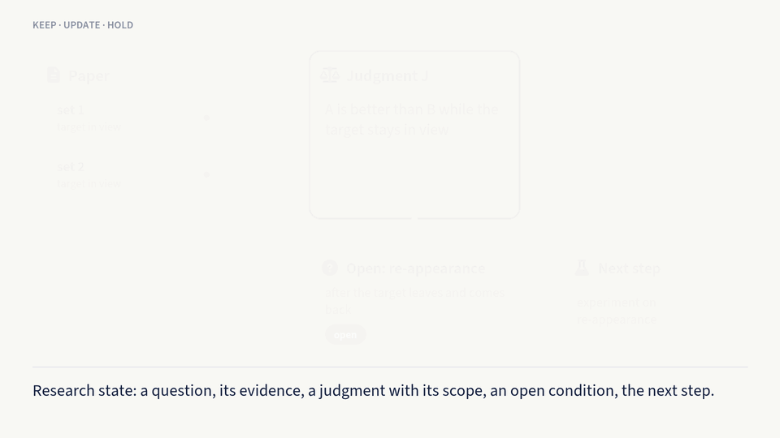
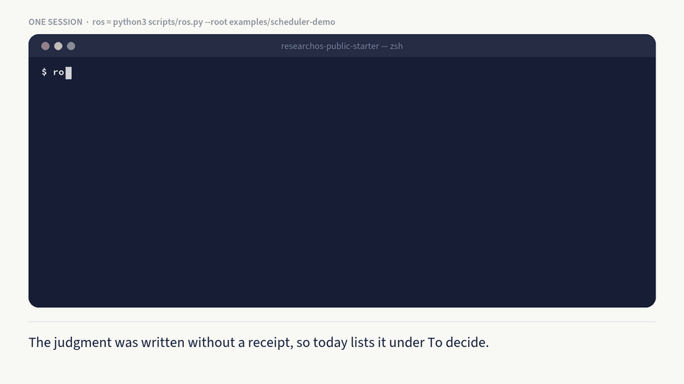

<p align="right">
  <strong>English</strong> | <a href="README.zh.md">中文</a>
</p>

# ResearchOS

**Keep your research judgment yours.**

**What it is.** A research memory that lives in plain files on your own computer, plus a few commands. When you work with AI assistants across many conversations, it keeps the judgments you reached and what each one rests on. When a source changes, it tells you which conclusions need another look, and you decide whether to change them.

**Why you might need it.** Three weeks ago you read a paper and concluded that method A beats method B. Which experiments that rests on, when it holds, what is still untested and what you planned next are scattered across chat histories. Then the paper is corrected, and you no longer remember which of your conclusions used it. Meanwhile an AI assistant may have written an unsupported claim straight into your notes.

**How it works.**

1. **Your research lives in cards.** Paper, project and collaborator cards are ordinary Markdown files on your computer. Each judgment records what it rests on (which file, which version) and where it applies.
2. **Start with `today`.** It lists what needs your decision. If a source file has changed, for example because you replaced a paper with its corrected version, it marks the judgments that depend on it for recheck.
3. **Let the AI work, but only as candidates.** `context` picks just the material this task needs, `run` writes a task packet you paste into any assistant, and `collect` brings the answer back as a candidate, which never changes your cards by itself.
4. **You decide.** You keep or refuse each candidate, and `close` ends the session by listing what changed and what is still open.

This repository stops at candidates and never writes into your cards; the prototype described in the [technical report](docs/technical-report.en.md) adds a step in which the researcher confirms at the terminal before anything is written. It is for individual researchers who track research judgments over months.

**Try it: one sentence to your AI assistant.** Open Claude Code, Codex or another assistant that can run commands on your computer, and send:

```text
Set up ResearchOS for me from https://github.com/huuuuusy/researchos-public-starter and walk me through the First Run section of its AGENTS.md.
```

The assistant downloads it, shows you in a few sentences what it does on a fictional example, then asks for your homepage or Google Scholar, a few of your papers, your collaborators and one current project, and sets up your own vault from them. It takes about fifteen minutes and you do not need to read anything first. It shows you the list of cards before writing them, everything stays in a git-ignored folder on your computer, and nothing is pushed anywhere. If git is not installed, the assistant can download the ZIP from the same page instead.

Already downloaded it? Open the folder in Codex or Claude Code and say one sentence: “Read AGENTS.md and walk me through its First Run.”

**Or do it yourself in 10 minutes**

1. Run the demo on fictional data: `python3 scripts/ros_demo.py`.
2. Walk through the same session yourself, one command at a time ([User Manual, Section 3](docs/user-manual.en.md#3-the-session-scheduler-and-command-line-checks)).
3. Start your own: `python3 scripts/ros_demo.py --init personal_vault`.

The [first-run guide](08_exports/public_starter/onboarding-step-by-step.md) takes you through all three and says what you should see at each step.



## What it is and is not

In the documentation's terms, ResearchOS is a local-primary system for continuously maintaining research state (see [Words you will meet](docs/user-manual.en.md#words-you-will-meet)). It is a small, file-based tool, not a hosted service, an autonomous scientist, a complete personal knowledge base, a question-answering tool detached from evidence, or a polished all-in-one product.

## Try it

You need Python 3.10 or newer and nothing else: no package, API key, database or server. CI tests CPython 3.10 and 3.13. It runs on macOS and Linux; on Windows, use WSL (Windows Subsystem for Linux), because the file locks it relies on are not available in native Windows Python. From the repository folder, run the demo. It works on a temporary copy of a fictional research graph:

```bash
python3 scripts/ros_demo.py
```



A source card changes, and the judgment that depends on it is flagged for recheck. The researcher reconfirms it, and the output shows that as a planned change without admitting it. At close the recheck is still pending. The output uses a few words in a narrow sense, such as candidate, admission, requirement and held; [Words you will meet](docs/user-manual.en.md#words-you-will-meet) explains each in one line. Where the output says `ros …`, it means `python3 scripts/ros.py --root <folder> …`, with the folder that holds the research graph.

You can also skip the scheduler and open the folder in Claude Code, Codex or another file-aware agent with one goal and one source; [Section 2 of the User Manual](docs/user-manual.en.md#2-one-loop-in-your-agent-client) gives the prompt.

## Start your own

Your own material goes in `personal_vault/`, a folder inside your clone that Git ignores. This command starts it from a copy of the demo graph, without the demo's records or its fictional judgment:

```bash
python3 scripts/ros_demo.py --init personal_vault
```

You then replace the fictional commitments and cards with one of your own and run `python3 scripts/ros.py --root personal_vault today`. The [first-run guide](08_exports/public_starter/onboarding-step-by-step.md) gives each step and what you should see; [Section 5 of the User Manual](docs/user-manual.en.md#5-your-own-material) is the reference for the fields. An optional Dashboard reads the same folder. Never push a clone that contains real material to a public remote.

## What is in the folder

- `examples/scheduler-demo/` and `08_exports/public_starter/` hold the fictional demos: the scheduler's research graph, and the Dashboard's demo agenda with its onboarding examples.
- `personal_vault/` holds your own material once you create it; Git ignores it.
- `00_identity/` to `06_active_context/` are the layers of a vault (identity, knowledge, decisions, cognition, people, workflows, current state). Here they hold layer notes and public-safe method notes; `personal_vault/` uses the same layout.
- `07_archive/` keeps public-safe history, `09_templates/` the card templates and data contracts, `corpus/` stays empty because raw material is never committed, and `distilled/` holds short public-safe method summaries.
- `scripts/`, `config/`, `dashboard/` and `evals/` are the command-line tools, runtime configuration, optional Dashboard and tests.

## What this repository does not do

This repository is copy-only, and its data is fictional. It never admits anything: where the prototype in the report would write an accepted change, it shows the planned change for you to copy, which the documentation calls copy fallback. The shipped `config/ros.json` sets `runtime_scope: public_starter`. [Section 3 of the User Manual](docs/user-manual.en.md#3-the-session-scheduler-and-command-line-checks) sets out what `ros` writes, what `admit` does, which `runtime_scope` value turns admission and dispatch on, and how personal-vault mode differs. The optional Dashboard and the plugin system are frozen.

## Where to read next

The [documentation index](docs/README.md) lists the guides in the order a newcomer needs them, with one line on when to read each. [AGENTS.md](AGENTS.md) tells a file-aware assistant how to work here.

The technical report ([English source](docs/technical-report.en.md) · [English PDF](docs/technical-report.en.pdf) · [Chinese PDF](docs/technical-report.zh.pdf)) describes the prototype, under the stylized spelling *ReSearchOS*, in Sections 1–8 and Appendices A–B, with [Supplementary Notes 1–6](docs/technical-report-supplement.en.md) supplied separately outside the PDFs; it has not been peer reviewed, and its claims are not a checklist of what this repository can do.

## Status

This is V1.0.1, released as `v1.0.1` on 2026-10-30 (see the [V1.0.1 release notes](docs/releases/v1.0.1.md) and the [changelog](CHANGELOG.md)).

## How to cite

The technical report and this repository are archived together on Zenodo, in one record that Zenodo lists as software under the title "ResearchOS Public Starter". Please cite them with the DOI [10.5281/zenodo.23769799](https://doi.org/10.5281/zenodo.23769799), which always resolves to the latest version; to cite exactly this release, use [10.5281/zenodo.23795586](https://doi.org/10.5281/zenodo.23795586).

> Hu, S. (2026). *ReSearchOS: A Reference Architecture for Sustained Human–AI Research* (Technical report, version 1.0.1). Zenodo. https://doi.org/10.5281/zenodo.23769799

```bibtex
@misc{hu2026researchos,
  author       = {Hu, Shiyu},
  title        = {{ReSearchOS}: A Reference Architecture for Sustained Human--{AI} Research},
  howpublished = {Technical report (not peer reviewed), version 1.0.1, Zenodo},
  year         = {2026},
  doi          = {10.5281/zenodo.23769799},
  url          = {https://github.com/huuuuusy/researchos-public-starter}
}
```

The "Cite this repository" button on the GitHub page gives this reference, in its own APA and BibTeX form, from [CITATION.cff](CITATION.cff).

## License and citation

ResearchOS Public Starter is source-available for personal learning, personal research, academic research, teaching, non-commercial evaluation, and non-commercial academic redistribution or derivative development. It is not released under an OSI-approved open-source license. Any use outside that scope, including commercial use of any kind, requires prior written permission; see [LICENSE.md](LICENSE.md) for the full terms and [COMMERCIAL_USE.md](docs/reference/COMMERCIAL_USE.md). To cite it, see [How to cite](#how-to-cite); contribution, support and security routes are in [CONTRIBUTING.md](CONTRIBUTING.md), [SUPPORT.md](SUPPORT.md) and [SECURITY.md](SECURITY.md). The name refers only to this project, which is not affiliated with other projects, products or companies that use the same or a similar name.

Created and maintained by [Shiyu Hu](https://huuuuusy.github.io/).
