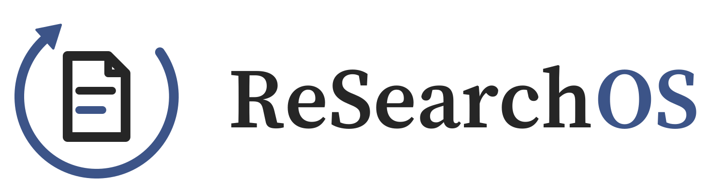
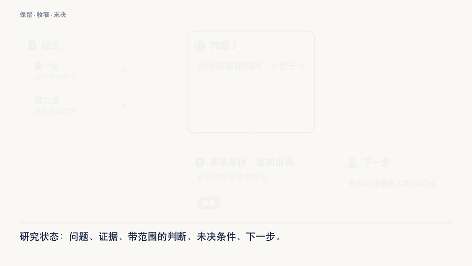
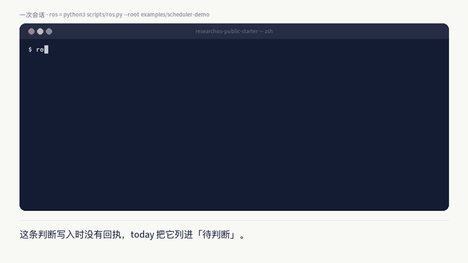

<p align="right">
  <a href="README.md">English</a> | <strong>中文</strong>
</p>

<p align="center">
  <picture>
    <source media="(prefers-color-scheme: dark)" srcset="docs/assets/brand/researchos-logo-dark.svg">
    
  </picture>
</p>

# ResearchOS

**让科研判断始终属于研究者。**

**它是什么。** 放在你自己电脑上的一个"研究记忆"文件夹，加上几条命令。你跟 AI 助手跨很多次对话做研究时，它帮你记住之前得出的判断和依据；某个来源变了，它提醒你哪些结论要重新看，改不改由你决定。它适合需要长期跟踪研究判断的个人研究者。

**为什么需要它。** 三周前你读了一篇论文，得出"方法 A 比 B 好"。这个结论根据哪组实验、在什么条件下成立、还有什么没验证、下一步打算做什么，都散在聊天记录里。后来论文出了更正，你已经想不起哪些结论用过它；AI 助手也可能顺手把一句没有依据的说法写进了你的笔记。

**它怎么做。**

1. **研究写成卡片。** 论文卡、项目卡、合作者卡都是普通的 Markdown 文件，存在你自己电脑上。每条判断都写明依据（哪个文件的哪个版本）和适用范围。
2. **开工先跑 `today`。** 它列出要你决定的事。某个来源文件变了，比如你换上了更正后的论文卡，它会把依赖这个来源的判断标为待复核。它读的是卡片，不是 PDF：PDF 本身变了，在你更新卡片之前它看不到。
3. **让 AI 干活，但只收候选。** `context` 只挑这次需要的材料，`run` 生成一个任务包让你贴给任何助手，`collect` 把回答收回来作为候选，它不会自己改你的卡片。
4. **由你拍板。** 哪些候选留下、哪些拒绝，你说了算；收工跑 `close`，列出这次变了什么、还有什么没做完。

现在是第一阶段：一个人用，材料是你电脑上的文件，拍板在你自己的终端里。目前只有作者一个人长期在用，它有没有帮助还没有和更简单的做法比较过。

**开始前要准备什么。** 不需要会写代码，但要有三样东西：

1. 一个能在你电脑上运行命令的 AI 助手。没用过的话，最省事的是装 [Claude 桌面版](https://claude.com/download)，登录后点 Code 页面（[说明](https://code.claude.com/docs/en/desktop)）；也可以用 OpenAI 的 [Codex](https://openai.com/codex/)。两者都要付费订阅，例如 Claude Pro 或 ChatGPT Plus，价格以官网为准。Claude 和 ChatGPT 目前都不对中国大陆提供服务，注册和付费要在它们支持的国家或地区完成，在大陆的话请先确认能否使用。
2. Python 3.10 或更高版本。在终端里输入 `python3 --version` 可以查看。Mac 第一次运行 `python3` 时可能弹窗要求安装「命令行开发者工具」，装完通常只有 3.9；版本不够就从 [python.org](https://www.python.org/downloads/) 下载安装包，也可以直接请助手一步步教你。Windows 需要先装 WSL，难度较高，建议先在 Mac 上用。
3. 一点耐心对待确认弹窗。默认设置下，助手每次要运行命令或改文件，都会先弹出确认，看一眼它说要做什么再点允许。少数确认要你本人在终端里输入一条命令，助手会把命令给你；终端就是 Mac 上的「终端」App，Claude 桌面版的 Code 页面里也有一个终端面板。

**你的材料会去哪里。** 卡片是你电脑上的普通文件，放在下载下来的仓库文件夹里的 `personal_vault/` 中。Git 忽略这个文件夹，所以它不会被提交或推送到 GitHub；但如果仓库放在 iCloud「桌面与文稿」、OneDrive 或 Dropbox 这类同步文件夹里，同步软件照样会把它上传。它也不会自动备份，删掉仓库文件夹就一起没了，请把它纳入你平时的备份。ResearchOS 的命令行工具本身不联网，但助手读到的文件和你在对话里说的话，都会发给助手的服务商（Anthropic 或 OpenAI）处理。卡片上的 `private` 等标签只决定 `ros context` 打包哪些材料，挡不住助手直接打开文件。

**哪些不要交给助手。** 下面这些不要放进这个文件夹，也不要发给助手：被试或来访者的原始数据、能认出具体个人的个案记录、访谈录音和逐字稿、含个人信息的伦理申请材料与知情同意书、你正在审的稿件和别人尚未公开的手稿或数据，以及你不愿交给服务商的未公开基金构想。需要提到这类材料时，卡片里只写它在哪里、是什么（例如「伦理批件，存在学校网盘」），不写内容。所在机构或伦理委员会对使用 AI 工具另有规定的，以规定为准。[审稿工作流](05_workflows/research_work/peer-review.zh.md)照同样的规矩办：助手依据你自己的笔记工作，不看稿件本身。

**一句话上手。** 打开你的 AI 助手，发送：

```text
帮我装好 ResearchOS（https://github.com/huuuuusy/researchos-public-starter），按它 AGENTS.md 里的 First Run 一步步带我设置，用中文和我交流。我不会编程，请每一步都用通俗的话告诉我在做什么。
```

助手会把它下载下来，先在虚构的例子上用几句话讲清它做什么，再问你的发表清单（个人主页、Google Scholar、知网或直接粘贴都可以）、几篇论文、合作者和一个正在做的项目，据此建好你自己的库。大约半小时到一小时，事先什么都不用读。写入前它会先把卡片清单给你看，卡片只写进你电脑上那个 Git 忽略的文件夹。没有装 git 的话，助手也可以从同一个页面下载 ZIP。

已经下载好了？在 Codex 或 Claude Code 里打开这个文件夹，说一句：「读一下 AGENTS.md，按 First Run 带我上手。」

只在浏览器里用 ChatGPT 或 Claude、没有终端？用户手册第 2 节的[没有终端](docs/user-manual.zh.md#没有终端只在浏览器里聊天)写了这时还能怎么用。

**或者自己动手，10 分钟**

1. 在虚构数据上跑一遍演示：`python3 scripts/ros_demo.py --lang zh-CN`。
2. 自己逐条命令走一遍同样的会话（[用户手册第 3 节](docs/user-manual.zh.md#3-会话调度器与命令行检查)）。
3. 开始自己的库：`python3 scripts/ros_demo.py --init personal_vault --lang zh-CN`。

[首次上手说明](08_exports/public_starter/onboarding-step-by-step.zh.md)带你走完这三步，并写明每一步应该看到什么。



## 第一阶段包含什么、不包含什么

按文档里的说法，ResearchOS 是一个持续维护研究状态、本地为主的系统（研究状态指什么，见[你会遇到的词](docs/user-manual.zh.md#你会遇到的词)）。第一阶段包含一次会话的六条命令 `today`、`context`、`run`、`collect`、`admit` 和 `close`，作用在一位研究者的 Markdown 卡片上：判断记住它依据哪些来源文件的哪个版本，其中一个变了，下一条命令就把它交回来等复核。在这个范围里，从写下一条判断，到来源变了它回来等你复核，再到收工，可以一步步走完。本仓库的命令做到候选为止，从不自己改你的卡片：要留下的改动，由你或你的助手照着它打印的内容贴进去，再由你确认；[技术报告](docs/technical-report.zh.md)描述的原型多一步：研究者在终端确认之后由系统写入。出厂 `config/ros.json` 设为 `runtime_scope: public_starter`。`ros` 写什么、`admit` 做什么、`runtime_scope` 取什么值才开启准入与派发、personal-vault 模式有何不同，见[用户手册第 3 节](docs/user-manual.zh.md#3-会话调度器与命令行检查)。

它是一个基于文件的小工具，不是在线托管的服务，不会自己做科研，不是完整的个人知识库，不是脱离证据的万能问答，也不是精雕细琢、什么都包的成品。本仓库只生成供你复制的内容，随附数据都是虚构的。它从不准入任何东西：报告中的原型会写入已接受改动的地方，这里只显示计划中的改动，由你自己复制，文档里称为「复制回退」。可选的 Dashboard 和插件体系处于冻结状态。多人协作、细到某一条论据的依赖、在你没运行命令时自动察觉变化，第一阶段都不包含；完整的清单见技术报告的[补充说明 6](docs/technical-report-supplement.zh.md)，逐条列出。

## 跑一下演示

除了 Python，不需要再装任何东西：不需要依赖包、API key、数据库或服务器。支持 macOS 与 Linux；Windows 请在 WSL（Windows Subsystem for Linux）中运行，因为它依赖的文件锁在原生 Windows 的 Python 中不可用。在仓库文件夹里运行演示，它在一份虚构研究图的临时副本上运行：

```bash
python3 scripts/ros_demo.py --lang zh-CN
```



来源卡片变化，依赖它的判断被标为待复核。研究者认为判断仍成立，输出只显示将要做的改动，并不真正准入。收尾时复核仍待处理。输出里有几个词用的是特定意思，比如候选、准入、事项、待答；[你会遇到的词](docs/user-manual.zh.md#你会遇到的词)每个用一句话说明。输出里写的 `ros …`，指 `python3 scripts/ros.py --root <文件夹> …`，文件夹就是存放研究图的那个目录。

也可以不用调度器，直接用 Claude Code、Codex 或其他能读写本地文件的 AI 助手打开本文件夹，给出一个目标和一份来源；提示词见[用户手册第 2 节](docs/user-manual.zh.md#2-在-agent-客户端里走一个闭环)。

## 开始自己的

你自己的材料放在 `personal_vault/`，这是下载下来的仓库里一个 Git 会忽略的文件夹。下面这条命令从演示研究图复制出一份作为起点，不带演示留下的记录，也不带虚构的判断：

```bash
python3 scripts/ros_demo.py --init personal_vault --lang zh-CN
```

接着把虚构的承诺和卡片换成你自己的一项和一张，再运行 `python3 scripts/ros.py --root personal_vault today`。每一步怎么做、应该看到什么，见[首次上手说明](08_exports/public_starter/onboarding-step-by-step.zh.md)；字段说明见[用户手册第 5 节](docs/user-manual.zh.md#5-用自己的材料)。[示例卡片](examples/starter-cards/zh-CN/README.md)给出每类卡填好的样子，从研究身份摘要、方向摘要到项目、论文、决策、启发式、人物和会议卡；空白骨架在 [`09_templates/basic/`](09_templates/basic/README.zh.md)。可选的 Dashboard 读取同一个文件夹。含有真实材料的 clone 不要推送到公开远程仓库。

## 文件夹里有什么

- `examples/scheduler-demo/` 和 `08_exports/public_starter/` 是虚构演示：前者是调度器用的研究图，后者是 Dashboard 的示例议程和上手示例。
- `personal_vault/` 放你自己的材料，由你创建，Git 忽略它。
- `00_identity/` 到 `06_active_context/` 是一个库的各层（身份、知识、决策、认知、人物、工作流、当前状态）。这里放的是各层说明和公开安全的方法笔记；`personal_vault/` 用同样的布局。
- `07_archive/` 存公开安全的历史，`09_templates/` 存卡片模板和数据契约，`corpus/` 保持为空（原始材料从不提交），`distilled/` 存简短的公开安全方法摘要。
- `scripts/`、`config/`、`dashboard/` 和 `evals/` 分别是命令行工具、运行配置、可选 Dashboard 和测试。

## 接下来读什么

[文档索引](docs/README.zh.md)按新手需要的顺序列出各份指南，每份用一句话说明什么时候读。[AGENTS.md](docs/reference/AGENTS.zh.md) 是写给助手看的，规定它在这个仓库里怎么做事。

技术报告（[中文源稿](docs/technical-report.zh.md) · [中文 PDF](docs/technical-report.zh.pdf) · [English PDF](docs/technical-report.en.pdf)）描述的是原型（报告里写作 *ReSearchOS*），包含正文第 1–8 节与附录 A–B；[补充说明 1–6](docs/technical-report-supplement.zh.md) 单独提供，不进入 PDF。报告未经同行评审，其中的主张不是本仓库的能力清单。

## 状态

本仓库是 V1.2 的候选版 `v1.2.0-rc.1`（见 [V1.2 发布说明](docs/releases/v1.2.0.zh.md)与[更新记录](CHANGELOG.md)）；上一个正式版是 2026-11-11 的 `v1.1.0`。1.x 系列是 ResearchOS 的第一阶段：一位研究者、本机文件、终端上的决定。

## 如何引用

技术报告和本仓库一起存档在 Zenodo 的同一条记录里，Zenodo 把这条记录列为软件，标题是「ResearchOS Public Starter」。引用时请用 DOI [10.5281/zenodo.23769799](https://doi.org/10.5281/zenodo.23769799)，它始终指向最新的存档版本；v1.1.0 还没有单独的版本 DOI，最近存档的 v1.0.4 是 [10.5281/zenodo.24038050](https://doi.org/10.5281/zenodo.24038050)。

> Hu, S. (2026). *ReSearchOS: A Reference Architecture for Sustained Human–AI Research* (Technical report, version 1.1.0). Zenodo. https://doi.org/10.5281/zenodo.23769799

```bibtex
@misc{hu2026researchos,
  author       = {Hu, Shiyu},
  title        = {{ReSearchOS}: A Reference Architecture for Sustained Human--{AI} Research},
  howpublished = {Technical report (not peer reviewed), version 1.1.0, Zenodo},
  year         = {2026},
  doi          = {10.5281/zenodo.23769799},
  url          = {https://github.com/huuuuusy/researchos-public-starter}
}
```

GitHub 页面上的「Cite this repository」按钮会根据 [CITATION.cff](CITATION.cff) 以它自己的 APA 和 BibTeX 格式给出这条引用。

## 许可

ResearchOS 公开 starter 允许个人学习、个人研究、学术研究、教学、非商业评估，以及非商业学术再分发或二次开发；它不是采用 OSI 认可开源许可证发布的项目。超出上述范围的任何使用，包括任何商业使用，都需要事先取得书面许可；完整条款见 [LICENSE.md](LICENSE.md)，中文说明见 [COMMERCIAL_USE.zh.md](docs/reference/COMMERCIAL_USE.zh.md)。贡献、支持与安全渠道见[贡献指南](docs/reference/CONTRIBUTING.zh.md)、[支持](docs/reference/SUPPORT.zh.md)和[安全政策](docs/reference/SECURITY.zh.md)。这里的名字只指本项目，与使用相同或相近名字的其他项目、产品或公司没有关联。

由 [Shiyu Hu](https://huuuuusy.github.io/) 创建并维护。
