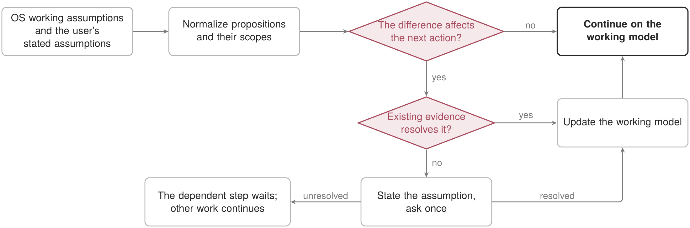

<p align="right"><strong>English</strong> | <a href="README.zh.md">中文</a></p>

# Alignment Stewardship

## Purpose

Recover one current shared task model at a consequential alignment checkpoint.

## Use and non-goals

Use after semantic discontinuity or repeated correction. It does not create a psychological profile or parallel memory.

## Availability and parity

This repository uses current statements and supplied history only; user authority is unchanged.

## Dependencies

Requires the declarative core; audit and reflection handoffs are optional.

## Lifecycle

Release-bundled and default-on; disablement returns to ordinary clarification.

## Data, permissions, and export

No read, network, command, state, or canonical-write permission.

## Verification

Run `python3 scripts/validate_plugins.py` and the public capability alignment tests.

## Failure recovery

Expose the uncertain assumption and ask one bounded question; never infer agreement from silence.

## Value and alternatives

Retain only if checkpoints reduce repeated correction without adding profiling burden.

## Retirement

Retire when ordinary interaction achieves equal consequence prediction more simply.

## Procedure and implementation

The pseudocode, control flow and implementation boundary for this function are given below. The alignment route specifies adaptive dialogue and confirmation boundaries. Proposition extraction and semantic correspondence remain host judgments; a symmetric difference does not establish disagreement or infer an internal human state.

In the diagram, arrows show control flow, including branches and bounded retries. Boxes name operations or returned states; diamonds identify decisions. They do not represent new record-graph edges. The procedure uses the plugin shorthand defined in the [plugin directory README](../README.md) and exposes the conditions that a replacement implementation must preserve.

The plugin system is frozen; see the [governance guide](../../governance-guide.en.md#task-extensions-and-plugins).

| Plugin, form and deployment | Core operator or constraint | Meaning, definitions and checks |
| --- | --- | --- |
| Collaborative alignment (`alignment_stewardship`); $\mathsf P_i^{\mathrm{cap}}$, bundled | $\mathcal B_t^{\mathrm{align}}=\mathcal M_t^{\mathrm{OS}}\triangle\mathcal M_t^{u,\mathrm{stated}}$ | Compare OS working assumptions with assumptions explicitly stated by the user, under common proposition identities and scope. Symmetric difference locates clarification needs, including omissions; it neither reads internal human state nor decides who is right. |

### Human–agent task alignment

The OS working assumptions and the user’s stated task assumptions; output: one bounded alignment move and an explicit continuation condition.

```pseudocode
// Compare stated propositions; do not infer a person’s unexpressed beliefs.
NORMALIZE proposition identities and scopes; KEEP ambiguities unresolved
SET $\mathcal B_t^{\mathrm{align}}\leftarrow\mathcal M_t^{\mathrm{OS}}\triangle\mathcal M_t^{u,\mathrm{stated}}$ over comparable propositions
SELECT a task-relevant discrepancy or ambiguity consequential for the next action
EXPOSE the assumption and its consequence
IF existing evidence cannot resolve it: REQUEST one clarification
IF explicit evidence or a response resolves it: UPDATE the working model
ELSE: KEEP the dependent action pending; CONTINUE independent work
```

**Algorithm explanation.** Normalization makes the discrepancy comparison meaningful. Only a consequential mismatch unresolved by existing evidence triggers clarification; dependent work waits for grounds while unrelated work can continue.


