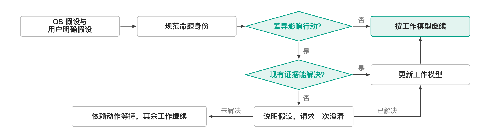

<p align="right"><a href="README.md">English</a> | <strong>中文</strong></p>

# Alignment Stewardship

## 用途

在会影响后果的对齐检查点恢复一个当前共享任务模型。

## 使用与非目标

在语义断裂或反复更正之后使用。它不构建心理画像，不把沉默当同意，也不创建并行记忆。

## 可用性与一致性

公开版只使用用户当前的陈述和明确提供的历史；用户权威不变，目标、价值与后果的决定权仍属于用户。

## 依赖

需要声明式核心；audit 与 reflection 交接是可选的。

## 生命周期

随版本提供并默认开启；禁用后退回普通澄清路线。

## 数据、权限与导出

没有读取、网络、命令、状态或 canonical-write 权限。

## 验证

运行 `python3 scripts/validate_plugins.py` 和公开能力对齐测试。

## 故障恢复

说明不确定的假设，并提出一个有界问题；不从沉默推断同意。

## 价值与替代

只有检查点能减少反复更正、又不增加画像负担时才保留。

## 退役

当普通交互能更简单地达到同等的后果预测时退役。

## 过程与实现

本功能的数学伪代码、控制流程与实现边界见下文。对齐路由规定自适应对话与确认边界。命题抽取和语义对应仍由宿主判断；对称差不证明意见冲突，也不推断人的内部状态。

图中箭头表示控制流程，包括分支与有界重试；方框表示操作或返回状态，菱形表示判断，不表示新增的记录图关系。过程采用[插件目录首页](../README.zh.md)定义的插件简写，明确替换实现必须保留的条件。

插件体系处于冻结状态，见[治理指南](../../governance-guide.zh.md#任务扩展与插件)。

| 插件、形态与部署 | 核心算子或约束 | 含义、定义与核查 |
| --- | --- | --- |
| 协作对齐 (`alignment_stewardship`); $\mathsf P_i^{\mathrm{cap}}$, 随附 | $\mathcal B_t^{\mathrm{align}}=\mathcal M_t^{\mathrm{OS}}\triangle\mathcal M_t^{u,\mathrm{stated}}$ | 两集合以共同命题标识与范围记录 OS 工作假设和用户明确表达的假设。对称差定位含遗漏在内的待澄清项，不读取人的内部状态，也不判定谁对。 |

### 人机任务对齐

OS 工作假设与用户明确表达的任务假设；输出：一次有界对齐动作及明确的继续条件。

```pseudocode
规范命题身份与范围，将歧义保留为未决
在可比命题上令 $\mathcal B_t^{\mathrm{align}}\leftarrow\mathcal M_t^{\mathrm{OS}}\triangle\mathcal M_t^{u,\mathrm{stated}}$
选择与当前任务相关、且影响下一步行动的差异或歧义
说明所用假设及其后果
// 只比较明确表达的命题；已有证据能解决时不再询问
若现有证据不能解决差异：请求一次澄清
若明确证据或回答解决了差异：更新工作模型
否则：保留依赖动作的等待状态，继续独立工作
```

**算法解释。** 共同命题身份使差异可以比较，行动后果决定差异是否值得处理。澄清只用于现有证据无法解决的重要分歧；等待局部回答不应使无关工作一并停下。


