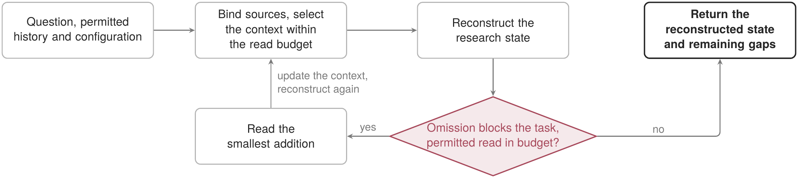

<p align="right"><strong>English</strong> | <a href="README.zh.md">中文</a></p>

# Research Context

## Purpose

Select the smallest public-safe or explicitly user-selected context for a research task.

## Use and non-goals

Use it to bound source reading. It does not discover private sibling repositories, infer permission, or write memory.

## Availability and parity

The Public Starter variant preserves the capability meaning while replacing private context with user-selected sources.

## Dependencies

Requires only the declarative ResearchOS core and the public conversation catalog.

## Lifecycle

Release-bundled and default-on; disablement leaves direct file-aware agent work available.

## Data, permissions, and export

No declared read path, network, command, or canonical-write permission; the runtime remains copy-only.

## Verification

Run `python3 scripts/validate_plugins.py` and `python3 -m unittest evals.test_public_capability_alignment`.

## Failure recovery

If a route needs an unselected or private source, stop at the current receipt and request an explicit source.

## Value and alternatives

It is useful only when bounded routing outperforms reading the exact target directly.

## Retirement

Retire when the host supplies equal context precision and privacy discipline with less governance.

## Procedure and implementation

The pseudocode, control flow and implementation boundary for this function are given below. The context planner implements declared routes and reading tiers. Its explicitly selected, one-step continuation path and restart-safe Private ledger stay frozen with the plugin system; derived refreshes and pending scientific changes remain separate. The host performs semantic reconstruction. Automated fidelity certification and a learned minimum-cost selector remain open.

In the diagram, arrows show control flow, including branches and bounded retries. Boxes name operations or returned states; diamonds identify decisions. They do not represent new record-graph edges. The procedure uses the plugin shorthand defined in the [plugin directory README](../README.md) and exposes the conditions that a replacement implementation must preserve.

The plugin system is frozen; see the [governance guide](../../governance-guide.en.md#task-extensions-and-plugins).

| Plugin, form and deployment | Core operator or constraint | Meaning, definitions and checks |
| --- | --- | --- |
| Context routing (`research_context`); $\mathsf P_i^{\mathrm{cap}}$, bundled | $Z_t=D_{\omega_t^u}(H_t^a,q_t)$; $\widehat R_t=C_{\omega_t^u}(Z_t,q_t)$ | Reuse context selection and state reconstruction from Section 3.1 of the report. The result is $\widehat R_t$, whose questions, evidence, judgments, unresolved conditions and next steps must remain recoverable. |

### Context reconstruction

Permitted history $H_t^a$, question $q_t$ and configuration $\omega_t^u$; output: $Z_t$ and $\widehat R_t$.

```pseudocode
// Later observations cannot fill a judgment missing at the decision time.
CHOOSE declared read tier; BIND task to permitted sources
SET $Z_t\leftarrow D_{\omega_t^u}(H_t^a,q_t)$ within the read budget
RECONSTRUCT $\widehat R_t\leftarrow C_{\omega_t^u}(Z_t,q_t)$, retaining $Q_t,E_t,J_t,B_t,N_t$
WHILE omitted conditions prevent this task AND a permitted addition fits the remaining budget:
    READ the smallest such addition; UPDATE $Z_t$ and reconstruct $\widehat R_t$
RETURN reconstructed state and remaining gaps
```

**Algorithm explanation.** Reconstruction begins with a budgeted selection and expands only when an omitted condition blocks the task. Each permitted addition feeds the reconstruction again; remaining gaps are returned when further reading is unavailable or unaffordable.


