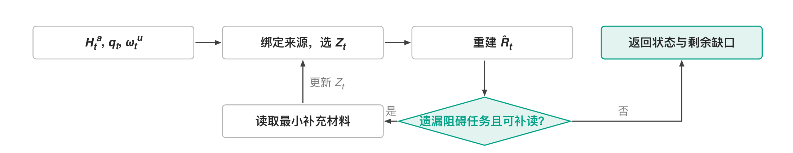

<p align="right"><a href="README.md">English</a> | <strong>中文</strong></p>

# Research Context

## 用途

为一个科研任务选择最小的公开安全上下文或用户明确选定的上下文。

## 使用与非目标

用来限定来源读取。它不发现相邻私有仓库、不推断读取权限，也不写入记忆。

## 可用性与一致性

Public Starter 版本保留能力含义，用用户选定的来源替代私有上下文。

## 依赖

只需要声明式 ResearchOS 核心和公开对话目录。

## 生命周期

随版本提供并默认开启；禁用后仍可直接用能读文件的 Agent 工作。

## 数据、权限与导出

没有声明的读取路径，也没有网络、命令或 canonical-write 权限；运行时保持 `copy_only`，只输出无副作用的 context receipt。

## 验证

运行 `python3 scripts/validate_plugins.py` 和 `python3 -m unittest evals.test_public_capability_alignment`。

## 故障恢复

路由需要未选定或私有来源时，停在当前 receipt，请用户明确提供来源。

## 价值与替代

只有有界路由比直接读取精确目标更有效时才有用。

## 退役

当宿主以更少的治理提供同等的上下文精度和隐私纪律时退役。

## 过程与实现

本功能的数学伪代码、控制流程与实现边界见下文。上下文规划器实现声明路由与分档读取。显式选定、单步接续及可重启恢复的 Private 账本随插件体系一同冻结；派生刷新与待审科研变化保持区分。语义重建由宿主完成；自动保真认证与学习式最小成本选择器仍待实现。

图中箭头表示控制流程，包括分支与有界重试；方框表示操作或返回状态，菱形表示判断，不表示新增的记录图关系。过程采用[插件目录首页](../README.zh.md)定义的插件简写，明确替换实现必须保留的条件。

插件体系处于冻结状态，见[治理指南](../../governance-guide.zh.md#任务扩展与插件)。

| 插件、形态与部署 | 核心算子或约束 | 含义、定义与核查 |
| --- | --- | --- |
| 研究上下文 (`research_context`); $\mathsf P_i^{\mathrm{cap}}$, 随附 | $Z_t=D_{\omega_t^u}(H_t^a,q_t)$; $\widehat R_t=C_{\omega_t^u}(Z_t,q_t)$ | 直接复用报告第 3.1 节的上下文选择与状态重建。结果为 $\widehat R_t$，须能恢复问题、证据、判断、未决条件和下一步。 |

### 上下文重建

获准历史 $H_t^a$、问题 $q_t$ 与配置 $\omega_t^u$；输出：$Z_t$ 与 $\widehat R_t$。

```pseudocode
选择声明读取层级，将任务绑定到获准来源
在读取预算内令 $Z_t\leftarrow D_{\omega_t^u}(H_t^a,q_t)$
重建 $\widehat R_t\leftarrow C_{\omega_t^u}(Z_t,q_t)$，保留 $Q_t,E_t,J_t,B_t,N_t$
// 只为阻碍当前任务的遗漏补读，不用后来观察补造早期判断
当遗漏条件阻碍当前任务，且仍有预算内的获准补读时：
    读取最小补充材料；更新 $Z_t$ 并重新构造 $\widehat R_t$
返回重建状态与剩余缺口
```

**算法解释。** 补读由当前任务的阻碍驱动，而非追求恢复更多历史。最小补充材料重新进入状态构造；没有合适来源或预算不足时，输出保留缺口，使后续判断知道哪些根据尚未恢复。


