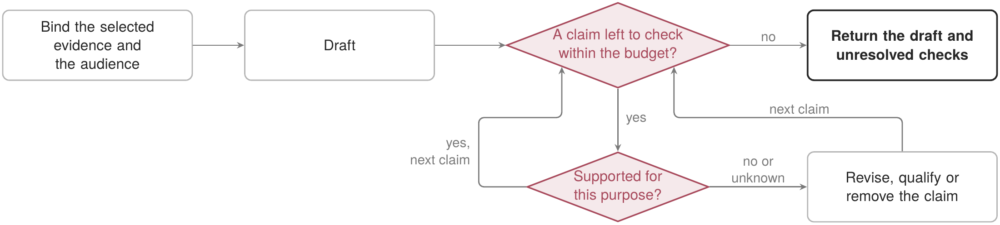

<p align="right"><strong>English</strong> | <a href="README.zh.md">中文</a></p>

# Research Expression

## Purpose

Route paper, proposal, presentation, and figure work while preserving evidence and author authority.

## Use and non-goals

Use it with exact user-selected sources. It does not load a private style profile or upgrade claims through polish.

## Availability and parity

The public variant preserves research-expression semantics with public-safe sources and candidate-only outputs.

## Dependencies

Requires the declarative core; public context routing is optional.

## Lifecycle

Release-bundled and default-on; direct authoring remains the fallback.

## Data, permissions, and export

No network, command, state, or canonical-write permission. Submission and publication remain external human actions.

## Verification

Run `python3 scripts/validate_plugins.py` and `python3 -m unittest evals.test_public_capability_alignment`.

## Failure recovery

On missing sources or citations, return the unresolved evidence gap instead of drafting a stronger claim.

## Value and alternatives

It remains only if exact-source routing is safer than an unconstrained model answer.

## Retirement

Retire when native authoring preserves the same evidence and release boundaries with less burden.

## Procedure and implementation

The pseudocode, control flow and implementation boundary for this function are given below. Expression task routes and the shared result envelope are implemented. The containment condition is a semantic requirement, not a general theorem prover or a guaranteed claim-extraction algorithm.

In the diagram, arrows show control flow, including branches and bounded retries. Boxes name operations or returned states; diamonds identify decisions. They do not represent new record-graph edges. The procedure uses the plugin shorthand defined in the [plugin directory README](../README.md) and exposes the conditions that a replacement implementation must preserve.

The plugin system is frozen; see the [governance guide](../../governance-guide.en.md#task-extensions-and-plugins).

| Plugin, form and deployment | Core operator or constraint | Meaning, definitions and checks |
| --- | --- | --- |
| Research expression (`research_expression`); $\mathsf P_i^{\mathrm{cap}}$, bundled | $\operatorname{assert}(y_t)\subseteq\operatorname{supp}_{\kappa}(E_t)$ | $\operatorname{assert}$ extracts the factual assertions of an artifact; $\operatorname{supp}_{\kappa}$ contains those supported by evidence for the stated purpose and scope. Inclusion constrains expression; hypotheses and plans remain qualified. |

### Evidence-grounded expression

$E_t$, the intended audience and $\kappa$; output: a draft, claim-to-evidence checks and explicit qualifications.

```pseudocode
// The check concerns support under this purpose, not whether a citation is attached.
// An exhausted budget leaves unchecked claims explicitly unresolved.
BIND artifact and audience to selected evidence and versions
DRAFT $y_t$ using the applicable method or skill
FOR each claim in $\operatorname{assert}(y_t)$ while the declared revision budget remains:
    CHECK support under $\kappa$ against bound evidence
    IF support is false or unknown: REVISE, QUALIFY or REMOVE the assertion
    PRESERVE hypotheses as hypotheses
RETURN draft, check statuses, source links and unresolved checks
```

**Algorithm explanation.** The procedure checks assertions against the bound evidence and purpose, not merely whether the draft contains citations. Revision can narrow or remove an assertion, while hypotheses and unchecked claims keep their own status when the budget ends.


