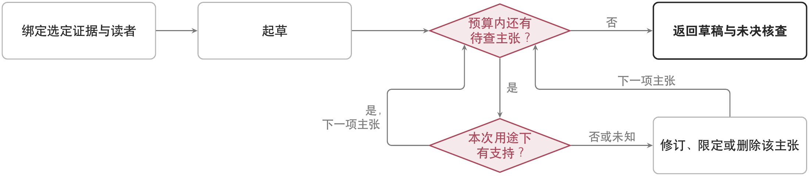

<p align="right"><a href="README.md">English</a> | <strong>中文</strong></p>

# Research Expression

## 用途

为论文、proposal、报告和科研图表工作选路，同时保留证据和作者权威。

## 使用与非目标

配合用户指定的确切来源使用。它不加载私人风格档案，润色也不能提升 claim 的证据状态。

## 可用性与一致性

本仓库用公开安全来源保留科研表达语义；生成的文本和视觉内容都只是候选。

## 依赖

需要声明式核心；公开上下文路由是可选的。

## 生命周期

随版本提供并默认开启；直接写作仍是后备方式。

## 数据、权限与导出

无网络、命令、状态或 canonical-write 权限。投稿或发布仍由作者在外部完成。

## 验证

运行 `python3 scripts/validate_plugins.py` 和 `python3 -m unittest evals.test_public_capability_alignment`。

## 故障恢复

来源或引用缺失时，返回未解决的证据缺口，而不是写出更强的 claim。

## 价值与替代

只有确切来源路由比不受约束的模型回答更安全时才保留。

## 退役

当原生写作以更低负担保留同样的证据与发布边界时退役。

## 过程与实现

本功能的数学伪代码、控制流程与实现边界见下文。表达任务路由与共用结果封装已经实现。集合包含是语义要求，不是通用定理证明器或保证完备的断言抽取算法。

图中箭头表示控制流程，包括分支与有界重试；方框表示操作或返回状态，菱形表示判断，不表示新增的记录图关系。过程采用[插件目录首页](../README.zh.md)定义的插件简写，明确替换实现必须保留的条件。

插件体系处于冻结状态，见[治理指南](../../governance-guide.zh.md#任务扩展与插件)。

| 插件、形态与部署 | 核心算子或约束 | 含义、定义与核查 |
| --- | --- | --- |
| 科研表达 (`research_expression`); $\mathsf P_i^{\mathrm{cap}}$, 随附 | $\operatorname{assert}(y_t)\subseteq\operatorname{supp}_{\kappa}(E_t)$ | $\operatorname{assert}$ 取出工件作出的事实断言，$\operatorname{supp}_{\kappa}$ 表示证据在本次用途与范围下支持的断言集合。用集合包含约束表达；假设与计划仍须标明其性质。 |

### 有证据依据的科研表达

$E_t$、目标读者与 $\kappa$；输出：草稿、逐项断言与证据核查，以及明确的限定。

```pseudocode
将工件及受众绑定到选定证据与版本
用适用方法或技能起草 $y_t$
// 检查的是本次用途下的支持关系，而非是否附有引用
// 预算用尽时，未检查的主张明确保留为未决
在声明修订预算内，对 $\operatorname{assert}(y_t)$ 中的每项主张：
    依据绑定证据，核查用途 $\kappa$ 下的支持
    若支持为假或未知：修订、限定或删除该主张
    将假设保留为假设
返回草稿、核查状态、来源链接与未决核查
```

**算法解释。** 引用存在与主张成立是两回事。核查针对证据在本次用途下能支持什么，修订可以改变断言的范围而不必强行补全答案；预算结束时，假设与未检查主张仍保留各自状态。


