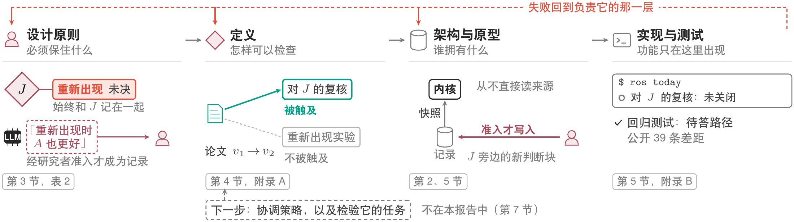
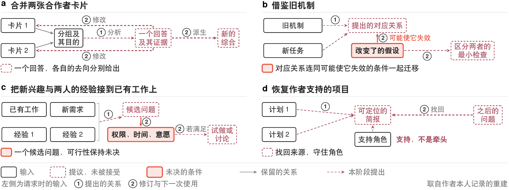
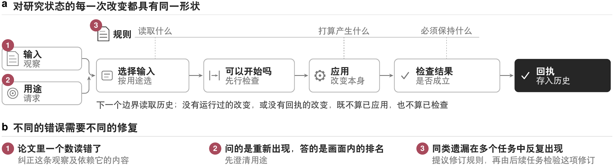
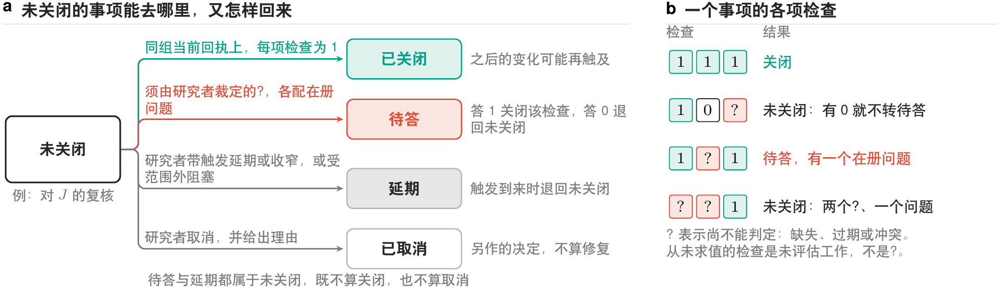
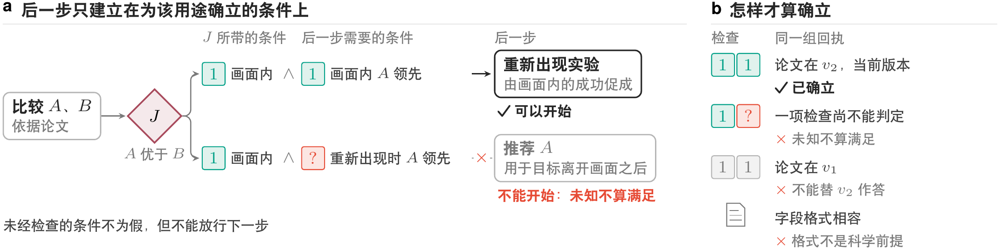
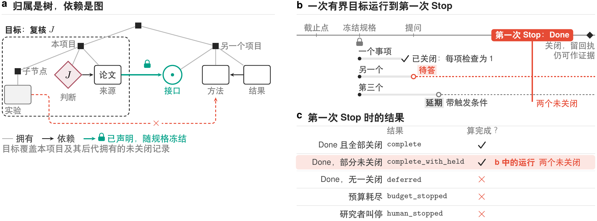

[English](technical-report-supplement.en.md)

# ReSearchOS 技术报告配套补充材料

## Agent Summary

按当前问题选读。说明 1 是报告第 3 节三项设计原则与未列入报告的第四项背后的来源与例子，关闭工作与交付上下文的条件，以及四个历史请求；说明 2 是报告第 2、5 节背后的会话命令、记录结构、职责的目标划分，以及作者的原型与可下载版本的差别；说明 3 连同 owner 复述正典条款，并给出能力主张、扩展、视图与仓库维护的合同；说明 4 是报告第 6 节对照背后的研究基础及该节从略的内容；说明 5 列出术语，精确陈述每个定义，并给出报告不再陈述的版本分支、三值记号、组合、有界目标、完成条件与两条命题；说明 6 列出报告第 5 节按主题归纳的全部 39 项实现差距。

本材料是[技术报告](technical-report.zh.md)的配套原文，不进入报告 PDF；中文为主稿，英文与之对应。除收录从报告移出的内容（原则背后的文献、实现细节、各定义的精确陈述与两条命题的论证、相近工作的细节、历史请求，以及差距明细）之外，补充材料不在报告之外新增主张或实现验收。文中的节、图、表与附录编号均指报告；本材料自有的编号只有说明 5 的定义与公式 5.1–5.21，以及图 S1–S7。《Soul Contract》《产品宣言》《Primitive Rule Model》《Product Design》是内部正典文件，未公开；§3 这类标记指所引条款。《Kernel》的节号指内核与扩展架构的内部文档，该文档同样未公开。

## 补充说明 1. 原则的来源与例子

报告第 3 节陈述三项原则。作者的设计文件中共有四项：下文的“后一步只在前一步确立的结果上运行”没有对应的命令，也没有检验它的测试，因此不列入报告第 3 节，只在这里陈述。本说明先给出每项原则背后的文献讨论，再用一个例子说明一件工作何时算做完，接着给出关闭工作与交付上下文的条件，说明 6 的差距 4–6 引用的就是这些条件，最后列出四个历史请求。下图（图 S1）是四项原则经定义和架构直至代码的推导过程。

四项原则来自作者自己的设计史：这段历史第一天记下的第一个请求，就已在理解研究判断与模仿措辞之间划了界线。规则本身写在作者的六份内部设计文件里，每条规则只由一处负责，并由一份冻结的合同与检验它的测试连在一起。

### 只有研究者能把候选变成记录

**角色分工。** 模型依据可见材料解释并提出候选；研究者判断证据是否充分、问题是否值得追求及何时转向，双方均依赖研究对象的证据，人的接受也不能免除后续检查。决定须保留证据与范围：QOC 记法 [Questions, Options, and Criteria](https://doi.org/10.1207/s15327051hci0603&4_2) 记录问题、选项与准则（如可复现性优先于微小精度差异），决策溯源 [Decision Provenance](https://doi.org/10.1109/ACCESS.2018.2887201) 追踪输入、决定和后果，区分为何接受与后来做了什么。

**何时需要审阅。** 长期保留推荐、扩大范围或向新接收者交付时，应说明对象、证据、影响和恢复办法；已有授权内的整理可继续。认知强制研究 [To Trust or to Think](https://doi.org/10.1145/3449287) 在其任务里看到的过度依赖与交互负担，和教育领域可信 AI 研究 [Trustworthy AI in education](https://doi.org/10.1142/S2737599425500264) 对问责与安全的要求，都指向同一件事：审阅要有选择。但两者都定不出最佳的批准频率。研究判断的授权不包含改变谁有权接受它的治理规则。

**够用的理解。** Clark 与 Brennan 的共同基础（grounding）理论 [Grounding in communication](https://doi.org/10.1037/10096-006) 要求达到当前目的所需的共同理解：用具体任务解释、产出或反例区分「比较可复现性」与「整理排名」，而非反复确认是否理解。本文不假定模型具有人的共同信念；一致回答也不代表科学判断正确。

这项原则借鉴的研究中，有三类值得在这里说。认知强制方面的研究 [To Trust or to Think](https://doi.org/10.1145/3449287) 表明，不加选择地接受，容易导致过度依赖。Clark 与 Brennan 关于共同基础（grounding）的论述 [Grounding in communication](https://doi.org/10.1037/10096-006) 认为，理解到什么程度算够，取决于当前目的需要什么，而不是反复确认。QOC 记法 [Questions, Options, and Criteria](https://doi.org/10.1207/s15327051hci0603&4_2) 记下问题、选项与标准，这里的决定也一样，连同证据与范围一起保留：比如选方法时，要留下的是为什么可复现性比报告里那点微小的精度差异更重要。接受与否由研究者决定，而不是由提出它的 AI 模型决定，所以长期保留推荐、扩大范围或把材料交给新的接收者之前，都要先经审阅；修订判断的权力，也不延伸到改变由谁来接受判断。

### 后一步只在前一步确立的结果上运行

**何时停止分解。** 任务分解要识别决定性的未知及相应检查，再核对这些结果共同支持什么行动；若继续细分不影响这一判断，就不增加步骤：比较方法时核对评测条件、指标及差异原因，准备研究邮件时区分已知事实、尚未作出的承诺和接收对象。领域理解界定科学瓶颈，研究组织协调跨边界的分工。Simon 的有限理性 [A Behavioral Model of Rational Choice](https://doi.org/10.2307/1884852) 要求在证据规模可管理的前提下为下一项决定提供支持；Malone 与 Crowston 的协调理论 [The Interdisciplinary Study of Coordination](https://ccs.mit.edu/papers/CCSWP157.html) 把协调看作管理活动之间的依赖；本文把这一视角落成三项要求：明确事前需要达成什么共识、哪些工作可以独立进行，以及何种情况会触发重新分工。检索可能改变实验假设或暴露构念问题，分配给不同执行者并不使工作相互独立。

**委托。** 委托他人执行后，研究者仍承担综合判断、识别瓶颈和寻找相应专长的责任，但不把技术从业背景设为领导的普遍资格；人的协作者保有自主性、责任与学习需要。团队组建研究 [Finding a team of experts](https://cs-people.bu.edu/evimaria/cs591/lappas09finding.pdf) 在已知要求和技能下以沟通成本为基线；对于经验、时间和意愿的未知，以及对问题的修订，仍须明确保留。既往合作只提供了解线索，不能确立适配或授权指派。

**修订分工。** 依赖同一项有争议假设而得到的一致输出，不是独立验证；反例改变问题时须复核计划，保留分解有效或失效的证据，使模型与 harness 更换后仍可修订或退役。Argyris 的单环与双环学习模型 [Single-Loop and Double-Loop Models](https://doi.org/10.2307/2391848) 区分修正行动与改变指导假设；反复漏掉条件时，应检查只要求排名的方法，并保留具体失误到任务、准则或分工修订的证据。方法、准则与分工可据此修订，治理变化仍单独审阅。组合须带上条件、未知与失败结果；字段一致只支持传递，后续使用仍检查科学前提和权限。

独立是另一回事。把文献检索与实验分别交给不同执行者，并不会使二者独立，因为检索可能改变假设，也可能表明实验测量的构念并不合适。所以任务分解要找出决定性的未知及相应检查，核对这些结果共同支持什么，继续细分不再改变这一判断时即停止。

细分到不再改变判断就停，这是 Simon 的有限理性 [A Behavioral Model of Rational Choice](https://doi.org/10.2307/1884852) 用在研究者管得过来的证据上。协调理论 [The Interdisciplinary Study of Coordination](https://ccs.mit.edu/papers/CCSWP157.html) 把协调看作管理活动之间的依赖，原则从中取了三条：先就要决定什么达成共识；把工作分成各自能独立推进的部分；事先定好什么情况下要重新分工，问题一变，计划就要重新审视。执行可以委托出去，综合仍是研究者的责任。依赖同一项有争议假设得到的一致输出，也算不上相互独立的验证。

这项原则防范的错误是在未知之上作更新。在例子中，目标留在画面内时的优势可以促成重新出现实验，但把 $A$ 推荐到目标离开之后的情形，就是在实验要回答的那个未知之上作更新。因此，后一步只有在前一步的实际结果确立其前提时才开始。为此，组合把条件、未知与失败带到下一步（说明 5 的定义 5.11–5.12），三值检查的结果分为通过、不通过和无从判定三种，其中无从判定从不当作满足（定义 5.4）。

| 原则 | 它回答的问题 | 规定 | 机制 |
| --- | --- | --- | --- |
| 带条件的组合 | 结果在什么条件下可复用？ | 后一步只在前一步的实际结果确立其前提时才开始；未知不算满足 | 带声明前提与检查的规则应用、组合（说明 5）与三值检查。这一机制目前没有对应的命令和测试（差距 10） |

### 记录比写下它的工具活得久

长期来源、临时运行数据与可重建视图各有分工：换工具后仍可读懂记录，显示完成不授予接受权，缓存不成为另一事实源。记录归研究者所有，这一点取自 local-first 软件 [Local-first software](https://doi.org/10.1145/3359591.3359737)；可维护的约定取自科学计算的够用实践 [Good enough practices](https://doi.org/10.1371/journal.pcbi.1005510)；按易变决策划边界取自 Parnas 的模块分解准则 [Parnas](https://doi.org/10.1145/361598.361623)。本地为主存储不声称实现完整 local-first 协作复制模型。Walsh 与 Ungson 的组织记忆理论 [Organizational Memory](https://doi.org/10.5465/amr.1991.4278992) 区分获取、留存、检索及误用，故内容须连同使用条件保留，后续须能判断相关性与解释是否仍适用。恢复的范围由当前决定界定；并行比较与质量检查可以使用不同记录，但须保留记录之间的联系。概述用于恢复工作方向，来源用于支持核查。

研究者的来源、运行时的临时数据、能从来源重建的视图（例如 Dashboard 上的卡片与日历），三者各有分工。

记录归研究者所有，这一点取自 local-first 软件 [Local-first software](https://doi.org/10.1145/3359591.3359737)，不过本地为主的存储并不声称实现完整的 local-first 复制模型。按最可能变化的决策划分边界，取自 Parnas [Parnas](https://doi.org/10.1145/361598.361623)。留存不等于检索：记录连同使用条件一起保存，后来的工作才能判断它是否仍然适用；恢复的范围也由当前决定界定。

环境保管共享记录与未完成的工作，工作本身则在 Agent 会话、命令行或专业工具中进行，环境并不编排这些工具。

### 纠正只收窄主张，不抹掉历史

**纠正保留什么。** 纠正时须保留改动及其理由，也保留仍然有用的部分；可积累的资产包括结论、方法、任务分解与失败经验。March 的探索—利用分析 [Exploration and Exploitation](https://doi.org/10.1287/orsc.2.1.71) 提醒复用可能损害探索，因此保留替代解释与反例，规则掩盖无支持假设或排除相关方向时可修订。方法须记录任务依据、适用范围、复核的触发条件及退役办法。一次成功不足以确立稳定规则。

**学习与工件。** 生成式 AI 与人的学习研究 [GenAI and human learning](https://doi.org/10.1038/s41562-024-02004-5) 区分工件表现与认知、元认知和学习；Flavell 的元认知理论 [Metacognition and cognitive monitoring](https://doi.org/10.1037/0003-066X.34.10.906) 将知识、体验、目标与策略联系起来，可通过前后判断理由及后续提问、检查观察变化，考察人能否识别缺失证据或辅助需要，并改变检查方法。由初步判断、冲突案例到解释改变的支架应按任务需要提供，并不是每条工作流都必须经过的教学过程；产出工件与练习判断是不同的目标。

**反馈与辅助。** 人机反馈循环研究 [Human–AI feedback loops](https://doi.org/10.1038/s41562-024-02077-2) 表明循环可能强化偏见，故不假定适应有益。反馈可帮助人修订方法，经审阅的记录、任务贡献或支持策略可以改变后续条件；减少、更换或停止辅助的证据须保留，系统可缩小，变化的证据仍须可追溯。

例子之外也是如此。已经退役的推荐仍可能提供有价值的反例，所以结论、方法与失败经验都连同适用范围、复核触发与退役办法一起留存。

March 关于探索与利用的分析 [Exploration and Exploitation](https://doi.org/10.1287/orsc.2.1.71) 提醒，复用可能挤占探索，所以替代解释与反例都要保留。生成式 AI 与人类学习的研究 [GenAI and human learning](https://doi.org/10.1038/s41562-024-02004-5) 区分了工件的表现与研究者自身理解了什么。照此看，一次成功不确立规则；本文不假定研究者的理解会因此受益，减少或停止辅助的证据也一并保留。

报告第 2 节的候选不改动重新出现条件与实验，因为二者另有独立的证据：撤回 $A$ 的一部分优势，既不推出 $B$ 更好，也不推出实验应当取消。

### 一次整理何时算做完

早期原型反复出现同一种失败：一次「整理」做完之后，下一次检查又发现更多。对近二百次提交中十轮清理的逐条归类表明，39 个反复出现的问题中，有 6 个（约 15%）被归为上次漏检；这是已观察记录中的占比，未经完整独立裁定，既不能据此得出召回率，也不能得出漏检率。其余问题来自并列的 owner、来源变化、新增检查、范围变化，以及尚待人作出的决定。整理不是一个有固定输入、可以计算完成条件的函数，正典因此补上四条收敛规定（补充说明 3 复述）。这正是有界目标（说明 5 的定义 5.15–5.20）要解决的问题，说明 5 给出精确陈述。

**例子：一次整理怎样算做完。** 研究者要求「核对方法比较卡片里的全部引用」。开始时冻结有界目标的规格：用途是引用核对；范围是该项目下全部未关闭的记录；规则是「每条引用可解析且版本匹配；引用已撤稿文献时，能否保留由研究者判断」；预算是二十个决策边界和三个问题。运行中发现 12 条引用：10 条核对通过；1 条指向一篇已撤稿的论文，能否保留要由研究者判断，转成一个有界问题；1 条写在另一范围的共享卡片里、只是显示在本卡片中，那张卡片不在冻结范围内，不产生事项，只在报告里列为范围外。研究者确立可以保留并写明理由，本次以 complete 结束；确立不能保留，这项事项回到 `open`，本次报告未完成；其他回答按说明 5 的定义 5.9 处理；没答，则以 complete_with_held 结束，并列出该问题与重开触发。若卡片在会话中被人改动，改动导出的新事项属于下一个有界目标。

### 关闭工作与交付上下文

**关闭与确认。** 《Soul Contract》§3 要求每项声明检查通过，事项才能关闭。只有明确以人类判断为依据的检查才能由附理由的人类决定满足；触发消失、局部扫描或测试通过不能代替检查。未授权的直接修改属 break-glass：事后确认只关闭确认事项，不把修改变成事前获准的准入；直接将承诺判断从「A 更好」改为「A 在目标可见时更好」也遵循此规则。规格适用所有判断内容，实现仅覆盖按块哈希追踪的判断块及按写入值摘要追踪的承诺判断字段。关闭报告不等于确认；值再次变化时会产生新的代次，旧确认不覆盖该代次。未确认的修改、前次规格不可重算的事项，以及范围内从未评价的工作，即使问题未答或已延期，也阻止完成（Done 的定义，说明 5 的定义 5.20）；从未评价的工作不能计为通过。事项状态为 `open`、`deferred`、`waiting`、`resolved`、`cancelled`；客户端与投影的别名须声明到这些状态的映射，Run、Session、Attention、Portfolio 是独立轴，无须映射。

**上下文交付。** 每次重要任务至少区分授权、交付、观测、排除与外发五个维度；没有观测手段时，不得把「已交付」宣称为「已观测」（《Soul Contract》§4）。会话 Agent 由云端模型驱动，它不是 provider，但经 `ros context` 交给它的上下文包同样离开本机。这类交付按来源自身的敏感级别决定：public 与 internal 可在研究者启动的会话内交付，用途即所请求的承诺或卡片；sensitive 每次须由研究者在本机终端亲自确认，Agent 自己给出的参数不算确认；private 以及任何无法识别的级别一律排除。标为 private 的承诺总表可在自身 frontmatter 声明哪些承诺字段按 internal 交付，例如只放行问题、下一步与当前阶段；未声明的字段与承诺标题仍按 private 处理，承诺 id 作为请求所用的键总随交付；sensitive 与无法识别级别的来源不适用这一声明。每次交付都在交付时记下去向服务、用途与所交付、所排除的来源；服务无法识别时去向记为未知，不得写成已外发。revoke 只能停止后续交付，已交付的内容无法收回。这些条件的实现现状见报告第 5 节与说明 6。

### 四个历史请求

交接比较之外，迄今的证据两方面都有，不足以作出任何裁定。一方面是作者重建的九十天设计史中的四个请求，列于下表，并沿用报告图 1 的画法绘于下图（图 S2）。已知在每个请求中，续接的线程都缺少上次会话记录并未写下的条件或去向。它们是迄今仅有的此类案例，所缺的恰恰是一页交接必须补上的内容。这四个请求都不是来源变化，因此报告第 7 节要求比较的任务中包含来源变化。

| 请求 | 续接时缺了什么 | 设计回应 |
| --- | --- | --- |
| 选中两张合作者卡片做组合，任务看似完成 | 看不到产出，也看不到改动应归于何处 | 返回带证据的回答，并分别标明每个候选去向；来源可以只读不改 |
| 借鉴早期一个记忆相关机制来完善设计说明，同时不把旧结构强行套进新任务 | 旧机制解决的是什么问题，哪项变了的前提可能让迁移失效 | 写明拟议对应、变化的前提和最小区分性检查；候选可以被放弃 |
| 把一个新的应用兴趣和两位潜在合作者的经验与已有工作相联系 | 资源访问、时间和参与意愿，当时问题和团队均未确定 | 把这些列为候选问题的可行性条件；经验能解释为何建议某个角色，不代表对方已经同意 |
| 为作者承担支持角色的项目整理两份方案文档的理解，并能在以后找到 | 来源位置、角色边界和尚未解决的问题 | 把文档和支持角色关联到一份可定位的项目说明；频繁参与不会悄然变成牵头 |

上表各行改写自作者本人的记录，是作者事后的重构。它们只作为需求来历的先例，既不是恢复出的执行轨迹，也不衡量收益，同样不表明一份维护良好的交接在这些情形下会失败。同一段历史还记录了反复提出的、希望界面少一些杂乱的请求，所记下的设计回应是：在扩展界面之前，先在同一次会话上，用能直接读写文件的强模型配一份维护良好的交接文档进行对照。

另一方面，一个拿到参与者包的无历史 Agent 在冻结的评分表上得到 10/10，没有硬失败（报告附录 B.1）。这是由作者评分的单一案例，既不证明仅凭交接就已足够，也不证明它跨任务或跨模型可靠、对参与者有价值。

报告第 7 节之后的下一步工作是协调策略，即环境中在每个决策边界决定检查什么、启动什么、询问什么、什么不予处理的部分，同时还需要一个任务，用来检验策略能否长期保持正确的研究状态。

积累还必须容纳纠正，也不能与人的学习混为一谈，这一点同样适用于报告第 6 节的对照；这个环境究竟是否必要，不在那些比较能够回答的范围之内，要由报告第 7 节的比较回答。

## 补充说明 2. 会话操作与实现映射

协调内核对来源适配器的快照计算变化和未关闭的事项，客户端负责呈现，平台适配器负责文件、执行与回执。长期来源仍是研究者持有的 Markdown，`scripts/ros.py` 连接既有服务、不另建事实库，模型输出不授予写权。准入渠道及旁路见报告第 5 节，该节把它们列为差距 1 与 2。

| 命令 | 操作、记录与边界 |
| --- | --- |
| `ros today` | 恢复注意力安排、待判断和注意力提议，并报告上个检查点以来观察到的节点变化。登记关系只指出值得检查的承诺，不证明必须修改；首次扫描时，变化列表把所有节点都算作初次发现，区分落在事项的归因字段 `cause=initial` 上；聚焦一项承诺不改变全图游标的历史归属。 |
| `ros context` | 按补充说明 1 的交付条件对选定的承诺或卡片生成获准的来源包，并留回执。 |
| `ros run judgment`；`ros propose judgment` | 前者发起模型辅助判断，后者登记已有草稿；执行须显式选择 provider 或可复制任务包，可下载版本只允许任务包。 |
| `ros collect` | 回收外部执行者的任务包结果。只有结构有效的候选才能进入准入；失败、无效结果或未知副作用不成为成功判断。 |
| `ros close`；`ros admit` | 收尾比较起点和当前来源，报告文件／事实字段变化、准入判断、已拒绝与待决的候选和未关闭的事项；缺起点快照则报告无法比较。尚未写进文件的判断草稿经 `ros propose` 登记，由研究者决定后经 `ros admit` 准入；已写进文件的判断块只能由研究者在终端用 `ros admit --confirm` 事后确认（报告第 5 节），这不算准入；收尾不代替准入，也不证明全部研究完成。 |
| `ros answer` | 记录研究者对 `ros today` 提出的一个有界问题的回答，只能在该问题给出的选项中选：满足、不满足、收窄、取消或延期。满足关闭该检查并解决事项，不满足使事项重新打开，取消即取消事项，收窄或延期使事项等待一个已登记的触发条件。满足与取消须写明理由，且只在终端接受；Agent 的转述只记为调用方的断言，问题仍未回答（报告第 5 节）。 |
| `ros decide` | 把事项延期到某一日期、写明理由取消、重新打开，或确认一个被直接写下的判断类字段。取消与确认只在终端接受；Agent 的转述只记为调用方的断言，事项保持原状（报告第 5 节）。由 Agent 转述的延期或重新打开会被执行，但记为调用方的断言。 |
| `ros attend` | 设定一项承诺的注意力安排：今天、明天、某一日期、搁置，或标记下一步已完成；`undo` 撤销最近一次这样的操作。它只写注意力安排，不写承诺总表，并记下每次操作以便撤销。可下载版本只显示计划中的操作。 |
| `ros state` | 显示一项承诺的问题、证据、判断、未关闭的事项与下一步，并标明每条判断是已准入、事后确认还是未准入。 |
| `ros rules` | 列出规则表及每条规则下未关闭事项的数量；加 `--check` 时还列出规则与边界问题，规则文件有问题时以非零状态退出。 |
| `ros receipt` | 在本地账本中查找关闭一张 episode 卡片的回执：其效果、支持它的检查、对应的候选，以及它是否已被回滚撤销。 |

**职责的目标划分。** 报告第 3 节要求 AI 模型、客户端和插件都可以替换，同时研究者的记录始终是权威。为此，下图（图 S3）给出目标划分，共分五行：客户端、方法、稳定内核、适配器与记录。在这一划分中，记录归研究者所有，稳定内核从适配器提供的快照计算变化与未关闭的事项，从不直接读取记录。适配器经既有服务处理文件、执行与回执，不另建事实存储，按这一划分，其写入也只以带回执的暂存编辑进行。客户端负责组织呈现；AI 模型的输出可以提议，但不能授予写权，因此只作为候选进入。这一划分是目标，现有代码与它的差别见报告第 5 节（差距 2、3）；它规定谁对什么负责，并不表示每种客户端都已存在。

**四种逻辑结构。** 内核背后有四种结构：记录图（即记录及其之间的链接）、规则、未关闭的事项和执行轨迹。它们是逻辑结构，而不是四套数据库：Markdown 文件和明确作出的决定仍是研究者的记录，事项的状态由已有轨迹推导，缓存仅用于加快恢复。其中，轨迹能够确立决定了什么、尝试了什么、观察到什么、检查了什么，但不能确立从未记录的依赖，对研究者的记录也没有权威。原型另有一些内部用语，本说明逐一列出并写明各自承担的合同；一种用语只有带着不同的合同或生命周期，才值得另立一类。以上边界都是设计上的承诺，实现是否遵守，需要在具体实现中检查。

**收尾不重复提问。** 承载判断的字段若在同一会话内已由完整的决定与成功的回执覆盖，就不再交由研究者第二次确认，而之后的直接修改或不完整的变化链仍需确认。因此，一次准入既不要求研究者重复刚作出的决定，也不授权之后的任意修改。

下表给出上述四类逻辑结构当前的承载位置，以及各自不能证明什么。

<!-- table: 记录结构的承载与证明边界 -->
| 结构 | 当前承载与作用 | 它不能证明什么 |
| --- | --- | --- |
| 研究图与来源快照 | 适配器读取来源、关系和版本，内核使用快照 | 图中没有关系，不证明现实中没有依赖 |
| 规则集合 | 任务扩展描述符承载声明，`config/extensions/rules/` 下的规则文件承载规则检查 | 描述符有效，不证明任意科学条件成立 |
| 未关闭的事项 | context-impact 账本族留存身份、代次、检查与处置 | 运行账不成为第二份长期事实来源 |
| 执行轨迹 | 分开记录决定、尝试、效果、检查与反馈 | 成功退出或一条回答不等于科学结论获准 |

原型其余的词汇及其合同如下。

| 职责或路径 | 保留的合同 |
| --- | --- |
| 任务、规则、skill 与策略 | 任务绑定用途、来源、范围和结果要求，可组合多次应用；规则定义条件与检查，skill 组织选择、分支、重试和停止，策略在资源约束下从就绪应用中选择。 |
| 执行、能力与插件 | Harness／适配器连接工具、模型、效果、失败及执行条件；能力主张把跨实例证据关联到适用范围，接受后仍可复核（补充说明 3）。插件装配共同生命周期内的任务或能力贡献：一个插件可以服务多项任务，一项任务可以使用多个插件。普通新任务应先组合现有对象与方法，仅在合同不同或生命周期独立时才需要新类别。 |
| 客户端与结果 | Client／View 保留来源身份、结果及访问范围。共同结果保留证据、候选／已采纳结论、人的决定、变化、生命周期、敏感性与持久 owner；回答、工件和候选回写经同一合同，准入按报告第 4 节。 |
| 运行路径 | 研究者目标与最少来源 → Agent／CLI／可选 Unified Desk → TaskIntent、归一化任务及已实现受控路径中的 policy-bound action → ResultEnvelope（answer、artifact、writeback candidate）或 ErrorEnvelope → 可选 Candidate、HumanDecision、Mutation、Validation、Receipt → 研究者文件与下一安全动作。 |
| 组件依赖 | 客户端调用任务／能力，经平台适配器访问文件、上下文与受支持执行服务；共同治理规定结果、权限和回执。持久记录、临时运行数据与生成视图分别管理，换部件仍可定位 owner。[信息隐藏](https://doi.org/10.1145/361598.361623)与 [Local-first](https://doi.org/10.1145/3359591.3359737)分别支持隔离易变组件、脱离执行服务读取用户数据；实现是否遵守仍需检查。 |

**图 2 的命令与两条拒绝路径。** 下表按步骤记录报告第 2 节贯穿会话中运行的命令；例子的科学边界在报告第 2 与 5 节陈述。

| 步骤 | 命令、结果与边界 |
| --- | --- |
| 1 观察 | `ros today` 发现论文由 $v_1$ 改为 $v_2$，把对依赖它的判断 $J$ 的复核记为未关闭的工作，不提问。 |
| 2 交付 | `ros context commitment:tracking-comparison` 按补充说明 1 的交付条件交付获准来源与当前状态，留存上下文回执。 |
| 3 派发 | `ros run judgment --target <承载 J 的卡片> --executor copy_packet` 产生可复制任务包，不调用模型服务；可下载版本只提供候选或计划差异，不改承诺来源。 |
| 4 回收 | `ros collect <run_id> --file draft.md`（或直接 `ros propose judgment`）登记候选并冻结全部依据，此处绑定论文的 $v_2$。通用非级联保留尚未实现，所以由候选自己写明 $J$ 的哪些部分保留。同一会话中的第二候选「目标重新出现后 $A$ 也更好」以同样方式回收。 |
| 5 准入 | `ros admit <candidate>` 记录决定渠道，但不阻断 Agent 代办（报告第 5 节）；在终端确认后把收窄的判断作为新块写在 $J$ 旁边，原型不能替换或撤回 $J$（差距 11），并拒绝第二候选。论文再次修改时拒绝旧 $v_2$ 候选并要求重提；计划写入后目标文件被他人编辑时，前像检查拒绝覆盖。 |
| 6 收尾 | `ros close` 留存原判断的依据、新决定、实际修改、待决候选和未关闭的事项。完整准入回执不再触发同一次字段确认，后续直接改动仍须确认。对 $J$ 的复核仍未关闭；重新出现条件下的未知与实验不被列出，因为原型没有规则登记它们（差距 12），也不能为显示完成而关闭。 |

**暂存写入与前像。** 写回必须落在形成计划时的那份内容上（报告第 5 节）。准入、重新确认、关闭 episode 卡片（`ros propose episode-close`）和规则修订这四条路径，写入都分两步：先由暂存服务保管计划中的写入，不碰来源；再由升格把它写进来源。episode 卡片是一张 Markdown 卡片，它记录的状态标明一段工作未关闭还是已关闭。形成写入计划时，这些路径把原文件摘要交给暂存服务；摘要是形成计划时那份内容的指纹，这份内容就是前像。升格时前像若不符，就拒绝写入，保留其间的编辑，也不发出成功回执，这就是报告第 2 节说的那种拒绝。审阅期间他人所作的编辑会保留，因为写入计划要到决定作出之后，才按文件当时的内容形成。这些检查保护内置的写回路径，但不验证任意规则须保持的部分（差距 9）。在报告图 7a 的判断一路上，候选的依据由 `ros collect` 或 `ros propose` 冻结，研究者在终端决定（`ros admit`），随后是暂存写入、升格与回执。

**作者的原型与可下载版本。** 与可下载版本相比，作者的原型增加了准入与 Dashboard 写回，其会话内核还可以把一次有界运行交给本地 runner（见下文「本地 runner」）。可下载版本与作者的原型的测试环境也不同：前者在 CI 中以 CPython 3.10 与 3.13 测试，后者以 CPython 3.11 测试（报告附录 B.3）。作者的原型运行在作者本人的记录上，不对外分发；用户若想在自己的 Markdown 笔记上使用，可以用 personal-vault 模式启动可下载版本。这一模式从这些笔记生成本机的 Dashboard 视图，经用户确认后把 Dashboard 的修改写入 `personal_vault/`；经自行配置，还可以启动本机安装的 Codex CLI。然而，`ros` 本身不随这一模式改变，`ros admit` 仍只显示拟议差异。安装耗时与每次会话的投入尚未测量。

**本地 runner。** 作者的原型的会话内核可以把一次有界运行交给本地 runner，即 Codex CLI 或 Claude Code CLI，二者各自须在 `providers` 下声明为可派发。报告不讲这一机制，由本说明保存。两者都从空的临时工作目录启动：Codex 使用只含登录凭据的临时配置目录，在只读沙箱中运行，网络关闭；Claude Code 在受限模式下运行，因此不读取用户设置，也不启用工具。

## 补充说明 3. 过程与组件合同

本说明先连同 owner 复述正典条款，报告不陈述这些条款；再给出能力主张、扩展、视图与仓库维护的合同。

### 正典条款全文

**做完的定义：四条收敛规定。** 四项规定约束有界完成。第一条在开始时冻结用途、范围、版本、保持条件、权限与预算，变化形成新规格；意图合同及取代关系依《Kernel》§1.1。第二条按冻结事项核算完成，预算耗尽或人为停止不是完成；单项检查的取证预算耗尽不等于目标预算耗尽（《Primitive Rule Model》的有界完成合同；《Kernel 与扩展架构》§2.1）。第三条规定证据不可裁定时仅循合法入口提出有界问题：依《Product Design》§6，事项内 Needs Review 以一个问题和有限选项呈现，同一依据版本不重复问；未答保持未知并登记重开条件，不阻止其余获准工作。第四条要求在同一规格、来源未变、没有新证据也没有到点触发时重跑不增加任何东西，每项新事项都能追溯到一次变化（《Primitive Rule Model》的发生绑定合同）。整理、归档与清理只在冻结范围和检查内报告新事项（《产品宣言》§4.2）；审阅新增的检查属于下次运行，不改写上次结论。说明 5 用文字陈述这些条件并给出数学条件（定义 5.4–5.10 与 5.13–5.20）；解决、取消、待答、延期与完成的排除条件均按这些定义，不另设第二套规则。规定背后的整理历史与引用核对例子见补充说明 1。

**图的三个轴：归属、依赖、有界目标。** 研究图同时回答三个不同的问题，任何一个轴都不得替另一个作答（《Primitive Rule Model》图的三个轴），图 S7 画出了三者。归属轴界定范围：它是由来源位置派生、可由来源显式覆盖的单亲树，不另建范围注册表，也不回答谁负责。依赖轴记录结果的证据，是由关系索引与判断依据字段拥有的多对多图；归属相同不意味着有证据支持。有界目标轴规定冻结与关闭。归属与有界目标都不是状态轴。范围按外延冻结：扫描配置不改变归属，搬动记录或关闭子目标不能缩小本次范围，跨范围接口键须声明并冻结。关闭不确立或否定科学结论，也不能由改名或位置推断；来源与关闭回执对判定关闭具有权威，运行账只能否定关闭（《Kernel》§2；说明 5 的定义 5.13）。跨范围的内部引用只计数而不拦截，是差距 8 披露的局限。

**关闭与上下文交付。** 关闭依《Soul Contract》§3：每项检查须成立，只有声明以人的判断为依据的检查才接受带理由的决定，break-glass 的事后确认不追认事前授权，未确认的修改、前次规格不可重算的事项与范围内未评价的工作阻止完成（Done 的定义，说明 5 的定义 5.20）。上下文交付依《Soul Contract》§4：授权、交付、观测、排除与外发分别记录，来源敏感级别约束每次交付。两组条件的全文见补充说明 1。

### 能力主张与证据

能力描述研究者、模型或人机组合在声明条件下完成任务并应对变化的倾向；一次任务实例只提供观察证据。按《Kernel》§1.1 规定的归属，ReSearchOS 把能力主张 $k$ 及其修订证据保存为元组 $\mathrm{Cap}_k=(s_k,T_k,\Omega_k,M_k,\mathcal{E}_k,\mathcal{F}_k,\mathcal{U}_k)$。$s_k$ 指明被评价的是研究者、模型还是人机组合，$T_k$ 说明需要完成的工作，$\Omega_k$ 限定主张的适用范围，$M_k$ 规定证据标准。其余三项分别保存观察实例、已知失败和复核或退役条件；每个实例还应注明所用策略、执行与观察条件及有关版本。人在模型辅助下完成比较，只能先作为该组合的表现记录；人机组合评价 [Human–AI combinations](https://doi.org/10.1038/s41562-024-02024-1)也强调个人表现与组合表现的区别。$k$ 标识这一能力主张，与研究承诺的标识无关。这一元组提供证据的组织方式，不将其换算为能力分数，也不预先证明迁移或组合优势。《Kernel》§1.1 还要求能力主张声明其权限边界，元组没有把它列为分量；能力主张无论得到多少实例支持，都不因此获得执行或准入权限，准入仍按报告第 4 节判定。

以方法比较为例，$T_k$ 可以是形成有来源支持且保留适用条件的比较。正确比较两篇使用同一测试集的论文，只提供一次表现证据；换成指标不同、目标重新出现的结果缺失的论文时，须指出可比项、缺失证据及不能排名的理由，不能据第一次成功主张通用能力。$\Omega_k$ 界定主张拟适用的来源类型与变化，实例则记录其中实际考察过哪些条件，由此显露尚未检验的范围。$M_k$ 规定如何判断遗漏、无支持的推荐与不确定性；已知失败关联相应实例，二者不是互斥的观察集合。安装插件不会增加证据，一次正确比较也不确立对另一情境的迁移，provider 更新还可能要求重新评价。因此，能力主张与研究判断遵循同一修订过程：积累有辨别力的实例，检查反例，在证据不再成立时收窄或退役主张。

这种记录方式可以借鉴 Model Cards [Model Cards](https://doi.org/10.1145/3287560.3287596)：报告模型表现时，同时说明预期用途与评价条件。能力主张将相近的记录要求用于明确的评价主体，包括人机组合，并保留可能改变主张的实例。CheckList [CheckList](https://aclanthology.org/2020.acl-main.442/) 进一步启发我们检查具体行为。对于方法比较，识别无支持的推荐与正确处理来源纠正应分别考察；能够生成一份看似合理的比较，并不意味着这两项要求都已满足。

将研究任务作为能力的探针时，证据选择与表示会影响它测量什么。MGIT [MGIT](https://proceedings.nips.cc/paper_files/paper/2023/hash/4ea14e6090343523ddcd5d3ca449695f-Abstract-Datasets_and_Benchmarks.html) 引入更丰富的时空与因果描述，CausalStep [CausalStep](https://ojs.aaai.org/index.php/AAAI/article/view/37582) 考察序列约束下的推理，Select Less, Reason More [Select Less, Reason More](https://openaccess.thecvf.com/content/CVPR2026/html/Li_Select_Less_Reason_More_Prioritizing_Evidence_Purity_for_Video_Reasoning_CVPR_2026_paper.html) 研究选择性视觉证据获取；FIOVA [FIOVA](https://arxiv.org/abs/2410.15270) 将人类标注差异纳入评估。这些方向支持保留条件与解释分歧，从而区分有支持的判断与过度推广。这里的联系属于方法层面：让主张受可用证据约束的同一研究准则，也用于研究状态模型，而具体任务和实现并不相同。

### 系统扩展与不变量保持

研究者可以用不同卡片、界面和方法组织访谈、仿真或实验。共同语法规定对象的角色与允许变化，而不穷举科研对象、宣称完整科研本体或要求统一模板：对象须有来源身份，关系须说明含义与证据，方法须声明输入、输出并遵守共同结果与准入协议。例如访谈卡片的主题仍须指向原始摘录，区分方法候选与研究者已接受的判断；换卡片类型不能把建议主题升级为已确认发现。细化映射 [Refinement mappings](https://research.google/pubs/the-existence-of-refinement-mappings-2/) 为连接实现与抽象规格提供先例。字段同名或宣称兼容不能证明性质保持；需要明确本地对象与操作怎样映射到核心。

设核心状态与初始状态为 $\mathcal X_0,\mathsf{Init}_0$，实例 $\lambda$ 的相应集合为 $\mathcal X_\lambda,\mathsf{Init}_\lambda$，解释映射为 $p_\lambda$。状态包含治理记录和观察效果，比报告第 4 节的研究状态完整；一个实例步骤可对应有限的零个或多个核心步骤。

**命题：扩展保持共同性质。** 固定投影 $p_\lambda:\mathcal X_\lambda\to\mathcal X_0$ 与性质 $\varphi$，要求：

1. 初始状态对应：$p_\lambda(\mathsf{Init}_\lambda)\subseteq\mathsf{Init}_0$。

2. 每次扩展转换由共同模型中的零步或多步模拟：$x\to_\lambda x'\Rightarrow p_\lambda(x)\to_0^*p_\lambda(x')$。

3. 共同模型的每个初始状态满足性质：$\forall z\in\mathsf{Init}_0:\varphi(z)$。

4. 共同模型的每次转换保持性质：$z\to_0 z'\Rightarrow(\varphi(z)\Rightarrow\varphi(z'))$。

则扩展中每个可达状态映射后都满足该性质，即 $\forall x\in\mathsf{Reach}_\lambda:\ \varphi(p_\lambda(x))$，其中 $\mathsf{Reach}_\lambda$ 是从 $\mathsf{Init}_\lambda$ 经有限本地路径可达的状态集合。映射后的初始状态满足 $\varphi$，每个实例步骤所对应的有限核心序列都保持它，沿路径归纳即得。该论证借鉴细化映射，只给出状态不变量的条件化保持，不是新验证定理；完整行为细化还须检查可观察行为与活性。

**构造与边界。** 任选局部工作空间 $\mathcal L_\lambda$，取 $\mathcal X_\lambda=\mathcal X_0\times\mathcal L_\lambda$、$p_\lambda(z,l)=z$，初始状态来自 $\mathsf{Init}_0\times\mathcal L_\lambda$。局部更新只改 $l$，核心更新只经允许转移改变 $z$，故满足步骤条件；$\mathcal L_\lambda$ 可存布局、临时组合或方法工作数据，但不得遗漏其对不变量的影响，新的接受规则或私有外发不能藏作布局偏好。映射须保持与 $\varphi$ 有关的来源身份、接受状态、访问范围、持久效果和授权／失败记录，不能通过省略文件或外发请求隐藏未授权写入或披露。只有不改变这些核心观察的操作可按零步处理：重排视图可以，接受关系须对应核心决定与效果。失败和部分效果也必须可解释，否则性质只在刻意不完整的模型内成立。

此结果不证明科研收益、科学真值、终止或完备隐私保障。永远循环且不改核心观察的扩展可满足安全条件而仍不可用，因而仍需任务验收、失败恢复和实际增益证据。单独合格的两个扩展也可通过共享状态干扰，组合须按实际依赖与效果重新检查。

**方法与规则的权力。** 方法可以声明输入、输出与检查，但声明本身并不赋予它接受的权力。在规则方面，已有种类的规则只需一个 JSON 文件，新种类的可执行检查则需要修改内核并通过架构审查，在此之前，它留下的未评估工作会阻止完成（差距 12）。

### 反馈、视图与仓库维护

反馈可改变当前问题、可复用方法或研究者实践。Horvitz 的[混合主动式交互原则](https://doi.org/10.1145/302979.303030)关注目标不确定性、介入时机与纠正机会；此处仅在缺失信息会改变行动时提出询问，常规工作则沿用有效授权，因为逐步确认会把协调负担交还研究者。这些变化都不会自动更新模型参数；任务内自我修订、跨任务保存策略以及基础模型训练分别处理。Self-Refine [Self-Refine](https://proceedings.neurips.cc/paper_files/paper/2023/hash/91edff07232fb1b55a505a9e9f6c0ff3-Abstract-Conference.html) 与 Reflexion [Reflexion](https://proceedings.neurips.cc/paper_files/paper/2023/hash/1b44b878bb782e6954cd888628510e90-Abstract-Conference.html) 提供反馈修订与经验使用的 AI 机制，ReSearchOS 进一步要求注明谁作出判断、反馈依据什么，以及修改怎样进入后来的工作。流程顺利执行也可能反复保留同一个误解，因此仍需反例、来源复核与后续任务检验。

视图按某一阅读用途，选择并组织获准的来源与回执快照，以及既有的会话、执行与准入状态。快照规定读取边界，不建立新数据库；视图产生的布局只是观察，不是人的理解测量。选中、筛选或重排这类纯视图事件只改变本地的选择、焦点、筛选条件与未提交草稿，不改变研究状态，也不改变历史；独立的来源更新仍可刷新视图。

仓库整理是研究状态载体的变换，目标不能简化为减少文件数。维护计划只有在获得授权、证据新鲜、所声明维护范围的覆盖已确立，并且必须继续可用的每项事实、条件、独立证据、未关闭的事项、历史和恢复性质都在暂存后态上确立时，才算就绪。每项检查沿用说明 5 的三值（定义 5.4）：通过（1）、不通过（0）或无从判定（?）；不能用一项满足抵消另一项失败或未知。接受时在应用边界重新检查就绪条件，核对实际文件与权限是否匹配计划，并在执行后回读的实际状态上重新核实同一组保持条件。归档或合并载体与对象，还须做绑定计划对象、消费者及其版本的身份、消费者和恢复检查；早先的计划就绪不能替代后态核验。清除只有在每道门都为 1 时才进行：任一项为 0 即拒绝，仍有未知则载体继续留存。

**客户端的边界。** 研究者的决定在命令行上作出，命令行也是明确使用内核结果的客户端。Dashboard 上的卡片、选择与日历则是投影，即记录的视图，因此既不建立科学关系，也不构成接受。各客户端是否遵守这些边界，需要逐一检查。例如，不带界面的回归测试既不能说明图形交互可以通过验收，也不能说明外部 Agent 受到控制，这些 Agent 的宿主保留各自的权限。作者的原型与可下载版本之间同样存在权限之别：二者的科学含义相同，权限不同；任务包被复制出去时，也不带走任何权限。把资源选入交接只是临时组装上下文，而记录它支持某个结论则是需经准入的断言，因此二者不宜共用同一个拖拽动作。

## 补充说明 4. 研究基础详述

报告第 6 节对照背后的叙述性综述。

### 从已有机制理解本文的设计选择

[Engelbart](https://www.dougengelbart.org/content/view/138/) 与 [Distributed cognition](https://hci.ucsd.edu/hollan/Pubs/tochi-revised.pdf) 将人、方法和外部表示共同视为思考条件；本文据此保留可跨会话重审的记录，并借鉴 [Guidelines for Human-AI Interaction](https://doi.org/10.1145/3290605.3300233) 与 [AI Chains](https://doi.org/10.1145/3491102.3517582) 的纠正和中间操作编辑。

依赖追踪 [Provenance as Dependency Analysis](https://doi.org/10.1017/S0960129511000211)、隔离易变决定 [Parnas](https://doi.org/10.1145/361598.361623)、设计理由 [Questions, Options, and Criteria](https://doi.org/10.1207/s15327051hci0603&4_2) 和决定—效果联系 [Decision Provenance](https://doi.org/10.1109/ACCESS.2018.2887201) 支持报告第 2–5 节的问题相关状态与可替换执行。[Truth maintenance](https://doi.org/10.1016/0004-3702%2879%2990008-0) 的理由依赖和 [Self-adjusting computation](https://doi.org/10.1007/978-3-540-71316-6_31) 的记忆化／变化传播启发版本化依据、反向索引与失效处理。

比较区分四项职责：判断与权威规定谁提问、接受及授权；状态与证据规定保留和修订；执行与扩展规定分解与替换；交互与呈现规定人的理解和干预。它们相互约束，不是数学独立轴或系统评分。

[AI Chains](https://doi.org/10.1145/3491102.3517582) 已支持策略比较与异常步骤编辑；说明 5 的组合（定义 5.11–5.12）进一步核对已检查结果的条件能否支持新的实验用途。

[Co-STORM](https://aclanthology.org/2024.emnlp-main.554/) 在问题未定时提供用户引导的讨论与动态思维导图；ReSearchOS 同样容纳问题形成，但区分探索联系与结论依据。

[Potluck](https://www.inkandswitch.com/potluck/) 的文本内计算和交互标注与 [Local-first](https://doi.org/10.1145/3359591.3359737) 的所有权、长期访问启发报告第 5 节的记录和接入边界。前者仍需编程知识，本文的描述符与插件同样需要开展适配研究；定制成本及替换后早期来源和决定的可解释性均须检查。

[Steps Towards an Infrastructure for Scholarly Synthesis](https://arxiv.org/abs/2407.20666) 已以可调整语法表达有证据的机会、约束和方案；其田野观察中，非正式链接也能支持使用，而不必编码每条关系。这支持先检索、后逐步结构化。本文考察它怎样接到有界任务、结果审阅与修订，不声称首创机会形成或图语法调整。

[A-MEM](https://proceedings.neurips.cc/paper_files/paper/2025/hash/19909c36f51abc4856b4560aff3d36d6-Abstract-Conference.html) 的向量召回、模型连边与属性更新可作增量记忆方法；接入须保留来源／计算版本，分开推断与已接受判断，对照重算，并在目标科研任务中测量成本和错误。

Denario、OmniScientist、EvoScientist 与 MemOS 已组合多项职责，见报告第 6 节；这种重叠要求具体比较围绕判断连续性组织它们所增加的价值与成本。

### 交互、组织与执行策略

[Effective harnesses for long-running agents](https://www.anthropic.com/engineering/effective-harnesses-for-long-running-agents) 的交接和增量检查与 [Harness design for long-running application development](https://www.anthropic.com/engineering/harness-design-long-running-apps) 的规划／生成／评估分工及随新模型撤去多余辅助，都是编码工程经验，不是科研收益的受控证据。[Why Do Multi-Agent LLM Systems Fail?](https://papers.nips.cc/paper_files/paper/2025/hash/b1041e52d3be19f0a9bc491657488e4a-Abstract-Datasets_and_Benchmarks_Track.html) 指出设计、协作错位和验证失败；本文因此须重查执行者变化后协调与验证的价值。编码代理已原生读取 AGENTS.md 这类项目规则文件：自 Claude Code 2.1.277 [source](https://github.com/anthropics/claude-code/releases/tag/v2.1.277)（2026 年 9 月 18 日）起，没有 CLAUDE.md 的项目直接读取 AGENTS.md（该版本尚不适用于 Bedrock、Vertex 与 Foundry），仓库通常可以只保留一份代理指令文件；是否还需要 `CLAUDE.md → @AGENTS.md` 桥接，取决于 provider 与已有的指令文件。

[Chain-of-thought](https://proceedings.neurips.cc/paper_files/paper/2022/hash/9d5609613524ecf4f15af0f7b31abca4-Abstract.html)、[Self-consistency](https://openreview.net/forum?id=1PL1NIMMrw)、[Tree of Thoughts](https://proceedings.neurips.cc/paper/2023/hash/271db9922b8d1f4dd7aaef84ed5ac703-Abstract.html) 与 [Self-Refine](https://proceedings.neurips.cc/paper_files/paper/2023/hash/91edff07232fb1b55a505a9e9f6c0ff3-Abstract-Conference.html) 提供推理、搜索和反馈策略，[ReAct](https://openreview.net/forum?id=WE_vluYUL-X)、[Toolformer](https://proceedings.neurips.cc/paper/2023/hash/d842425e4bf79ba039352da0f658a906-Abstract-Conference.html) 与 [Gorilla](https://proceedings.neurips.cc/paper_files/paper/2024/hash/e4c61f578ff07830f5c37378dd3ecb0d-Abstract-Conference.html) 提供行动／工具机制。它们可替换，但保留的科研证据仍须列出证据与替代解释，生成推理轨迹不应被视为忠实计算记录。

[AutoGen](https://openreview.net/forum?id=BAakY1hNKS)、[MetaGPT](https://proceedings.iclr.cc/paper_files/paper/2024/hash/6507b115562bb0a305f1958ccc87355a-Abstract-Conference.html)、[ChatDev](https://aclanthology.org/2024.acl-long.810/) 和 [AgentScope](https://arxiv.org/abs/2402.14034) 提供协调先例，[Reflexion](https://proceedings.neurips.cc/paper_files/paper/2023/hash/1b44b878bb782e6954cd888628510e90-Abstract-Conference.html) 和 [Voyager](https://openreview.net/forum?id=ehfRiF0R3a) 保留反馈或技能，[Foundation models](https://arxiv.org/abs/2108.07258) 影响下游行为。插件合同分离贡献身份与生命周期，不将兼容视为能力不变。

### 证据选择与可修订记忆

[DPR](https://aclanthology.org/2020.emnlp-main.550/)、[REALM](https://proceedings.mlr.press/v119/guu20a.html) 的检索学习，[RAG](https://papers.neurips.cc/paper/2020/hash/6b493230205f780e1bc26945df7481e5-Abstract.html)、[Fusion-in-Decoder](https://aclanthology.org/2021.eacl-main.74/) 的证据生成，以及 [RETRO](https://proceedings.mlr.press/v162/borgeaud22a.html)、[Atlas](https://jmlr.org/papers/v24/23-0037.html) 的检索训练与适应，可提供相关上下文候选；研究状态另外规定选择后必须保留什么。

检索综述 [RAG survey](https://arxiv.org/abs/2312.10997)、证据获取／使用 [IRCoT](https://aclanthology.org/2023.acl-long.557/)、[Self-RAG](https://proceedings.iclr.cc/paper_files/paper/2024/hash/25f7be9694d7b32d5cc670927b8091e1-Abstract-Conference.html)、[RAFT](https://openreview.net/forum?id=rzQGHXNReU) 及单元／关系组织 [Dense X Retrieval](https://aclanthology.org/2024.emnlp-main.845/)、[GraphRAG](https://arxiv.org/abs/2404.16130)、[HippoRAG](https://proceedings.neurips.cc/paper_files/paper/2024/hash/6ddc001d07ca4f319af96a3024f6dbd1-Abstract.html) 启发同时选择段落与关系；局部相关仍可能漏掉别处的必要限定。

[MemGPT](https://arxiv.org/abs/2310.08560) 管理记忆层级，[MemoryBank](https://ojs.aaai.org/index.php/AAAI/article/view/29946) 保留交互，[Generative Agents](https://doi.org/10.1145/3586183.3606763) 结合检索反思，[A-MEM](https://proceedings.neurips.cc/paper_files/paper/2025/hash/19909c36f51abc4856b4560aff3d36d6-Abstract-Conference.html) 修订笔记关联，[Mem0](https://doi.org/10.3233/FAIA251160) 选择更新并提供图变体。它们可作为待适配的记忆实现；研究者已接受判断的状态与范围仍须另行保留。Agent 直接编辑的 Git 化 Markdown 记忆已是产品功能（Letta Code MemFS [source](https://docs.letta.com/concepts/memfs)，Letta Code 0.33.0 [source](https://github.com/letta-ai/letta-code/releases/tag/v0.33.0) 把记忆维护交给后台 worker）；我们的贡献不在存储形态，而在 Agent 提出的候选与研究者接受的判断之间的准入边界，以及围绕它的成本核算。

[CoALA](https://openreview.net/forum?id=1i6ZCyf1QJ)、[Memory in the Age of AI Agents](https://arxiv.org/abs/2512.13564)、[Memory for Autonomous LLM Agents](https://arxiv.org/abs/2603.07670) 区分记忆、行动、决策和演化，关注来源的 [Agent Zero Memory](https://arxiv.org/abs/2608.29606) 是相近路线。仅凭表示本身不能判断：计入维护成本后，保留判断状态是否优于强动态记忆。

[FAIR](https://doi.org/10.1038/sdata.2016.18)、[RO-Crate](https://doi.org/10.3233/DS-210053) 和 [Provenance as Dependency Analysis](https://doi.org/10.1017/S0960129511000211) 启发溯源与推导关系记录，本文以来源引用和变更回执落实。RO-Crate 1.3 [source](https://www.researchobject.org/ro-crate/specification/1.3/)（2026 年 6 月）为当前版本。可追溯性只帮助定位复核证据，不确立当前解释已经获得支持，也不声称标准 RO-Crate 互操作；本文回执不符合 RO-Crate 规范。

[Indirect prompt injection](https://doi.org/10.1145/3605764.3623985)、[InjecAgent](https://aclanthology.org/2024.findings-acl.624/)、[AgentDojo](https://proceedings.neurips.cc/paper_files/paper/2024/hash/97091a5177d8dc64b1da8bf3e1f6fb54-Abstract-Datasets_and_Benchmarks_Track.html) 的工具对抗指令与 [Authorization laundering](https://arxiv.org/abs/2609.01836) 的保留信息权限错误说明，准确检索不构成授权。准入（报告第 4 节）仍须绑定当前操作和范围；未集成的宿主仍在其外。

### 科学任务与条件化能力

[Global Instance Tracking](https://doi.org/10.1109/TPAMI.2022.3153312) 扩展跟踪假设，[BioDrone](https://doi.org/10.1007/s11263-023-01937-0) 改变物理扰动，[SOTVerse](https://doi.org/10.1007/s11263-023-01908-5) 区分 Environment、Evaluation、Executor，均启发通过条件变化考察能力保持或调整。本文的 task episode 是特定条件下的行为证据；策略或插件存在本身不确立能力。

方法比较使本文案例可检查；更复杂任务可借鉴自动科研 [Automated Scientific Discovery](https://doi.org/10.1007/s10994-025-06955-2)、工具辅助 [ChemCrow](https://www.nature.com/articles/s42256-024-00832-8)、Coscientist（Boiko 等）[source](https://doi.org/10.1038/s41586-023-06792-0) 及研究流程 [The AI Scientist](https://doi.org/10.1038/s41586-026-10265-5)、[Agent Laboratory](https://aclanthology.org/2025.findings-emnlp.320/)、AI co-scientist（Gottweis 等）[source](https://www.nature.com/articles/s41586-026-10644-y)、[SciAgents](https://advanced.onlinelibrary.wiley.com/doi/10.1002/adma.202413523)、[Robin](https://www.nature.com/articles/s41586-026-10652-y)，把工件作为后续调查输入。The AI Scientist 以「Towards end-to-end automation of AI research」为题发表于 Nature。XScientist [source](https://arxiv.org/abs/2607.12301) 等类 Git 研究协议同样对研究状态做版本化并以人的权限作门禁；ReSearchOS 的不同在于把研究者准入的判断、而非自主运行本身置于续接的中心，并在这一记录之上形式化有界目标与范围冻结。当前合成案例没有集成全部系统或比较发现能力。

### 评价、迁移与人的发展

[SOEI](https://arxiv.org/abs/2410.15701)、[EduVerse](https://arxiv.org/abs/2510.05650)、[EduPersona](https://arxiv.org/abs/2510.04648) 分别以模拟教学、可配置环境和差异学习者引入参与者／episode 变化；[CheckList](https://aclanthology.org/2020.acl-main.442/) 的行为测试及 [AgentBench](https://proceedings.iclr.cc/paper_files/paper/2024/hash/e9df36b21ff4ee211a8b71ee8b7e9f57-Abstract-Conference.html)、[AgentBoard](https://proceedings.neurips.cc/paper_files/paper/2024/hash/877b40688e330a0e2a3fc24084208dfa-Abstract-Datasets_and_Benchmarks_Track.html) 的交互表现与进展提供互补评价。

[FActScore](https://aclanthology.org/2023.emnlp-main.741/)、[ALCE](https://aclanthology.org/2023.emnlp-main.398/)、[Ragas](https://aclanthology.org/2024.eacl-demo.16/)、[RGB](https://ojs.aaai.org/index.php/AAAI/article/view/29728) 和 [CRAG](https://proceedings.neurips.cc/paper_files/paper/2024/hash/1435d2d0fca85a84d83ddcb754f58c29-Abstract-Datasets_and_Benchmarks_Track.html) 区分事实支持、引用质量与证据使用；[LLM-as-a-judge](https://proceedings.neurips.cc/paper_files/paper/2023/hash/91f18a1287b398d378ef22505bf41832-Abstract-Datasets_and_Benchmarks.html) 和 [VerifyBench](https://ojs.aaai.org/index.php/AAAI/article/view/40448) 核查评估者本身。本文应分别报告来源支持、适用性、接受状态错误与关键失误，不能用单一模型分数认证判断质量。

辅助产出改善不等于协作或研究者发展。[Human–AI combinations](https://doi.org/10.1038/s41562-024-02024-1) 区分胜过单个人与胜过更强单一组成，[Generative AI and human learning](https://doi.org/10.1038/s41562-024-02004-5)、[Collective intelligence](https://doi.org/10.1038/s41562-024-01959-9)、[Human–AI feedback loops](https://doi.org/10.1038/s41562-024-02077-2) 提出迁移、依赖和偏差积累问题。因此，评价须允许保留材料支持判断、增加维护负担或延续错误这三类结果。

### 其他相关工作

报告表 4 中 Agent 记忆与 AI 科学家两行的背后，是更大的一批工作。RAG [RAG](https://papers.neurips.cc/paper/2020/hash/6b493230205f780e1bc26945df7481e5-Abstract.html)、A-MEM [A-MEM](https://proceedings.neurips.cc/paper_files/paper/2025/hash/19909c36f51abc4856b4560aff3d36d6-Abstract-Conference.html)、Mem0 [Mem0](https://doi.org/10.3233/FAIA251160) 与 MemOS [MemOS](https://arxiv.org/abs/2505.22101) 等检索与记忆系统提供获取、留存和迁移上下文的机制。MemGPT [MemGPT](https://arxiv.org/abs/2310.08560) 则在持续对话中管理分层记忆。The AI Scientist [The AI Scientist](https://doi.org/10.1038/s41586-026-10265-5) 与 Agent Laboratory [Agent Laboratory](https://aclanthology.org/2025.findings-emnlp.320/) 把这些信息组织为假设、实验和工件，OpenScholar [OpenScholar](https://www.nature.com/articles/s41586-025-10072-4) 与 PaperQA2 [PaperQA2](https://arxiv.org/abs/2409.13740) 则进行带引用证据的文献综合。Co-Scientist [Co-Scientist](https://www.nature.com/articles/s41586-026-10644-y) 与 Denario [Denario](https://arxiv.org/abs/2510.26887) 把辅助延伸到假设探索与模块化流程，EvoScientist [EvoScientist](https://arxiv.org/abs/2603.08127) 则跨运行积累策略。

其他工作提供了设计的若干部分。溯源即依赖分析 [Provenance as Dependency Analysis](https://doi.org/10.1017/S0960129511000211) 启发了对支持关系的留存，AI Chains [AI Chains](https://doi.org/10.1145/3491102.3517582) 支持编辑中间步骤。人机交互指南 [Guidelines for Human-AI Interaction](https://doi.org/10.1145/3290605.3300233) 与认知强制研究 [To Trust or to Think](https://doi.org/10.1145/3449287) 支持把审阅放在重要的转变处。VIKI [VIKI](https://people.engr.tamu.edu/shipman/abstracts/echt94-abstract.html)、DiscourseGraphs [DiscourseGraphs](https://arxiv.org/abs/2407.20666)、Co-STORM [Co-STORM](https://aclanthology.org/2024.emnlp-main.554/) 与 Potluck [Potluck](https://www.inkandswitch.com/potluck/) 让用户塑造半结构对象、主张与证据、讨论以及计算关系。AutoGen [AutoGen](https://openreview.net/forum?id=BAakY1hNKS) 把研究语义留给应用定义。local-first 软件 [Local-first software](https://doi.org/10.1145/3359591.3359737) 把所有权与跨服务的可用性联系起来，组织记忆 [Organizational Memory](https://doi.org/10.5465/amr.1991.4278992) 则区分留存与检索。

作者在其他工作中研究过类似的问题，对象是跟踪系统和学习者。本报告只把这一问题用于科研实践，并不把这个环境当作那些工作的成果。

### 报告第 6 节从略的对照

这里保存报告第 6 节为缩短篇幅而从略的内容。表、图与节的编号均指报告。

**版本控制。** 版本控制检测并发分支的方式类似版本向量 [Version vectors](https://doi.org/10.1109/TSE.1983.236733)。规格（说明 5）把冲突分支保留为当前版本候选，并把选择留给研究者；这是设计，原型只拒绝写入。

**真值维护与信念修正。** 撤回某个假设的理由一旦失效，该假设即恢复；还有其他有效理由支撑的信念则继续成立 [Truth maintenance system](https://doi.org/10.1016/0004-3702%2879%2990008-0)。基于逻辑的真值维护系统 [Logic-based TMS](https://cdn.aaai.org/AAAI/1990/AAAI90-164.pdf) 把信念标为真、假或未知；基于假设的真值维护系统 [ATMS](https://doi.org/10.1016/0004-3702%2886%2990080-9) 同时保留所有相容的语境，无需撤回。说明 5 的三值检查使用的也是这三个值；报告第 4 节的触及则更简单，只沿已记录的依赖前进一步。在真值维护系统中，系统自行重新标注，“未知”是指传播既未推出真，也未推出假；按规格，系统无法裁定的检查在冻结范围内由研究者给值，因此一次变化可以使对判断的复核转为待答。AGM 传统的信念修正 [AGM](https://doi.org/10.2307/2274239) 用受一组公设约束的函数定义理论如何改变，而保留、收窄与撤回描述的是研究者的记录发生了什么，并不是修正算子。

**构建系统。** 支持提前截止的系统在重算值未变时即停止 [Build systems à la carte](https://doi.org/10.1145/3236774)。

**Agent 记忆。** GitHub Copilot Memory [Copilot Memory](https://github.blog/ai-and-ml/github-copilot/building-an-agentic-memory-system-for-github-copilot/) 在使用一条记忆之前，先对照当前分支核对它所引用的代码位置；发现矛盾时，系统鼓励 Agent 存入更正后的记忆，同样不询问任何人。GovMem [GovMem](https://arxiv.org/abs/2607.02579) 也没有描述记忆写入后的复核。

**AI 科学家系统。** Agent Laboratory [Agent Laboratory](https://aclanthology.org/2025.findings-emnlp.320/) 在每个阶段接受研究者的反馈；Kosmos [Kosmos](https://arxiv.org/abs/2511.02824) 在最长十二小时的一次运行内，为报告中的每条陈述标出代码或文献出处。这些系统，连同构建系统与 Agent 记忆，都不记录经过准入、带有范围、并在来源变化后重新打开的判断。

**科研知识图谱与实验跟踪器。** 这两类系统更新的是论文的记录，而不是建立在记录之上的判断的证据。科研知识图谱 [Open Research Knowledge Graph](https://doi.org/10.1145/3360901.3364435) 会把论文及其比较作为一等对象，并为存储的数据保留版本与溯源；本报告的判断协议在此之上加入范围、检查与权威，用来决定建立在这项比较之上的判断是否仍然成立。实验跟踪器与溯源存储保留运行与谱系，它们回答的是执行过什么，而不是判断是否仍然成立。

**撤稿处理。** Cochrane 2026 年 6 月还宣布将联系受影响综述的作者 [Cochrane retracted publications](https://www.cochrane.org/about-us/news/cochrane-strengthens-systems-manage-retracted-publications-its-published-reviews)。

**主张台账。** 依赖于某条未通过主张的其他主张会被阻断 [Provable discourse](https://arxiv.org/abs/2603.10450)。

**研究者权威。** OmniScientist 的 OSP 协议 [OmniScientist](https://arxiv.org/abs/2511.16931) 把人对某个工件的批准连同该工件的版本哈希记入中心 Hub 上的溯源链。被批准的是 Agent 提交审阅的工件，而不是带有范围、来源变化后会重新打开的判断。在 Magnolia [Magnolia](https://arxiv.org/abs/2610.27230) 中，工具版本被取代后，绑定在旧版本上的规则会一直保留，直到研究者修订或停用它；在 ResearchLoop [ResearchLoop](https://arxiv.org/abs/2605.28282) 中，复核是运行时对门槛（gate）的确定性评估，证据链缺失或不匹配的主张会被降级或阻断。

## 补充说明 5. 形式规格

报告第 4 节在贯穿例子上用文字讲解维护一条判断所必需的定义，报告附录 A 列出它们的对象及其状态，并画出一项事项的生命周期。本说明连同公式精确表述每条定义。报告不再陈述的内容也在这里：组合、有界目标、Done 与五种结果，以及两条命题的完整假设、论证，证明了什么、没有证明什么。第 4 节略去的形式条件与边界情形也集中在这里，包括版本分支与晚到的记录、合格的回执组、待答与延期的完整条件、在册问题、不得豁免的工作类别、范围树与扫描规则。研究状态与准入先给出，不编号；其余定义与公式编号为 5.1–5.21，定义 5.k 对应公式 5.k。

每条编号定义先写明用途、给出定义；报告第 4 节尚未做到的，再在报告第 1 节的例子上读一遍并写明限定。例子中，「论文」指从 $v_1$ 更正为 $v_2$ 的那篇论文，第一组与第二组是它的两组基准，$J$ 是「目标在画面内时 $A$ 优于 $B$」这一判断。定义内部用到的符号，即使省略了参数，也沿用该定义的对象、用途、规则版本与截点。下文 $t$ 始终表示已声明序列中的决策边界编号，下标 $t+1$ 表示下一个边界，$\vartheta_t$ 是边界 $t$ 在时钟上的取值，即它的截点，$\varepsilon$ 表示一次有界目标。

**用语对应。** 报告第 4 节是这份规格的文字版，只讲触及、复核、关闭与准入，本说明与它共用事项、未关闭、待答与延期这些用语。形式名称的对应如下。集合 $\mathcal U_t$ 是未关闭的事项，$\mathcal Z^{\mathrm{held}}_t$ 是待答的事项，$\mathcal Z^{\mathrm{wait}}_t$ 是延期的事项；这些符号与结果名 complete_with_held 沿用规格原有的写法。有界问题即报告所说选项有限的问题。有界目标是报告的会话在本说明中的规格，原型的会话只近似它（差距 15）。组合、当前版本候选与规则的应用只出现在本说明中，报告不用这些名称。报告把研究者对一条判断的决定称为保留、收窄或撤回；本说明的保留、更新与留待则是关于研究状态的陈述。报告的未决条件与留待实验的科学条件，对应 $B_t$ 中的未决条件，与待答的维护工作不同。准入的形式版本有五个条件，报告陈述三个，对应关系见下文“决策边界、研究状态与准入”。

<!-- table: 全文用到的术语 -->
| 术语 | 在本报告中的含义 |
| --- | --- |
| 研究状态 | 研究需要延续下去的内容：问题、证据及其关系、带范围的已接受判断、未决条件与下一步（报告第 4 节） |
| 客户端 | 开展工作的任何入口，例如命令行、Dashboard 或 Agent 会话；所有客户端面对的是同一套记录 |
| 卡片 | 一份 Markdown 记录，例如承载 $J$ 的那一份 |
| 候选 | 尚未准入的 AI 模型产出或草稿 |
| 准入 | 候选进入研究者记录的一步；它需要研究者的决定（报告第 4 节） |
| 回执 | 做了什么、查了什么的记录 |
| 证据 | 判断所依赖的科学支持，例如 $J$ 所依赖的第一组基准 |
| 依据 | 判断中记录下来的字段，把来源钉在某个版本上，写作 `依据：` |
| 事项 | 一项登记下来的维护工作；代码中称为 issue，`ros` 的输出印作“要求”（报告第 4 节与附录 A） |
| 复核 | 判断所依赖的来源变化之后，询问这条判断是否仍然成立的那项事项，例如对 $J$ 的复核（报告第 4 节） |
| 检查 | 对一项事项所作的检验，结果有三种：通过、不通过、无从判定，分别写作 1、0、?（本说明） |
| 有界目标 | 带冻结范围、冻结规格和明确结果的维护工作单元；原型中以一次会话近似代替，代码中称为 episode（本说明） |
| 可下载版本 | 读者能够安装的版本，默认只复制：回收候选，但从不准入。作者的原型在此之上加入准入与 Dashboard 写回 |

### 决策边界、研究状态与准入

决策边界是系统查看已到达的内容、决定下一步的时刻，它不是一小时或一天。边界按已声明的序列先后排列，每个边界在时钟上有一个取值，即它的截点。边界之间工作并不停止：并发活动表现为已交付的观察。在边界截点之后才到达的记录，不能进入该边界上的决定。

**研究状态。** *用途：* 说明研究者要接着工作，需要保留什么（报告第 4 节）。边界 $t$ 上的研究状态是从记录出发的一次重建：

$$
\widehat R_t := (Q_t,E_t,J_t,B_t,N_t).
$$

$Q_t$ 到 $N_t$ 依次是问题、证据及其关系、已接受的判断及其范围、未决条件与下一步。$B_t$ 还记录冲突以及判断不适用的情形。帽号表示这是从记录出发的重建，而不是概述：它的来源与状态都可以检查和纠正。保留、更新与留待都是关于这个五元组的陈述。被保留的判断连同证据与范围留在 $J_t$ 中。依据被触及的判断同样留在 $J_t$ 中，但未关闭集合（定义 5.3）里会有一项事项把它标为待复核；只有钉在已变化来源版本上、收窄或替换它的候选被准入，它才算更新。证据无法裁定的科学条件留在 $B_t$ 的未决条件里，与待答的维护工作（定义 5.6）分开。有三方作用于这一状态：环境从它可以使用的历史中选取上下文，重建 $\widehat R_t$，并连同候选一起呈现；模型提出产出 $y_t$ 与修改 $\Delta_t$；研究者的决定 $d_t$ 选择接下来发生什么。

**准入。** *用途：* 这是候选变成状态的唯一途径，任何一方都无法单独完成。候选在五个条件同时成立时才被准入：

$$
\begin{aligned}
\operatorname{Admitted}_t&:=\operatorname{Accept}(d_t,\Delta_t)
\land\operatorname{Authorized}(\rho_t,\Delta_t)\\
&\quad\land\operatorname{Applied}(\rho_t,\Delta_t)
\land\operatorname{Passed}(\rho_t,\Delta_t)\\
&\quad\land\operatorname{Recorded}(H_{t+1},\rho_t).
\end{aligned}
$$

研究者的决定 $d_t$ 接受修改 $\Delta_t$。授权来自可信宿主或范围内的真实指令，候选自身的文字不能授权。修改确实已经应用，其检查确实已经通过。最后，回执 $\rho_t$，即做了什么、查了什么的记录，保存在下一边界读取的历史 $H_{t+1}$ 中。*限定：* 没有运行过的修改，或没有回执的修改，都不算已应用或已检查。失败或部分完成的应用可能已产生效果却未达到预期结果，因此已产生的效果与是否达到结果分开记录。重建与呈现在相同的获准输入上必须给出相同的状态，缺失的来源必须显示为未知而不能填补。二者既不能改写记录，也不能预选接受。Accept 只表示操作层面对决定的要求已经满足，并不使判断在科学上为真。

研究状态这个想法有两类研究可依。分布式认知 [Distributed cognition](https://hci.ucsd.edu/hollan/Pubs/tochi-revised.pdf) 研究借助外部表示展开的推理，研究记录正是这样一种表示；溯源分析 [Provenance as dependency analysis](https://doi.org/10.1017/S0960129511000211) 研究结果如何依赖输入，研究状态里的证据要保存的正是这些依赖。

**报告的三个条件与这里的五个条件。** 报告第 4 节把准入写成三个条件：研究者的决定、依据仍是当前版本、写入完成并留下回执。形式版本有五个条件。研究者的决定对应 Accept 与 Authorized：前者是研究者接受修改，后者是授权来自可信宿主或范围内的真实指令，候选自身的文字不能授权。依据仍是当前版本是原型为 Passed 所作的检查。写入完成并留下回执对应 Applied 与 Recorded。原型在写入后记录的检查正是这三项：写入的块能被解析回来、依据钉在当前版本、暂存回执已提交。把决定与写入时的检查分开，是为了不让“已应用”和“已检查”读成循环：它们是写入时查到的事实，不是决定的一部分。

**定义不计算变化触及了哪条证据。** 每条证据的保留与更新只通过复核跟踪。准入收窄后的候选本身不关闭对 $J$ 的复核，因为复核还带有检查，而这项检查仍须通过。

**每一次改变的形状。** 无论由哪一方发起，对研究状态的每一次改变都具有同一形状：按用途选择输入，检查这次改变可以开始，实施改变，再检查结果。本说明沿用带类型的图变换 [Graph Transformation in a Nutshell](https://www.cs.le.ac.uk/people/rh122/papers/2006/Hec06Nutshell.pdf) 的说法，把这样一次改变称为规则的一次**应用**（application），规则声明它读取什么、必须保持什么、打算产生什么。采用这一形状，是因为不同的错误需要在不同的步骤上修复。例如，若读错了论文中的一个数字，需要纠正的是这条观察及依赖它的内容；若问的是目标重新出现后的情形，得到的回答却是画面内的排名，则需要先澄清用途。只有当同类遗漏在多个任务中反复出现时，才有理由提议修订规则本身，而这项修订还须在后续任务中检验。

### 版本与被触及的事项

边界上的决定只能使用对当前任务获准、且在该边界截点之前已经可用的观察。这些观察可能描述同一对象的多个版本，当前版本并不就是最新的文件。一个对象的当前版本候选，是这些观察所记录的修订中没有已知后继的那些；只有可见历史确立了的后继，才算已知。因此当前候选可以一个也没有，可以只有一个修订，也可以包含若干未消解的分支；晚到的祖先也不能取代已知的后代。内容从一个版本改到另一个版本再改回来，产生新的修订；重复存档则不产生。修订由记录它的观察来标识，钉选与回执绑定这个修订，并记下它的内容摘要。原型标识版本的方式与此不同（报告第 5 节）。

**定义 5.1（当前版本候选）。** *用途：* 说明一个决定把对象的哪些版本当作当前版本（报告从略，由本说明保存）。记 $\mathcal O_t^a$ 为对当前任务获准（上标即表示获准）、且在 $\vartheta_t$ 之前已经可用的观察，对象 $v$ 的当前候选是：

$$
\mathcal S_t(v)
:=\operatorname{Max}_{\prec_t}\!
\left(\bigcup_{o\in\mathcal O_t^a}\operatorname{States}(o,v)\right). \tag{5.1}
$$

$\operatorname{States}(o,v)$ 是观察 $o$ 中记录的对象 $v$ 的修订，次序 $\prec_t$ 只包含可见历史中已确立的前驱关系。

**定义 5.2（被触及的事项）。** *用途：* 说明一次变化触及哪些事项。$\mathcal J_t^\kappa$ 是当前用途 $\kappa_t$ 下已登记的事项，各带稳定身份 $j$；$\operatorname{dep}_t(j)$ 是 $j$ 的已记录输入，包括它的规则与用途版本；$\mathcal C_t$ 是当前版本候选自上一边界以来有变化的输入，按修订摘要比较；$\mathcal F_t^{\mathrm{scan}}$ 是初次建立工作或重跑有范围的核对时发现的需要，包括遗漏的依赖：

$$
\mathcal F_t:=\mathcal F_t^{\mathrm{scan}}
\cup\{j\in \mathcal J_t^\kappa:
\operatorname{dep}_t(j)\cap\mathcal C_t\ne\varnothing\}. \tag{5.2}
$$

**定义 5.3（未关闭的事项）。** *用途：* 让被触及的事项一直留在视野里，直到它在记录上关闭。记 $\mathcal Z_t^{\mathrm{res}}$ 为边界 $t$ 上解决的事项（定义 5.5），$\mathcal Z_t^{\mathrm{cancel}}$ 为经记录的决定取消的事项，合并按事项身份进行：

$$
\mathcal U_{t+1}:=(\mathcal U_t\cup\mathcal F_t)
\setminus\bigl(\mathcal Z_t^{\mathrm{res}}
\cup\mathcal Z_t^{\mathrm{cancel}}\bigr). \tag{5.3}
$$

*限定：* 未关闭集合按身份只记每项事项一次，所以重复的观察不会把一项需要变成多项，没有人检查过的事项会延续到下一个边界。依赖索引固定时，找出被触及的事项只需按变化的输入查找，无须检查每条记录；不过这种查找无法发现从未记录的依赖。一项事项是否被触及，只看哪些输入发生了变化。证据是联合的还是替代的，记在判断的依据里，由研究者裁定；仅凭共同路径或共同参与者，也不能确立某段概述必须修改。在例子里，重新出现实验不会仅因与被更正的论文共享路径而被触及。待答、延期（定义 5.6）和没有证据的完成报告，既不是解决，也不是取消。为有界目标运行的扫描，不能造出冻结规格不蕴含的事项（定义 5.18–5.19）。

**规格与原型的差别。** 定义 5.2 针对已登记的事项：事项先带着已记录的输入登记，输入有新的当前版本时被触及。原型在发现时才登记：每次边界上，规则检查每条带依据的判断块，依据未钉在当前版本上时产生一项事项。事项的身份是规则、绑定对象与用途版本的摘要，所以同一判断上的复核身份稳定，所读内容变化时代次加一。报告第 4 节因此把登记与触及放在一起讲。依据没有记录版本的判断块一经发现就产生复核，没有依据字段的判断块则不产生。一张卡片上的判断块与关系不计入这张卡片的版本。

原型按内容摘要标识版本，只比较钉定值与当前摘要的前缀，所以没有版本分支，也没有晚到的祖先；内容改回原样时算回到原先的版本。依据的文件被删除、判断块仍在时，事项保持未关闭，不进入有界问题（`_check_basis` 的 `basis_unresolved` 只有在规则不再产生该发现时才到达提问路径）。

### 三值检查、待答与延期的工作

**定义 5.4（检查取值）。** *用途：* 把未知与失败分开（报告附录 A 用文字列出三种结果，记号由本说明保存）。事项 $j$ 的非空检查集 $D_{t+1}(j)$ 随事项的规则与用途版本一起声明并冻结，而不是在运行时派生；其中每项检查 $\chi$ 在一组回执 $\rho$ 上评价；1 与 0 表示确立满足与确立不满足，? 表示证据缺失、过期或处在未消解的冲突中：

$$
s_{\chi,t}(\rho)\in\{1,0,?\}. \tag{5.4}
$$

取 1 或 0 须有合格且当前有效的检查。问号不是零，关闭规则只接受 1。

**定义 5.5（解决）。** *用途：* 这是检查关闭一项事项的唯一途径。记 $\mathcal E_{t+1}(j)$ 为本轮结束时可用的合格回执组，每组绑定同一次规则应用、用途与事项，所涉版本仍为当前版本：

$$
\mathcal Z_t^{\mathrm{res}}
:=\left\{j\in\mathcal U_t\cup\mathcal F_t:
\exists\rho\in\mathcal E_{t+1}(j),\quad
\forall\chi\in D_{t+1}(j),\ s_{\chi,t+1}(\rho)=1\right\}. \tag{5.5}
$$

一项事项的全部检查都在同一组回执上求值，所以后面的公式省略 $s_{\chi,t+1}$ 的回执参数。取消是另一个决定，即不再追求这项需要，它不算修复。

**定义 5.6（待答与延期的工作）。** *用途：* 说明有界目标 $\varepsilon$ 中哪些未关闭的工作在等待研究者回答问题，哪些延期到触发条件出现。记 $\mathcal U^\varepsilon_t:=\mathcal U_t\cap\widehat{\mathcal Q}_\varepsilon$：

$$
\begin{aligned}
\mathcal Z^{\mathrm{held}}_t&:=\bigl\{j\in\mathcal U^\varepsilon_t\cup\mathcal F^\varepsilon_t:
\operatorname{Trig}_t(j)\neq\bot\ \land\ (\exists\chi\in D(j):s_{\chi,t+1}=?)\\
&\qquad{}\land\ \forall\chi\in D(j):\bigl[s_{\chi,t+1}=1\ \lor\ (s_{\chi,t+1}=?\ \land\ \operatorname{Undecidable}_{\varepsilon,t}(\chi)\\
&\qquad\qquad{}\land\ \operatorname{Asked}^{\mathrm{live}}_t(j,\chi))\bigr]\bigr\},\\
\mathcal Z^{\mathrm{wait}}_t&:=\bigl\{j\in\mathcal U^\varepsilon_t\cup\mathcal F^\varepsilon_t:
j\in\mathcal W_t\ \land\ \operatorname{Trig}_t(j)\neq\bot\\
&\qquad{}\land\ \bigl(\operatorname{Ext}_\varepsilon(j)\lor\operatorname{Defer}^u_t(j)\bigr)\bigr\}.
\end{aligned} \tag{5.6}
$$

$\mathcal U^\varepsilon_t$ 与 $\mathcal F^\varepsilon_t$（定义 5.19）由此把未关闭集与被触及的事项限于本目标已登记的事项 $\widehat{\mathcal Q}_\varepsilon$（定义 5.18）。$\operatorname{Trig}_t(j)$ 是让待答或延期的工作重开的触发条件，没有时为 $\bot$。$\operatorname{Undecidable}_{\varepsilon,t}(\chi)$ 指这个问号离开研究者就无法去除（定义 5.8），$\operatorname{Asked}^{\mathrm{live}}_t(j,\chi)$ 指截至本边界的截点，同一依据版本上关于它的有界问题已经提出或正待处理（定义 5.10）。$\mathcal W_t$ 是最近一次记录的转移为延期（代码中的 `waiting` 或 `deferred`）的事项集合。$\operatorname{Ext}_\varepsilon(j)$ 指某项检查阻塞在冻结范围之外；这种阻塞也使问号不可裁定，但只有当工作带触发条件进入 $\mathcal W_t$ 后，它才使工作成为延期。$\operatorname{Defer}^u_t(j)$ 指研究者带触发条件延期或收窄了这项工作，或在终端确认了延期。待答与延期的工作仍未关闭。*例子：* 按定义，对 $J$ 的复核有一项检查只能由研究者裁定；系统就它提出有界问题之后，复核待答，直到研究者回答为止。

*限定：* 触发条件消失、局部扫描通过、测试变绿都不是检查，不能据此给出 1。从不兼容的尝试或过期版本拼合而成的检查，同样不能关闭任何事项。从未求值的检查根本没有取值：它记为阻止完成的未评估工作（定义 5.19–5.20），而不是未知。有理由的检查可以得出无须编辑的结论，但这一结论仍需证据支持。关闭也从来不是永久的：旧回执不能替新版本作答，之后的来源变化可以再次触及同一事项；所以用 $v_1$ 上的旧回执关闭对 $J$ 的复核不算解决。待答也有其限制：检查中出现一个 0，或两个未知只对应一个问题，都不能转为待答。同样，执行者的延期或对范围内依赖的等待不使工作成为延期，因此这样的工作除非待答，否则仍只是未关闭。待答与延期从不解决或取消事项。

系统为每项检查规定三种结果：通过、不通过和无从判定，分别记作 1、0 和 ?。只有合格且当前有效的检查确立了结果，才算通过或不通过；证据缺失、过期或处于未消解的冲突中，结果就是无从判定，而这一结果从不算作通过。正因如此，$v_1$ 上的旧回执不能替 $v_2$ 作答。有时，未通过的检查全部无从判定，而且每一项都只能由研究者裁定，系统就每一项提出一个选项有限的问题，工作在得到回答之前停留于此；只要有一项检查不通过，就不能转为待答。就规格中对 $J$ 的复核而言，若回答“仍然支持”，这项检查关闭；若回答“不再支持”，复核重新开启；若不回答，复核就一直待答，不会被算作完成。

工作也可能延期：例如把重新出现实验延至预定日期。这是规格上的例子。原型不登记实验（差距 12），延期只产生于研究者的推迟或收窄。

**原型的关闭路径。** 原型中对 $J$ 的复核唯一的检查是依据版本，所以更正之后结果是 0，复核只是未关闭，不是待答。它的关闭路径有四条：`ros admit --reconfirm` 重新钉定依据（Agent 执行时同样写入，检查随后通过，事项解决，决定记为 `invoker_asserted`）；手工修改依据版本使检查通过，同时产生一项 `confirm_judgment_change` 事项；$J$ 被删除后转入有界问题，由研究者在终端取消；研究者在终端用 `ros decide … cancel` 取消。提问以规则版本为版本，`ros today` 提示中的“同一依据版本”指这个版本；随附规则都不声明 `check_basis: researcher`，所以“确立满足”这一选项不出现。同一规则版本只问一次与 `ros today` 的集中清单都意在减轻审阅负担、防止审阅流于习惯，两者都尚未检验，只改一个错字的更正同样会开启复核。

### 不可裁定的检查与有界问题

**定义 5.7（检查依据）。** *用途：* 说明谁能给一项检查取值，是机械过程还是研究者。每项检查有一个依据，或是机械的，或由人判断，它属于检查的版本：

$$
\operatorname{basis}:\ \mathsf{Ver}\text{-索引的检查}\to\{\mathrm{mech},u\},\qquad \chi^u:=\{\chi:\operatorname{basis}(\chi)=u\}. \tag{5.7}
$$

$\chi^u$ 是以研究者 $u$ 为依据的检查。以人为依据的检查从研究者的决定及其理由得到回执与取值 1 或 0。*例子：* 第一组的结果是否仍支持 $J$，是以人为依据的检查，也是对 $J$ 的复核唯一的检查。$J$ 的依据是否钉在论文的当前版本上，不另算一项检查，因为公式 5.5 只接受当前版本上的回执组。原型则把这个版本条件声明为它唯一的机械检查，得 0，所以报告第 2 节里复核保持未关闭，而不是待答。*限定：* 依据随 $\mathsf{Ver}_\varepsilon$ 冻结，运行中不可改写。研究者的回答本身不关闭事项：关闭仍要求一组当前回执让这项事项的每项检查都通过（公式 5.5）。

**定义 5.8（不可裁定的检查）。** *用途：* 说明一个未知什么时候离开研究者就去不掉，也就是公式 5.6 允许待答的时候。检查需要人的判断、已用尽取证额度，或被范围外的依赖阻塞时，即不可裁定：

$$
\operatorname{Undecidable}_{\varepsilon,t}(\chi):=[\operatorname{basis}(\chi)=u]\ \lor\ [\mathrm{spent}_t(\chi)\ge\mathrm{alloc}_\varepsilon(\chi)]\ \lor\ [\operatorname{blockdep}(\chi)\not\subseteq\mathrm{Sc}_\varepsilon]. \tag{5.8}
$$

$\mathrm{spent}_t(\chi)$ 是截至截点已花费的非负取证量，与 $\mathrm{alloc}_\varepsilon(\chi)$（定义 5.16）同单位；$\operatorname{blockdep}(\chi)$ 返回阻塞它的输入。*例子：* 第一组的结果是否仍支持 $J$，这项检查一开始就不可裁定，因为它的依据是研究者。

**定义 5.9（有界问题）。** *用途：* 把一个不可裁定的未知变成一个问题，研究者从固定选项中作答：

$$
\begin{aligned}
\operatorname{Ask}(j,\chi)&:=\bigl(\operatorname{class}(j,\chi),\ \operatorname{basisVer}(\chi),\ \mathcal O^{\mathrm{ask}}\bigr),\\
\mathcal O^{\mathrm{ask}}&=\{\text{确立满足},\ \text{确立不满足},\ \text{收窄范围},\ \text{取消},\ \text{带触发延期}\}.
\end{aligned} \tag{5.9}
$$

问题类由规则、绑定主体、检查及其不可裁定的理由组成。依据版本取自规则与检查的版本，所以一项检查的每个版本只问研究者一次。*性质：* 附理由确立满足的回答记 1。确立不满足的回答记 0，事项回到未关闭状态，除非另行取消，否则阻止完成。取消进入取消集，收窄在下一份规格生效、带触发时工作在此期间处于延期，研究者带触发的延期同样使工作处于延期。*例子：* 研究者只被问一次：第一组的结果是否仍支持 $J$；若答「不满足」，复核回到未关闭的工作。*限定：* 机械检查不能以「确立满足」作答，取消须给理由，收窄须有新规格。检查读取的东西变了不构成重问的理由，版本变了才重问。

**定义 5.10（在册问题）。** *用途：* 告诉公式 5.6，在这个边界上一个未知有没有问题覆盖。截至本边界的截点，问题已进入研究者的队列（`pending`），或已呈现尚未回答（`asked`），就算在册：

$$
\begin{aligned}
\operatorname{Asked}^{\mathrm{live}}_t(j,\chi):=\exists A\in H^a_t:\;&
\operatorname{class}(A)=\operatorname{class}(j,\chi)\\
&{}\land\ \operatorname{basisVer}(A)=\operatorname{basisVer}(\chi)\\
&{}\land\ \overline\tau_{\mathrm{avail}}(A)\le\vartheta_t\\
&{}\land\ \operatorname{state}_t(A)\in\{\texttt{pending},\texttt{asked}\}.
\end{aligned} \tag{5.10}
$$

前两个条件把问题对应到这项检查和这个依据版本，第三个条件要求问题不晚于截点可用。*例子：* 对 $J$ 的复核从截点晚于这个问题的第一个边界起才算待答，到研究者回答为止。*限定：* 截点之后登记的问题从下一边界起算，每项未知都须有自己的在册问题。因版本变化而作废的问题不算回答过，检查仍不可裁定时就再问。执行者的延期不获完成豁免，所有延期都须有触发。

### 组合与已确立的结果

**定义 5.11（组合）。** *用途：* 说明一次应用何时可以建立在另一次应用的结果之上（报告不用这一名称，由本说明保存）。令 $f$ 与 $g$ 为应用，$x$ 为输入，$y$ 为 $f$ 的结果，$\kappa$ 为带科学条件与审阅依据的用途。只有当 $f$ 的结果所带的条件和 $g$ 对输入要求的条件都已确立，$g$ 才就绪：

$$
\begin{aligned}
\operatorname{Ready}_{f\to g}(x,y\mid\kappa):={}&
\operatorname{Established}_{\kappa}\!\left(\operatorname{Post}_{f}(x,y)\right)\\
&\land\operatorname{Established}_{\kappa}\!\left(\operatorname{Pre}_{g}(y;\kappa)\right).
\end{aligned} \tag{5.11}
$$

*限定：* 未经检查的条件不为假，但不能放行下一步；格式相容也不是科学前提。要保证任意组合还需要更多条件：前一次应用的合同已经得到证明，前提得到满足，且输出保证蕴含后一次应用的前提。

**定义 5.12（已确立的结果）。** *用途：* 组合（公式 5.11）只允许一个结果在它对当前用途已确立时支持下一步。命题 $\varphi$ 在用途 $\kappa$ 下确立，当且仅当一组相容的当前版本回执通过该用途为它声明的全部检查：

$$
\operatorname{Established}_\kappa(\varphi):=\exists\rho\in\mathcal E_t(\varphi)\ \forall\chi\in D_\kappa(\varphi):\ s_{\chi,t}(\rho)=1 . \tag{5.12}
$$

$\mathcal E_t(\varphi)$ 是该命题的合格回执组，$D_\kappa(\varphi)$ 是它的非空检查集。与解决（公式 5.5）一样，这组回执绑定同一次应用、用途与问题。*例子：* 只有当论文当前版本上的回执通过检查，$A$ 在第一组上的优势才能促成重新出现实验；目标重新出现之后，没有任何已确立的结果支持 $A$。*限定：* 用途或依据变了要重查；由假的后置条件作出的空真推理不能放行下一步。因为规则停用、字段不可读或过滤条件改变而消失的检查，并没有被求值。

一步何时可以建立在另一步的结果之上，例子已经给出答案：目标在画面内时的成功可以促成重新出现实验，却不能用来在目标离开画面后推荐 $A$。一般而言，须有两组条件在当前用途下都已确立，即前一次结果所带的条件，以及后一次对输入要求的条件。一个条件只有在同一组当前回执通过用途为它声明的每项检查时才算确立，这与解决是同一个检验。未经检查的条件并不为假，但不能放行下一步。这些定义目前没有对应的命令和测试（差距 10）。

### 范围、规格与事项

**定义 5.13（归属闭包）。** *用途：* 确定一个范围节点上的目标要对哪些记录负责。归属 $\operatorname{own}$ 把每条记录映到范围树上的一个节点。它由记录所在位置决定，可逐条覆盖，与扫描怎样配置无关。$\operatorname{anc}^{*}(n)$ 是节点自身连同全部祖先；$\operatorname{ep}(k)$ 表示有界目标的一条记录是未关闭还是已关闭，其他记录视同未关闭。节点 $n$ 的闭包是 $n$ 及其后代拥有的未关闭记录：

$$
\operatorname{cl}(n):=\{\,k:\ \operatorname{own}(k)\ \text{有定义}\ \land\ n\in\operatorname{anc}^{*}(\operatorname{own}(k))\ \land\ \operatorname{ep}(k)\neq\mathrm{closed}\,\}. \tag{5.13}
$$

*性质：* 互不为祖先的节点，闭包不相交；祖先的闭包包含后代的闭包。已关闭的目标不再产生新事项，但仍可作为证据。*限定：* 只有来源记载了关闭、且关闭回执存在时，目标才算已关闭，单有一个 closed 标记不够。移动记录既不改变它的身份，也不改变它是否已关闭。本机账只能否定关闭回执、不能确立它，账中没有的回执报告为不可核实，而不是被否定。伪造回执标识属于蓄意改写来源，本定义不阻止它。

**定义 5.14（目标的范围）。** *用途：* 确定一次目标能读什么：它拥有的记录，加上从别处声明读入的少数输入。$\varepsilon$ 的范围是它的节点 $n_\varepsilon$ 的闭包，加上一个显式有限的跨范围键集合 $\mathrm{Cr}_\varepsilon$。这些键只能指向其他范围声明的接口节点 $\operatorname{iface}(n')$，整体在冻结那一刻求值：

$$
\mathrm{Sc}_\varepsilon:=\Bigl[\operatorname{cl}(n_\varepsilon)\ \cup\ \mathrm{Cr}_\varepsilon\Bigr]_{\vartheta_{\mathrm{freeze}}},\qquad
\mathrm{Cr}_\varepsilon\subseteq\bigcup_{n'\neq n_\varepsilon}\operatorname{iface}(n'),\qquad |\mathrm{Cr}_\varepsilon|<\infty . \tag{5.14}
$$

冻结保存范围的外延与摘要。跨范围键与它指向的接口版本一起冻结。接口节点由记录声明派生，不来自注册表。*例子：* 复核 $J$ 的目标覆盖自己节点下的未关闭记录。另一个项目的记录只能作为跨范围键，经那个项目声明的接口读入；绕过接口的读取落在冻结范围之外。

**定义 5.15（规格）。** *用途：* 确定目标回答什么、按哪些规则回答，让完成与否对照的是运行中不会变的东西。规格由问题、获准证据与获准历史编译而来，像任何候选一样经上述准入的五个条件准入后，冻结为八元组：

$$
\widetilde\Phi_\varepsilon=\operatorname{Compile}_{\omega_t}(q_t,\ e_t^a,\ H_t^a),\qquad
\Phi_\varepsilon=\bigl(q,\ \kappa,\ \mathrm{Sc},\ \mathsf{Ver},\ \mathcal P^{\mathrm{keep}},\ \alpha,\ \beta,\ \mathrm{sv}\bigr)_\varepsilon . \tag{5.15}
$$

八项依次是问题 $q$、用途 $\kappa$、范围 $\mathrm{Sc}$、规则与检查版本 $\mathsf{Ver}$、须保持的集合 $\mathcal P^{\mathrm{keep}}$、授权 $\alpha$、预算 $\beta$，以及含截点的来源版本 $\mathrm{sv}$。*例子：* 规格固定的问题是更正之后 $J$ 是否仍成立，来源版本里记的是论文的 $v_2$。*限定：* 规格不能自行签署它所携带的授权与预算。扩大或收窄请求、新增保持条件由研究者决定，否则沿用既有授权。

**定义 5.16（预算）。** *用途：* 限定目标在必须停下之前能花多少。预算按分量规定，包括有限的决策边界额度，延期也计入其中；提问与重开的额度，以及调用、token 等其他分量；还有每项检查冻结的取证额度 $\mathrm{alloc}_\varepsilon(\chi)$：

$$
\beta_\varepsilon=\bigl(\beta^{\mathrm{bnd}},\ \beta^{\mathrm{ask}},\ \beta^{\mathrm{reopen}},\ \beta^{\mathrm{call}},\ \beta^{\mathrm{tok}},\dots;\ \mathrm{alloc}_\varepsilon\bigr). \tag{5.16}
$$

*例子：* 研究者还没回答关于 $J$ 的问题时，每个边界照样消耗边界额度。

**定义 5.17（耗尽）。** *用途：* 它就是 Stop（公式 5.20）里的耗尽。某一预算分量的花费达到配额即耗尽：

$$
\operatorname{Exhausted}(\beta_\varepsilon,t):=\bigvee_{i\in\mathrm{comp}(\beta_\varepsilon)}\bigl[\mathrm{spent}^i_t\ge\beta^i_\varepsilon\bigr],\qquad \mathrm{bnd}\in\mathrm{comp}(\beta_\varepsilon). \tag{5.17}
$$

$\mathrm{comp}(\beta_\varepsilon)$ 列出各分量，边界额度总在其中。*例子：* 重新出现实验仍只是未关闭时边界额度用完，Stop 成立，结果为 budget_stopped。

**定义 5.18（事项集）。** *用途：* 让目标的工作只取决于冻结下来的东西，扫描加不进规格导不出的工作。事项集由四个冻结参数的纯函数 $\operatorname{Req}$ 给出。其中 $\operatorname{gen}_{\kappa,r}$ 是规则在一次匹配 $m$ 上生成的事项，$\operatorname{keys}(m)$ 是该匹配读取的输入集合：

$$
\begin{aligned}
\mathcal Q_\varepsilon&:=\operatorname{Req}\bigl(\kappa_\varepsilon,\mathrm{Sc}_\varepsilon,\mathsf{Ver}_\varepsilon,\mathrm{sv}_\varepsilon\bigr),\\
\operatorname{Req}(\kappa,\mathrm{Sc},\mathsf{Ver},\mathrm{sv})&:=\bigl\{\,j:\exists r\in\mathsf{Ver},\ \exists m,\ \operatorname{keys}(m)\subseteq\mathrm{Sc},\ j\in\operatorname{gen}_{\kappa,r}(m\mid\mathrm{sv})\,\bigr\}.
\end{aligned} \tag{5.18}
$$

运行时，完成只在已登记集 $\widehat{\mathcal Q}_\varepsilon\subseteq\mathcal Q_\varepsilon$ 上核算。*例子：* 对 $J$ 的复核属于 $\mathcal Q_\varepsilon$，因为有规则从一次匹配生成它，这次匹配的键 $J$ 与其来源论文都在范围内。*限定：* $\operatorname{Req}$ 对四个参数是纯函数，这是实现义务，不是已证性质；$\mathcal Q_\varepsilon$ 与 $\widehat{\mathcal Q}_\varepsilon$ 的差属于评价。

**定义 5.19（目标内被触及的事项）。** *用途：* 公式 5.6 需要把公式 5.2 的被触及事项限于一次目标：

$$
\mathcal F^{\varepsilon}_t:=\Bigl(\mathcal F^{\mathrm{scan},\varepsilon}_t\cup\{\,j\in\mathcal J^\kappa_t:\operatorname{dep}_t(j)\cap\mathcal C_t\neq\varnothing\,\}\Bigr)\cap\widehat{\mathcal Q}_\varepsilon,\qquad
\mathcal F^{\mathrm{scan},\varepsilon}_t\subseteq\mathcal Q_\varepsilon . \tag{5.19}
$$

这里 $\mathcal F^{\mathrm{scan},\varepsilon}_t$ 是为本目标运行的扫描所发现的需要，第二个条件把它限制在冻结规格导得出的范围内。*例子：* 更正到 $v_2$ 把对 $J$ 的复核放进 $\mathcal F^\varepsilon_t$；重新出现实验的证据与论文无关，不在其中。*限定：* 运行从未求值的范围内匹配记为未评估工作，即公式 5.20 中的 $\mathcal Q^{\mathrm{cov}}_\varepsilon$，它阻止完成。范围外被触及的事项在全局仍未关闭，留给以后的目标。

**定义 5.20（Done 与 Stop）。** *用途：* 说明有界目标何时完成、何时停止（报告从略，由本说明保存）。记 $\mathcal Q^{\mathrm{nr}}_\varepsilon$、$\mathcal Q^{\mathrm{bg}}_\varepsilon$、$\mathcal Q^{\mathrm{cov}}_\varepsilon$ 依次为前次规格无法重建的事项、绕过准入的直接修改仍欠的确认、运行从未求值的范围内工作，耗尽见公式 5.17，$d_t$ 为研究者的决定：

$$
\begin{aligned}
\operatorname{Done}_\varepsilon(t)&:=\bigl[\mathcal U^\varepsilon_{t+1}\subseteq\mathcal Z^{\mathrm{held}}_t\cup\mathcal Z^{\mathrm{wait}}_t\bigr]\\
&\qquad{}\land\ \bigl[\mathcal U^\varepsilon_{t+1}\cap(\mathcal Q^{\mathrm{nr}}_\varepsilon\cup\mathcal Q^{\mathrm{bg}}_\varepsilon\cup\mathcal Q^{\mathrm{cov}}_\varepsilon)=\varnothing\bigr],\\
\operatorname{Stop}_\varepsilon(t)&:=\operatorname{Done}_\varepsilon(t)\lor\operatorname{Exhausted}(\beta_\varepsilon,t)\lor[d_t=\mathrm{stop}].
\end{aligned} \tag{5.20}
$$

结果在第一次 Stop 时读出。Done 成立时，没有未关闭的工作记为 complete；仍有待答或延期的工作记为 complete_with_held，并报告 $\widehat{\mathcal Q}_\varepsilon$ 中已解决的比例，比例为零则记为 deferred；否则记为 budget_stopped 或 human_stopped。*限定：* Done 是指到下一边界时，目标中没有一项工作只是未关闭。三类不得豁免的工作可以暂时待答或延期，但在完成之前必须关闭，因此目标不会因默认接受自己的结论而结束。之后归属的变化只影响下一个目标，所以关闭子目标或把未完成的工作移出范围，都不能使当前目标完成。budget_stopped 与 human_stopped 都不报告完成。

**例（另一个有界目标）。** 以核对方法比较卡片里的全部引用为例。冻结的规格写明用途是引用核对，范围是该项目下未关闭的记录，预算是二十个边界和三个问题。规则是每条引用可解析且版本匹配；引用已撤稿的论文能否保留，由研究者判断。运行发现 12 条引用：10 条通过，1 条指向已撤稿的论文，转成一个有界问题。另 1 条写在另一范围的共享卡片里、只是显示在这里，不产生事项，列为范围外。研究者给出理由确立可以保留，目标以 complete 结束；确立不能保留，这项事项回到未关闭的工作，目标不算完成。没有回答，这个问题连同重开触发条件一起列出，目标以 complete_with_held 结束；其他回答按定义 5.9 处理。

围绕 $J$ 的这次复核，工作何时算结束，并不像表面看来那样简单。这些定义把工作限定为一个**有界目标**，即带有冻结范围、冻结规格和明确结果的工作单元。规格冻结问题、用途、范围、规则与检查的版本、必须保持的内容、授权、预算，以及带截点的来源版本；它与其他候选一样经过准入。这样，判断完成与否所对照的就是运行中不会改变的内容。

范围规定目标能够读取什么。归属是一棵树，按记录所在的位置给每条记录一个归属，依赖则可以连接任意记录。目标覆盖其所在项目节点及其下各节点的未关闭记录，以及经其他项目声明的接口读入的少数输入，这些接口随规格一起冻结；绕过接口的读取处于冻结范围之外。

在有界目标中，完成工作与停止运行是两回事。只有当目标中仍未关闭的工作或者待答，或者延期，并且三类不得豁免的工作没有一项未关闭时，目标才算 Done。这三类工作是：范围内运行从未求值的工作、无法重建的前次规格，以及绕过准入的直接修改仍欠缺的确认。它们可以暂时待答或延期，但在到达 Done 之前必须关闭，因此目标不会以默认接受自身结论的方式结束。

目标在三种情况下停止：到达 Done，预算的某一部分耗尽，或研究者决定停止；停止的方式不同，记录的结果也不同。到达 Done 且没有未关闭的工作，记为 complete。目标也可以在待答或延期的工作仍未关闭时到达 Done，此时记为 complete_with_held，它逐项列出这些工作及其问题和触发条件，并报告目标已登记的事项中已解决的比例；比例为零则记为 deferred，不算完成。否则，因预算耗尽而停止的记为 budget_stopped，由研究者决定停止的记为 human_stopped，两者都不报告完成。原型的结果计算不检查解决比例，所以 deferred 这一结果没有实现（差距 18）。

### 范围独立与有限进展的论证

这些定义保证什么，由两条命题说明。第一条命题指出，冻结范围互不重叠的两个目标没有共同的事项，因此一个目标的完成不依赖另一个：例如，一个无关项目上的目标，既不增加也不减少复核 $J$ 的那个目标的事项。第二条命题指出，目标经过有限步后，或者到达 Done，或者耗尽预算；除了假设之外，它还需要一个调度方面的条件，因为重新开启一项事项或回答“不满足”，都会增加未关闭的工作。两条命题都只在这些条件下成立，而有限的决策边界预算保证的是目标会停止，而不是目标会完成。两条命题也都不证明完成可达，因为这还需要每项未关闭的事项都能在范围与预算内裁定，并且没有新的来源变化。

本小节论证这两条命题；报告不陈述它们。下文的范围 $\mathrm{Sc}_\varepsilon$、冻结版本 $\mathsf{Ver}_\varepsilon$ 与事项函数 $\operatorname{Req}$ 是公式 5.14、5.15 与 5.18 中的那些。

**命题 1（范围独立）。** 设 (i) $\mathrm{Sc}_{\varepsilon_1}\cap\mathrm{Sc}_{\varepsilon_2}=\varnothing$；(ii) 每个事项的身份携带其生成键，且 $\varnothing\neq\operatorname{keys}(j)\subseteq\operatorname{keys}(m)$；(iii) 规则不使用空键匹配。则 $\mathcal Q_{\varepsilon_1}\cap\mathcal Q_{\varepsilon_2}=\varnothing$：任一次目标的完成核算不依赖只属于另一次的事项。*证明。* 由 (iii) 与 $\operatorname{Req}$ 的定义，任一 $j\in\mathcal Q_{\varepsilon_i}$ 都来自某个 $\operatorname{keys}(m)\subseteq\mathrm{Sc}_{\varepsilon_i}$ 的非空匹配；由 (ii)，$\operatorname{keys}(j)$ 非空且含于 $\mathrm{Sc}_{\varepsilon_i}$；由 (i)，没有事项同属两者。

这些是一组充分条件，不主张逐条必要；前提针对完整的范围，包括跨范围键。一次目标读取另一次的接口节点时，两者共享输入，必须一起检查；一个范围是另一个的祖先时，两者的闭包具有包含关系。无键匹配的全局规则对任意范围都成立，须单独声明与计数。$\operatorname{keys}(m)$ 须覆盖匹配枚举、事项生成与检查所读的全部输入，不能隐藏范围外读取。在 (i)–(iii) 下，新增的不相交子树若既不改变四个冻结参数，也不改变既有目标读取的输入，就不改变那次目标的事项集。在例子里，一个无关项目上的目标既不增加也不减少复核 $J$ 的那次目标的事项。它如果经接口读取这篇论文，两次目标就共享输入，必须一起检查。

**有界停止。** 若 $\beta^{\mathrm{bnd}}_\varepsilon<\infty$，则 $\operatorname{Stop}_\varepsilon$ 在至多这么多个决策边界内成立，因为每个边界消耗该额度的一个单位。

**定义 5.21（进展测度）。** *用途：* 数出仍未关闭的工作，用来说明一次运行在进展。测度按字典序比较：

$$
\mu_t=\bigl(|\widehat{\mathcal Q}_\varepsilon\setminus(\mathcal Z^{\mathrm{res}}\cup\mathcal Z^{\mathrm{cancel}}\cup\mathcal Z^{\mathrm{held}}\cup\mathcal Z^{\mathrm{wait}})_{\le t}|,\ \text{剩余取证预算},\ \text{剩余重开额度}\bigr). \tag{5.21}
$$

其中 $(\cdot)_{\le t}$ 指这些集合截至边界 $t$ 的状态。第一分量数的是已登记、但尚未解决、取消、待答或延期的事项；后两个分量是剩余的取证预算与重开额度。*例子：* 对 $J$ 的复核一旦待答就离开第一分量；研究者若答「不满足」，它又回到第一分量。

**命题 2（有限进展，带条件）。** 设下列条件成立。(H1) $\mathrm{Sc}_\varepsilon$ 有限：范围树有限，每个范围节点的记录有限，$\mathrm{Cr}_\varepsilon$ 显式且有限。(H2) $\mathsf{Ver}_\varepsilon$ 固定。(H3) 每项检查或有有限的取证预算，或依据为研究者判断，或其阻塞依赖在范围外。(H4) 冻结后依赖输入不再变化。(H5) 重开受 $\beta^{\mathrm{reopen}}$ 约束。(H6) 登记在有限步内完成。(H7) 范围在停止之前保持固定。再设调度条件 (S)：生成的事项集有限，剩余的取证预算和重开额度均取非负整数，每个决策边界都会返回。(S) 还约束不消耗决策边界的有效步骤：都不使 $\mu_t$ 按字典序上升，其中只有有限步让它保持不变，改变它的步骤至少使一个分量减少 1。则运行经有限进展到达 Done、某一预算分量耗尽或研究者决定停止。

*论证。* 在 (S) 下，不消耗决策边界的有效步骤要么让 $\mu_t$ 保持不变，要么让它的某个非负整数分量至少减少 1，且不使它按字典序上升。保持不变的步骤只有有限个，所以无限个不产生进展的步骤被排除。测度因此给出到达 Done 或预算耗尽的有限进展。有界停止另由决策边界预算保证，不来自这个测度。论证只用到 (S)；H1–H7 描述的是 (S) 看来可能成立的情形，其中 H4 也排除了目标之内的准入，例如例子里收窄的那个块。定义允许的两种步骤说明这些假设防的是什么。没有固定的范围，关闭子目标就能人为缩小事项集，新开子目标则可能让第一分量上升。回答确立「不满足」也不必让这个分量下降：它确认的是真实未完成的工作，在这些工作被解决或获准取消之前，结果仍应报告为 budget_stopped 或 human_stopped。

**证明了什么，没有证明什么。** 命题 1 证明，在 (i)–(iii) 下两次目标没有共同的事项，所以任一次的完成核算都不依赖另一次。它不给出成本界：它推不出维护成本随项目数线性增长，本文也不作此主张。成本还取决于每个范围内的匹配数量、单次检查的代价、全局规则，以及共享资源上的争用。有界停止保证的是停止，不是完成。命题 2 只在 H1–H7 与 (S) 同时成立时证明有限进展，而 H1–H7 本身推不出 (S)。两者都不证明 Done 可达。待答项不计入第一分量，而 Done（公式 5.20）仍要求部分待答的事项先关闭，所以第一分量降到零本身并不给出 Done。完成还需要每项未关闭的事项都能在范围与预算内裁定，并且其间不出现新的来源变化。这些条件在真实研究里一般不成立，本文因此不作完成可达的主张。

## 补充说明 6. 实现差距全表

报告第 5 节的表 3 按主题归纳了其中最要紧的几项，编号与此一致。每条说明原型中观察到的机制与仍缺的验证。

| 编号 | 差距与主张边界 |
| --- | --- |
| 1 | 非终端（例如由 Agent 执行）的 `ros admit` 准入判断候选或重新确认时，以及 Agent 关闭一张 episode 卡片（`ros propose episode-close`）时，记录 `invoker_asserted` 后仍会写入，只有终端调用才记为研究者的决定。重新确认写入之后，依据已钉到当前版本，检查随之通过，复核也就解决，决定记为 `invoker_asserted`：Agent 可以这样关闭一项复核，下文的终端限制只约束明确的决定。已准入之后被手工改动的判断块例外，重新确认拒绝它。规则修订，以及用 `ros decide … cancel/confirm` 或 `ros answer … cancel/satisfied` 关闭事项，只在终端接受，Agent 转述时记为 `invoker_asserted`，事项仍未关闭。Agent 对未经准入写下的块执行事后的 `ros admit --confirm`，同样记为 `invoker_asserted`，该块的确认事项仍未关闭。记录调用渠道并不强制由人独占准入。终端渠道靠交互提示识别，所以它证明的是渠道，不是人：分配了伪终端的进程也能代答。 |
| 2 | Dashboard 生命周期写入直接修改 state（重开与完成时也修改 priority），没有候选、准入或前像暂存；跨客户端的统一保护仍是目标。 |
| 3 | 治理的合同与协调的代码已同属一个包，但准入仍由 `ros.py` 而非该包执行；说明 2 目标划分中的稳定内核仍是目标。 |
| 4 | 确认依赖收尾时的差异：未收尾的修改进入下次起点，取消不回滚，身份、认知和已确认记忆文件只列一行概述，没有绑定版本的确认。补充说明 1 要求的、直至确认的统一跟踪尚未实现。 |
| 5 | 通知仍用 pending_review/closed，未统一为内核词表；补充说明 1 的别名映射不完整。 |
| 6 | 未标 frontmatter 敏感性的来源按 internal 交付；补充说明 1 对未知敏感级别的排除未完整执行。 |
| 7 | `ros today/state` 输出及 Agent 的直接读取与外发都没有回执，仍为未知；外发回执只覆盖有限路径。 |
| 8 | 对范围内部记录的跨范围引用只计数和报告，不阻断；跨范围键的接口约束（说明 5 的定义 5.14）仍在规格层。 |
| 9 | 冻结依据与前像只保护内置条件，不验证任意规则下须保持的部分（第 4、5 节）。 |
| 10 | 没有完整的执行消费者支持通用的后继、并行或汇合检查。固定管线的阻断不能确立它们：链、汇合、异常、可选项与非法依赖测试只确立这条管线的行为，不确立科研后置条件，也不确立说明 5 的组合条件（定义 5.11–5.12）。 |
| 11 | 依据按文件及其摘要记录，不按论据，只更新被触及部分尚未实现。纠正不能完整保护有独立支持的替代依据（第 2 与 5 节）。准入只新增判断块，原型既不能替换也不能撤回已有判断，由研究者自己改动或删去（第 2 节）。 |
| 12 | 新种类的可执行检查须改动内核并经架构审查；不支持的检查留下的未评估工作阻止完成；目录或示例既不证明端到端执行，也不证明任意组合。内置规则不登记研究者陈述的条件或计划的实验，这些只存在于定义层面，`ros close` 不列出它们（第 5 节）。 |
| 13 | 六项验收均未完成：恢复主线与下一步、区分延期与过期、理解触发、关系状态、取消不写回的预览或刷新其日期、带证据与仅复制交接的精确事项 Review。历史截图与无界面测试既不证明客户端集成，也不证明可用性。 |
| 14 | 合成回归未验证真实模型隔离、长期恢复体验和自然科研收益。 |
| 15 | 会话只近似有界目标，规格冻结不完整（报告附录 B.2；说明 5 的定义 5.15–5.20）。 |
| 16 | 实现要求冻结范围非空。在无其他事项或未返回的运行时，定义允许空范围完成，实现却可能拒绝。 |
| 17 | 尚无为范围外依赖产生延期的路径，延期定义（说明 5 的定义 5.6）的这一分支仍停留在规格层；终端确认的延期确实生效（报告附录 B.2）。 |
| 18 | 未经核对的 `answer:` 待答项在提问额度耗尽后仍可能留存，并在过期依据上得出 complete_with_held，违反待答条件（说明 5 的定义 5.6 与 5.10）。结果计算也不检查解决比例，所以比例为零的规则（说明 5 的定义 5.20）只停留在规格上。 |
| 19 | 取证、调用与 token 尚未完整计量，预算与耗尽规则（说明 5 的定义 5.16–5.17）因此没有完整执行。 |
| 20 | 共用边界取最小的会话额度，不同目标的预算没有独立执行。 |
| 21 | 只有 `ros` 计量边界，直接调用者自行报告提问余量，缺少同等的计量保证。 |
| 22 | 写后边界只覆盖对判断或规则的 `ros admit`、关闭一张 episode 卡片（`ros propose episode-close`），以及新登记字段确认的 `ros close`，不含 `ros answer`、`ros attend` 或 `ros decide`。手动 `ros decide … reopen` 没有截点，在终端记为 `researcher_decision:reopen`，否则记为 `invoker_asserted:reopen`，也不在计入预算的重开原因之内。新事项的归因与计量因此不完整（报告附录 B.2）。 |
| 23 | 根和成员不变时，内部归属的移动可能被归因为来源变化，尽管归因规则让范围变化优先。 |
| 24 | 缺少消费者哈希，限制了来源变化的归因。 |
| 25 | 实现只执行脚本检查，尚未建立语义缓存，语义重跑因此仍在规格层。 |
| 26 | 对冻结来源的有界目标判分所用的满足关系，与开发试验所用的最终或各期限满足关系尚未统一；两者都属于留待以后的评价工作（第 7 节）。 |
| 27 | 为评价协调策略提出的诊断接口规定了输入与输出，不是完整的基准或策略；通用反证、语义依赖和选择机制仍待实施与评价。 |
| 28 | 部署字段推导与 manifest 归一化只覆盖相应义务的子集，身份、版本、依据、授权、失败及效果都未完整验收；该义务仍是规格。 |
| 29 | 通过与同等有效的强模型交接比较来决定简化、委托或退役，尚未完成验收；相应义务仍是规格（第 7 节）。 |
| 30 | 重复的语义存储、队列与目录缺少完整的治理检查，并列的主计划仍人工审查（第 3 节）。 |
| 31 | 架构合同的变更分级 C0–C3（C3 指须经架构审查的内核变更）未经验证。内核准入须有安全或权威不变量，或至少 3 项真实能力共享语义并经 C3 审查，验收桩不能证明这一点。该义务仍是规格。 |
| 32 | 上下文优化器与科学真理解析器尚未实现。 |
| 33 | 完整的多人组织尚未实现，个人合同不规定团队责任、同意或访问安排。 |
| 34 | 文件监听、递归传播、通用图编辑与 Desk 关系写回、语义支持与兼容检查、自主优化都缺完整闭环，有界接续不能证明它们。 |
| 35 | 启发式方法与提取缺陷使卡片成熟度的语义要求尚未实现。在 2026 年 9 月 13 日的卡片盘点中，132 张卡里有 47 张缺少 I/R 见证，这不否定已经记录的事实，这一结果及相关测试都只是有界证据。 |
| 36 | 实现尚未计算 Pareto 方案与成本向量，去重计数既不证明多维度的保持，也不证明节省。 |
| 37 | 目前没有通用的放置分类器，依据归属、身份、消费者和敏感性进行处置仍是设计合同。 |
| 38 | 描述符校验不从任意 skill 文本推导完整语义，插件接入仍是规格。 |
| 39 | 共同适应优化与人的发展模型尚未实现。 |
