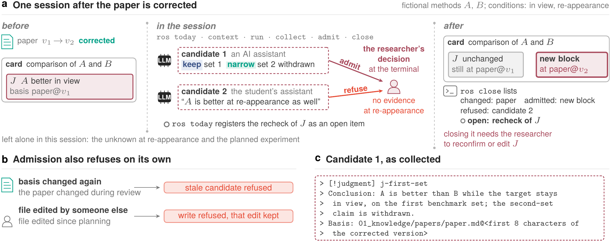
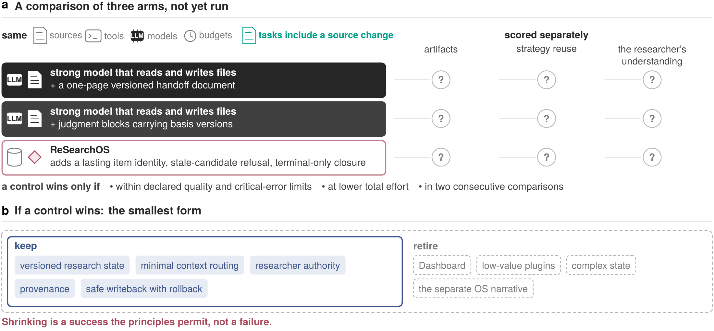
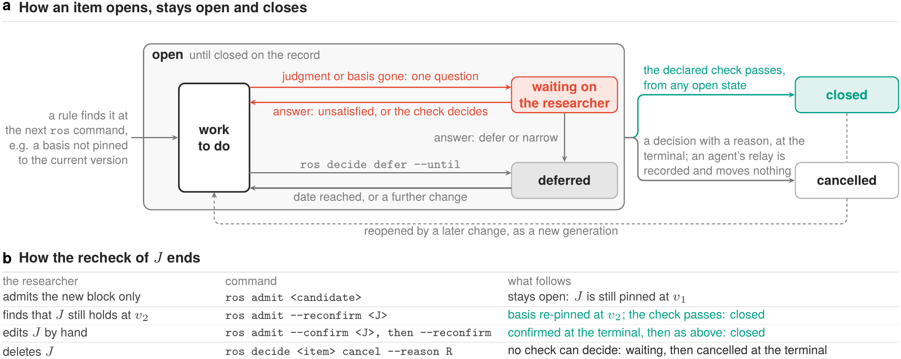

[中文](technical-report.zh.md)

# ReSearchOS: A Reference Architecture for Sustained Human–AI Research

Shiyu Hu[^author-note] · Technical report · 30 October 2026 · Not peer reviewed

School of Physical and Mathematical Sciences, Nanyang Technological University, Singapore

[shiyu.hu@ntu.edu.sg](mailto:shiyu.hu@ntu.edu.sg)

> As execution becomes easier to delegate, researchers must decide what is worth asking, what is sufficient evidence, and what is worth retaining.

## Abstract

In human–AI research that runs for weeks or months, later work builds on earlier judgments, and the sources those judgments rest on can change: a paper is corrected, a dataset is replaced. Existing tools respond to such a change in roughly two ways. Build systems and truth maintenance systems recompute on their own; note-taking tools and most agent memory do nothing. Requirements tracing and living reviews already hand changes back to people, but for links or whole reviews. The first two practices do not suit a research judgment. The same correction may leave part of a judgment standing and part needing revision, while a case the paper never tested remains undecided; this is a judgment of evidence, which an AI model may propose and whose acceptance is the researcher's responsibility, so a system should not recompute it on its own. Yet once a judgment is written as a block with a pinned version, the sources it rests on are on record, so it need not be left to go stale either. This report argues for handing the change back at the level of a single research judgment. A judgment is written, with its basis version and scope, into the researcher's own files; when a source changes, the system follows the recorded dependency, finds the related judgments and hands them back to the researcher as items to recheck, and the researcher decides whether to keep, narrow or withdraw them; an AI model's output remains a candidate until the researcher admits it. The report gives the record format and admission protocol this requires, a command-line prototype, and a class-by-class comparison with neighboring systems. The prototype notices a changed source file at the next command and registers a recheck, refuses a candidate whose basis changed again during review, and does not accept a cancellation or confirmation relayed by an agent (a reconfirmation run directly by an agent still writes and closes the recheck). It records dependencies per file rather than per argument, and it does not register conditions the researcher has stated or planned experiments. By default the downloadable version only collects candidates and does not change the researcher's records. The prototype's only user so far is the author, no study of use has been run and no comparison with simpler approaches has been made, so this report claims no research benefit.

**Keywords:** human–AI collaboration; source change; judgment recheck; research records; admission; reference architecture.

## 1. After a source changes

A researcher reads a paper, concludes that method $A$ is better than method $B$ and writes “use $A$” in the notes. Weeks later the paper is corrected: the numbers for the second benchmark set were wrong, and with the right numbers $A$'s advantage on that set disappears. No record shows which conclusions rest on the paper. The same week the researcher's student asks an AI assistant to read the corrected paper, and the assistant concludes that $A$ is also better in a situation the paper never tested. Whoever continues from “use $A$” after this has nothing else to go on.

This example contains two problems, and the report deals only with the second. The first is recording: the reason for a judgment, if it is not written down, tends to be lost when the conversation ends. Fuller notes can solve this, and it calls for no new system. The second is maintenance: even when the reason has been written down, after a source changes someone still has to find out which judgments are affected and decide what to do with the affected parts.

Existing tools treat maintenance in roughly two ways. A build system rebuilds what depends on a changed input without asking anyone, because its output is a function of its inputs; a truth maintenance system relabels beliefs along their recorded justifications, for the same reason. Note-taking tools and most agent memory do nothing: a note stays as it is until the researcher changes it, directly or through an assistant. Requirements tracing and living reviews already hand changes back to people, but for links or whole reviews (Section 6). The first two practices do not suit a research judgment (Figure 1). In the example above, part of “$A$ is better than $B$” still stands, because the first benchmark set was not wrong; part of it has to change, because the advantage on the second set has gone; while the case in which the target leaves the view and comes back, which the paper never tested, remains undecided and can only wait for the planned experiment. This is a judgment of evidence: an AI model may propose it, and accepting it is the researcher's responsibility. Which judgments depend on this paper, however, can be recorded when they are written, so a changed source need not wait until someone happens to remember it.


The practice this report argues for lies between the two: the system follows the recorded dependencies, finds the related judgments and hands them back to the researcher as items to recheck; the researcher decides whether to keep, narrow or withdraw them, and only that decision is written into the records. This requires three conditions. First, a judgment has to be written with its basis version and scope in the researcher's own files; otherwise the system has no dependency to follow. Second, what AI models and other sessions produce has to remain a candidate until the researcher admits it; otherwise the unsupported claim from the student's assistant could change the conclusion directly. Third, once a recheck is registered, it can be closed only by passing checks or by the researcher's explicit decision; otherwise an item nobody has examined quietly disappears. Section 2 shows what these three conditions look like in one session, and Sections 3 and 4 give their reasons and definitions.

**ReSearchOS** is a research environment built on this practice, owned by the researcher and kept mainly in local files.[^name] The report makes three contributions: the record format and admission protocol for judgments, a command-line prototype, and a class-by-class comparison with neighboring systems. Section 4 is a specification; the prototype described in Section 5 records dependencies per file rather than per argument. The researcher's decision is enforced only at the terminal: an admission or reconfirmation run by an agent still writes and is merely recorded as the invoker's assertion, and the latter also lets the recheck's check pass; the Dashboard's lifecycle writes bypass admission as well (Section 5). The author is the prototype's only user so far, as well as its developer and the evaluator of every result. The report is meant for researchers who already check sources and work across sessions; how novices would learn with it, and how a team would settle disagreements in it, need separate study.

This claim faces a strong alternative. A researcher could write the current state of the work into a one-page versioned handoff document and give it to a strong model that reads and writes files directly, and that model might find the affected judgments just as well after a source changes. The report cannot rule this out, and Section 7 sets out how to compare the two. Until that comparison has been done, the report claims a design and a prototype, not a research benefit.

## 2. One session

This section keeps the example of Section 1; the methods $A$ and $B$ are fictional, and no real method's performance is reported. Written out in full, the judgment $J$ is “$A$ is better than $B$ while the target stays in view”. Six words are used below: a judgment block is a labeled passage of judgment on a card, a card being a Markdown record; the basis is the field of a block that pins a source at a version; a candidate is an output not yet admitted; admission is the step that writes a candidate into the researcher's records; a recheck is the item that asks whether a judgment still stands after a source has changed; and a receipt is the record of what was done and checked. Figure 2 draws the session.



Before the session, the researcher has written $J$ on a card as a judgment block and admitted it, with its basis pinned at version $v_1$ of the paper. Everything below depends on this: the prototype's detection starts from judgment blocks and their basis fields and infers no dependency from notes, so without such a record `ros today` registers no recheck. The paper is then corrected to $v_2$: the numbers of the second set change and the first set does not. The correction reaches the records when the user, or an agent acting on the user's instruction, replaces the local file that records the paper, `01_knowledge/papers/paper.md`. The prototype observes only Markdown files under the directories listed in its configuration, and in this example the paper's record lies under `01_knowledge/`; a change to the paper's PDF itself goes unseen.

The session starts with `ros today`. As the first `ros` command after the correction, it sees that the file's content digest has changed, registers a recheck item for $J$ and lists the item under the heading for things to decide (this example assumes $J$ belongs to an active commitment). The item has a stable identity: however many more times the paper changes, it remains the same item with its versions updated, it is not registered twice, and it does not disappear when a conversation ends. At this point the system asks no question and does not judge whether the correction matters, since it may have fixed only a typo and left the judgment standing. Next, `ros context` delivers the permitted sources and the current records and leaves a receipt, and `ros run judgment --target <card> --executor copy_packet` writes a task packet for the card that carries $J$, a Markdown file holding the task and the delivered context, without calling any AI service; the user pastes it into any assistant. The packet holds only the card, and the user supplies the corrected paper. `ros collect <run> --file draft.md` reads the assistant's draft back as a candidate. Only the one to three judgment blocks in the draft are read, and everything else is ignored:

```
> [!judgment] j-first-set
> Conclusion: A is better than B while the target stays in view, on the first benchmark set; the second-set claim is withdrawn.
> Basis: 01_knowledge/papers/paper.md@<first 8 characters of the corrected version>
```

This candidate pins its basis at $v_2$. The packet asks for citations from its own sources only, and this one goes beyond them; `ros collect` does not check that. A basis in a draft that names no version is pinned to the version current at collection, and a draft pinned to an outdated version is refused at collection. Because a basis is recorded per file, the prototype cannot see the split between the first and second sets inside the paper, so “the second-set claim is withdrawn” is something the candidate states and the researcher judges, not something the system computes. After the researcher's review, `ros admit <candidate>` writes it as a new judgment block beside $J$, and because the decision was confirmed at the terminal, the admission is recorded as the researcher's.

In the same session a candidate from the student's AI assistant, “$A$ is also better after the target re-appears”, is collected as well, with its basis likewise at $v_2$. The paper reports no result for this case, and the researcher refuses the candidate at the terminal. The refusal is recorded, and nothing is written to any judgment.

Admission can also refuse on its own, in two cases, and neither refusal is a scientific judgment. If the paper changes again during review, admission refuses the candidate because its basis is stale, and it has to be proposed again on the current material. If someone else edits the file carrying $J$ after the write is planned and before it lands, the system refuses to write and does not overwrite that edit.

The session ends with `ros close`, which compares the files at the session's start and end and lists what changed in between, the admissions, the refusals, the undecided candidates and the items still open. The recheck of $J$ is still open at this point, because admitting the new block does not change $J$: the basis of $J$ is still pinned at $v_1$, and the one check the prototype can decide on its own keeps failing. To close the recheck, the researcher has to deal with $J$ itself. If the researcher holds that $J$ still stands under $v_2$, `ros admit --reconfirm` re-pins the basis at $v_2$ and the check then passes. If the researcher has edited $J$ by hand, the edit must first be confirmed after the fact with `ros admit --confirm` at the terminal before $J$ can be re-pinned. If the researcher has deleted $J$, the system cannot decide the check, the recheck moves to waiting on the researcher, and the researcher cancels it at the terminal. The researcher can also leave $J$ alone and cancel the recheck at the terminal with `ros decide … cancel`, giving a reason; such a cancellation covers only the current versions, and the item reopens when $J$ or its basis changes again.

There are three things the prototype did not do in this session. It does not separate the parts of a claim that a correction touches; the candidate states that split and the researcher judges it (gap 11). It does not register the re-appearance condition or the planned experiment, which exist only in the card's text and which `ros close` does not list (gap 12). Nor does it deal with $J$ on the researcher's behalf: the narrowed new block and the original stand side by side until the researcher makes one of the choices above.

The session's result also depends on two things the prototype does not guarantee. The correction was found because someone replaced that file: the prototype does not watch files, a change is seen only at the next `ros` command (gap 34), and a new study that changes no recorded input is not noticed at all. The researcher's decision, likewise, is enforced only at the terminal: a confirmation or cancellation relayed by an agent does not close an item, but if an agent runs `ros admit --reconfirm` itself, the write goes through, is recorded only as the invoker's assertion, and the item closes once the check passes (gap 1).

All of this is the author's prototype. The downloadable version, in its default copy-only mode, runs the same commands on its own fictional fixture, passed with `--root`, so its runs are not evidence for this session. As Table 1 shows, it may write runtime records, packets and candidates locally, but it yields only copyable candidates or planned differences, and it never admits a candidate or changes the researcher's records:

<!-- table: The same commands in the author's prototype and, by default, in the downloadable version -->
| Command | The author's prototype in this session | Downloadable version by default |
| --- | --- | --- |
| `ros today` | Observe the source change and register a recheck item | Observe source changes and register recheck items in git-ignored working state |
| `ros context` | Deliver the permitted sources and current records and leave a receipt | Deliver permitted fictional context and leave a receipt |
| `ros run judgment --target <card> --executor copy_packet` | Prepare a task packet without calling an AI service | Prepare a copyable task packet; provider dispatch remains refused |
| `ros collect` | Return the draft as a candidate with its basis pinned to a version | Collect a candidate and do not admit it |
| `ros admit` | Admit after the researcher's decision at the terminal; refuse a stale basis, or a file changed since the write was planned | Show the planned difference through copy fallback, without writing it into the researcher's records |
| `ros close` | List changes, admissions, refusals, undecided candidates and open items | Record the local session and its remaining work; admit nothing |

**Trying it.** The downloadable version is copy-only by default. Its shipped `config/ros.json` sets `runtime_scope: public_starter`, and the behavior below holds under that setting. On its fictional fixture `examples/scheduler-demo`, a first session takes the steps of this section with the commands in the right-hand column of Table 1. Because the downloadable version dispatches to no AI model provider and admits nothing into the researcher's records, a user can try recovery, context delivery and candidate collection, but not admission.

Figure 3 shows the downloadable version's Research desk, which cannot save an entry's lifecycle, and Figure 4 its agent handoff, which it can only preview and copy. The copied packet opens with its digest and copy_only route and continues with the goal, the session sources and the context route. The two screenshots show how it presents an entry; they do not show task completion, accepted judgment or usability.


The author's prototype runs on the author's own records and is not distributed; a user who wants to work on personal Markdown notes can start the downloadable version in its personal-vault mode. This mode builds a local Dashboard view from those notes and, after the user confirms, writes Dashboard changes under `personal_vault/`; if configured, it can also start a locally installed Codex CLI. However, `ros` itself does not change in that mode, and `ros admit` still only shows the planned difference. Nor does `ros` intercept ordinary agent sessions, which continue as before; only judgment blocks that come back through `ros collect` or are registered with `ros propose` enter the candidate path. Setup time and per-session effort have not been measured.

## 3. What the environment must preserve

Section 2 left the decision about $J$ with the researcher. For that decision to stay there weeks later, and after AI models and clients have been replaced, the environment has to preserve three things: the authority to decide, the records, and the history of claims that were corrected. Three principles correspond to these three things. Where efficiency, control and retention pull against each other, the principles set priorities; they do not prescribe uniform directories, methods, interfaces or review arrangements. Because research records take time to read and effort to maintain, and review can interrupt work or harden into habit, inspection is concentrated on the transitions that matter, and routine work goes on within the scope already agreed.

The first principle is that only the researcher turns a candidate into a record. The student's AI assistant proposes that $A$ is also better after the target re-appears; written into the records without the researcher's decision, this claim would extend $J$ to cases the paper does not support. The output of AI models and of other sessions therefore always starts as a candidate, and the researcher decides whether to admit it (Section 4). Admission settles who accepted a candidate, not whether the candidate is correct, which is left to later checks, because the researcher's agreement does not prove a scientific judgment right. At present this principle is enforced only at the terminal: an admission run by an agent still writes, and is recorded as the invoker's assertion (Section 5).

The second principle is that records outlast the tools that wrote them. If $J$ and its basis existed only in the conversation that produced them, nothing would show that a later correction of the paper touched $J$. Authority therefore rests with the researcher's local, readable, versionable records, while AI models, clients and plugins can be replaced. In the prototype, $J$ is written on a card, its basis is pinned to a version of the source, and context is delivered with a receipt (Section 2). By the same reasoning, a view that shows "done" does not mean accepted, and a cache does not become a second record. Nor is retention the same as retrieval: a record has to be kept with its scope, so that later work can tell whether it still applies.

The third principle is that correction narrows a claim and does not erase history. The correction touches only the second benchmark set; deleting $J$ would erase both the evidence from the first set, which the correction did not touch, and the record that the claim on the second set was once accepted. Failures, unknowns and unverified states therefore remain as they are, and what was changed, why it was changed and what is still useful are kept as well. In the session of Section 2, the narrowed judgment is admitted beside $J$, and the recheck of $J$ closes only once the researcher deals with $J$ itself (Section 4). This report does not assume that the researcher's understanding benefits.

The three principles come from the author's own design history, and their rules are written in six internal design documents; this section summarizes those documents and has been checked against them. The documents contain one further principle, that a later step starts only on what an earlier step established. It currently has no command and no test that checks it, so it is not listed here. Table 2 gives each principle's question, commitment and mechanism, [Supplementary Note 1](technical-report-supplement.en.md#supplementary-note-1-principle-sources-and-examples) gives the principle left out together with the examples and sources behind each, and [Supplementary Note 3](technical-report-supplement.en.md#supplementary-note-3-process-and-component-contracts) restates the provisions in full with their owners.

<!-- table: The three design principles and their mechanisms -->
| Principle | Question it answers | Commitment | Mechanism |
| --- | --- | --- | --- |
| Human judgment | Who accepts a judgment? | Only the researcher decides what enters the records; machine output always starts as a candidate | Candidate, decision, change, check and receipt recorded separately; the researcher's decision is recorded only at the terminal |
| Records that outlast tools | What survives tool replacement? | Local, readable, versionable records remain authoritative; AI models, clients and plugins can be replaced | Records owned by the researcher, context receipts, and a basis pinned to a source version |
| Correctable accumulation | Which judgments must change after correction? | Correction narrows affected claims without erasing history; failures, unknowns and unverified states remain visible | A narrowed judgment block beside the original, rollback receipts, and items that stay open across sessions |

## 4. Touch, recheck and closure

The principles of Section 3 say what must be preserved but not what counts as preserving it. This section gives definitions that make them checkable. The definitions are a specification: they say what the system should do. [Supplementary Note 5](technical-report-supplement.en.md#supplementary-note-5-formal-specification) states each one precisely, and Section 5 and Appendix B.1 say how far the prototype goes. This section explains, on the example of Section 1, only what maintaining one judgment needs, and notes where the prototype differs as it goes.

To resume the comparison weeks later, the researcher needs five things rather than the files themselves: the question being answered, the evidence used and how it fits together, the judgment accepted and its scope, the conditions still open (including conflicts and the cases in which a judgment does not apply), and the step planned next. In the example these are the choice between $A$ and $B$, the paper's two benchmark sets, the judgment $J$, the unknown when the target re-appears, and the experiment on that case. **Research state** is these five, reconstructed from the researcher's records. Because it is a reconstruction rather than a summary, each part can be traced back to the records, checked and corrected; how much it holds depends on what the question needs, not on how much material exists.

Of the five, the judgment is the hardest to maintain, because the evidence for it lies outside it: when a source changes, the words of the judgment do not. A judgment is therefore written as a judgment block that records its **basis**, the source it cites and the version of that source; the basis of $J$ is pinned to $v_1$ of the paper. Everything below rests on this record. A judgment is not a function of its sources, so the system cannot compute whether it holds; and the system can find the judgments that depend on a source only because that dependency was written down. These blocks are written by the researcher or by candidates the researcher admits, and without them `ros today` registers no recheck for any judgment. The same record fixes the grain of the dependency: a basis is a file and its content digest, not a particular claim in the file (gap 11).

The first question, then, is which work a change involves. Once the paper is corrected from $v_1$ to $v_2$, the version pinned by $J$ is no longer the paper's current version, so the change **touches** $J$ and the system registers a **recheck** of it. A recheck is one kind of **item**, a piece of maintenance work with a stable identity: if the paper changes again, the same item is involved and no second one appears. Touch follows recorded dependencies only. The experiment on re-appearance does not cite this paper as its basis, so it is not touched (Figure 5).


Touch therefore marks what to inspect, not what to edit. Had the correction fixed only a typo, $J$ would still be touched with nothing to change; and because the dependency stops at the file, the system cannot say whether the correction affected the first set or the second. Conversely, a dependency that was never recorded cannot be found, and a new study that changes no file in the basis of $J$ goes unnoticed even if it makes $J$ unreliable. The prototype has two further limits here. It has no file watcher, so a change is seen only at the next `ros` command (gap 34). Nor does it register the conditions a researcher states or planned experiments: in the specification these are open work, and in the prototype they are only text on the card (gap 12). The content digest also excludes judgment blocks and relations, and judgments on closed episode cards get no recheck.

The second question is what ends a recheck. Once registered, an item stays **open**, and two things alone can close it: all its checks pass, or the researcher makes an explicit decision. This is why an item nobody has dealt with does not disappear, and why a report of completion without evidence does not close it. The recheck of $J$ has to answer whether $J$ still holds under $v_2$, and only the researcher can judge that; what the system can decide by itself is only whether the basis of $J$ is pinned to the current version, and this is the one check the prototype declares (gap 34). In the prototype, therefore, the researcher's judgment reaches the records through this check. A researcher who finds that $J$ still holds uses `ros admit --reconfirm` to pin the basis to $v_2$; the check then passes and the recheck closes. Admitting the narrowed block does not replace this step, because $J$ stays pinned to $v_1$. If the researcher has edited $J$ by hand, reconfirmation is refused until the edit is confirmed afterwards with `ros admit --confirm` at the terminal. If the researcher deletes $J$, the check cannot be decided and the recheck becomes waiting on the researcher. The researcher may also leave $J$ alone and cancel the recheck at the terminal with `ros decide … cancel`, giving a reason. None of these closures is permanent: when the paper changes again, the same item reopens.

The strength of this check should be stated plainly. Its passing shows that the basis is pinned to the current version, not that anyone read the correction. Run by an agent, `ros admit --reconfirm` still writes and is recorded as the invoker's assertion; the check then passes and the recheck closes (gap 1). An agent editing the pin directly also passes the check, leaving only an after-the-fact confirmation item. Explicit decisions are enforced more strictly: cancelling an item or confirming an edit is accepted only at the terminal, and when an agent relays one, it is recorded as the invoker's assertion and the item stays as it was.

An open item has two sub-states. Both keep it in view, and `ros close` lists them, but neither closes it. The first is **waiting on the researcher**: a check cannot be decided, the system puts a question with a fixed set of options to the researcher, and the item waits for the answer. The specification lets any check that only the researcher can settle reach this state, but the shipped rules declare no such check, so in practice the path is reached when the item's subject no longer exists, as when $J$ is deleted, and the researcher then cancels the recheck at the terminal. A question is asked only once per rule version, and `ros today` gathers unanswered questions into one list; both are meant to reduce the load of review, and whether they do has not been tested. The second sub-state is **deferred**: the researcher postpones the item to a date, after which it is work to do again. A deferral confirmed at the terminal is recorded as the researcher's decision; one run by an agent is recorded as the invoker's assertion, and the item still counts as unfinished at close.

The third question is how new content enters the records. Three parties act on research state (Figure 6): the environment selects context from the history it may use, reconstructs research state and presents it with any candidate; an AI model proposes an output and a change; and the researcher decides what happens next. By the specification a candidate enters the researcher's records only through **admission**, which has three conditions. The first is the researcher's decision, which neither an AI model's output nor the candidate's own text can stand in for. The other two are not decisions but checks made at write time. The basis must still be the source's current version; otherwise the admission is refused as stale. The write must actually complete and leave a **receipt**, the record of what was done and checked; if the target file was edited after the write was planned, the write is refused and that edit is not overwritten. The formal version in Supplementary Note 5 divides these three conditions into five.


Admission settles only the operational decision. The researcher's acceptance does not make a judgment scientifically true, and passing software checks establishes neither what the researcher accepted nor that the judgment is valid. The prototype also enforces less than the specification. The researcher's decision is recorded only at the terminal; an admission run by an agent still writes and is recorded as the invoker's assertion, and lifecycle writes from the Dashboard bypass admission (gaps 1, 2). The downloadable version does not admit: it only shows the proposed change.

## 5. The prototype

The prototype that ran the session of Section 2 implements part of Section 4. What follows holds at the two commits listed in Appendix B.3, and [Supplementary Note 2](technical-report-supplement.en.md#supplementary-note-2-session-operations-and-implementation-mappings) holds the commands and record tables behind it. The most important gap between the prototype and the definitions is that the researcher's decision is enforced at only one channel.

### Three channels

Facts and judgments take different routes into the records (Figure 7a). A fact may be updated within existing task authority, while a judgment passes through candidate, decision, write, check and receipt, each recorded separately. This route is tied to sources from the candidate onward: when `ros collect` or `ros propose` registers a candidate, every basis it rests on is frozen at its full version, and if a basis changes during review, admission refuses the candidate and asks for a new proposal. The write is tied in the same way to the content it was planned against: if that content has changed by the time the write lands, the write is refused, the intervening edits are kept and no success receipt is issued. A change after `ros admit` starts and before the terminal answer is not refused: the block lands on the old version and the same command registers a recheck. These checks protect the built-in writeback paths, but they do not verify what an arbitrary rule must preserve (gap 9).


This route binds only the writes that pass through it, and three channels can write the same card (Figure 7b). At the terminal, `ros admit` prompts the researcher, and a confirmed admission is recorded as the researcher's decision. An agent with shell access that runs the same command sees no prompt; the admission is recorded as asserted by the invoker and still writes (gap 1). The Dashboard, the prototype's graphical client, makes lifecycle writes that bypass admission. When such writes are made during a session, `ros close` registers the fields that carry a judgment (state and priority) as unconfirmed changes, which stay open until the researcher confirms them (gap 2). Nor does `ros` intercept ordinary agent sessions: when an agent edits a card directly the file is not rolled back, and only judgment blocks that come back through `ros collect` or are registered with `ros propose` take the candidate route.

This fixes the reach of the terminal rule. What it enforces is closure: `ros decide … cancel/confirm` and `ros answer … cancel/satisfied` are accepted only at the terminal, and an agent's relay is recorded as asserted by the invoker while the item stays open. A judgment block without an admission receipt is registered as an item at the next `ros` command, and confirming it after the fact with `ros admit --confirm` also takes effect only at the terminal, so a judgment written directly does not sit in the records unnoticed.

What the rule does not enforce is the write itself. An agent can admit a candidate, and it can run `ros admit --reconfirm` on an unedited admitted or confirmed block. The reconfirmation pins the basis to the current version, the check then passes and the recheck closes, with one more invoker's assertion in the record. "An agent's relay does not close an item" therefore binds explicit decisions; it does not stop an agent from making a check pass. The terminal record has a limit of its own: the prototype asks only whether standard input and standard error are terminals, so a process that allocates a pseudo-terminal can also answer the prompt, and its answer is then recorded as the researcher's decision. The record attests the channel, not the person (gap 1). For an agent with shell access, these records are attribution and an audit trail rather than a block. In the downloadable version no such admission takes place by default: the same commands show the planned difference and never admit.

### The code as it stands

The difference between the channels comes from how the code is built today (Figure 8). The researcher's records are local Markdown cards. Adapters read them into a snapshot and pass it to the kernel package `researchos_kernel`, which computes changes, items and checks from the snapshot, reads only its rule table and data contracts, and writes only its own ledger, so it never reads a card directly. Adapters stage writes, which reach the file only after the check and leave a receipt. The command-line entry `scripts/ros.py` connects these parts, and both the terminal and agent sessions (such as Codex or Claude Code) run it. The ledger records what was decided, attempted and checked, but it cannot establish a dependency that was never recorded, and it has no authority over the researcher's records.

The code differs in two places from the target division of Supplementary Note 2. Admission is still carried out by `ros.py` rather than by the kernel package, so the single stable kernel remains a target (gap 3). The Dashboard is served by a local service and its writes do not pass through `ros.py`, so the protections above do not apply to them (gap 2).


This build decides what the prototype can notice. Every dependency comes from the records: detection starts from the judgment blocks and basis fields the researcher wrote by hand (confirmed relations likewise), and without them `ros today` finds no judgment to recheck. Dependencies are recorded per file: a basis is a file and its content digest, and the check asks only whether the basis is pinned to the current version, so it cannot see which part of the file a correction touched (gap 11). Noticing waits for a command: the prototype has no file watcher and no background process, most `ros` commands compare once as they start, so a change is seen only at the next such command, and it does not propagate across several hops (gap 34). A new study that changes no recorded input goes unnoticed.

### Gaps and evidence

The recheck of Section 2 never becomes waiting on the researcher, and this is one place where the session differs from the definitions. By the definitions (Supplementary Note 5), whether $J$ still holds under $v_2$ is a check only the researcher can decide, so the recheck should wait on the researcher with a question attached. In the prototype, the only check it can decide by itself is whether the basis is pinned to the current version, and after the correction that check fails; failing is not the same as being undecidable, so the recheck simply stays open. Only when a check cannot be decided does `ros today` put a question (not repeated under the same rule version), and the item then waits until the researcher answers with `ros answer`. No shipped rule declares a check that rests on the researcher's judgment, so outside the regression tests this path is reached only when an item's subject no longer resolves, for example when $J$ is deleted (Appendix B.1). Whether the first-set result still supports $J$ is left entirely to the researcher for now (gap 34, semantic checks).

Section 4, with Supplementary Note 5, is the specification; the current code supplies selected executable paths, and coverage is recorded per obligation rather than inferred from test counts. Table 3 groups the most important gaps by theme, and [Supplementary Note 6](technical-report-supplement.en.md#supplementary-note-6-implementation-gaps-in-full) gives all 39 in full, under the numbers used throughout this report. The gaps bound what the implementation can claim and leave the definitions unchanged.

The prototype falls short of the definitions in a few further places. It cannot replace or withdraw $J$; the researcher does that by hand (gap 11). It does not register stated conditions or planned experiments, so `ros close` lists neither (gap 12). A deferral the researcher confirms at the terminal with `ros decide … defer` does take effect, but no mechanism yet produces a deferral from an out-of-scope dependency (gap 17). Versions are identified by content digest alone, so a return to earlier content counts as the earlier version rather than as a new revision (Appendix B.1). Cross-client integration also remains unverified.

<!-- table: Disclosed implementation gaps grouped by theme -->
| Theme | Gaps (numbers in Supplementary Note 6) | What it means for a user of the prototype |
| --- | --- | --- |
| Admission and writeback | 1, 2, 9 | Agent-executed admissions and reconfirmations and Dashboard writes are recorded but not blocked, and the built-in checks do not verify what an arbitrary rule must preserve. |
| Sessions and completion | 15, 17, 18 | A session's specification is only partly frozen, an out-of-scope dependency produces no deferral, and a question left waiting on an obsolete basis can still let a session report `complete_with_held`. |
| Dependencies and maintenance | 3, 10, 11, 12, 34 | The single stable kernel remains a target because `ros.py` still carries out admission. General checks across successive steps, protection of independently supported parts during a correction, registration of stated conditions and planned experiments, file watching and propagation across several hops remain specified only. |
| Acceptance and benefit | 13, 14 | Human acceptance of the interface, isolation of real models, long-run recovery and research benefit are unverified. |

Two kinds of evidence have to be kept apart in assessing this prototype. The first is the regression tests of the kernel and of writeback, which exercise source changes, candidate freezing, admission, refusal of concurrent writes and closure records on temporary fixtures; passing them establishes those execution properties for those inputs. Within that range the claim is firm: a file-level source change is found at the next command and registered as an item with a stable identity; a candidate whose basis changed during review and a write whose planned-against content changed are both refused; and an item closes only by a passing check or an explicit decision at the terminal, which an agent's relay cannot supply. The second kind of evidence answers other questions: whether the narrowed judgment is right, whether the experiment is worth running and whether the researcher understood more. These need actual tasks and independent evidence, and software checks establish neither acceptance nor scientific validity. The prototype has one user so far, the author. Neither a study of use nor the comparison of Section 7 has been run, so this report claims no research benefit.

## 6. Neighboring systems

The prototype stops at that boundary, which raises a question: do the tools researchers already use already do the same thing? To answer it, the paper of Section 1 is corrected once in each class of tool, and the question is what happens next. Table 4 records the result by class. A row describes the mechanisms that the named or typical systems of a class report, not every system in it, and it says nothing about integration or performance. ReSearchOS takes two rows, because a specification cannot be compared with other people's implementations: the "prototype" row states what the code of Section 5 does, and the "design" row states what Section 4 and [Supplementary Note 5](technical-report-supplement.en.md#supplementary-note-5-formal-specification) specify.

In a note tool the correction changes nothing: the note that records $J$ stays as it was until the researcher edits it, by hand or through an assistant. Version control keeps every version and refuses a stale write by optimistic concurrency control [Optimistic concurrency control](https://doi.org/10.1145/319566.319567), which is also the mechanism behind the prototype's refusal of a changed file. It does not, however, distinguish a fact from a judgment, and on a concurrent change it only merges or reports a conflict. The prototype is no stronger here: it refuses the write and does not keep the two conflicting versions.

Several classes handle the correction themselves. A truth maintenance system [Truth maintenance system](https://doi.org/10.1016/0004-3702%2879%2990008-0) revises beliefs along recorded justifications: with the two benchmark sets drawn as separate justifications, the one through the second set fails and $J$ stays in through the first (Figure 9c). The difference is who gives the value. Such a system relabels by itself, whereas ReSearchOS only reports that a basis is no longer the current version and leaves to the researcher whether the judgment still holds. A build system [Build systems à la carte](https://doi.org/10.1145/3236774) rebuilds the results a changed input invalidates, and a suspended task waits for its dependencies, not for a person's judgment. In agent memory, Graphiti [Zep](https://arxiv.org/abs/2501.13956) invalidates a contradicted fact and PACMI [PACMI](https://arxiv.org/abs/2610.05732) marks memories that depend on changed evidence as needing verification; in both the system sets the new status and no person is asked. GovMem [GovMem](https://arxiv.org/abs/2607.02579) routes a doubtful candidate memory to human review, but only before it is written. AI-scientist papers report no step triggered by a corrected source; a person may start or steer a new run. Figure 9 shows how these six classes handle the correction, and none of them leaves the change as a question for the researcher.

Other tools bring the change back to a person, a practice older than this report. Requirements tools such as IBM Engineering Lifecycle Management mark a trace link suspect when the content at either end changes, and a team member then marks it valid or invalid [Link validity](https://www.ibm.com/docs/en/engineering-lifecycle-management-suite/lifecycle-management/7.0.3?topic=management-link-validity). A protected branch on GitHub can be set so that, once new commits change an approved diff, the change cannot merge without a new approval [Protected branches](https://docs.github.com/en/repositories/configuring-branches-and-merges-in-your-repository/managing-protected-branches/about-protected-branches).

Living systematic reviews bring research conclusions back to their authors, and they do what ReSearchOS does not. Under Cochrane's guidance such a review searches for new evidence every month, its authors judge whether new studies are likely to have an important impact on the findings, and readers learn the review's status each month and are told that an update is pending while new evidence is integrated [Cochrane living systematic reviews](https://resources.cochrane.org/sites/resources.cochrane.org/files/uploads/inline-files/Transform/201912_LSR_Revised_Guidance.pdf). In June 2026 Cochrane also announced that it is matching retracted studies to the reviews that include them and will add editorial notes while authors assess the impact, leaving the decision on the conclusions to its editors [Cochrane retracted publications](https://www.cochrane.org/about-us/news/cochrane-strengthens-systems-manage-retracted-publications-its-published-reviews). ReSearchOS does none of this. It does not search for new studies and receives no retraction notices: the prototype only sees whether the local file recording a source has changed, and that file is replaced by the user or by an agent acting on the user's instruction. A new study can therefore make a judgment unreliable, and as long as it changes no input the judgment depends on, the prototype does not notice. The prototype shows no reader other than the researcher that a judgment awaits a recheck, and it has no author team or editorial process. Living reviews are built for these cases, and the practice proposed here does not replace them.

Closer to a single claim, a ledger of the quantitative claims in one paper [Provable discourse](https://arxiv.org/abs/2603.10450) flags a claim as stale when the fingerprint of its data changes, even if the claim still passes.

One recent system carries a retraction down a whole chain of records. In a wiki maintained by a language model for regulated settings, Zhang's provenance layer [Provenance-native wiki](https://doi.org/10.53941/aiet.2026.100010) binds claims to evidence passages. When a source is marked retracted, superseded or downgraded, it follows those links to the dependent claims, rules and decisions. A claim with other support has its confidence recomputed and is marked disputed below a threshold, a claim with none is suspended, and the decisions downstream are flagged; a decision whose confidence falls below a floor is flagged for human review, though at the default threshold no decision in the reported run reached it. Five simulated retractions on a 112-document corpus reached every affected record.

This is the nearest mechanism this report found to the touch of Section 4, and it goes further. It travels the whole chain, where the prototype goes one step along recorded dependencies (gap 34), and it reports a controlled evaluation, which ReSearchOS does not. The difference lies in who acts and on what: the system sets the status of a whole claim by rule and threshold, and the paper describes no scope on a claim and no question to a person about which part still stands.

Researcher authority has precedents too, and what matters is what happens to an approval when the paper is corrected. OmniScientist [OmniScientist](https://arxiv.org/abs/2511.16931) records a human's approval of an artifact with its version hash; what is approved is the artifact, not a judgment that returns to the researcher after a source change. Magnolia [Magnolia](https://arxiv.org/abs/2610.27230) enables cross-project rules only after a researcher confirms each one, and ResearchLoop [ResearchLoop](https://arxiv.org/abs/2605.28282) admits a claim only within the scope approved by a gate written by the researcher or a prespecified protocol file. Neither paper describes returning an admitted result to the researcher when a source later changes.

What these tools leave open is a link, a pending change, a whole review or a whole claim. No system this report examined does three things together: keep the judgments a researcher admitted with their basis versions, return a judgment to the researcher as an item when a source changes, and change that record only through candidates the researcher admits. The prototype does the first two; the third holds only for new judgments, since existing ones change only by hand or by re-pinning. The scope is narrow. Dependency is recorded by file and a whole judgment comes back, which is no finer in grain than a suspect link or a claim ledger; updating only the touched part is so far design (gap 11); and the researcher's decision is enforced only at the terminal (gaps 1, 2).


<!-- table: After the paper is corrected: what neighboring systems keep, what happens and what stays open -->
| System class | Keeps | What happens when a source changes | What stays open |
| --- | --- | --- | --- |
| Personal knowledge bases and note tools | Notes and links | Nothing; the researcher edits, by hand or through an assistant | Nothing; an open question is a note |
| Version control with optimistic concurrency | Every version; refuses a stale write | Merges, or reports a conflict | Branches, without saying what they mean |
| Truth maintenance systems (JTMS, LTMS, ATMS) | Conclusions with their justifications | Relabels along justifications on its own; a conclusion with another valid justification stays in | Unknown labels (LTMS) or several consistent contexts at once (ATMS), maintained by the system, not put to the researcher |
| Retraction services and claim ledgers | Reviews and their studies, or claims with a fingerprint of their evidence or bound to evidence passages | Flags a retracted study, marks a claim stale when its data change, or marks claims disputed by threshold, suspends them when no support remains and flags the decisions downstream | A whole review, to which Cochrane announced it will add an editorial note, a whole claim until its author updates it, or a whole claim the system suspends; nothing scoped, no candidate to admit |
| Build systems and scientific workflows | Keys, values and their inputs | Rebuilds what the change invalidates | Nothing; the human is outside the loop |
| Research knowledge graphs and experiment trackers | Comparison records, runs and lineage | The record is updated; a judgment built on it is not | Nothing |
| Agent memory (RAG, A-MEM, Mem0, MemOS, Graphiti, PACMI) | Retrieved and compressed context | Overwrites, re-ranks, or invalidates as the agent decides | At most a needs-verification mark set by the system; nothing put to the researcher |
| AI-scientist systems (AI Scientist, Agent Laboratory, Co-Scientist, Kosmos, Denario) | Hypotheses, experiments and artifacts | No reaction to a source change reported; a person may start or steer a run | Nothing kept open |
| ReSearchOS (prototype) | Judgment blocks with basis versions, the basis recorded by file; conditions are text the prototype does not read | Registers one recheck at the next command; only an admitted candidate is written, and the original judgment stays until the researcher acts on it | A recheck of a whole judgment, until its check passes or the researcher decides at the terminal; open conditions and planned experiments are not registered |
| ReSearchOS (design) | Judgments with scope and basis version | Only the touched part, through a candidate the researcher admits | Open conditions, and checks waiting on the researcher |

Figure 10 sets this comparison on two axes. One is what a source change leaves open, taken from the last column of Table 4 or from the paragraph above that describes the system. The other is who acts on the change: the system or an agent, a person directly, or the researcher admitting a candidate. Research knowledge graphs and experiment trackers are not placed, because Table 4 does not say who updates their record. The "touched part" column holds only ReSearchOS, but that is the position of the design; the prototype returns a whole judgment, which puts it in the researcher's row under "a whole claim".


[Supplementary Note 4](technical-report-supplement.en.md#supplementary-note-4-research-foundations-in-detail) gives the full synthesis, including the systems passed over here. This comparison shows only that the mechanisms differ, not that the difference is useful.

## 7. How to test it

Whether a difference in mechanism is useful has to be settled by comparison, which is also what the counter-case of Section 1 asks. The comparison has two controls, each with the same sources, tools, models and budgets as the prototype, over enough natural research tasks. The first control is a strong model that can read and write files, given a one-page versioned handoff document. The second is the same model given judgment blocks that carry basis versions, written in the researcher's files, without the prototype.

The second control is the fair one for the narrow claim, because the recorded dependency is already in the blocks and the model can compare versions and find a stale judgment by itself. The prototype adds only three things beyond it: the persistent identity of the item, the refusal of stale candidates, and closure of a recheck only by a passing check or a decision at the terminal. The comparison has to show whether these three are worth keeping. The tasks must therefore include a source change, and the change must have a chance to fall during review and between sessions, or the three never come into play. The four historical requests reconstructed so far involve no source change (Supplementary Note 1) and cannot stand in for such tasks.



The first control wins under the following criterion. If the model recovers the current question, the key evidence, the accepted judgments, the open boundaries and the next action within declared quality and critical-error limits, at lower total effort, and does so in two consecutive comparisons, the handoff wins. In that case ReSearchOS should shrink to versioned research state, minimal context routing, researcher authority, provenance, and safe writeback with rollback, and the Dashboard, low-value plugins, complex state and the separate operating-system narrative could then be retired. Such shrinking is a success the principles permit, not a failure (Figure 11). The same criterion applies to the second control: if judgment blocks alone reach it, the prototype's three additions have no reason to stay.

The comparison needs to evaluate three things separately: artifacts, strategy reuse and the researcher's understanding. Studies of generative AI and learning [GenAI and human learning](https://doi.org/10.1038/s41562-024-02004-5), of human–AI combinations [Human–AI combinations](https://doi.org/10.1038/s41562-024-02024-1) and of feedback loops [Human–AI feedback loops](https://doi.org/10.1038/s41562-024-02077-2) give grounds for it: the first calls for evaluating effects on cognition and metacognition, a meta-analysis found that human–AI combinations on average perform worse than the better of humans or AI alone, and feedback-loop experiments found that AI alters human judgment, often without people noticing. Output quality alone therefore cannot show what the researcher understands.

Neither this comparison nor the first study of use, with researchers other than the author, has been run, and nothing in Sections 2–5 presumes their outcome. Until they have been run, the practical advice is to start with the simpler practice: write the state of the work into a one-page versioned document, give it to a strong model that can read and write files, and use it for two weeks of real work, installing the downloadable version only where this misses a source change. In its default mode the downloadable version collects candidates but does not admit them.

## 8. Conclusion

After a source changes, a research judgment should not be recomputed by the system on its own, because which part still holds is a judgment of evidence: an AI model may propose it, and accepting it is the researcher's responsibility. Nor need it decay: provided the judgment is a block with a pinned version, the sources it depends on are on record. This report therefore argues for handing the change back at the level of a single research judgment: the system follows the recorded dependency to the judgment and hands it back to the researcher as an item to recheck, and the researcher decides to keep, narrow or withdraw it; machine output stays a candidate until the researcher admits it.

The prototype implements the narrowest part of this practice, in a form that can be checked at the terminal. A change to a source file is found at the next command and registered as an item with a stable identity. A candidate whose basis changed again during review is refused, and so is a write whose target changed after the write was planned. An item closes only by a passing check or an explicit decision, and the explicit decisions to cancel or confirm take effect only at the terminal, so an agent's relay does not close an item. A reconfirmation run by an agent is the exception: it still writes and makes the check pass, recorded as the invoker's assertion (gap 1), and a process that allocates a pseudo-terminal also passes the terminal test (Section 5). In the session of Section 2, the new judgment was admitted only on the researcher's decision, the unsupported proposal was refused and the refusal recorded, and the recheck of $J$ was still open at closure. To separate the evidence given from what remains to be shown, Table 5 sets each contribution beside both.

<!-- table: Contributions, evidence and what remains -->
| Contribution | Evidence given in this report | What remains to be shown |
| --- | --- | --- |
| Record format for judgments and admission protocol (Sections 3, 4) | The definitions of Section 4; the specification of Supplementary Note 5 and two propositions argued under their stated hypotheses; in Supplementary Note 1, the literature behind each principle and four historical requests, as precedents for where the design needs came from only | Whether they improve understanding and decisions in actual research, since no study of use has been run; neither proposition shows that completion is reachable |
| Command-line prototype (Sections 2, 5) | The fictional example of Section 2 (illustrates mechanism only); kernel regression tests and the CI runs of Appendix B.3. These software checks establish neither acceptance nor validity | Not implemented: dependency by argument (gap 11), registration of stated conditions and planned experiments (gap 12), a file watcher (gap 34), waiting on an out-of-scope dependency (gap 17), general checks of a later step on an earlier step's result (gap 10). Unverified: cross-client integration. Away from the terminal the researcher's decision is not enforced (gaps 1, 2) |
| Class-by-class comparison with neighboring systems (Section 6) | Table 4 and Figures 9 and 10, which record mechanisms as their sources report them | Integration and performance were not compared; neither comparison of Section 7 has been run; a new study that changes no input is not noticed |

Long-term benefit has not been shown. The author is the prototype's only user so far, as well as its developer and the evaluator of all results. Neither the comparison nor the study of use of Section 7 has been run, and their results should revise the definitions or the prototype before any value is claimed. Where a clear handoff is sufficient, the simpler arrangement should be preferred; additional structure deserves to remain only where it helps researchers notice a source change, revise a judgment and avoid repeated work. Whatever the results, the researcher, not the AI model or another session, should decide which part of a judgment to keep, narrow or withdraw.

**Availability and ethics.** The reference artifact uses public literature and fictional examples. The four design requests listed in Supplementary Note 1 were reconstructed from a ninety-day history of the author's own records, which contains messages from collaborators and students and unpublished work. That history was processed only locally, its symbolic projection carries no identifiers, and nothing from it is distributed. Personal and project identifiers, original private documents, unpublished technical details, private records and record graphs are excluded from this report, and this report does not announce a dataset or benchmark release. The current software license is noncommercial source-available, without an OSI-approved open-source claim. Artifact access remains subject to repository visibility. Any study with participants requires consent, applicable institutional review, data minimization and withdrawal arrangements, and safety experiments require isolation from real external effects.

**Disclosure.** AI assistance supported source discovery, drafting, translation, figures and typesetting; the author is responsible for the scientific claims and submission metadata. The bibliography includes relevant coauthored studies as methodological sources, without treating their results as validation of ReSearchOS. No participant outcomes or long-term causal benefits are reported.

## Appendix A. Objects and the lifecycle of an item

Section 4 introduces these objects one at a time, on the example; this appendix puts them side by side. Table 6 lists each kind of object, the states it can be in, the condition under which it moves and the party that moves it. The parties are the researcher, the system (the kernel and the commands of Sections 2 and 5) and an AI model, whose output enters only as a candidate. [Supplementary Note 5](technical-report-supplement.en.md#supplementary-note-5-formal-specification) states these definitions precisely and gives version branches, the notation for checks, the conditions for completion and the two propositions.

The output of `ros` keeps older wording: it prints "requirement" (要求) for what this report calls an item, "open" (未决) for open, "held" (挂起) for waiting on the researcher, and "waiting" (等待) for deferred. The code calls an item an issue, with the states `open`, `deferred`, `waiting`, `resolved` and `cancelled`, the first three being what this report calls open. Waiting on the researcher is, in the code, `waiting` with an `answer:` trigger; deferred is either `deferred`, from `ros decide … defer`, or `waiting` with a date or event, from answering a question.

<!-- table: Objects, states and who changes them -->
| Object | States | Condition | Who changes it |
| --- | --- | --- | --- |
| Version of a source | Current, or superseded | The system compares content digests: once a file's content changes, the older version pinned by a judgment is no longer current; content restored to what it was counts as the earlier version again (Appendix B.1). Version branches and late records in the specification are in Supplementary Note 5 | The system, at the next `ros` command |
| Candidate | Collected and undecided, admitted, or rejected | Admitted only when the researcher decides to accept it, its basis is still current, and the write completes and leaves a receipt. If the basis changed during review the admission is refused as stale and the candidate must be proposed again; if the file changed after the write was planned, the write is refused, not the candidate | `ros collect` or `ros propose` collects it and freezes its basis; the researcher admits or rejects it. An admission run by an agent still writes and is recorded as the invoker's assertion (gap 1) |
| Judgment | Basis current, or due for recheck; the researcher may keep, narrow or withdraw it | Keep: `ros admit --reconfirm` pins the basis to the current version. Narrow: a new block pinned to the new version is admitted beside the original, which stays due for recheck. Withdraw: the researcher deletes it by hand, and the recheck becomes waiting on the researcher; the prototype keeps no text of a withdrawn judgment, short of the third principle | The system marks it due; the researcher decides. The prototype can neither replace nor withdraw an existing judgment; the researcher edits or deletes it by hand (gap 11). A hand-edited block has no admission receipt, so the system registers a separate item for confirming it afterwards, even when the edit pinned the basis to the current version |
| Item (a piece of maintenance work, such as the recheck of $J$) | Open, resolved or cancelled; waiting on the researcher and deferred are two sub-states of open | Registered when the version a judgment pins is no longer current; its identity comes from the rule, the judgment and the purpose version, and does not change with the source. Resolved when all its checks pass; cancelled by a recorded decision with a reason. A resolved item reopens when its condition recurs, and a cancelled one when what it read changes | The system registers and resolves it; the researcher cancels, defers or answers. Cancellation is accepted only at the terminal |
| Item waiting on the researcher | Awaiting the researcher's answer | A check cannot be decided and only the researcher can settle it. The shipped rules declare no such check, and in practice this state is reached when the item's subject no longer exists, as when $J$ is deleted. If only the basis file is deleted, the item stays open and no question is asked | The researcher answers. Closing the item by cancelling or by establishing satisfaction is accepted only at the terminal, and an agent's relay changes nothing; the shipped rules do not offer establishing satisfaction |
| Deferred item | Waiting for a date or an event | The researcher postpones it to a date with `ros decide … defer`, or chooses to defer or narrow when answering a question. It is work again once the date comes; after an event, the researcher reopens it with `ros decide … reopen`. The out-of-scope block in the specification is not implemented (gap 17) | The researcher. Only a deferral confirmed at the terminal counts as the researcher's decision; one run by an agent is recorded as the invoker's assertion, and the item still counts as unfinished at close |
| Check | Pass, fail, or cannot be decided; a check never evaluated has no result | Pass or fail only from a qualified, currently valid check; cannot be decided when the evidence is missing, stale or in unresolved conflict, and this never counts as a pass. A check with no result is unevaluated work that blocks completion | The system, for a mechanical check; the researcher's decision and reason, for a check that needs human judgment, of which the shipped rules have none |
| Question | Asked, answered or withdrawn | A fixed set of options; asked once per rule version and again only when the rule's version changes (the `ros today` message says "basis version"; it means the rule version); withdrawn if evidence later decides the check | The system asks; the researcher answers |
| Session | Running; closes as `complete`, `complete_with_held`, `budget_stopped` or `human_stopped` | `ros today` starts it and freezes its scope and rule versions; `ros close` ends it and reads off the outcome. All items closed gives `complete`; only items waiting on the researcher or deferred left gives `complete_with_held`; the other two depend on whether the budget ran out. The specification's fifth outcome, `deferred`, is not implemented (gap 18), and a session only approximates the unit of work in the specification (gap 15) | The system determines the outcome; the researcher decides when to close |

Of these objects it is the item that carries the maintenance work, and Figure 12 draws its lifecycle. An item is registered or reopened when the version a judgment pins is no longer current; in the specification, a scan can also find an item when work is first set up or a scoped check is rerun (Supplementary Note 5). An item closes only when all its checks pass or when a recorded decision with a reason cancels it. Until then, the two sub-states keep it in view: when the researcher answers that satisfaction is not established, or the date comes, it returns to plain open. A failed check means the item is not yet resolved, while a check never evaluated has no result and counts as unevaluated work. A session can therefore end with items waiting on the researcher or deferred, as `complete_with_held`, and it lists those items one by one.



## Appendix B. Implementation and engineering record

Sections 2 and 5 say what the prototype does; this appendix records the commits, commands and tests it rests on. B.1 maps each definition behind Section 4 to the commands and regressions that carry it, B.2 says how a session stands in for the bounded goal of Supplementary Note 5, and B.3 gives the commits, the same as in Sections 2 and 5, and their tests; Supplementary Note 6 lists every disclosed gap. Design obligations, formal definitions, implemented paths and evidence are kept as separate claims, so no unimplemented mechanism is presented here as a runtime capability. Implementation statements not made for these commits keep the scope in which they were validated earlier and were not accepted anew at these commits. Components kept in the repositories but not under development, such as the plugin system, are described as they stand, and this report adds no functionality to them.

### From definitions to commands

Table 7 answers three questions for each definition behind Section 4: through which commands it reaches the researcher, which kernel regressions in `evals/test_ros_kernel.py` exercise it, and what the prototype still lacks. The numbered definitions are in [Supplementary Note 5](technical-report-supplement.en.md#supplementary-note-5-formal-specification), the only place where the names composition and bounded goal are defined.

<!-- table: Definitions of Section 4 in the prototype -->
| Definition in Section 4 | Commands | Kernel regressions | What the prototype still lacks |
| --- | --- | --- | --- |
| Research state (Section 4) | `ros state`, `ros context` | `test_state_reports_q_e_j_b_n`; `test_cr2_ros_context_emits_context_receipt_with_egress_service` | Stated conditions and planned experiments are not registered (gap 12); agents' direct reads lack receipts (gap 7) |
| Admission (Section 4) | `ros collect`, `ros propose`, `ros admit` | `test_hj1_ros_admission_requires_human_decision_record`; `test_proposal_freezes_unpinned_basis_and_admit_rejects_later_change`; `test_admission_does_not_overwrite_an_edit_after_planning` | `test_hj1_…` checks that the channel is recorded, not that the researcher's decision is required; agent-executed admissions and Dashboard writes are recorded, not blocked (gaps 1, 2); what an arbitrary rule must preserve is not verified (gap 9) |
| Versions (Definition 5.1) | `ros today` | `test_cr16_exact_replay_adds_no_observation_work_or_question`; `test_today_explains_exact_changes_and_related_requirements` | Versions are content digests, one per record at each boundary, so the order, branches and late ancestors of Definition 5.1 are not computed. The cited regressions test replay and change detection only; a change is seen only at the next `ros` command, with no file watcher (gap 34) |
| Touched and open items (Definitions 5.2–5.3) | `ros today` | `test_basis_change_opens_then_reconfirm_resolves_and_replay_is_deterministic`; `test_a_b_a_reopens_and_generation_advances_on_new_read_set` | A return to earlier content counts as the earlier version and resolves the recheck, unlike the new revision of Definition 5.1; no propagation across several hops (gap 34); attribution of new items is partial (gaps 23–25) |
| Three-valued checks and closure (Definitions 5.4–5.5) | `ros today`; `ros decide … cancel` at the terminal | `test_a_requirement_closes_on_its_declared_check_bound_to_the_current_version`; `test_cc3_unknown_check_never_resolves_and_stays_apart_from_coverage_unknown`; `test_b8_only_the_terminal_closes_a_requirement_by_decide` | Only script checks run, and a new kind of executable check needs a kernel change (gaps 12, 25) |
| Work waiting on the researcher and deferred work (Definitions 5.6–5.10) | `ros today`, `ros answer`, `ros decide … defer` | `test_hj6_undecidable_unknown_is_asked_once_and_waits_outside_open_work`; `test_cc7_defer_channel_controls_completion_and_terminal_decline_does_not_write` | No shipped rule declares a human-basis check, so outside the kernel regressions an item waits on the researcher only when its subject no longer resolves. No producer for a deferral on an out-of-scope dependency (gap 17); items left waiting on obsolete questions can survive (gap 18) |
| Composition (Definition 5.11) | None | None | No execution consumer for general successor, parallel or join checks (gap 10) |
| Bounded goal, Done and Stop (Definition 5.20) | `ros today` (also with `--for`), `ros close` | `test_cc6_episode_spec_is_frozen_and_scan_stays_inside_it`; `test_cc7_special_requirements_exclude_done_in_every_unclosed_state`; `test_cc10_waiting_spends_boundaries_and_an_exhausted_session_stops` | Sessions only approximate bounded goals (gaps 15, 16); budgets are not fully metered (gaps 19–22); the zero-share rule is not enforced (gap 18) |

Each row reads from a definition to the command a researcher types, the regression that runs that command on a temporary fixture, and the gaps that bound the claim. The regressions establish the named execution properties for their fixtures; whether a definition is implemented in full, whether a judgment is right and whether the researcher gained anything lie beyond what they show. Coverage is therefore read per definition and per gap, never from the number of tests. Composition is the one definition with no command, and the bounded goal is carried only approximately, by sessions (B.2).

One further record here concerns the comparison of Section 7 rather than a definition. A history-free local agent, using the participant package and the authorized sources, scored 10/10 on a frozen 10-point rubric without hard failure. This is a single case scored by the author; it shows neither that a handoff alone suffices nor that it is reliable across tasks or models, nor that it is valuable to participants.

### Sessions as approximate bounded goals

The prototype has no separate goal object: a session stands in for the bounded goal of Supplementary Note 5. The command `ros today` opens the session and freezes its specification, which covers the purpose and its version, the target with its scope and digest, the rules and fields to preserve, the authority, the budget, and the sources with their cutoff. Running it again on the same day for the same target keeps that snapshot and reports what differs, and an admitted revision affects only the next goal. With `--for`, the session narrows to one commitment, its judgments, the cards that hold them, its source card and its basis cards. A target that does not exist or is ambiguous opens no session, and an empty or absent scope snapshot cannot report complete or complete_with_held (gap 16).

The budget covers boundaries, questions and reopenings and is frozen with the specification. Each boundary is charged to its session, including one at which only deferred items continue, so the budget counts boundaries rather than elapsed time. Exhaustion stops questions, dispatch and further boundaries, but not the maintenance of items or the recording of reopenings, and a session then closed unfinished is budget_stopped unless old questions waiting on the researcher exempt it. Gaps 19–22 record where metering and accounting are incomplete.

A deferral is exempt from completion only when the researcher made it with a trigger that has not expired: by a triggered deferral or narrowing through the researcher's own channel, or by confirming `ros decide … defer` at the terminal. A deferral confirmed at the terminal therefore is exempt, while a deferral on an out-of-scope dependency has no producer (gap 17). A deferral asserted off the terminal (`invoker_asserted`), an unconfirmed legacy deferral, an executor's deferral, a dependency inside the scope, and a deferral without a trigger or past it grant no exemption.

Some things always block completion: an unreconstructable earlier specification, a break-glass block or field confirmation, in-scope unevaluated work, and a dispatched run without a usable result, including one that failed with unknown effects. A failure before dispatch does not. Items waiting on an answer can nonetheless rest on invalid old questions (gap 18). An explicit abandonment records the unknown effects without a receipt and lets the session settle.

At closure the session counts items, not inputs, and only in-scope unevaluated work affects completion. Early closure is recorded as `human_stopped`, all questions are listed regardless of scope, and an unverifiable receipt cannot exclude an existing in-scope item. Each boundary freezes enough of its inputs for a later boundary to tell an item missed under the earlier specification from one caused by a change. A cold start, or a missing earlier specification, is recorded as initial; in the second case the miss status is unknown, and one item for the unreconstructable specification is registered, or reopened if it was closed. Attribution of new items to scope, source and version changes is partial, and semantic caching is absent (gaps 23–25).

### Code and tests

Sections 2 and 5 and this appendix describe the downloadable version at commit f541cb6d161a and the author's prototype at commit 4a9f696a6ebc. In CI, the downloadable version's 661 Python regression tests pass on CPython 3.10 and 3.13, and the default regression set of the author's prototype passes on CPython 3.11; tests of components not under development are outside these default sets. These are software checks of the stated commits and establish neither human acceptance nor scientific validity.

[^name]: The name **ReSearchOS** comes from Re Search: returning to material with a new question and retaining what that examination changes. Other public projects use the name ResearchOS, including `github.com/CognitiveAISystems/ResearcherOS` and `github.com/JRH89/researchos`; ReSearchOS is not related to them.

[^author-note]: This technical report describes the design principles, the definitions of research state and the command-line prototype of ReSearchOS, a personal project that the author designed and built independently. It has not been peer reviewed, and the prototype is partial; its formal parts are there to make the design precise enough to discuss, not to establish reviewed results. It is shared for understanding and discussion.
