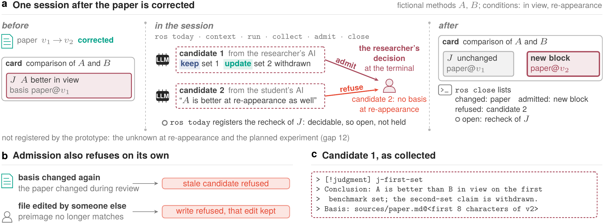

[中文](technical-report.zh.md)

# ReSearchOS: A Reference Architecture for Sustained Human–AI Research

Shiyu Hu[^author-note] · Technical report · 29 October 2026 · Not peer reviewed

School of Physical and Mathematical Sciences, Nanyang Technological University, Singapore

[shiyu.hu@ntu.edu.sg](mailto:shiyu.hu@ntu.edu.sg)

> As execution becomes easier to delegate, researchers must decide what is worth asking, what is sufficient grounds for judgment, and what is worth retaining.

## Agent Summary

In research that runs across many AI-assisted sessions, a paper the researcher relied on is corrected weeks later. Three things then have to happen: the judgments the correction leaves intact are kept with their grounds; the part it touches is updated, and only that part; and what the evidence cannot yet settle is held open until the researcher answers. Which part is kept, updated or held is for the researcher to decide, not a model or another session: what has to be kept is research state, not research files. ReSearchOS is an environment built on this idea, owned by the researcher and kept mainly in local files. A model's output stays a candidate until the researcher admits it into research state: the question, the evidence, the accepted judgments with their scope, the open conditions and the next step. The report gives design principles that say what such an environment must preserve, a model of research state that makes keep, update and hold checkable, and a reference architecture with a command-line prototype and an installable, copy-only public starter. At its next command the prototype notices a changed source and registers a recheck of the judgments that rest on it; it refuses a candidate whose source changed during review, and it does not overwrite content that someone else edited before its write. In the worked session the researcher admits a narrowed judgment as a new block beside the original and refuses an unsupported proposal. The prototype is partial: which part of a judgment a correction touches is stated by the candidate, not computed by the prototype, and the researcher's decision is enforced only at the terminal. No study of use and no comparison with a strong model given a one-page handoff has been run, so no research benefit is claimed.

**Keywords:** human–AI collaboration; research-state maintenance; reference architecture; judgment continuity; extensibility.

## 1. Research state, not research files

Research that runs across many AI-assisted sessions builds each step on earlier judgments, and the sources behind those judgments change. Across many sessions, getting the current step right is not enough: what is carried forward from earlier work has to be checked to see whether it still holds. When a source changes, what should a research environment do? Take an example.

A researcher wants to know which of two methods, $A$ or $B$, works better. A paper that ran two benchmark tests found $A$ better on both, and the researcher writes down the conclusion: $A$ is better than $B$. The paper, though, tested only one kind of situation. Whether $A$ is still better in another kind it does not say, and that is left for an experiment the researcher plans to run later.

Weeks later the paper is corrected: the numbers in the second test were wrong, and with the right numbers $A$'s advantage on that test disappears. The same week the researcher's student asks an AI assistant in another session to read the corrected paper, and the assistant says that $A$ will be better in the untested situation too.

What should happen to the conclusion? The first test was not wrong, so its support for the conclusion still stands and is **kept**. The second test changed, so the part of the conclusion that rested on it is **updated**, and nothing else is touched. The untested situation still has no answer, so it stays **held** open for the planned experiment, and the assistant's claim, which nothing in the paper supports, is refused. Keep, update and hold all ask the same question: what does the new evidence reach?

Why can these choices not be left to a tool? In a build system an output is a function of its inputs: when an input changes, what depends on it is rebuilt and no one is asked (Figure 1a). A judgment is not a function of its sources. One correction can leave part of a judgment standing, make another part need revision and leave a third undecidable, and which part is which takes someone who reads the evidence (Figure 1b). A model or another session can propose, as the student's AI assistant did, but neither they nor the files should make these choices for the researcher. What a system can do is find which judgments rest on the changed source, hand them back to the researcher, and admit nothing into durable state without that decision (Figure 1c).

From here on the conclusion is called $J$. The two methods are visual tracking methods, which follow a target through a video. The paper tested them only while the target stays in view, so in full $J$ reads “$A$ is better than $B$ while the target stays in view”. The untested situation is the one in which the target leaves the view and comes back. The report calls these two situations the in-view condition and the re-appearance condition.

![**A build system rebuilds on its own; research state waits for the researcher's decision.** **a**, In a build system an output is a function of its inputs: when an input changes, the program that depends on it is rebuilt and the library is reused, and no one is asked. **b**, In research state a judgment is not a function of its sources. When the paper's second benchmark set (set 2) is corrected, the ground $J$ draws from set 1 is kept and the ground from set 2 must be rechecked, so $J$ is left to the researcher. The open re-appearance condition stays open, and another session's proposal, which the paper does not support, is refused. The bars are shapes, not data: on set 2, $A$'s lead disappears after the correction. **c**, Only the researcher's admission writes. The notation is used throughout: squares are sources with their versions, diamonds are judgments, dashed boxes are candidates; blue, green and red-orange mark keep, update and hold.](figures/architecture/researchos-r9-contrast-en.png)

What has to survive such a change is research state: the question, the evidence and its relations, the accepted judgments with their scope, the open conditions and the supported next step. In the example these are the choice between $A$ and $B$, the paper's two benchmark sets, the judgment $J$ with its in-view scope, the open re-appearance condition and the planned experiment. A note saying only “use $A$” loses all of this, down to the open condition and the experiment that comes next. This gives the report its answer: what has to be kept is research state, not research files, and when a source changes, the researcher, not the model or another session, decides which part is kept, updated or held open.[^lineage]

Research state changes in three ways, and the example has all three. Time passes, as the paper is corrected, sessions end, and tools and models may be replaced. Conditions change, as the purpose turns to re-appearance. Participants change, as another session proposes and someone must decide what counts as correct. The tools researchers already use keep and update, and some flag a changed source, or a claim that rests on it, to a person. None of the classes compared in Section 5.1, however, keeps a judgment with its scope and basis version and puts only the part a change touches back to the researcher to decide. That section sets the same correction against them.

ReSearchOS is a researcher-owned, local-primary environment built for the moment a source changes. The last thing a system can do, as said above, is to admit nothing into durable state without the researcher's decision, and here that becomes its single rule of authority: machine outputs begin as candidates, that is, outputs not yet admitted, and only the researcher admits a candidate into research state. Admission, the step that turns a candidate into durable state, needs that decision and keeps a receipt, the record of what was done and checked (Section 3.1).

The name **ReSearchOS** comes from Re Search: returning to material with a new question and retaining what that examination changes.[^name] In the environment, researchers and computational assistants form questions, examine evidence and revise judgments across sessions through shared research objects. We call the design requirement it serves judgment continuity: recovering the grounds of earlier work and reconsidering whether they still apply. The environment keeps the shared records and the unresolved work, while the work itself happens in agent sessions, at the command line or in specialist tools. It does not orchestrate those tools.

For the researcher, the rule sits in one loop: recover the state that matters now, advance the research in whatever client does the work, and confirm only what deserves durable state. A client is any entry point where the work is done, such as the command line, the Dashboard or an agent session, and every client works against the same records. Recovery selects the minimum context for the work in hand rather than the whole repository. Confirmation asks what real change the session produced that the future should inherit, and it writes nothing when there is none. Section 4.1 shows the loop as the six commands of one session.

### Three contributions

The report makes three contributions, in Sections 2, 3 and 4. The first is a set of design principles (Section 2), which state what the environment must preserve for the choice among keep, update and hold to stay with the researcher: human judgment, conditional composition, records that outlast tools and correctable accumulation. In the example, they require that the open re-appearance condition stays attached to $J$, and that the proposal from the student's AI assistant becomes state only if the researcher accepts it.

The principles become checkable through the second contribution, a model (Section 3). It describes research state and what keep, update and hold require of maintenance work, with one subsection for each (3.1–3.3). It then composes them within bounded goals, units of maintenance work with a frozen scope and an explicit outcome (3.4). In the example, the model says when $J$ may support the re-appearance experiment, what the correction of the paper does to that support and when the work is finished.

The model then has to reach the commands a researcher actually runs, and that is the third contribution: a reference architecture and prototype (Section 4), which carry change detection, the recheck and the researcher's decision at the command line. In the example, the prototype recovers the comparison and marks $J$ for recheck once the paper is corrected. At the terminal it admits a narrowed judgment only on the researcher's decision, as a new judgment block beside $J$ rather than an edit of $J$. It refuses a candidate whose source changed during review and will not overwrite another's edit. The report also gives an installable public starter, an edition that is copy-only by default: it collects candidates but never admits them.

**How to read this report.** A first pass covers this section and its glossary (Table 1), the principles in Table 2 and the worked session in Section 4.1. A reader deciding whether to try the environment should first read Section 5.2, which states the case for using a strong model with a one-page handoff instead; if that handoff wins, ReSearchOS should shrink to its smallest form. Section 3 explains the model on the running example. Appendix A lists the model's objects and the lifecycle of a requirement, and Supplementary Note 5 states every definition precisely and argues the two propositions. Appendix B is the implementation record, and Supplementary Note 6 lists every gap.

Table 1 gives the plain meaning of the words a first-pass reader meets before Section 3. Terms of the model itself, such as requirement, check, held and waiting, are explained on the example where Section 3 first uses them; Table 8 in Appendix A lists them with their states, and Supplementary Note 5 defines them precisely. Most names match the prototype's code and commands; the code calls a bounded goal an episode.

<!-- table: Terms used throughout the report -->
| Term | Meaning in this report |
| --- | --- |
| Research state | What research carries forward: the question, the evidence and its relations, the accepted judgments with their scope, the open conditions and the next step (Section 3.1) |
| Client | Any entry point where the work is done, such as the command line, the Dashboard or an agent session; every client works against the same records |
| Card | A Markdown record, such as the one that carries $J$ |
| Candidate | A model's output or a draft that has not been admitted |
| Admission | The step by which a candidate enters research state; it needs the researcher's decision (Section 3.1) |
| Receipt | The record of what was done and checked |
| Bounded goal | A unit of maintenance work with a frozen scope, a frozen specification and an explicit outcome; in the prototype a session approximates it (Section 3.4) |
| Public starter | The edition a reader can install, copy-only by default: it collects candidates but never admits them. The private edition adds admission and Dashboard writeback |

**Claim boundary.** The model in Section 3 is a specification, and its two propositions hold only under the hypotheses stated with them in [Supplementary Note 5](technical-report-supplement.en.md#supplementary-note-5-formal-specification). Section 4 describes a partial prototype at the commits listed in Appendix B.3, and its worked session shows what those commits do. The prototype enforces the researcher's decision only at the terminal (gaps 1 and 2), and Section 4.5 lists what it does not yet do. The prototype has had one user, the author, who is also its developer and the evaluator of every result reported here, so none of those results is independent of the author. No study of use has been performed and no comparison with a strong model given a one-page handoff has been run; nothing here establishes human acceptance or research benefit. The intended users already inspect sources and work across sessions; novice learning and team disagreement would need separate study.

## 2. What a research environment must preserve

What must a research environment preserve so that the decision of Section 1 stays with the researcher? The design starts from one sentence: research is decomposed until a judgment can be made, then composed back into a state that can be continued. When that state changes, keep, update and hold are what the sentence asks for: what still stands, what must be revised and what must wait for an answer.

Each principle guards against one way these operations go wrong, and the four follow the life of a judgment: it is made, reused, carried across tools and corrected. A model's output can become state without anyone deciding to accept it; that keeps what was never accepted (Section 2.1). A next step can then run on a result that was never established; that updates on an unknown (Section 2.2). A record can be readable by only one tool; when that tool is gone, what should have been kept is lost with it (Section 2.3). A correction can erase history instead of narrowing a claim; that updates by deletion (Section 2.4). When efficiency, control and retention conflict, the principles give priority to four things: consequential human judgment, conditional composition, records that outlast tools and correctable accumulation. Figure 2 traces the derivation from the principles down to the code.

![**Principles, model, architecture and implementation each answer one question, and a failure returns to the layer responsible for it.** Each layer is drawn by what it says about the running example. Design principles say what must be preserved: the open re-appearance condition stays attached to $J$, and the student's proposal becomes state only if the researcher accepts it. They fix human judgment, conditional composition, records that outlast tools and correctable accumulation. The model makes this checkable: when the paper moves from version $v_1$ to $v_2$, the recheck of $J$ is touched and the re-appearance experiment is not. It fixes research state, what a change touches, three-valued checks, held and waiting work, and bounded goals. The architecture and prototype say who owns what: the kernel computes from snapshots and never reads a source directly, and a judgment is written only through admission, as a new block beside $J$. The single kernel is the target (gap 3). They fix one admission chain and adapters that create no second store of facts. Features appear only in the implementation and its tests: `ros today` marks the recheck of $J$ as open work, regression tests exercise the held path, and 39 gaps are disclosed. Gray tags give where each layer is in this report. The coordination policy and a task that tests it are the next step and are not in this report.](figures/architecture/researchos-r9-derivation-en.png)

The principles do not prescribe uniform directories, methods, interfaces or review arrangements. Explanations take time to read and maintain, and review can interrupt work or turn into a habit, so inspection is concentrated on the transitions that matter, while routine work goes on within the scope already agreed.

The principles grew out of the author's own design history: its first request, recorded on its first day, already drew a line between understanding a research judgment and imitating wording. The rules themselves are written in six of the author's internal design documents. There each rule has a single owner, and a frozen contract ties it to the test that checks it; this section is a summary checked against those documents. Table 2 gives each principle's question, commitment and mechanism. [Supplementary Note 1](technical-report-supplement.en.md#supplementary-note-1-principle-sources-and-examples) gives the examples and the sources behind each principle, and [Supplementary Note 3](technical-report-supplement.en.md#supplementary-note-3-process-and-component-contracts) restates the provisions in full with their owners.

<!-- table: The four design principles and where they are carried -->
| Principle | Question it answers | Commitment | Mechanism |
| --- | --- | --- | --- |
| Human judgment | Who accepts a judgment? | Only the researcher decides what becomes long-lived state; machine outputs begin as candidates | Candidate, decision, change, check and receipt recorded separately |
| Conditional composition | When may a result be reused? | A successor starts only when the predecessor's actual result establishes its conditions; unknown is not satisfied | Rule applications with declared premises and checks, composition (Section 3.4) and three-valued checks |
| Records that outlast tools | What survives tool replacement? | Readable, versionable local sources remain authoritative while models, clients and plugins can be replaced | Source ownership, context and disclosure receipts, and a basis pinned to a source version |
| Correctable accumulation | What changes after correction? | Correction narrows affected claims without erasing history; failure, unknowns and unverified states remain visible | Judgment revision, rollback receipts and capability evidence accumulated across sessions |

### Only the researcher turns a candidate into state

The first failure is keeping what was never accepted. In the example, the student's AI assistant proposes that $A$ is also better after re-appearance; admitted without the researcher's decision, that proposal would widen $J$ to a case the paper gives no basis for. So only the researcher decides what becomes long-lived state. Models explain accessible material and propose candidates, and the researcher judges whether the evidence suffices, which questions are worth pursuing and when to change direction. Acceptance belongs to the researcher, not to the model that made the proposal, and acceptance does not make a proposal correct. Review is thus required before a recommendation is retained, scope widens or material reaches new recipients. The principle is carried by admission: a candidate enters research state only when all five conditions of admission hold, the first being the researcher's decision (Section 3.1).

This principle draws on, among others, three lines of work. Cognitive-forcing research [To Trust or to Think](https://doi.org/10.1145/3449287) shows that accepting output unselectively invites overreliance. Clark and Brennan's account of grounding [Grounding in communication](https://doi.org/10.1037/10096-006) sets the standard of understanding at what the purpose needs, rather than at confirming again and again. And as in the QOC notation, which records questions, options and criteria [Questions, Options, and Criteria](https://doi.org/10.1207/s15327051hci0603&4_2), a decision is kept with its grounds and scope: in choosing a method, for instance, what is kept is why reproducibility mattered more than a small reported difference in accuracy. Admission settles who accepted a candidate, not whether it is right. Human acceptance does not remove later checks, agreement does not establish scientific correctness, and the authority to revise a judgment does not include changing who may accept it.

### A successor runs only on an established result

The second failure is updating on an unknown. In the example, success while the target stays in view may motivate the re-appearance experiment, but recommending $A$ after the target leaves would update on the unknown the experiment must settle. So a successor starts only when the predecessor's actual result establishes its conditions. Composition carries conditions, unknowns and failures forward (Section 3.4). A three-valued check returns pass, fail or cannot yet tell, and cannot yet tell is never counted as satisfied (Section 3.3). Independence is a separate matter. Assigning a literature search and an experiment to different executors does not make them independent, because the search may change the hypothesis or show that the experiment measures the wrong construct. Decomposition finds the decisive unknowns and their checks, asks what the results jointly support, and stops when further division no longer changes that judgment.

Stopping division once it no longer changes the judgment is Simon's bounded rationality [A Behavioral Model of Rational Choice](https://doi.org/10.2307/1884852) applied to the evidence a researcher can manage. Coordination theory [The Interdisciplinary Study of Coordination](https://ccs.mit.edu/papers/CCSWP157.html) treats coordination as managing dependencies among activities, and the principles take three things from it: agree first on what is being decided, divide the work into parts that are each feasible on their own, and set in advance what will trigger revising the division. If the question changes, the plan has to be reviewed. Delegating execution does not delegate synthesis, which stays the researcher's responsibility. When the fields one step produces match what the next step expects, information can pass between them, but that establishes neither that it is valid nor that its use is permitted; and outputs that agree because they share one contested assumption are not independent confirmation of each other.

### Records outlast the tools that wrote them

The third failure is losing what should have been kept. If $J$ and its grounds lived only in the conversation that produced them, nothing would show that the later correction of the paper touches $J$. An earlier record should make sense without relying on that conversation window, or the plugin that produced it, still running. So readable, versionable local sources remain authoritative, while models, clients and plugins can be replaced. Durable sources, temporary runtime data and views that can be rebuilt from the sources, such as the Dashboard's cards and calendars, have distinct roles. Work that a view displays as complete has not thereby been accepted, and a cache never becomes a second source of facts. In the prototype, $J$ sits on a card with its basis pinned to a source version. The prototype also delivers context with a receipt (Section 4.1), and adapters keep no second store of facts (Section 4.2).

Ownership of records by the researcher follows local-first software [Local-first software](https://doi.org/10.1145/3359591.3359737), although local-primary storage does not claim the full local-first replication model. Boundaries are drawn around the decisions most likely to change, following Parnas [Parnas](https://doi.org/10.1145/361598.361623). Retention, moreover, is not retrieval: a record is kept with its conditions of use so that later work can judge whether it still applies, and recovery is scoped to the current decision.

### Correction narrows a claim; it does not erase history

The fourth failure is updating by deletion. In the example, the correction touches only the second benchmark set, yet deleting $J$ would erase both its first-set ground, which the correction leaves intact, and the record that the second-set claim was once accepted. So correction narrows affected claims without erasing history, and failure, unknowns and unverified states remain visible. It keeps what changed, why it changed and which parts remain useful: the narrowed judgment is admitted beside $J$ (Section 4.1), and the recheck of $J$ leaves the unresolved set only through recorded resolution or cancellation (Section 3.2). Beyond the example, a retired recommendation may still supply a valuable counterexample, so conclusions, methods and lessons from failure are retained with their scope, review triggers and a path to retirement.

March's analysis of exploration and exploitation [Exploration and Exploitation](https://doi.org/10.1287/orsc.2.1.71) warns that reuse can crowd out exploration, so alternatives and counterexamples are kept. Research on generative AI and human learning [GenAI and human learning](https://doi.org/10.1038/s41562-024-02004-5) separates the performance of an artifact from what the researcher comes to understand. A single success establishes no rule, and this report assumes no benefit to the researcher's understanding; the grounds for reducing or stopping assistance are also kept.

## 3. A model of research state and its changes

The principles say what must be preserved, but not yet what counts as preserving it. To check whether maintenance did so, keep, update and hold are stated here in words, on the example of Section 1. Appendix A lists the objects of the model with their states and who changes them, and draws the lifecycle of a requirement. [Supplementary Note 5](technical-report-supplement.en.md#supplementary-note-5-formal-specification) states every definition precisely and argues the two propositions of Section 3.4, and Appendix B.1 gives each definition's implementation status.

### Keep: research state and admission

What does the researcher need in order to resume the comparison weeks later? Not the files, but five things: the question being answered, the evidence used and how it fits together, the judgment accepted and its scope, the conditions still open, and the step planned next. In the example these are the choice between $A$ and $B$, the paper's two benchmark sets, the judgment $J$ for targets in view, the unknown under the re-appearance condition, and the experiment on it. **Research state** is these five, reconstructed from the records; the open conditions also record conflicts and the cases in which a judgment does not apply. Because it is a reconstruction rather than a summary, its sources and status can be checked and corrected, and how much it holds depends on what the question needs, not on how much material exists. Two lines of work bear on it. Distributed cognition [Distributed cognition](https://hci.ucsd.edu/hollan/Pubs/tochi-revised.pdf) studies reasoning that runs through external representations, and a research record is one. Provenance as dependency analysis [Provenance as dependency analysis](https://doi.org/10.1017/S0960129511000211) studies how a result depends on its inputs, and these dependencies are what the evidence in research state must keep.

Keep, update and hold say what happens to this state when something changes. A judgment whose grounds a change does not touch is **kept**, with its grounds and scope. A judgment whose grounds are touched also stays, but a **requirement**, a registered piece of maintenance work, marks it for recheck (Section 3.2). It is **updated** when the researcher admits a candidate that narrows or replaces it, pinned to the changed version of the source. In the example $J$ is updated, not deleted: its ground on the first set is untouched, so the admitted candidate narrows it. Admitting that candidate does not by itself close the recheck, because a requirement also carries **checks**, tests it must pass, and the recheck's check must still pass (Section 3.3). The model follows keep and update for each ground only through that recheck; it does not compute which ground a change touches.

**Hold** has two places, which the model keeps apart. A scientific condition that the evidence cannot settle stays among the open conditions of research state, as the re-appearance condition does throughout the example. A step of maintenance that cannot yet be decided is held with a question to the researcher, as the recheck of $J$ is after the correction (Section 3.3).

Who changes this state? Three parties act on it (Figure 3). The environment, ReSearchOS in the figure, selects context from the history it may use, reconstructs the research state and presents it with any candidate. A model proposes an output and a change, and the researcher decides what happens next. Whichever party starts it, every change has the same shape: select inputs for a purpose, check that the change may start, apply it, and check the result. Following typed graph transformation [Graph Transformation in a Nutshell](https://www.cs.le.ac.uk/people/rh122/papers/2006/Hec06Nutshell.pdf), we call such a change an **application** of a rule; the rule declares what it reads, what it must preserve and what it intends to produce. The shape matters because different errors call for different repairs (Figure 4). A misread number in the paper calls for correcting that observation and what depends on it. A ranking for targets in view, given in answer to a question about re-appearance, calls for clarifying the purpose first. Only an omission that recurs across tasks is grounds to propose revising the rule itself, and later tasks must check that revision.

![**Only the researcher's admission turns a candidate into state.** ReSearchOS keeps the research state of the running example and presents it, with any candidate, to the researcher. A model or agent receives permitted context, and its output and proposed change return only as a candidate: here the student's AI assistant's proposal that $A$ is better after re-appearance as well, which the paper gives no basis for and the researcher refuses. The only route into state is admission, whose first condition is the researcher's decision (Section 3.1). The lines at the foot give what each party does and may not do.](figures/architecture/researchos-r9-three-parties-en.png)

![**Every change to the state has the same shape, and different errors call for different repairs.** **a**, A change selects inputs for a purpose, checks that it may start, is applied and has its result checked; the rule declares what it reads, produces and preserves, and a receipt is kept in the history the next decision boundary reads. **b**, The three errors of the text, numbered as in **a** where each repair applies: a misread number (1), a question answered for the wrong condition (2), and an omission recurring across tasks, the only ground for proposing a revised rule (3).](figures/architecture/researchos-r9-application-en.png)

How, then, does a candidate become state? Only through **admission**, and no single party can take that route alone. A candidate is admitted when five conditions hold together: the researcher accepts the change; a trusted host or an actual instruction within scope authorizes it, which the candidate's own text cannot do; the change has actually been applied; its checks have passed; and a **receipt**, the record of what was done and checked, is kept in the history that the next decision boundary reads (Section 3.2). A change that never ran, or one without a receipt, therefore counts as neither applied nor checked. Acceptance means only that the operational decision has been made; it does not make the judgment scientifically true.

### Update: what a source change touches

Weeks after the comparison the paper is corrected from version $v_1$ to $v_2$. Which version of the paper is now current, and which work does the change touch? The system answers both at **decision boundaries**, the moments at which it looks at what has arrived and decides what to do next; work does not stop between them. Each boundary has a cutoff, and a record that arrives after it waits for the next boundary. In the prototype a change is seen at the next `ros` command (Section 4.1).

The current version is not simply the newest file. An object's **current version candidates** are its versions with no known successor among the records the task may use, so two versions neither of which is known to follow the other stay side by side as unresolved branches, and the choice between them is left to the researcher (Figure 5a). The prototype identifies versions differently (Section 4.5). In the example, once the correction is seen, the paper's current version is $v_2$.

Take the recheck of $J$. Like every requirement, it has a stable identity and is registered for a purpose, which carries the scientific conditions and review basis of the work. It also records the inputs it depends on: here the paper, together with the versions of the rule and purpose behind the recheck. A change **touches** a registered requirement when one of those inputs has a new current version since the previous boundary. The recheck of $J$ depends on the paper, so the correction touches it. The re-appearance experiment rests on the open re-appearance condition rather than on the paper, so it is not touched (Figure 5b). Registered requirements are not the only way work is found: when work is first set up, or a scoped check is rerun, a scan also finds needs, missing dependencies included. Once touched, a requirement joins the **unresolved set** and leaves it only through recorded resolution or cancellation. Deferral, waiting and an unsupported report of completion do not remove it, so work that nobody examined survives to the next boundary. Supplementary Note 5 gives the remaining rules, for comparing versions, late-arriving records and scans.

Touching marks what to inspect, not what to edit. It follows recorded dependencies only, so it cannot discover a dependency that was never recorded, and a changed file is a reason to look, not a verdict. Had the correction fixed only a typo, the recheck of $J$ would still be touched with nothing in $J$ to change. Conversely, a new study can make $J$ unreliable without changing any input $J$ depends on.

![**A change touches only the requirements that depend on it or that a scan finds, and the current version is not simply the newest file.** **a**, The current version candidates of an object are its versions with no known successor among the records available by the cutoff: one revision, branches that stay unresolved, a late ancestor that cannot replace its descendant, and a return to old content that counts as a new revision. **b**, The example before and after the paper is corrected, in the notation of Figure 1. The ground of $J$ on the first set is kept and the ground on the corrected second set must be rechecked, so the recheck of $J$ is touched; the experiment, which rests on the open re-appearance condition, is not.](figures/architecture/researchos-r9-update-en.png)

### Hold: three-valued checks, held and waiting work

After the correction, can the recheck of $J$ be closed? That depends on whether the result on the first set still supports $J$, and only the researcher can judge this. The system therefore gives each check one of three results: pass, fail, or cannot yet tell, written 1, 0 and ?. A check passes or fails only when a qualified check that is currently valid establishes it; it cannot yet tell when the evidence is missing, stale or in unresolved conflict, and a ? never counts as a pass. A requirement is **resolved** only when all its checks pass on the same current receipts.

What if every check that has not passed cannot yet tell, and only the researcher can settle each of them? Then the system asks the researcher one question for each, with a fixed set of options and only once for each version of the check's basis, and the work stays there until the answers come. A check that fails rules out holding. This is what **held** means. In the example, an answer that $J$ is still supported closes that check, and an answer that it is no longer supported reopens the recheck; without an answer the recheck stays held and is never counted as done. This is how the model reads the example; the prototype leaves the recheck open instead (Section 4.1). Asking once per basis version, and the prototype's `ros today` gathering the open questions into one list, are meant to keep the load of review down and keep review from becoming a habit (Section 2). Neither has been tested, and a correction that only fixes a typo still opens a recheck.

Work can also be **waiting** rather than held: it waits on a trigger that will bring it back, because the researcher deferred or narrowed it or because something outside the goal's scope blocks it. Deferring the re-appearance experiment to its scheduled date would make it waiting (Section 3.4). Held and waiting work stays in view but neither resolves nor cancels a requirement. Only resolution, or cancellation, a separate recorded decision to stop pursuing the need that does not count as a repair, removes it from the unresolved set. Figure 6 shows what each combination of checks allows, and Figure 18 in Appendix A draws the whole lifecycle of a requirement.

For the example, two limits matter. The old receipt for $v_1$ cannot close the recheck of $J$, since it cannot answer for $v_2$, and closure is never permanent: a later change to the paper can touch the same requirement again. Supplementary Note 5 states the other limits on checks, holding and waiting.

![**Only checks that all pass can close a requirement; otherwise it is held on a question, waits on a trigger, is cancelled by the researcher, or stays open.** **a**, Open work is resolved when every check is 1 (pass) on the same current receipts, or cancelled by the researcher's decision. Until then it may be held, with one question for each check that only the researcher can decide, or waiting, deferred or narrowed with a trigger or blocked outside the scope; the right column says how each returns. **b**, Combinations of 1 (pass), 0 (fail) and ? (cannot yet tell) and their result. On the example the model reads the recheck of $J$ as held (Section 3.3), while the prototype leaves it open (Section 4.1).](figures/architecture/researchos-r9-hold-en.png)

### Composition and bounded goals

Two questions remain: when one step may build on the result of another, and when work is done. Success while the target stays in view may motivate the re-appearance experiment, but it may not be used to recommend $A$ once the target leaves the view. One application may build on the result of another only when two sets of conditions are both established for the purpose: the conditions the first result carries, and those the second requires of its input. A condition is established when the same current receipts pass every check the purpose declares for it, the same test as resolution. In the example the result is established only for targets in view, so it can motivate the experiment but cannot support recommending $A$ after re-appearance (Figure 7). An unchecked condition is not false, but it cannot authorize the next step.

![**A successor builds only on conditions established for its purpose.** **a**, Comparing $A$ and $B$ on the paper yields $J$, established only for targets in view. Success in view may motivate the re-appearance experiment; recommending $A$ after the target leaves the view needs $A$'s advantage under re-appearance, which is unknown, so that step is not ready. **b**, A condition is established when the same current receipts pass every check the purpose declares for it. An unknown is not satisfied, receipts for $v_1$ cannot answer for $v_2$, and compatibility of format is not a scientific premise.](figures/architecture/researchos-r9-composition-en.png)

When is the work around the recheck of $J$ finished? This is harder than it sounds: in the early prototype, issues kept coming back after a cleanup was declared finished, across ten cleanup rounds and nearly two hundred commits. The model therefore confines the work to a **bounded goal**, a unit of work with a frozen scope, a frozen specification and an explicit outcome (Figure 8). The scope is what the goal may read: the records its project owns, plus a few inputs from other projects read through the interfaces those projects declare. The specification freezes the question, the purpose, the scope, the versions of rules and checks, what must be preserved, the authority, the budget, and the source versions with their cutoff, and it is admitted like any other candidate. Completion is then judged against something that cannot move during the run.

Within a bounded goal, being done and stopping are different things. The goal is **Done** when everything still open in it is either held on a question or waiting on a trigger, and when none of the three non-exempt kinds of work remains open: in-scope work the run never evaluated, an earlier specification that cannot be reconstructed, and a confirmation still owed for a direct edit that bypassed admission (Supplementary Note 5). Those three may be held or waiting for a while, but they must close before completion, so a goal cannot end by default acceptance of its own conclusion. The goal stops when it is Done, when a part of its budget runs out, or when the researcher decides to stop, and what it reports depends on how it stopped. Done with nothing unresolved is complete. Done with held or waiting work is complete_with_held: it lists that work, all still open, with its questions and triggers, and reports the share of the goal's registered requirements that are resolved; a zero share is reported as deferred, not as completion. Otherwise, a goal stopped by its budget ends budget_stopped, and one stopped by the researcher ends human_stopped; neither reports completion.

![**A bounded goal freezes what it may read and what it must answer, and reports held or waiting work as still open.** **a**, Ownership (gray lines) is a tree that gives each record one owner, following where the record lives; dependency (arrows) can link any records. The goal that rechecks $J$ covers the unclosed records of its project's node and the nodes below it, and reads another project only through the interface that project declares, frozen with the specification; a read that bypasses the interface lies outside the frozen scope (Supplementary Note 5). **b**, The run under the deferral the text supposes. The specification records the paper at $v_2$, and requirement 1 is resolved on the way. The recheck of $J$ is held in the model's reading (the prototype leaves it open, Section 4.1) and the experiment waits, so the goal is Done with both still open; after a receipted closure it remains available as evidence. **c**, The outcome read off at the first Stop, complete_with_held.](figures/architecture/researchos-r9-three-axes-en.png)

Figure 8b–c draws the example under one supposition, that the researcher also defers the re-appearance experiment to its scheduled date at the terminal. The experiment then waits, the recheck of $J$ is held, and a third requirement (requirement 1 in Figure 8b) is resolved by all its checks. With one of three requirements resolved, the goal is Done before the researcher answers, as complete_with_held with both still open. This deferral is hypothetical: the worked session of Section 4.1 runs none, so there the experiment stays unresolved and the goal is not Done.

How much do these definitions promise? Two propositions mark the limit, and Supplementary Note 5 states their hypotheses and argues them. The first says that, under its hypotheses, goals whose frozen scopes do not overlap share no requirement, so neither's completion depends on the other: a goal on an unrelated project, for instance, neither adds to nor removes from the requirements of the goal that rechecks $J$. The second says that, under stated conditions, a goal either reaches Done or exhausts its budget in finitely many steps. It needs a condition on scheduling, because reopening a requirement, or an answer of “unsatisfied”, adds open work. The promise stops there. A finite budget of decision boundaries guarantees that a goal stops, not that it completes, and neither proposition shows that completion can be reached: that would need every unresolved requirement to be decidable within scope and budget, with no new source change.

## 4. The prototype: keep, update and hold at the command line

How much of this model has reached the terminal? This section describes the local prototype at the two commits listed in Appendix B.3, where their tests are summarized. At the command line, the prototype carries part of keep, update and hold, and part of the researcher's decision among them.

### Worked example: a session after the paper is corrected

The session follows the example of Section 1. The methods $A$ and $B$ are fictional, and no real method's performance is reported. Figure 9 draws the session; each of its six steps is one command of `ros.py`, the program that runs a session. Beforehand, the researcher had bound $J$, “$A$ is better than $B$ while the target stays in view”, to the paper at version $v_1$, grounded in both benchmark sets. The unknown under the re-appearance condition had been kept among the open conditions, and the re-appearance experiment planned. Then the paper is corrected to $v_2$: the second set's numbers change and the first set's do not.

One difference from the model runs through the session, so it is worth stating first. In the model, the recheck of $J$ is held on a question to the researcher (Section 3.3 and Figure 6); in this session the prototype leaves it open instead. The reason lies in what the prototype can check. The only check on the recheck that it can decide itself is whether the basis is pinned to the current version, and after the correction that check fails (returns 0). A failed check is not one that cannot yet tell, so there is nothing to hold, and the recheck simply stays open. Whether the first-set result still supports $J$ is left to the researcher (gap 34, semantic checks; gap numbers refer to Section 4.5 and Supplementary Note 6). The prototype holds a requirement only when it cannot decide a check itself and must put it to the researcher: `ros today` asks once, and the requirement stays held until the researcher answers with `ros answer`. No rule shipped with the prototype declares such a check, one whose basis is the researcher's judgment, so the held path is reached in the session kernel's regression tests and otherwise only when a requirement's subject or basis no longer resolves (Appendix B.1).



The correction reaches the records when the user, or an agent the user instructs, replaces the local file that records the paper, here `sources/paper.md`; the next `ros` command then sees its changed content digest. The session opens with `ros today`, which sees the version change and registers the recheck of $J$ as open work. It asks no question yet: the correction may only fix a typo and leave the judgment valid, so keep or update is still undecided.

Next, `ros context` delivers the permitted sources and the current state with a receipt. Then `ros run judgment --target <card> --executor copy_packet` writes a packet for the card carrying $J$ without calling any model service. The packet is a Markdown file holding the task and the delivered context, and the user pastes it into any assistant. Finally, `ros collect <run> --file draft.md` reads the assistant's draft back as a candidate. Only the one to three judgment blocks in the draft are read; anything else is ignored:

```
> [!judgment] j-first-set
> Conclusion: A is better than B while the target stays in view, on the first benchmark set; the second-set claim is withdrawn.
> Basis: sources/paper.md@<first 8 characters of the corrected version>
```

Here the basis pins the paper at $v_2$. A basis is recorded per source file, as its path with a content digest, so the prototype cannot see the split between the first and second sets inside the paper; the candidate states which part the correction touches (gap 11). A basis that names no version is pinned to the version current at collection, and a draft pinned to an outdated version is refused. The candidate leaves the re-appearance condition and the experiment alone, since they have independent grounds: withdrawing part of $A$'s advantage implies neither that $B$ is better nor that the experiment should be cancelled.

The researcher then decides, and `ros admit <candidate>` performs admission. Only after the researcher's review does it write the narrowed judgment, as a new judgment block beside $J$, and it records the decision as the researcher's because it was confirmed at the terminal. In the prototype, update therefore means this step. $J$ stays on its card, still pinned to $v_1$; keep and update both land in the new block beside it, and the prototype does not edit $J$ itself.

In the same session a second candidate, “$A$ is better after re-appearance as well”, is collected from the student's AI assistant, with its basis at $v_2$. The paper reports nothing about re-appearance, so the researcher refuses it at the terminal. The refusal is recorded as the researcher's decision; nothing is written and the state does not change. The session ends with `ros close`, which compares the sources at its start and end and lists what changed, what was admitted, what was refused, which candidates are still undecided and what is still open.

Admission can also refuse on its own, in two cases. If the paper changes again during review, admission rejects the candidate as stale and asks for a new proposal on the current material. If someone else edits the file carrying $J$ after the write is planned and before it lands, the file's preimage, the content the write was planned against, no longer matches, and the system refuses to overwrite that edit. An edit made during the review is kept, because the write is planned only after the decision, against the file as it then stands. Neither refusal is a scientific judgment.

The public starter, in its default copy-only mode, runs the same commands on its own fictional fixture, passed with `--root`, so its runs are not evidence for this private session. As Table 3 shows, the starter may write runtime records, packets and candidates locally, but it yields only copyable candidates or planned differences and never admits a candidate or changes the researcher's sources:

<!-- table: The worked session and the default public candidate path -->
| Command | Private terminal in this worked session | Default public starter |
| --- | --- | --- |
| `ros today` | Observe the source change and mark the judgment for recheck | Inspect fictional sources and maintain git-ignored working state |
| `ros context` | Deliver permitted sources and reconstructed state with a receipt | Deliver permitted fictional context with a receipt |
| `ros run judgment --target <card> --executor copy_packet` | Prepare a task packet without calling a model service | Prepare a copy packet; provider dispatch remains refused |
| `ros collect` | Return the draft as a candidate pinned to its source version | Collect a candidate, without canonical admission |
| `ros admit` | Admit after the researcher's terminal decision; refuse a stale basis or conflicting preimage | Show the planned difference through copy fallback, without writing it into the source |
| `ros close` | List changes, admissions, refusals, undecided candidates and open work | Record the local session and its remaining work; grant no canonical admission |

### Responsibilities and the stable kernel

Behind these commands, who owns what? Section 2.3 requires that models, clients and plugins can be replaced while the researcher's sources stay authoritative. Figure 10 maps the target division drawn to meet it, in five rows: the clients, the methods, the stable kernel, the adapters and the records. Researchers own the durable sources. The stable kernel computes changes and unresolved requirements from snapshots that adapters provide and never reads a source directly. Clients organize presentation. Adapters handle files, execution and receipts through existing services without creating a second store of facts. Model output can propose but cannot grant write authority. In the prototype, the session kernel that runs the commands of Section 4.1 is `ros.py`. Behind it, the contracts of governance (what may become durable state) and of coordination (what needs attention now) share one package. Admission itself, however, is still carried out by `ros.py` rather than by that package, so the figure's single stable kernel is a target, not existing code (gap 3). [Supplementary Note 2](technical-report-supplement.en.md#supplementary-note-2-session-operations-and-implementation-mappings) holds the commands, the record tables and the stepwise records behind this section.

![**Every dependency points toward a stable kernel that never reads a source directly; the figure specifies responsibilities, not what exists.** Clients and methods depend downward on the kernel and adapters upward. The kernel computes from snapshots that adapters provide and defines what may become durable state (governance) and what needs attention now (coordination). Adapters read the records and write only staged edits with receipts, and model output enters only as a candidate. Agent sessions include Codex, Claude Code and others; the configuration is `config/ros.json`. The wine-colored tags mark where the prototype differs: the Dashboard (gap 2), and `ros.py`, which still carries out admission itself (gap 3).](figures/architecture/researchos-r9-target-architecture-en.png)

Four structures sit behind the kernel: the record graph, that is, the records and the links between them; the rules; the unresolved requirements; and the execution traces. They are logical structures, not four databases. Markdown files and explicit decisions remain the durable sources; requirement state is derived from the traces that already exist, and caches only speed up recovery. A trace establishes what was decided, attempted, observed and checked. It does not establish a dependency that was never recorded, and it has no authority over the durable sources. The prototype has further internal terms, and Supplementary Note 2 gives each with the contract it carries; a new category of term is justified only by a distinct contract or lifecycle. Whether an implementation respects these boundaries still has to be checked.

### Session protocol and admission

Why can the narrowed judgment of Section 4.1 not be written in directly, like a fact? Facts and judgments take different routes to durable state (Figure 11). A fact may be updated within existing task authority. A judgment passes through candidate, decision, actual change, check and receipt, each recorded separately. When `ros collect` or `ros propose` records the candidate, every basis it rests on is frozen at its full source version. If a basis changes during review, admission rejects the stale candidate and requires a new proposal. An existing judgment can rebind its basis only through an explicit reconfirmation.

![**Facts and judgments take different routes to durable state, and only the terminal path enforces the rule of authority.** **a**, A fact is updated within existing task authority. A judgment, here candidate 1 of Section 4.1 with its basis, the paper at $v_2$, frozen by `ros collect` or `ros propose`, passes the researcher's decision at the terminal (`ros admit`), a staged write, promotion and a receipt. It is refused as stale when its basis changes during review. If the file's preimage no longer matches, the write is refused, the intervening edits are kept and no success receipt is issued. **b**, Three channels write the same card. A terminal admission is recorded as the researcher's decision. An agent running `ros admit` is recorded as asserted by the invoker and still writes (gap 1). Dashboard lifecycle writes bypass admission, and `ros close` registers their state and priority as unconfirmed changes that stay open until the researcher confirms them (gap 2). Neither path is yet blocked.](figures/architecture/researchos-r9-admission-en.png)

Writeback must also land on the content it was planned against. On four paths, admission, reconfirmation, closing an episode card (`ros propose episode-close`) and rule revision, the write goes in two stages: the staging service holds the planned write before it touches the source, and promotion then writes it in. An episode card is a Markdown card whose recorded state marks an episode of work open or closed. When the write is planned, these paths hand the staging service the original file digest, a fingerprint of the content the plan was formed on, the preimage of Section 4.1. Promotion refuses a mismatching preimage, keeps the intervening edits and issues no success receipt; this is the refusal described in Section 4.1. These checks protect the built-in writeback paths but do not verify what an arbitrary rule must preserve (gap 9).

![**The public starter reconstructs an item's state for the researcher but cannot save it.** The Research desk of the public starter, opened on the fictional item Evaluation Pilot Decision. It was captured on 29 October 2026 from a fresh clone of the released public starter at commit f541cb6, and the screenshot is not retouched. The panel on the right reconstructs the item's state: its progress record, its judgments, boundaries and source, and its next step with the acceptance criterion. The public starter does not save item state: the lifecycle cannot be saved, and the agent handoff can only be previewed and copied.](figures/architecture/researchos-r9-dashboard-en.png)

The single rule of authority is enforced on the terminal path only. A judgment admission confirmed at the terminal is recorded as the researcher's decision, and one executed by an agent is recorded as asserted by the invoker. For an agent with shell access, this is attribution and an audit trail, not a block. The terminal is recognized by an interactive prompt, which a process that allocates a pseudo-terminal can answer, and the answer is then recorded as the researcher's decision: the record attests the channel, not the person (gap 1). Lifecycle writes from the Dashboard, the prototype's graphical client, bypass admission. If they are made during a session, `ros close` registers the fields that carry a judgment (state and priority) as unconfirmed changes that stay open until the researcher confirms them. Neither path is yet blocked (gaps 1 and 2). Figure 11 draws both routes and the three channels.

Closing a requirement is stricter. `ros decide … cancel/confirm` and `ros answer … cancel/satisfied` are accepted only at the terminal; an agent's relay is recorded as asserted by the invoker, and the requirement stays open. Confirming, after the fact, a block written without admission follows the same rule: `ros admit --confirm` run by an agent is recorded as asserted by the invoker, and the confirmation requirement stays open. Fields carrying a judgment that a complete decision and a successful receipt already cover in the same session are not put to the researcher again at closure; a later direct edit or an incomplete chain of changes still requires confirmation. One admission therefore neither asks the researcher to repeat a decision just made nor licenses arbitrary later changes.

### Clients, methods and the public boundary

Where do the clients beyond the terminal stand? The command line is the client that explicitly consumes the kernel's results. The Dashboard's cards, selections and calendars are projections, that is, views of the records: they establish no scientific relation and count as no acceptance. Methods declare their inputs, outputs and checks, but declaring them gives a method no authority to accept anything. A rule of a kind that already exists is one JSON file. A new kind of executable check, by contrast, needs a change to the kernel and an architecture review, and until then the work it leaves unevaluated blocks completion (gap 12). Whether each client keeps to these boundaries is checked client by client. Regression tests run without a graphical interface establish neither that graphical interactions pass acceptance nor that external agents are under control, and those agents' hosts keep their own authority. The private and public deployments share the same scientific meaning and differ in authority; a packet that is copied carries no permission with it.

For the Dashboard's home page, the design first considered making the question, grounds, open conditions and next step the main entrance. The author preferred a calendar and resource cards for everyday use, so the home page keeps that familiar entrance and shows research state in a selected item's details. Selecting a resource for a handoff only assembles temporary context, whereas recording that it supports a conclusion is an assertion to be admitted, so the two should not share one drag action. Neither the author's preference nor the implementation checks show which arrangement other researchers would find better.

**Trying it.** The public starter is the copy-only edition. Its shipped config/ros.json sets `runtime_scope: public_starter`, and the behavior below holds under that setting. A first session on its fictional fixture `examples/scheduler-demo` takes the steps of Section 4.1 with the commands in the public column of Table 3. The starter dispatches to no model provider and admits nothing into the canonical sources, the records that count as authoritative. A user can therefore try recovery, context delivery and candidate collection, but not admission. Figure 12 shows the public starter's Research desk, and Figure 13 its agent handoff, which the public starter can only preview and copy. Both screenshots show presentation, not task completion, accepted judgment or usability.

![**The handoff is text the user copies; nothing runs and no record changes.** The agent handoff of the public starter, previewed for the item of Figure 12. It was captured on 29 October 2026 from a fresh clone of the released public starter at commit f541cb6 and cropped from the top of the dialog to the head of the packet, not otherwise retouched. Above the notice it shows the goal and the selected source. The preview states that it prepares handoff text only: no task runs and no research record changes. Expanded, it shows the head of the packet the user copies to an assistant of the user's choice, its digest and copy_only route; the packet continues with the goal, the session sources and the context route.](figures/architecture/researchos-r9-handoff-en.png)

The private edition adds admission and Dashboard writeback. Its session kernel can also hand a bounded run to a local runner, the Codex CLI or the Claude Code CLI, each only when declared dispatchable under `providers`. Both runners start in an empty temporary workspace. Codex uses a temporary configuration directory that holds only its login, and runs in a read-only sandbox with network off. Claude Code runs in restricted mode, so it reads no user settings and enables no tools. The public edition is tested in CI on CPython 3.10 and 3.13 and the private edition on CPython 3.11 (Appendix B.3).

The private edition runs on the author's own records and is not distributed. A user who wants to work on personal Markdown notes can start the public starter in its personal-vault mode. That mode builds a local Dashboard view from those notes and, after the user confirms, writes Dashboard changes under `personal_vault/`; if configured, it can also start a locally installed Codex CLI. Even so, `ros` does not change in that mode, and `ros admit` still only shows the planned difference. Because `ros` does not intercept ordinary agent sessions, they continue as before; only judgment blocks that come back through `ros collect` or are registered with `ros propose` enter the candidate path. Setup time and per-session effort have not been measured.

### What the prototype does not yet do

How far is the prototype from Section 3? Section 3, made precise in Supplementary Note 5, is the specification; the current code supplies selected executable paths, and coverage is recorded per obligation rather than inferred from test counts. Table 4 groups the most important gaps by theme, and [Supplementary Note 6](technical-report-supplement.en.md#supplementary-note-6-implementation-gaps-in-full) gives all 39 in full. The gaps constrain implementation claims; they leave the model of Section 3, its definitions and their conditional arguments unchanged. Likewise, the architecture of Section 4.2 says who is responsible for what; it does not claim that every composition or client exists.

Three gaps matter most to a user of the prototype. Only the terminal path enforces the rule of authority: Dashboard writes and agent-executed admissions are recorded but not blocked (gaps 1 and 2). A source change is seen only at the next `ros` command, because no file watcher exists, and it does not propagate across several hops (gap 34). A deferral the researcher confirms at the terminal with `ros decide … defer` does produce waiting (Appendix B.2), but no producer exists for waiting on an out-of-scope dependency (gap 17).

Besides the held path (Section 4.1), the prototype departs from the model in several places. Which parts of a judgment a correction touches is stated by the candidate and decided by the researcher; the prototype does not compute it (gap 11). Nor can the prototype replace or withdraw $J$; the researcher edits or removes it by hand. In the model, the unknown under the re-appearance condition stays among the open conditions and the experiment remains an unresolved requirement. The prototype has no rule to register a stated condition or a planned experiment, so `ros close` lists neither (gap 12). The experiment would be waiting only if the researcher deferred it at the terminal with `ros decide … defer`, which the worked session does not do. The prototype also identifies a version by its content digest alone, so a return to earlier content counts as the earlier version rather than as a new revision (Appendix B.1). It does not implement complete conditional composition (gap 10), sessions only approximate bounded goals (gap 15), and cross-client integration remains unverified.

Two kinds of evidence stay separate. The regression tests of the kernel and of writeback exercise source changes, proposal freezing, admission, refusal of concurrent writes and closure records on temporary fixtures. Passing them establishes those execution properties for those inputs. Whether the judgments for the in-view and re-appearance conditions are right, whether the experiment is worth running and whether the researcher understood more are questions for actual tasks and independent evidence.

<!-- table: Disclosed implementation gaps grouped by theme -->
| Theme | Gaps (numbers in Supplementary Note 6) | What it means for a user of the prototype |
| --- | --- | --- |
| Admission and writeback | 1, 2, 9 | A researcher's decision is recorded but not enforced on every path: agent-executed admissions and Dashboard writes bypass it, and the built-in checks do not verify what an arbitrary rule must preserve. |
| Bounded goals and completion | 15, 17, 18 | Sessions only approximate bounded goals: specification freezing is incomplete, waiting on an out-of-scope dependency is not produced, and a held question on an obsolete basis can still let a session report complete_with_held. |
| Composition and maintenance | 3, 10, 11, 12, 34 | The single stable kernel remains a target because `ros.py` still carries out admission itself. General composition checks, protection of independently supported parts during a correction, registration of stated conditions and planned experiments, file watching and propagation across several hops remain specified only. |
| Acceptance and benefit | 13, 14 | Human acceptance of the interface, isolation of real models, long-run recovery and research benefit are unverified. |

## 5. Neighboring systems, the strongest counter-case and conclusion

Even with these gaps closed, one question would remain: do the tools researchers already use do what ReSearchOS sets out to do? This section first places ReSearchOS among those tools (Section 5.1), then names the result that would make it unnecessary (Section 5.2), and finally states what the report has shown and what remains to be shown (Section 5.3). None of these comparisons can settle whether the environment is needed at all; that is left to a comparison with a one-page handoff, which has not yet been run.

### Neighboring systems

The nearest alternatives are not research agents but the tools researchers already use. Table 5 compares them on three points: what each class keeps, what it updates when a source changes, and what it can hold open. A row describes the class as its named or typical systems report it, not every system in it, and the prose below adds only what a row cannot show. Version control keeps every version, refuses a stale write by optimistic concurrency control [Optimistic concurrency control](https://doi.org/10.1145/319566.319567), and detects concurrent branches as version vectors do [Version vectors](https://doi.org/10.1109/TSE.1983.236733). Optimistic concurrency control is also the mechanism of the prototype's preimage check. Version control does not, however, distinguish a fact from a judgment, and its answer to a conflict is to merge. ReSearchOS instead keeps conflicting branches as current version candidates ([Supplementary Note 5](technical-report-supplement.en.md#supplementary-note-5-formal-specification)) and leaves the choice to the researcher.

Truth maintenance systems [Truth maintenance system](https://doi.org/10.1016/0004-3702%2879%2990008-0) record why each belief is held and revise beliefs along those recorded justifications: once the reason for retracting an assumption fails, the assumption is restored, and a belief that still has another valid justification stays in. The logic-based TMS [Logic-based TMS](https://cdn.aaai.org/AAAI/1990/AAAI90-164.pdf) labels each belief true, false or unknown, and the assumption-based TMS [ATMS](https://doi.org/10.1016/0004-3702%2886%2990080-9) keeps every consistent context at once, without retraction. The checks of Section 3.3 use the same three values, and the touched set of Section 3.2 is simpler, marking requirements only one step along recorded dependencies. The two differ in who gives the value. In a truth maintenance system the system relabels, and unknown means that propagation derived neither true nor false. In ReSearchOS, a check that the system cannot decide takes its value from the researcher, within a frozen scope, so a change can leave a judgment held for the researcher. Belief revision in the AGM tradition [AGM](https://doi.org/10.2307/2274239) defines how a theory changes through functions governed by a set of postulates. Keep, update and hold, by contrast, name what happens to the researcher's records and are not revision operators.

Flagging a changed source to a person is older than this report. Requirements tools such as IBM Engineering Lifecycle Management mark a trace link suspect when the content of either linked artifact changes, and a team member then marks it valid or invalid [Link validity](https://www.ibm.com/docs/en/engineering-lifecycle-management-suite/lifecycle-management/7.0.3?topic=management-link-validity). On GitHub, a protected branch can be set to dismiss an approval once new commits change the diff it approved, and the change cannot merge until someone approves it again [Protected branches](https://docs.github.com/en/repositories/configuring-branches-and-merges-in-your-repository/managing-protected-branches/about-protected-branches). Living systematic reviews bring research conclusions back to their authors in a similar way, usually when new evidence is found. The authors judge whether new studies are likely to have an important impact on the review's findings, and readers are told that an update is pending while the new evidence is integrated [Cochrane living systematic reviews](https://resources.cochrane.org/sites/resources.cochrane.org/files/uploads/inline-files/Transform/201912_LSR_Revised_Guidance.pdf). In June 2026 Cochrane announced that it matches retracted studies to the reviews that include them. It also announced that it will contact the authors, add editorial notes to affected reviews while the impact is assessed, and leave the decision on the conclusions to its editors [Cochrane retracted publications](https://www.cochrane.org/about-us/news/cochrane-strengthens-systems-manage-retracted-publications-its-published-reviews).

Closer to a single claim, a ledger of the quantitative claims in one paper [Provable discourse](https://arxiv.org/abs/2603.10450) fingerprints the data behind each claim. It flags a claim as stale when that data changes even if the claim still passes, and it blocks the claims that depend on one that fails. What these hold is a link, a pending change, a whole review or a whole claim. None keeps admitted research judgments with their scope and basis version, updates only the part a change touches through a candidate the researcher admits, and holds a check with a question for the researcher. Conversely, a new study can make a judgment unreliable without changing any input the judgment depends on (Section 3.2). Living reviews are built for that case, and ReSearchOS does not notice it.

Build systems [Build systems à la carte](https://doi.org/10.1145/3236774) decide what a changed input invalidates, and those with early cutoff stop when a rebuilt value is unchanged, which is the update operation for artifacts. A suspended build task, however, waits for its dependencies, not for a person's judgment. Research knowledge graphs [Open Research Knowledge Graph](https://doi.org/10.1145/3360901.3364435) would make the paper and its comparison a first-class object, with versions and provenance for the stored data. The judgment protocol here adds the scope, checks and authority that decide whether a judgment built on it still holds. Experiment trackers and provenance stores keep runs and lineage; they answer what was run, not whether a judgment still holds.

Agent memory keeps and retrieves. Graphiti [Zep](https://arxiv.org/abs/2501.13956) invalidates a contradicted fact instead of deleting it. GitHub Copilot Memory [Copilot Memory](https://github.blog/ai-and-ml/github-copilot/building-an-agentic-memory-system-for-github-copilot/) checks the code locations a memory cites against the current branch before use, and PACMI [PACMI](https://arxiv.org/abs/2610.05732) marks the memories that depend on changed evidence as needing verification. In all three, the system sets the new status and no person is asked. GovMem [GovMem](https://arxiv.org/abs/2607.02579) routes a doubtful candidate memory to human review, but only before it is written, and describes no later recheck of a memory once it is promoted. AI-scientist systems keep, update and produce artifacts under their own authority. Agent Laboratory [Agent Laboratory](https://aclanthology.org/2025.findings-emnlp.320/) accepts a researcher's feedback at each stage, and Kosmos [Kosmos](https://arxiv.org/abs/2511.02824) cites every statement of its reports to code or literature within a run of up to twelve hours. None of these records an admitted, scoped judgment that a later source change reopens. The ReSearchOS row of Table 5 describes the design mechanisms. Section 4.5 states their executable coverage, and Figure 14 draws the same correction in six classes.

![**When the paper is corrected, each neighboring class of system resolves the change itself or leaves it to the researcher to edit.** **a**–**f**, The same correction (left of each panel) in six neighboring classes of system, with the keep, update and hold colors of Figure 1. **a**, Note tools leave the linked note as it was until the researcher edits it, by hand or through an assistant. **b**, Version control keeps every version, merges a concurrent branch and refuses a stale write. **c**, A truth maintenance system relabels on its own: with the first and second sets drawn as separate justifications, the one through the second set fails and $J$ stays in through the first. **d**, A build system rebuilds the result with the person outside the loop. **e**, Agent memory overwrites or invalidates the old chunk as the agent decides. **f**, An AI-scientist system reruns under its own authority, and a researcher may give feedback on a stage. The foot line of each panel names who resolves the change. As the last column of Table 5 records for these six classes, none holds it open as a question for the researcher. Table 5 states in words what each class keeps, updates and holds open; the figure shows only how the correction plays out in each.](figures/architecture/researchos-r9-neighbours-en.png)

<!-- table: Neighboring systems by the three operations -->
| System class | Keeps | Updates when a source changes | Holds open |
| --- | --- | --- | --- |
| Personal knowledge bases and note tools | Notes and links | Nothing when a source changes; the researcher edits, by hand or through an assistant | Nothing; an open question is a note |
| Version control with optimistic concurrency | Every version; refuses a stale write | Merges, or reports a conflict | Branches, without saying what they mean |
| Truth maintenance systems (JTMS, LTMS, ATMS) | Conclusions with their justifications | Relabels along justifications on its own; a conclusion with another valid justification stays in | Unknown labels (LTMS) or several consistent contexts at once (ATMS), maintained by the system, not put to the researcher |
| Retraction services and claim ledgers | Reviews and their studies, or claims with a fingerprint of their evidence | Flags a retracted study, or marks a claim stale when its data change | A whole review, to which Cochrane announced it will add an editorial note, or a whole claim until its author updates it; nothing scoped, no candidate to admit |
| Build systems and scientific workflows | Keys, values and their inputs | Rebuilds what the change invalidates | Nothing; the human is outside the loop |
| Research knowledge graphs and experiment trackers | Comparison records, runs and lineage | The record, not the judgment's basis | Nothing |
| Agent memory (RAG, A-MEM, Mem0, MemOS, Graphiti, PACMI) | Retrieved and compressed context | Overwrites, re-ranks, or invalidates as the agent decides | At most a needs-verification mark set by the system; nothing put to the researcher |
| AI-scientist systems (AI Scientist, Agent Laboratory, Co-Scientist, Kosmos, Denario) | Hypotheses, experiments and artifacts | Reruns under their own authority; a researcher may give feedback on a stage | Nothing the researcher decides |
| ReSearchOS | Judgments with scope and basis version | Only the touched part, through a candidate the researcher admits | Open scientific conditions, and checks with a question for the researcher |

![**Neighboring systems differ from ReSearchOS in what a source change leaves held open and in who resolves it.** Classes of Table 5 (filled dots; retraction services and claim ledgers, one row of the table, are drawn apart) and some systems named in Section 5.1 (hollow dots) are placed on two axes. One is the last column of Table 5, or the paragraph that describes them. The other is who acts on the change. It may be the system or an agent, which relabels, merges, rebuilds, reruns or overwrites, or a person, who edits, re-approves or updates the whole item directly. It may also be the researcher, who admits a candidate for the touched part of a judgment. Research knowledge graphs and experiment trackers are not placed, because Table 5 does not say who updates their record. Only ReSearchOS holds the touched part open and resolves it through admission.](figures/architecture/researchos-r9-positioning-en.png)

On researcher authority, one precedent is OmniScientist's OSP protocol [OmniScientist](https://arxiv.org/abs/2511.16931), which records a human's approval of an artifact, with its version hash, in a provenance chain kept on a central hub. What a human approves there is an artifact that an agent submits for review, not a scoped judgment that a later source change reopens. In the running example, approving only the ranking of $A$ over $B$ and passing it to the next task would conceal the untested re-appearance condition. Two recent systems come closer on researcher authority. Magnolia [Magnolia](https://arxiv.org/abs/2610.27230) applies proposed cross-project rules only after a researcher confirms each one, and ResearchLoop [ResearchLoop](https://arxiv.org/abs/2605.28282) admits a claim only within the scope that a gate, written by the researcher or a prespecified protocol file, approves. Neither paper, however, describes returning an admitted result to the researcher when one of its sources later changes. In Magnolia, a rule tied to a superseded tool version stays until the researcher revises or retires it. In ResearchLoop, the recheck is a deterministic gate evaluation that downgrades or blocks a claim whose evidence chain is missing or mismatched. Figure 15 places most classes of Table 5, and several systems named in this section, by what a source change leaves held open and who resolves it.

Two notes close the comparison. First, the comparisons above record mechanisms as their sources report them, not integration or performance; [Supplementary Note 4](technical-report-supplement.en.md#supplementary-note-4-research-foundations-in-detail) gives the full synthesis, including the retrieval, memory and AI-scientist systems behind Table 5 and other work that supplies parts of the design. Second, accumulation must also accommodate correction and must not be confused with human learning. Studies of generative AI and learning [GenAI and human learning](https://doi.org/10.1038/s41562-024-02004-5), of human–AI combinations [Human–AI combinations](https://doi.org/10.1038/s41562-024-02024-1) and of feedback loops [Human–AI feedback loops](https://doi.org/10.1038/s41562-024-02077-2) therefore motivate evaluating three things separately: artifacts, strategy reuse and the researcher's learning. What none of these comparisons can say is whether the environment is needed at all, and that is the question of the counter-case.

### The strongest counter-case and the smallest form

![**One comparison would make most of this report unnecessary, and the evidence so far decides nothing.** **a**, The comparison: a strong file-aware model with a one-page versioned handoff against ReSearchOS, with the same sources, tools, models and budgets, each scored on recovering five things in natural research tasks. The handoff wins only if it does so within declared quality and critical-error limits, at lower total effort, and in two consecutive comparisons. No cell is scored yet, because the comparison has not been run. **b**, If the handoff wins, ReSearchOS should shrink to the smallest form inside the blue frame, and the four items outside it could be retired. **c**, The evidence so far points both ways: four requests from the reconstructed ninety-day history, and one history-free agent at 10/10, a single case scored by the author.](figures/architecture/researchos-r9-counter-case-en.png)

What result would make most of this report unnecessary? The design documents behind Section 2 name a comparison: a strong file-aware model given a one-page versioned handoff, set against ReSearchOS over enough natural research tasks with equal sources, tools, models and budgets. The handoff wins if the model recovers the current question, the key grounds, the accepted judgments, the open boundaries and the next action within declared quality and critical-error limits, at lower total effort, and in two consecutive comparisons. If the handoff wins, ReSearchOS should shrink to versioned research state, minimal context routing, researcher authority, provenance, and safe writeback with rollback. The Dashboard, low-value plugins, complex state and the separate operating-system narrative could then be retired. Shrinking is a success the principles permit, not a failure (Figure 16).

The evidence so far points both ways and decides nothing. On one side are four requests from the author's reconstructed ninety-day design history, listed in Table 6 and drawn in Figure 17. In each, a resumed thread is known to have lacked a condition or a destination that the record of the previous session did not carry. They are the only such cases so far, and what was missing in them is what a one-page handoff would have to supply. Since none of them is a source change, this report suggests that the natural tasks of the comparison include one in which a source changes, as the paper does in the running example.

<!-- table: Four historical requests and what resuming lacked -->
| Request | What resuming lacked | Design response |
| --- | --- | --- |
| Combine two collaborator cards; the task appeared complete | The output, and where a change belonged, were not visible | Return an answer with its grounds and name each proposed destination separately; a source can be read without being edited |
| Borrow from an earlier memory-related mechanism for a design note, without forcing the old structure onto the new task | What problem the mechanism solved, and which changed assumption could defeat the transfer | State the correspondence, the changed assumptions and the smallest check that tells them apart; the candidate may be rejected |
| Connect a new application interest, and two potential contributors' experience, to existing work | Access, time and willingness, with no question or team yet fixed | Keep these as feasibility conditions of a candidate question; experience explains a suggested role but is not consent |
| Attach the understanding of two plan documents for a project the author supports, and find it later | The source locations, the role boundary and what remained unresolved | Link the documents and the role to a locatable brief; frequent activity does not turn support into ownership |

![**In each of the four requests, what resuming lacked was a condition or a destination that the record did not carry.** **a**–**d**, The four requests of Table 6 in order, in the style of Figure 1, each object drawn once and labeled in words. The inputs at the request are on the left, and each edge carries a numbered mark for its stage: mark 1 is the relation the resumed work proposed, mark 2 the revision and next use. The foot line of each panel gives the design response of Table 6. Dashed objects are proposed, not accepted; red-orange boxes are conditions held open. The panels illustrate Table 6.](figures/architecture/researchos-r9-cases-en.png)

The rows of Table 6 paraphrase the author's own records and are the author's retrospective reconstructions. They serve as precedents for where the requirements came from, not as recovered execution traces or measurements of benefit. They do not show that a maintained handoff would have failed on them. The same history records repeated requests for a less cluttered interface, and the design response recorded there is to run the same episode with a strong file-aware model and a maintained handoff as the comparison before expanding the interface. On the other side, one history-free agent given a participant package reached 10 of 10 on a frozen rubric without hard failure (Appendix B.1). That single case, scored by the author, does not establish that the handoff alone is sufficient, or that it is reliable across tasks or models.

The next step is the coordination policy, the part of the environment that decides, at each decision boundary, what to check, start, ask or leave alone. The step also needs a task that tests whether a policy keeps the right state over time. Neither the comparison with the handoff baseline nor the first study of use, with researchers other than the author, has been run, and nothing in Sections 2–4 presumes their outcome. Until they have been run, the practical advice is to try the handoff first, for two weeks of real work, and to install the prototype only where the handoff loses a condition or a destination; the public starter a reader can install collects candidates but does not admit them (Section 4.4).

### Conclusion

ReSearchOS treats continuity in research as a question about the state that research carries forward rather than about its files. It answers the question in three parts that constrain each other. Principles say what must survive a change, a model defines research state and the three operations on it, and a reference architecture and prototype assign those operations to records, a kernel and clients. In the worked session, the prototype recovered the comparison, marked the judgment for recheck when its source changed and admitted the narrowed judgment only on the researcher's decision. It also recorded the researcher's refusal of the unsupported proposal and kept the recheck open at closure. These are checkable starting paths at the terminal.

Table 7 sets each contribution beside the evidence given for it and what remains to be shown.

<!-- table: Contributions, evidence and what remains -->
| Contribution | Evidence given in this report | What remains to be shown |
| --- | --- | --- |
| Design principles (Section 2) | The four requests of Table 6, as precedents for where the requirements came from, and the literature that motivates each principle | Whether they improve understanding and decisions in actual research; no study of use has been run |
| Model of research state (Section 3) | Definitions, and two propositions argued under their stated hypotheses (Supplementary Note 5) | The prototype does not implement complete conditional composition; neither proposition shows that completion is reachable |
| Reference architecture and prototype (Section 4) | The worked session, kernel regression tests and the CI runs of Appendix B.3 | Not implemented: registration of stated conditions and planned experiments, and waiting on an out-of-scope dependency. Unverified: cross-client integration. Not run: the comparison with a strong model given a one-page handoff |

Long-term benefit has not been shown. Neither of the two studies of Section 5.2 has been run, and the results of each should be used to revise the model or the prototype before any value is claimed. Where a clear handoff is sufficient, the simpler arrangement should be preferred. Additional structure deserves to remain only where it helps researchers notice changed conditions, revise judgments and avoid repeated work. This returns to the answer the report began with: what research must keep is its state, not its files, and when a source changes, the researcher, not the model or another session, decides which part is kept, updated or held open.

**Availability and ethics.** The reference artifact uses public literature and fictional examples. The four design requests mentioned in Section 5.2 were reconstructed from a ninety-day history of the author's own records, which contains messages from collaborators and students and unpublished work. That history was processed only locally, its symbolic projection carries no identifiers, and nothing from it is distributed. Personal and project identifiers, original private documents, unpublished technical details, private sources and record graphs are excluded from the public report, and this report does not announce a dataset or benchmark release. The current software license is noncommercial source-available, without an OSI-approved open-source claim. Artifact access remains subject to repository visibility. Any study with participants requires consent, applicable institutional review, data minimization and withdrawal arrangements, and safety experiments require isolation from real external effects.

**Disclosure.** AI assistance supported source discovery, drafting, translation, figures and typesetting; the author is responsible for the scientific claims and submission metadata. The bibliography includes relevant coauthored studies as methodological sources, without treating their results as validation of ReSearchOS. No participant outcomes or long-term causal benefits are reported.

## Appendix A. Objects and the lifecycle of a requirement

Section 3 introduces the objects of the model one at a time, on the example. This appendix puts them side by side. Table 8 lists each kind of object the model maintains, the states it can be in, the condition under which it moves and the party or mechanism that moves it. The parties are the researcher, the system (the kernel and the commands of Section 4) and a model, whose output only ever enters as a candidate. [Supplementary Note 5](technical-report-supplement.en.md#supplementary-note-5-formal-specification) states each of these definitions precisely and argues the two propositions of Section 3.4.

<!-- table: Objects, states and who changes them -->
| Object | States | Condition | Moved by |
| --- | --- | --- | --- |
| Source or record version | Current version candidate, or superseded | Current while it is a recorded revision with no known successor among the permitted observations available by the cutoff; a successor is known only when the visible history establishes it, so several unresolved branches can be current at once | The system, at each decision boundary; in the prototype, at the next `ros` command |
| Candidate | Collected and undecided, admitted, or refused | Admitted only when the five conditions of admission hold (Section 3.1), beginning with the researcher's decision; refused by the researcher, or as stale by admission itself when a basis changed during review. A preimage that no longer matches refuses the write, not the candidate | Collected with its bases frozen by `ros collect` or `ros propose`; admitted or refused by the researcher; refused as stale by admission itself |
| Judgment | Kept, marked for recheck, or updated | Kept while a change touches none of its grounds; marked for recheck when a requirement on it is touched; updated only when a candidate that narrows or replaces it, pinned to the changed source version, is admitted | The system marks it; the researcher's admission updates it. In the prototype the update is a new block beside the old judgment, which the prototype can neither replace nor withdraw; the researcher edits or removes it by hand (gap 11) |
| Requirement (a piece of maintenance work) | Unresolved, resolved or cancelled; held and waiting are kinds of unresolved work | Unresolved once a change touches one of its recorded inputs or a scan finds it. Resolved when every check is 1 on one eligible bundle of receipts on current versions; cancelled by a recorded decision. A later change can touch it again | The system registers and resolves it; the researcher cancels, defers or answers |
| Held requirement | Held on a question | Held when it has a trigger that reopens it, at least one check is ?, and every check that is not 1 is a ? that only the researcher can remove, each with its own live question | The researcher's answer or the trigger: an answer that establishes satisfaction closes the check, one that establishes non-satisfaction returns the work to open, and the trigger reopens it |
| Waiting requirement | Waiting on a trigger | Waiting when its last recorded transition is a wait or a deferral, it has a trigger, and a dependency outside the scope blocks it or the researcher deferred or narrowed it | The researcher's deferral or narrowing, or an out-of-scope block, puts it there; the trigger reopens it |
| Check | 1 (pass), 0 (fail) or ? (cannot yet tell); a check never evaluated has no value | 1 or 0 only when a qualified, currently valid check establishes satisfaction or non-satisfaction; ? when the evidence is missing, stale or in unresolved conflict; a check never evaluated is unevaluated work that blocks completion | A mechanism, for a check whose basis is mechanical; the researcher's decision and reason, for a check whose basis is human |
| Bounded question | Pending, asked or answered; invalidated by a version change | Asked once for each version of the check's basis, with a finite set of options; live while it is pending or asked by the cutoff; a question invalidated by a version change has not been answered | The system asks; the researcher answers |
| Bounded goal (a session in the prototype) | Running; stopped with outcome `complete`, `complete_with_held`, `deferred`, `budget_stopped` or `human_stopped` | Specification frozen at the start and admitted like any candidate; stops at Done, at an exhausted budget component or at the researcher's decision to stop; the outcome is read off at the first Stop | The system freezes the specification (`ros today` in the prototype) and evaluates Done and exhaustion; the researcher may stop it |

Of these objects, the requirement carries the maintenance work, and Figure 18 draws its lifecycle. Holding and waiting keep a requirement in view without closing it: only resolution and cancellation remove it from the unresolved set. Held or waiting work still lets a goal be Done, as complete_with_held, or as deferred if none of its requirements is resolved.

![**A requirement stays unresolved until it is closed on the record; held and waiting work is still unresolved.** **a**, A requirement is touched when one of its recorded inputs changes, compared by revision digest, or when a scan finds it as work is set up or a scoped check is rerun. It closes only when every check is 1 on one bundle of receipts bound to current versions, or when a recorded decision with a reason cancels it. Until then it is held when it has a trigger, every check that is not 1 is a ? that only the researcher can remove, and each such ? has its own live question, asked once per basis version. It is waiting when its last recorded transition is a wait or a deferral with a trigger, because the researcher deferred or narrowed it or something outside the frozen scope blocks it. An answer of 0, or the trigger, returns held work to simply unresolved work, and the trigger reopens waiting work. A later change can touch a resolved requirement again. **b**, A 0 is established non-satisfaction and keeps the work unresolved; a check never evaluated has no value and counts as unevaluated work. **c**, A bounded goal is Done when every unresolved registered requirement is held or waiting and no unevaluated work, unreconstructable specification or owed confirmation remains unresolved. The outcome is read off at the first Stop.](figures/architecture/researchos-r9-lifecycle-en.png)

## Appendix B. Implementation and engineering record

Section 4 says what the prototype does; this appendix records the commits, commands and tests it rests on. B.1 maps each definition behind Section 3 to the commands and regressions that carry it, B.2 says how a session stands in for a bounded goal, and B.3 gives the commits, the same as in Section 4, and their tests; Supplementary Note 6 lists every disclosed gap. Design obligations, formal definitions, implemented paths and evidence are separate claims, and nothing here turns an unimplemented mechanism into a runtime capability. Implementation statements not made for these commits keep the scope in which they were validated earlier; they were not accepted anew at these commits. Components kept in the repositories but not under development, such as the plugin system, are described as they stand, and this report adds no functionality to them.

### From definitions to commands

Table 9 answers three questions for each definition behind Section 3: through which commands it reaches the researcher, which kernel regressions in `evals/test_ros_kernel.py` exercise it, and what the prototype still lacks. The numbered definitions are in [Supplementary Note 5](technical-report-supplement.en.md#supplementary-note-5-formal-specification).

<!-- table: Definitions of Section 3 in the prototype -->
| Definition in Section 3 | Commands | Kernel regressions | What the prototype still lacks |
| --- | --- | --- | --- |
| Research state (Section 3.1) | `ros state`, `ros context` | `test_state_reports_q_e_j_b_n`; `test_cr2_ros_context_emits_context_receipt_with_egress_service` | Stated conditions and planned experiments are not registered (gap 12); agents' direct reads lack receipts (gap 7) |
| Admission (Section 3.1) | `ros collect`, `ros propose`, `ros admit` | `test_hj1_ros_admission_requires_human_decision_record`; `test_proposal_freezes_unpinned_basis_and_admit_rejects_later_change`; `test_admission_does_not_overwrite_an_edit_after_planning` | `test_hj1_…` checks that the channel is recorded, not that the researcher's decision is required; agent-executed admissions and Dashboard writes are recorded, not blocked (gaps 1, 2); what an arbitrary rule must preserve is not verified (gap 9) |
| Current version candidates (Definition 5.1) | `ros today` | `test_cr16_exact_replay_adds_no_observation_work_or_question`; `test_today_explains_exact_changes_and_related_requirements` | Versions are content digests, one per record at each boundary, so the order, branches and late ancestors of Definition 5.1 are not computed. The cited regressions test replay and change detection only; a change is seen only at the next `ros` command, with no file watcher (gap 34) |
| Touched and unresolved requirements (Definitions 5.2–5.3) | `ros today` | `test_basis_change_opens_then_reconfirm_resolves_and_replay_is_deterministic`; `test_a_b_a_reopens_and_generation_advances_on_new_read_set` | A return to earlier content counts as the earlier version and resolves the recheck, unlike the new revision of Definition 5.1; no propagation across several hops (gap 34); attribution of new requirements is partial (gaps 23–25) |
| Three-valued checks and resolution (Definitions 5.4–5.5) | `ros today`; `ros decide … cancel` at the terminal | `test_a_requirement_closes_on_its_declared_check_bound_to_the_current_version`; `test_cc3_unknown_check_never_resolves_and_stays_apart_from_coverage_unknown`; `test_b8_only_the_terminal_closes_a_requirement_by_decide` | Only script checks run, and a new kind of executable check needs a kernel change (gaps 12, 25) |
| Held and waiting work (Definitions 5.6–5.10) | `ros today`, `ros answer`, `ros decide … defer` | `test_hj6_undecidable_unknown_is_asked_once_and_waits_outside_open_work`; `test_cc7_defer_channel_controls_completion_and_terminal_decline_does_not_write` | No shipped rule declares a human-basis check, so the held path is reached only when a requirement's subject or basis no longer resolves. No producer for waiting on an out-of-scope dependency (gap 17); holds on obsolete questions can survive (gap 18) |
| Composition (Definition 5.11) | None | None | No execution consumer for general successor, parallel or join checks (gap 10) |
| Bounded goal, Done and Stop (Definition 5.20) | `ros today` (also with `--for`), `ros close` | `test_cc6_episode_spec_is_frozen_and_scan_stays_inside_it`; `test_cc7_special_requirements_exclude_done_in_every_unclosed_state`; `test_cc10_waiting_spends_boundaries_and_an_exhausted_session_stops` | Sessions only approximate bounded goals (gaps 15, 16); budgets are not fully metered (gaps 19–22); the zero-share rule is not enforced (gap 18) |

Each row reads from a definition to the command a researcher types, the regression that runs that command on a temporary fixture, and the gaps that bound the claim. The regressions establish the named execution properties for their fixtures. They do not establish that a definition is implemented in full, that a judgment is right or that the researcher gained anything. Coverage is therefore read per definition and per gap, never from the number of tests. Composition is the one definition with no command, and the bounded goal is carried only approximately, by sessions (B.2).

One result here concerns the counter-case of Section 5.2 rather than a definition. A history-free local agent, using the participant package and the authorized sources, scored 10/10 on a frozen 10-point rubric without hard failure. This does not establish that the handoff alone is sufficient, that it is reliable across tasks or models, or that it has value for participants.

### Sessions as approximate bounded goals

The prototype has no separate goal object: a session stands in for the bounded goal of Section 3.4. The command `ros today` opens the session and freezes its specification. That covers the purpose and its version, the target with its scope and digest, the rules and fields to preserve, the authority, the budget, and the sources with their cutoff. Running it again on the same day for the same target keeps that snapshot and reports what differs, and an admitted revision affects only the next goal. With `--for`, the session narrows to one commitment, its judgments, the cards that hold them, its source card and its basis cards. A target that does not exist or is ambiguous opens no session, and an empty or absent scope snapshot cannot report complete or complete_with_held (gap 16).

The budget covers boundaries, questions and reopenings and is frozen with the specification. Each boundary is charged to its session, including one at which only waiting continues, so the budget counts boundaries rather than elapsed time. Exhaustion stops questions, dispatch and further boundaries, but not the maintenance of requirements or the recording of reopenings. A session then closed unfinished is budget_stopped unless old held questions exempt it. Gaps 19–22 record where metering and accounting are incomplete.

Waiting is exempt from completion only when the researcher put it there with a trigger that has not expired: by a triggered deferral or narrowing through the researcher's own channel, or by confirming `ros decide … defer` at the terminal. A deferral confirmed at the terminal therefore does produce waiting, while waiting on an out-of-scope dependency has no producer (gap 17). A deferral asserted off the terminal (`invoker_asserted`), an unconfirmed legacy deferral, an executor's deferral, a dependency inside the scope, and waiting without a trigger or past it grant no exemption. An unreconstructable earlier specification, a break-glass block or field confirmation, in-scope unevaluated work and a dispatched run without a usable result, including one that failed with unknown effects, always block completion. A failure before dispatch does not. Answer-triggered holds can nonetheless rest on invalid old questions (gap 18). An explicit abandonment records the unknown effects without a receipt and lets the session settle.

At closure the session counts requirements, not inputs, and only in-scope unevaluated work affects completion. Early closure is recorded as human_stopped, all questions are listed regardless of scope, and an unverifiable receipt cannot exclude an existing in-scope requirement. Each boundary freezes enough of its inputs for a later boundary to tell a requirement missed under the earlier specification from one caused by a change. A cold start, or a missing earlier specification, is recorded as initial. In the second case, the miss status is unknown, and one requirement for the unreconstructable specification is registered, reopened if it was closed. Attribution of new requirements to scope, source and version changes is partial, and semantic caching is absent (gaps 23–25).

### Code and tests

Section 4 and this appendix describe the public starter at commit f541cb6d161a and the private prototype at commit 4a9f696a6ebc. In CI, the public starter's 661 Python regression tests pass on CPython 3.10 and 3.13, and the private default regression set passes on CPython 3.11; tests of components not under development are outside these default sets. These are software checks of the stated commits and establish neither human acceptance nor scientific validity.

[^lineage]: The author studies similar questions in other work, on tracking systems and on learners. This report applies the question only to research practice and does not present the environment as a result of that other work.

[^name]: Other public projects use the name ResearchOS, including `github.com/CognitiveAISystems/ResearcherOS` and `github.com/JRH89/researchos`; ReSearchOS is not related to them.

[^author-note]: This technical report describes the design principles, the model of research state and the command-line prototype of ReSearchOS, a personal project that the author designed and built independently. It has not been peer reviewed, and the prototype is partial; its formal parts are there to make the design precise enough to discuss, not to establish reviewed results. It is shared for understanding and discussion.
