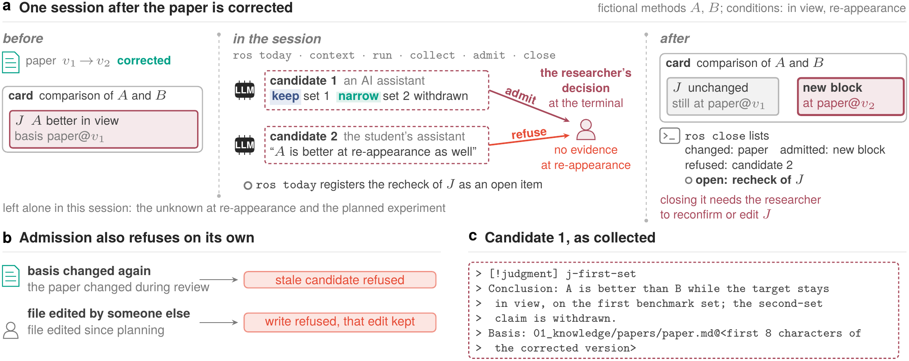
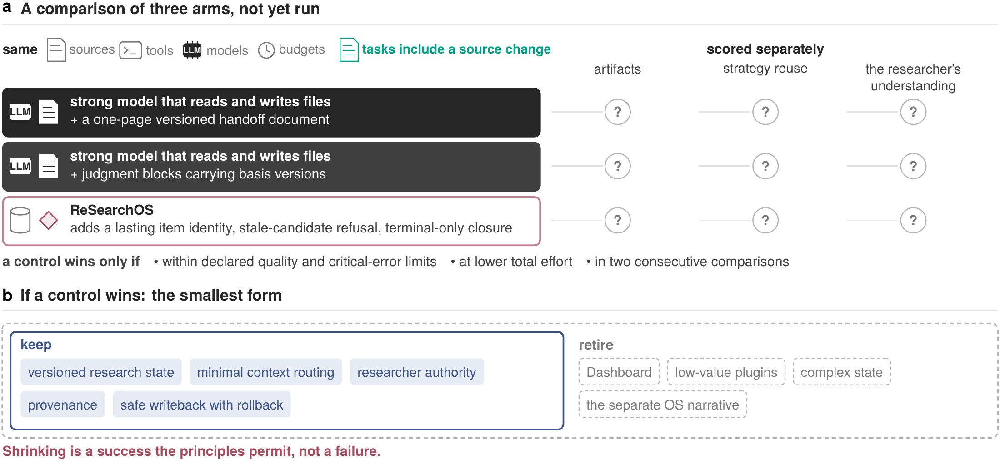
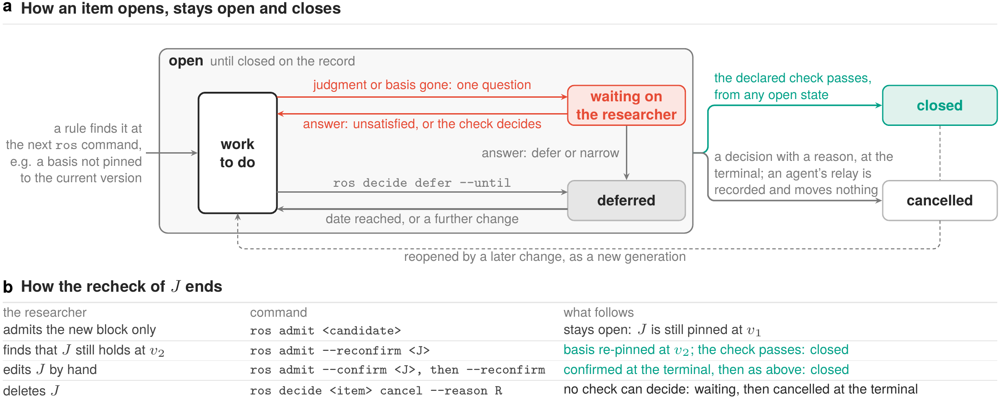

[中文](technical-report.zh.md)

# ReSearchOS: A Reference Architecture for Sustained Human–AI Research

Shiyu Hu[^author-note] · Technical report · 10 November 2026 · Not peer reviewed

School of Physical and Mathematical Sciences, Nanyang Technological University, Singapore

[shiyu.hu@ntu.edu.sg](mailto:shiyu.hu@ntu.edu.sg)

> As execution becomes easier to delegate, researchers must decide what is worth asking, what is sufficient evidence, and what is worth retaining.

## Abstract

Research with AI assistants over weeks or months builds on earlier judgments whose sources can change: a paper is corrected, a dataset replaced. Without a record, nothing shows which conclusions rest on the changed source. A correction may leave part of a judgment standing, part needing revision and part undecided; telling these apart is a judgment of evidence that a system should not work out on its own. ReSearchOS records, with each judgment, which version of which source it rests on and the scope in which it holds. When a source file changes, it follows these records to the related judgments and hands them back, and the researcher decides whether to keep, narrow or withdraw them. A conclusion written by an AI assistant stays a draft until the researcher agrees to put it in the records. This report gives the record format and rules, a command-line prototype and a comparison with neighboring tools. It describes a first stage (one researcher, records in files on the researcher's own computer, decisions at the terminal), within which the example of Section 2 runs from start to finish; Section 5 sets out the scope. A downloadable version follows the same steps, with the final write made and confirmed by the user (Section 2). The author is the prototype's only user so far and no study of use has been run, so the report claims no research benefit.

**Keywords:** human–AI collaboration; source change; judgment recheck; research records; admission; reference architecture.

## 1. After a source changes

Suppose a researcher is comparing two methods for visual object tracking, that is, for following one target through a video. The researcher reads a paper, concludes that method $A$ is better than method $B$ and writes “use $A$” in the notes. The paper compares the two methods on two benchmark sets, both with the target in view throughout; it does not test the case in which the target leaves the view and later comes back. Weeks later the paper is corrected: the numbers for the second benchmark set were wrong, and with the right numbers $A$'s advantage on that set disappears. No record shows which conclusions rest on the paper. The same week the researcher's student asks an AI assistant to read the corrected paper, and the assistant concludes that $A$ is also better after the target comes back, which is exactly the case the paper never tested. Whoever continues from “use $A$” after this has nothing else to go on.

Coming back to this comparison weeks later, the researcher needs five things rather than the files themselves: the question being answered, the evidence used and how it fits together, the judgment accepted and its scope, the conditions still open (including conflicts and the cases in which a judgment does not apply), and the step planned next. In the example these are the choice between $A$ and $B$, the paper's two benchmark sets, the judgment “use $A$”, the unknown when the target re-appears, and the experiment on that case. Of the five, the judgment is the hardest to maintain: the evidence for it lies outside it, and when a source changes, the words of the judgment do not.

This example contains two problems, and the report deals only with the second. The first is recording: the reason for a judgment, if it is not written down, tends to be lost when the conversation ends. Fuller notes can solve this, and it calls for no new system. The second is maintenance: even when the reason has been written down, after a source changes someone still has to find out which judgments are affected and decide what to do with the affected parts.

Existing tools treat maintenance in roughly two ways. One is to recompute on their own: a build system in software engineering regenerates its results when a source file changes, and a truth maintenance system in artificial intelligence rewrites its conclusions when a premise changes. The other is to do nothing: note-taking tools and the memory features of most AI assistants leave a note as it was until someone remembers to edit it. Some tools already hand changes back to people, such as requirements tracing and continually updated systematic reviews (living reviews), but what they hand back is a link or a whole review (Section 6). The first two practices do not suit a research judgment (Figure 1). In the example above, part of “$A$ is better than $B$” still stands, because the first benchmark set was not wrong; part of it has to change, because the advantage on the second set has gone; and the case in which the target re-appears, which the paper never tested, remains undecided and can only wait for the planned experiment. This is a judgment of evidence: an AI assistant may propose it, and accepting it is the researcher's responsibility, so it should not be recomputed the way a build system recomputes. Which judgments depend on this paper, however, can be recorded when they are written, so a changed source need not wait until someone happens to remember it.


The practice this report argues for lies between the two: the system follows the recorded dependencies, finds the related judgments and hands them back to the researcher to look at again; the researcher decides whether to keep, narrow or withdraw them, and only that decision is written into the records. One such matter waiting for the researcher's second look is called a recheck below. This requires three conditions. First, a judgment has to be written with its basis and scope in the researcher's own files, the basis being the source it cites and the version of that source at the time; otherwise the system has no dependency to follow. Second, a conclusion written by an AI assistant or in another conversation counts only as a draft, called a candidate below, and enters the records only after the researcher agrees, a step called admission; otherwise the unsupported claim from the student's assistant could change the conclusion directly. Third, once a recheck is registered it stays, and closes in only two ways: the researcher makes an explicit decision, or a check the system can verify by itself passes (for example, the judgment's basis has been updated to the source's current version). Otherwise a recheck nobody has looked at quietly disappears. Section 2 shows what these three conditions look like in one piece of work, and Sections 3 and 4 give their reasons and definitions.

It helps to say here what the system does and does not do. It does not watch journals for the researcher, and it receives no notice of corrections or retractions. Once the researcher knows that a paper has been corrected and updates the note on that paper, personally or through an assistant, the system takes over from there: it tells the researcher which judgments rest on that paper and need another look. Whether to keep, narrow or withdraw them is still the researcher's decision.

**ReSearchOS** is a research environment built on this practice, owned by the researcher and kept mainly in local files.[^name] The report makes three contributions: the record format and admission protocol for judgments, a command-line prototype, and a class-by-class comparison with neighboring systems. Readers can download a version and try it on their own material, and Section 2 says how to start. The definitions of Section 4 are a design specification; the prototype implements part of it, and Section 5 sets out its scope in one place. The report is meant for researchers who already check sources and return to the same project after days or weeks; how novices would learn with it, and how a team would settle disagreements in it, need separate study. Whether this practice does better than a simpler one (a one-page handoff document plus a strong model that reads and writes files directly) has not yet been compared, and Section 7 says how it will be tested.

## 2. One session

This section keeps the example of Section 1 and walks through the session after the correction from the researcher's side: what the researcher sees, what the researcher decides, and what the system records. A session is the stretch from the researcher starting work to stopping. The methods $A$ and $B$ are fictional, and no real method's performance is reported. Written out in full, the judgment $J$ is “$A$ is better than $B$ while the target stays in view”. Figure 2 draws the session, and Table 1 lists the six commands it uses; they are typed at a terminal (the window where text commands are entered on a computer), and what appears on screen uses this report's words.

**Getting started.** Readers can download a version and try it on their own computer; this paragraph follows the README of the downloadable version v1.1.0. Two things are needed: Python 3.10 or newer, and an AI assistant. This report uses AI assistant for any assistant a researcher talks to; one that can read and write files and run commands directly on the computer is called an Agent below (Claude Code or Codex, for example); AI model means the model behind these assistants. The easiest route is the guided one, which takes an Agent: the user sends it one sentence asking it to install the downloadable version and to follow the first-run instructions it contains. It first shows on a fictional example what the system does, then sets up the user's own cards from the user's publication list, a few papers, collaborators and one current project, and shows the list of cards before writing them. A card is a Markdown note on one paper, project or collaborator. The README gives fifteen to thirty minutes for this, and also a do-it-yourself route of about ten minutes in which the user types the commands at a terminal, starting from a demonstration on a fictional example.

The downloadable version takes the steps of the session below as they are: it notices a changed source, hands the related judgments back, prepares the task for the assistant, takes the answer back as a candidate, and lists at the end what is left. It differs at the step that writes the records: admission and reconfirmation only show the suggested change, the user or the user's assistant writes it into the card, and the user then confirms it at the terminal; a refusal is not recorded either, so candidates are listed as undecided at the close. In other words, the downloadable version by default admits nothing; it does not edit the user's cards. The same steps also work without an Agent: the user types the commands of Section 3 of the user manual at a terminal on macOS or Linux (Windows needs WSL first); the system writes the task for the assistant as a piece of text, called a task packet, which can be pasted into any assistant, including ChatGPT or Claude in the browser; the answer is saved to a file and handed back with `ros collect … --file`. Only the guided installation needs an Agent. The user's cards are kept on the user's computer in the folder `personal_vault/`, which git ignores and does not upload with the repository; a card is a Markdown file that opens with a short block of fields, and the templates supplied give the format. Raw materials such as paper PDFs and data can stay where they are, outside the repository, with their paths recorded on cards; the system compares the cards, so when a file elsewhere changes, the matching card has to be updated first. The cards are plain Markdown files that a Markdown editor such as Obsidian can open; a judgment block edited by hand is registered at the next `ros` command as an item for the user to confirm at the terminal. Files the assistant reads are sent to the assistant's provider for processing. Other work done with an Agent continues as before, and only judgments that come back through `ros collect` or are registered with `ros propose` enter the candidate path. The example below is told for the prototype the author uses: there the system writes once the researcher has confirmed at the terminal; the prototype runs on the author's own records and is not distributed. Appendix B.4 describes how the downloadable version runs and its shipped configuration.

The session is possible because of one thing the researcher did earlier: $J$ was written on a card, and its entry into the records was confirmed. On the card, $J$ is a judgment block, a labeled passage of judgment whose basis line names the source it cites and its version, here version $v_1$ of the paper; below, the basis is said to be pinned at $v_1$. The system looks for dependencies only from such blocks and infers none from ordinary notes. The paper is then corrected to $v_2$: the numbers of the second set change and the first set does not. Having learned of this, the researcher, personally or through an Agent, updates the note file that records the paper, `01_knowledge/papers/paper.md`, and the system takes over from there.



The researcher starts work with `ros today`. As the first `ros` command after the correction, it sees that the content of the paper's note has changed and lists a recheck under the heading for things to decide: the paper $J$ rests on has a new version, and the researcher needs to look at $J$ again. A recheck is a piece of work the system registers, and such pieces of work are called items below. However many more times the paper changes, it remains the same recheck with its versions updated; it is not registered twice, and it does not disappear when a conversation is closed. At this point the system asks no question and does not judge whether the correction matters, since it may have fixed only a typo and left the judgment standing.

Next the researcher asks an AI assistant to reread the corrected paper. `ros context` lists the sources this work may use and the current records, and leaves a receipt of what was delivered; `ros run` writes a task packet for the card that carries $J$, a Markdown text holding the task and those materials, which the user pastes into the assistant of the user's choice, and this step calls no AI service. The packet holds only the card, and the user supplies the corrected paper. When the assistant has written a draft, `ros collect` reads it back as a candidate. Only the one to three judgment blocks in the draft are read, and everything else is ignored:

```
> [!judgment] j-first-set
> Conclusion: A is better than B while the target stays in view, on the first benchmark set; the second-set claim is withdrawn.
> Basis: 01_knowledge/papers/paper.md@<first 8 characters of the corrected version>
```

In the basis line, what follows `@` identifies the version; the system computes it from the file's content, and its first 8 characters are enough. This candidate pins its basis at $v_2$. Because the system records a basis per file, it cannot see the split between the first and second sets inside the paper, so “the second-set claim is withdrawn” is something the candidate states and the researcher judges, not something the system computes. Appendix B.4 gives the detailed checks made at collection.

After reviewing the candidate above, the researcher runs `ros admit` and confirms at the terminal; the system writes it as a new judgment block beside $J$, and the admission is recorded as the researcher's decision. In the same session a candidate from the student's AI assistant, “$A$ is also better after the target re-appears”, is collected as well, with its basis likewise at $v_2$. The paper reports no result for this case, and the researcher refuses the candidate at the terminal; the refusal is recorded, and nothing is written to any judgment. If the paper changes again during review, the system refuses the candidate and asks for it to be proposed again on the current material; a refusal the system makes in this way is never a scientific judgment (Appendix B.4).

<!-- table: The six commands of one session: what the researcher does and what the system records -->
| Command | What the researcher sees and decides | What the system records |
| --- | --- | --- |
| `ros today` | At the start of work, sees the things to decide, among them judgments to recheck after a source change | Observes changed source files and registers recheck items |
| `ros context` | Receives the sources this work is permitted to use and the current records | A receipt of what was delivered |
| `ros run` | Receives a task packet to paste into the assistant of the user's choice | The packet; this step calls no AI service |
| `ros collect` | Hands the assistant's draft back | The judgment blocks in the draft become a candidate, with its basis pinned to a version |
| `ros admit` | Decides whether the candidate enters the records, and confirms at the terminal | The admitted block and its receipt; a stale basis is refused |
| `ros close` | At the end of work, sees changes, admissions, refusals, undecided candidates and open items | The session's outcome and remaining work |

The session ends with `ros close`, which lists what changed during the session, the admissions, the refusals, the undecided candidates and the items still open. The recheck of $J$ is still open at this point, because admitting the new block does not change $J$: the basis of $J$ is still pinned at $v_1$, the narrowed new block and the original stand side by side, and $J$ itself is left for the researcher. There are three ways for it to end. If the researcher holds that $J$ still stands under $v_2$, a reconfirmation re-pins the basis at $v_2$ and the recheck closes. If $J$ has to change, the researcher writes the new judgment and then deals with the original $J$ (Section 4). If the researcher prefers to leave it for now, the recheck can be cancelled at the terminal with a reason; such a cancellation covers only the current versions, so the recheck reopens when $J$ or its basis changes again. All of these decisions are made at the terminal, which is how the system comes to record them as the researcher's; Section 5 says how they are recorded when an Agent runs the commands instead.

The downloadable version also has an optional graphical interface, the Dashboard, which sets out one entry's research records on a page in the browser: its progress, its judgments, boundaries and sources, and its next step (Figure 3). It can also turn an entry into a handoff text for the user to copy to an assistant (Figure 4). As shipped, this interface is for viewing and copying: it cannot save an entry's lifecycle, and the handoff packet can only be previewed and copied. The two screenshots show how it presents an entry; they do not show task completion, accepted judgment or usability. A user who wants to use the Dashboard on personal cards can start the downloadable version in its personal-vault mode: this mode builds a local Dashboard view from the cards in `personal_vault/` and, after the user confirms, writes Dashboard changes into that folder; if configured, it can also start a locally installed Codex CLI. The `ros` commands do not change in that mode.

![**The Research desk of the downloadable version reconstructs an entry's research records on one page for the researcher to read.** Opened on the fictional entry Evaluation Pilot Decision; captured on 29 October 2026 from a fresh clone of the downloadable version at the commit prepared for release v1.0.0 (Appendix B.3), not retouched; the interface is unchanged at v1.1.0 apart from dates in the fictional data. The right panel holds the progress record, the judgments, boundaries and source, and the next step with its acceptance criterion. As shipped, this view does not save changes.](figures/architecture/researchos-r11-dashboard-en.png)


## 3. What the environment must preserve

Section 2 left the decision about $J$ with the researcher. For that decision to stay there weeks later, and after AI models and clients have been replaced, the environment has to preserve three things: the authority to decide, the records, and the history of claims that were corrected. Three principles correspond to these three things. Where efficiency, control and retention pull against each other, the principles set priorities; they do not prescribe uniform directories, methods, interfaces or review arrangements. Because research records take time to read and effort to maintain, and review can interrupt work or harden into habit, inspection is concentrated on the transitions that matter, and routine work goes on within the scope already agreed.

The first principle is that only the researcher turns a candidate into a record. The student's AI assistant proposes that $A$ is also better after the target re-appears; written into the records without the researcher's decision, this claim would extend $J$ to cases the paper does not support. The output of AI models and of other sessions therefore always starts as a candidate, and the researcher decides whether to admit it (Section 4). Admission settles who accepted a candidate, not whether the candidate is correct, which is left to later checks, because the researcher's agreement does not prove a scientific judgment right. Section 5 says how far the prototype carries this principle out.

The second principle is that records outlast the tools that wrote them. If $J$ and its basis existed only in the conversation that produced them, nothing would show that a later correction of the paper touched $J$. Authority therefore rests with the researcher's local, readable, versionable records, while AI models, clients and plugins can be replaced. In the prototype, $J$ is written on a card, its basis is pinned to a version of the source, and context is delivered with a receipt (Section 2). By the same reasoning, an interface that shows "done" does not mean accepted, and a copy a tool keeps temporarily for speed does not become a second record. Nor is retention the same as retrieval: a record has to be kept with its scope, so that later work can tell whether it still applies.

The third principle is that correction narrows a claim and does not erase history. The correction touches only the second benchmark set; deleting $J$ would erase both the evidence from the first set, which the correction did not touch, and the record that the claim on the second set was once accepted. Failures, unknowns and unverified states therefore remain as they are, and what was changed, why it was changed and what is still useful are kept as well. In the session of Section 2, the narrowed judgment is admitted beside $J$, and the recheck of $J$ closes only once the researcher deals with $J$ itself (Section 4).

The three principles come from the author's own design history; this section summarizes the author's internal design documents and has been checked against them. Table 2 gives each principle's question, commitment and mechanism, [Supplementary Note 1](technical-report-supplement.en.md#supplementary-note-1-principle-sources-and-examples) gives the examples and sources behind each, together with one further principle left out of this section because it has no command and no test yet, and [Supplementary Note 3](technical-report-supplement.en.md#supplementary-note-3-process-and-component-contracts) restates the provisions in full with their owners.

<!-- table: The three design principles and their mechanisms -->
| Principle | Question it answers | Commitment | Mechanism |
| --- | --- | --- | --- |
| Human judgment | Who accepts a judgment? | Only the researcher decides what enters the records; machine output always starts as a candidate | Candidate, decision, change, check and receipt recorded separately; the researcher's decision is recorded only at the terminal |
| Records that outlast tools | What survives tool replacement? | Local, readable, versionable records remain authoritative; AI models, clients and plugins can be replaced | Records owned by the researcher, context receipts, and a basis pinned to a source version |
| Correctable accumulation | Which judgments must change after correction? | Correction narrows affected claims without erasing history; failures, unknowns and unverified states remain visible | A narrowed judgment block beside the original, a receipt left when a write is undone, and items that stay open across sessions |

## 4. Touch, recheck and closure

The principles of Section 3 say what must be preserved but not what counts as preserving it. This section gives definitions that make them checkable. It stays with the example of Section 1 and with four words: judgment, basis, candidate and recheck. The other objects and states are described in ordinary words and listed in Appendix A. The definitions are a design specification: they say what the system should do, and [Supplementary Note 5](technical-report-supplement.en.md#supplementary-note-5-formal-specification) states each one precisely; Section 5 says in one place how far the prototype implements them.

Section 1 said that a researcher returning to a piece of work weeks later needs five things: the question, the evidence, the judgment, the open conditions and the next step. **Research state** is these five, reconstructed from the researcher's records. Because it is a reconstruction rather than a summary, each part can be traced back to the records, checked and corrected; how much it holds depends on what the question needs, not on how much material exists.

Of the five, the **judgment**, a conclusion the researcher has accepted together with the scope in which it holds, is the hardest to maintain, because the evidence for it lies outside it: when a source changes, the words of the judgment do not. A judgment is therefore written as a judgment block that records its **basis**, the source it cites and the version of that source; the basis of $J$ is pinned to $v_1$ of the paper. Everything below rests on this record. Whether a judgment holds cannot be derived mechanically from its sources, so the system cannot compute it; and the system can find the judgments that depend on a source only because that dependency was written down.

The first question, then, is which judgments a change involves. Once the paper is corrected from $v_1$ to $v_2$, the version pinned by $J$ is no longer the paper's current version. The change is then said to touch $J$, and the system registers a **recheck** of it, the item that asks whether $J$ still stands. If the paper changes again, the same recheck is involved and no second one appears. Touch follows recorded dependencies only: the experiment on re-appearance does not cite this paper as its basis, so it is not touched (Figure 5). Touch therefore marks what to inspect, not what to edit. Had the correction fixed only a typo, $J$ would still be touched with nothing to change.


The second question is what ends a recheck. Once registered, a recheck stays open, and two things alone can close it: all its checks pass, or the researcher makes an explicit decision. This is why it does not disappear when a conversation ends. The recheck of $J$ has to answer whether $J$ still holds under $v_2$, and only the researcher can judge that; there are three ways for it to end. If $J$ still holds, the researcher reconfirms it (`ros admit --reconfirm`), which pins the basis to $v_2$; the check on the basis then passes and the recheck closes. If $J$ has to be narrowed, the researcher admits a new block pinned to $v_2$ beside it, as in Section 2, and then deals with $J$ itself: either by editing it by hand and confirming the edit afterwards at the terminal (`ros admit --confirm`), or by deleting it, in which case the system puts one question with a fixed set of options to the researcher and the recheck waits for the answer. If the researcher prefers to leave $J$ for now, the recheck can be cancelled at the terminal with a reason (`ros decide … cancel`) or postponed to a date; a recheck that is postponed, or that waits for an answer, is still open, and `ros close` lists it (Appendix A). None of these closures is permanent: when the paper changes again, the same recheck reopens. The strength of the check should be stated plainly: its passing shows that the basis is pinned to the current version, not that anyone read the correction.

The third question is how new content enters the records. Three parties act on research state (Figure 6): the environment selects context from the history it may use, reconstructs research state and presents it with any candidate; an AI model proposes an output and a change; and the researcher decides what happens next. What the AI model proposes is a **candidate**, an output not yet in the records. By the specification a candidate enters the researcher's records only through admission, which has three conditions. The first is the researcher's decision, which neither an AI model's output nor the candidate's own text can stand in for. The other two are not decisions but checks made at write time: the basis must still be the source's current version, and the write must actually complete and leave a receipt (the formal version in Supplementary Note 5 divides these three conditions into five, and Appendix B.4 gives the refusals at write time). Admission settles only the operational decision: the researcher's acceptance does not make a judgment scientifically true, and passing software checks establishes neither what the researcher accepted nor that the judgment is valid.


## 5. The prototype

The session of Section 2 ran on a command-line prototype that implements part of the specification of Section 4. This section says first what the prototype does, then through which channels a card can be written and how the code is built, and last, in one place, the scope within which the prototype applies; the qualifications that other sections point to are all under “Scope” below. Appendix B.3 gives the versions described, and [Supplementary Note 2](technical-report-supplement.en.md#supplementary-note-2-session-operations-and-implementation-mappings) holds the commands and record tables behind them.

The prototype does three things, and each of them is exercised by automated tests on fictional data (Appendix B.4). First, it notices a changed source. Detection starts from the judgment blocks and bases the researcher wrote. Most `ros` commands compare once as they start, so a changed source file is found at the next such command and registered as an item, which stays the same item if the source changes again.

Second, a judgment stays tied to its sources on its way into the records. Facts and judgments take different routes (Figure 7a): a fact may be updated directly within the task the user has already approved, while a judgment passes through candidate, decision, write, check and receipt, each recorded separately. When a candidate is registered, every basis it rests on is fixed at its version at that moment, and if a basis changes during review, admission refuses the candidate and asks for a new proposal. The write is checked in the same way: if the file's content has changed since the write was planned, the system refuses to write and the intervening edits are kept.

Third, an explicit decision about an item is accepted only at the terminal. An item closes only by a passing check or an explicit decision, and decisions such as cancelling or confirming take effect only when typed there; the same decision relayed by an Agent leaves the item open. A judgment block written directly, without admission, is registered as an item at the next `ros` command and waits for the researcher to confirm it afterwards, which also takes effect only at the terminal, so a judgment written directly does not sit in the records unnoticed.


### Three channels

Three channels can write the same card, and the researcher's decision is recorded at only one (Figure 7b). A decision the researcher makes at the terminal is recorded as the researcher's decision. When an Agent runs these commands for the researcher, no confirmation prompt appears; an admission or a reconfirmation still writes, and a reconfirmation also makes the check pass and closes the recheck, but they are recorded only as the Agent's action, not as the researcher's decision. Writes from the Dashboard do not go through admission. For an Agent, then, these records are attribution and a trail that can be checked afterwards, rather than a block. Appendix B.4 gives the details of each channel.

### How it is built, and where it applies

The difference between the channels comes from how the code is built today (Figure 8). The researcher's records are local Markdown cards. The part that computes, called the kernel (the kernel package `researchos_kernel` in the code), does not read a card directly: it receives a snapshot of the cards, computes changes, items and checks from it, and writes only its own ledger; a write to a card is staged first, reaches the file only after a check, and leaves a receipt. The terminal and an Agent run the same command-line entry, `scripts/ros.py`. The code differs in two places from the target design: admission is still carried out by `ros.py` rather than in the kernel; and the Dashboard is served by a separate local service whose writes do not pass through `ros.py`, so the protections above do not apply to them. Appendix B.4 gives the names and details of the parts.

![**The kernel package computes only from snapshots, while admission stays in `ros.py` and Dashboard writes bypass it.** The figure shows today's code, not the target division; Appendix B.4 says what each layer does. The shaded label at admission and the dashed path from the Dashboard mark the two places where the code departs from the target division of Supplementary Note 2: admission is still carried out by `ros.py` rather than the kernel package, and Dashboard writes bypass it. The label at the Agent sessions notes that an admission run by an Agent still writes without being recorded as the researcher's decision.](figures/architecture/researchos-r12-architecture-en.png)

**Scope.** The scope of the first stage, which is also the scope within which the prototype applies, is one researcher, whose records are local Markdown files and whose decisions are made at the researcher's own terminal. Within this scope there are five things to know. (1) It works only from judgment blocks. Every dependency comes from records the researcher has written as blocks with a basis, and the system infers nothing from conclusions in ordinary notes; without blocks, `ros today` finds no judgment to recheck. It reads only Markdown files under the directories listed in its configuration, so a change to the paper's PDF itself goes unseen. (2) It works per file, not per argument. A basis is a file and its content digest (an identifier computed from the content), and the check asks only whether the basis is pinned to the current version, so it cannot see which part of the file a correction touched; a passing check shows that the basis is pinned to the current version, not that anyone read the correction. Whether the first-set result still supports $J$ is the researcher's to judge, as the definitions require, and the prototype has no semantic support check that could inform that judgment (Supplementary Note 6); replacing or withdrawing $J$ is also done by hand. What comes back is therefore a whole judgment, not the part of it that was touched; returning only the touched part is so far design. (3) It works when a command runs. There is no file watcher and no background process, a change is seen only at the next `ros` command, and it does not propagate across several hops. It does not search for new studies and receives no notice of corrections or retractions: a new study that changes no recorded input goes unnoticed, and no reader other than the researcher is shown that a judgment awaits a recheck. (4) Only a confirmation at the terminal is recorded as the researcher's decision. An admission or reconfirmation run by an Agent still writes, and writes from the Dashboard do not go through admission (previous subsection). (5) Stated conditions and planned experiments are not registered; they are only text on the card, and `ros close` lists neither. The downloadable version by default admits nothing: the user makes the write and confirms it at the terminal (“Getting started” in Section 2).

The first stage also leaves out a few paths of the specification. By the specification a recheck waits on a question to the researcher (Supplementary Note 5); in the first stage the system asks only when the subject of the recheck no longer exists, as when $J$ is deleted. A deferral the researcher confirms at the terminal takes effect, but no mechanism yet produces a deferral from an out-of-scope dependency. A change after `ros admit` starts and before the terminal answer is not refused: the block lands on the old version and the same command registers a recheck. Versions are identified by content digest alone, so a return to earlier content counts as the earlier version and resolves the recheck. The built-in checks protect only the shipped write paths; they do not verify, rule by rule, what a rule requires to stay unchanged. Cross-client integration remains unverified. Appendices B.1 and B.4 give the details of these paths.

Section 4, with Supplementary Note 5, is the specification; the current code supplies selected executable paths, and what is and is not done is recorded entry by entry rather than inferred from test counts. Table 3 groups the most important entries by theme and says what each group means for a user of the prototype, and [Supplementary Note 6](technical-report-supplement.en.md#supplementary-note-6-scope-of-the-first-stage) gives the full list; the entry numbers in Table 3 and in the appendices are those of that note. These entries bound what the implementation can claim and leave the definitions unchanged.

<!-- table: The scope of the first stage, by theme -->
| Theme | Entries (numbers in Supplementary Note 6) | What it means for a user of the prototype |
| --- | --- | --- |
| Admission and writeback | 1, 2, 9 | Agent-executed admissions and reconfirmations and Dashboard writes are recorded but not blocked; the built-in checks protect only the shipped write paths and do not verify, rule by rule, what a rule requires to stay unchanged. |
| Sessions and completion | 15, 17, 18 | The scope and rules fixed when a session starts are incomplete, and an out-of-scope dependency produces no deferral; even when no item was resolved, a session whose remaining items all wait on the researcher or are deferred still closes as complete, with those items listed, because the separate outcome the specification gives this case is not implemented (Appendix B.2). |
| Dependencies and maintenance | 3, 10, 11, 12, 34 | The single stable kernel remains a target because `ros.py` still carries out admission. General checks across successive steps, protection of independently supported parts during a correction, registration of stated conditions and planned experiments, file watching and propagation across several hops remain specified only. |
| Acceptance and benefit | 13, 14 | Human acceptance of the interface, isolation of real models, long-run recovery and research benefit are unverified. |

The automated tests mentioned above answer questions of execution. Other questions need another kind of evidence: whether the narrowed judgment is right, whether the experiment is worth running and whether the researcher understood more. These need actual tasks and independent evidence, and software checks establish neither acceptance nor scientific validity; nor does this report assume that the researcher's understanding benefits. The author is the prototype's only user so far, as well as its developer and the evaluator of every result. No study of use has been run, and the prototype has not been compared with the simpler practice (a one-page handoff document plus a strong model, Section 7), so this report claims no research benefit.

## 6. Neighboring systems

This section places the practice among the tools researchers already use: first what it shares with them, then where it differs. The paper of Section 1 is corrected once in each class of tool, and Table 4 records what happens next. A row describes the mechanisms that the named or typical systems of a class report, not every system in it, and it says nothing about integration or performance. ReSearchOS takes two rows, because a specification cannot be compared with other people's implementations: "prototype" is what the code of Section 5 does, and "design" is what Section 4 and [Supplementary Note 5](technical-report-supplement.en.md#supplementary-note-5-formal-specification) specify.

Handing a change back to a person is older than this report, and some tools also follow a change to the claims that depend on it. A familiar example for researchers is the living systematic review: under Cochrane's guidance it searches for new evidence every month, and its authors judge whether new studies are likely to have an important impact on the findings [Cochrane living systematic reviews](https://resources.cochrane.org/sites/resources.cochrane.org/files/uploads/inline-files/Transform/201912_LSR_Revised_Guidance.pdf); in June 2026 Cochrane also announced that it is matching retracted studies to the reviews that include them and will add editorial notes while authors assess the impact [Cochrane retracted publications](https://www.cochrane.org/about-us/news/cochrane-strengthens-systems-manage-retracted-publications-its-published-reviews). Software engineering has the same practice: requirements tools such as IBM Engineering Lifecycle Management mark a trace link suspect when the content at either end changes, and a team member then marks it valid or invalid [Link validity](https://www.ibm.com/docs/en/engineering-lifecycle-management-suite/lifecycle-management/7.0.3?topic=management-link-validity); a protected branch on GitHub can require a new approval once new commits change an approved change [Protected branches](https://docs.github.com/en/repositories/configuring-branches-and-merges-in-your-repository/managing-protected-branches/about-protected-branches). Closer to a single claim, a ledger of the quantitative claims in one paper flags a claim as stale when the fingerprint of its data changes [Provable discourse](https://arxiv.org/abs/2603.10450). The nearest mechanism this report found to the touch of Section 4 is Zhang's provenance layer for a wiki maintained by a language model in regulated settings [Provenance-native wiki](https://doi.org/10.53941/aiet.2026.100010). It binds claims to evidence passages, and when a source is marked retracted, superseded or downgraded it follows those links to the dependent claims, rules and decisions; the system marks a claim disputed or suspended by rule and threshold and flags the decisions downstream (Supplementary Note 4).

Two of these do what ReSearchOS does not. Living reviews search for new studies, show readers that a conclusion awaits an update, and have an author team and an editorial process; ReSearchOS does not search for new studies and shows no reader other than the researcher that a judgment awaits a recheck (Section 1; scope (3) in Section 5), and the practice proposed here does not replace living reviews. The provenance layer travels the whole chain and reports a controlled evaluation, five simulated retractions on a 112-document corpus that reached every affected record. The prototype goes one step along recorded dependencies and has no such evaluation yet.

Other classes settle the change themselves or leave it alone (Figure 9). A note tool leaves the note as it was until the researcher edits it, by hand or through an assistant. Version control refuses a stale write by optimistic concurrency control [Optimistic concurrency control](https://doi.org/10.1145/319566.319567), the mechanism behind the prototype's refusal of a changed file, but version control does not distinguish a fact from a judgment. A truth maintenance system [Truth maintenance system](https://doi.org/10.1016/0004-3702%2879%2990008-0) relabels beliefs along recorded justifications by itself: with the two benchmark sets drawn as separate justifications, $J$ stays in through the first (Figure 9c), where ReSearchOS only reports that a basis is no longer the current version and leaves to the researcher whether the judgment still holds. A build system [Build systems à la carte](https://doi.org/10.1145/3236774) rebuilds the results a changed input invalidates. In agent memory, Graphiti [Zep](https://arxiv.org/abs/2501.13956) invalidates a contradicted fact and PACMI [PACMI](https://arxiv.org/abs/2610.05732) marks memories that depend on changed evidence as needing verification, in both cases without asking a person; GovMem [GovMem](https://arxiv.org/abs/2607.02579) routes a doubtful candidate memory to human review, but only before it is written. AI-scientist papers report no step triggered by a corrected source.


Where ReSearchOS differs is in what is handed back and who settles it. In the tools above, what stays open is a link, a pending change, a whole review or a whole claim. The provenance layer sets the status of a whole claim by rule and threshold, and its paper describes no scope on a claim and no question to a person about which part still stands. Approval or confirmation by the researcher has precedents too, but not for a judgment that comes back: OmniScientist [OmniScientist](https://arxiv.org/abs/2511.16931) records a human's approval of an artifact with its version, and what is approved is the artifact, not a judgment that comes back after a source change; Magnolia [Magnolia](https://arxiv.org/abs/2610.27230) enables cross-project rules only after a researcher confirms each one, and ResearchLoop [ResearchLoop](https://arxiv.org/abs/2605.28282) admits a claim only within the scope approved by a gate written by the researcher or a prespecified protocol file; neither of these two papers describes returning an admitted result to the researcher when a source later changes.

No system this report examined does three things together: keep the judgments a researcher admitted with their basis versions, return a judgment to the researcher as an item when a source changes, and change that record only through candidates the researcher admits. The ReSearchOS prototype does the first two; the third holds only for confirmations at the terminal and, so far, only for new judgments, while an existing judgment is still edited or re-pinned by the researcher (scope (2) and (4) in Section 5).

<!-- table: After the paper is corrected: what neighboring systems keep, what happens and what stays open -->
| System class | Keeps | What happens when a source changes | What stays open |
| --- | --- | --- | --- |
| Personal knowledge bases and note tools | Notes and links | Nothing; the researcher edits, by hand or through an assistant | Nothing; an open question is a note |
| Version control with optimistic concurrency | Every version; refuses a stale write | Merges, or reports a conflict | Branches, without saying what they mean |
| Truth maintenance systems (JTMS, LTMS, ATMS) | Conclusions with their justifications | Relabels along justifications on its own; a conclusion with another valid justification stays in | Unknown labels (LTMS) or several consistent contexts at once (ATMS), maintained by the system, not put to the researcher |
| Retraction services and claim ledgers | Reviews and their studies, or claims with a fingerprint of their evidence or bound to evidence passages | Flags a retracted study, marks a claim stale when its data change, or marks claims disputed by threshold, suspends them when no support remains and flags the decisions downstream | A whole review, to which Cochrane announced it will add an editorial note, a whole claim until its author updates it, or a whole claim the system suspends; nothing scoped, no candidate to admit |
| Build systems and scientific workflows | Keys, values and their inputs | Rebuilds what the change invalidates | Nothing; the human is outside the loop |
| Research knowledge graphs and experiment trackers | Comparison records, runs and lineage | The record is updated; a judgment built on it is not | Nothing |
| Agent memory (RAG, A-MEM, Mem0, MemOS, Graphiti, PACMI) | Retrieved and compressed context | Overwrites, re-ranks, or invalidates as the agent decides | At most a needs-verification mark set by the system; nothing put to the researcher |
| AI-scientist systems (AI Scientist, Agent Laboratory, Co-Scientist, Kosmos, Denario) | Hypotheses, experiments and artifacts | No reaction to a source change reported; a person may start or steer a run | Nothing kept open |
| ReSearchOS (prototype) | Judgment blocks with basis versions, the basis recorded by file; conditions are text the prototype does not read | Registers one recheck at the next command; only an admitted candidate is written, and the original judgment stays until the researcher acts on it | A recheck of a whole judgment, until its check passes or the researcher decides at the terminal; open conditions and planned experiments are not registered |
| ReSearchOS (design) | Judgments with scope and basis version | Only the touched part, through a candidate the researcher admits | Open conditions, and checks waiting on the researcher |

Figure 10 sets this comparison on two axes: what a source change leaves open, taken from Table 4 and the text above, and who acts on the change. Research knowledge graphs and experiment trackers are not placed, because Table 4 does not say who updates their record. ReSearchOS appears twice: the design sits in the "touched part" column, and the prototype returns a whole judgment, which puts it in the researcher's row under "a whole claim".


[Supplementary Note 4](technical-report-supplement.en.md#supplementary-note-4-research-foundations-in-detail) gives the full synthesis, including the systems passed over here. This comparison shows that the mechanisms differ; whether the difference is useful is the question of Section 7.

## 7. Who it suits, and how to test it

Whether the difference is useful depends first on the work. The design addresses work with three features, those of the example in Section 1: the project runs for weeks or months, so later steps build on earlier judgments; its sources may be corrected or replaced along the way; and someone other than the researcher, a student or an AI assistant, writes conclusions that could enter the records. The prototype's additions come into play only when a source changes or someone else proposes a conclusion, so a short project with fixed sources and a single author of every conclusion is better served by a clear handoff, that is, the state of the work written into a one-page document and given to an assistant. Work with all three features is the case the design is built for. A reader who wants to try it can pick a real project of this kind, ideally one that will run for months and whose sources may be corrected or replaced, and use the downloadable version alongside the handoff the reader already uses. Whether it does better than a one-page handoff document plus a strong model has not yet been compared; that test is the author's next piece of work, described below.

The test is a comparison (Figure 11). Two controls use the same sources, tools, models and effort budgets as the prototype, over enough real research tasks: a strong model that can read and write files, given a one-page versioned handoff document, and the same model given judgment blocks that carry basis versions, written in the researcher's files, without the prototype. The second is the fair control closer to this report's claim, because the recorded dependency is already in the blocks and the model can compare versions and find a stale judgment by itself. The prototype adds only three things beyond it: the persistent identity of the item, the refusal of stale candidates, and closure of a recheck only by a passing check or a decision at the terminal. The tasks must therefore include a source change that has a chance to fall during review and between sessions, or the three never come into play; the four historical requests the author has reconstructed from ninety days of personal records (Supplementary Note 1) involve no source change and cannot stand in for such tasks.



The result of the comparison will decide which parts stay (Figure 11b): additional structure deserves to remain only where it helps researchers notice a source change, revise a judgment and avoid repeated work. The criterion by which a control wins, and what should then shrink, the author has written down in advance, in the paragraph on this comparison under “Four historical requests”, Supplementary Note 1.

The comparison should score three things separately: artifacts, strategy reuse and the researcher's understanding. Output quality alone cannot show what the researcher understands: work on generative AI and learning calls for evaluating effects on cognition and metacognition [GenAI and human learning](https://doi.org/10.1038/s41562-024-02004-5), a meta-analysis found that human–AI combinations on average perform worse than the better of humans or AI alone [Human–AI combinations](https://doi.org/10.1038/s41562-024-02024-1), and feedback-loop experiments found that AI alters human judgment, often without people noticing [Human–AI feedback loops](https://doi.org/10.1038/s41562-024-02077-2). Neither this comparison nor the first study of use, with researchers other than the author, has been run, and nothing in Sections 2–5 presumes their outcome; their results should revise the definitions or the prototype before any value is claimed.

## 8. Conclusion

After a source changes, a research judgment should not be recomputed by the system on its own, because which part still holds is a judgment of evidence: an AI model may propose it, and accepting it is the researcher's responsibility. Nor need it decay: provided the judgment is a block with a pinned version, the sources it depends on are on record. This report therefore argues for handing the change back at the level of a single research judgment: the system follows the recorded dependency to the judgment and hands it back to the researcher as an item to recheck, and the researcher decides to keep, narrow or withdraw it; machine output stays a candidate until the researcher admits it. The prototype implements the first stage of this practice: one researcher, local files, decisions at the terminal. Within that scope, a change to a source file is found at the next command and registered as an item, a candidate whose basis has gone stale is refused, and the explicit decisions to cancel or confirm take effect only at the terminal; readers can download a version and try it on their own material (Section 2). Section 5 sets out the scope in one place, and Table 5 sets each contribution beside the evidence given and what remains to be shown. Long-term benefit is among the latter: the author is the prototype's only user so far, and neither the comparison nor the study of use of Section 7 has been run. Whatever their results, the researcher, not the AI model or another session, should decide which part of a judgment to keep, narrow or withdraw.

<!-- table: Contributions, evidence and what remains -->
| Contribution | Evidence given in this report | What remains to be shown |
| --- | --- | --- |
| Record format for judgments and admission protocol (Sections 3, 4) | The definitions of Section 4; the specification of Supplementary Note 5 and two propositions argued under their stated hypotheses; in Supplementary Note 1, the literature behind each principle and four historical requests, as precedents for where the design needs came from only | Whether they improve understanding and decisions in actual research, since no study of use has been run; neither proposition shows that completion is reachable |
| Command-line prototype (Sections 2, 5) | The fictional example of Section 2 (illustrates mechanism only); kernel regression tests and the CI runs of Appendix B.3. These software checks establish neither acceptance nor validity | Not implemented: dependency by argument, registration of stated conditions and planned experiments, a file watcher, waiting on an out-of-scope dependency, general checks of a later step on an earlier step's result. Unverified: cross-client integration. Away from the terminal the researcher's decision is not enforced (Table 3) |
| Class-by-class comparison with neighboring systems (Section 6) | Table 4 and Figures 9 and 10, which record mechanisms as their sources report them | Integration and performance were not compared; neither comparison of Section 7 has been run; a new study that changes no input is not noticed |

**Availability and ethics.** The reference artifact uses public literature and fictional examples. The four historical requests listed in Supplementary Note 1 were reconstructed from a ninety-day history of the author's own records, which contains messages from collaborators and students and unpublished work. That history was processed only locally, its symbolic projection carries no identifiers, and nothing from it is distributed. Personal and project identifiers, original private documents, unpublished technical details, private records and record graphs are excluded from this report, and this report does not announce a dataset or benchmark release. The current software license is noncommercial source-available, and no claim is made that it is an open-source license approved by the Open Source Initiative (OSI). Artifact access remains subject to repository visibility. Any study with participants requires consent, applicable institutional review, data minimization and withdrawal arrangements, and safety experiments require isolation from real external effects.

**Disclosure.** AI assistance supported source discovery, drafting, translation, figures and typesetting; the author is responsible for the scientific claims and submission metadata. The bibliography includes relevant coauthored studies as methodological sources, without treating their results as validation of ReSearchOS. No participant outcomes or long-term causal benefits are reported.

## Appendix A. Objects and the lifecycle of an item

Section 4 keeps to four words and says the rest in ordinary words; this appendix names every object and state and puts them side by side. Table 6 lists each kind of object, the states it can be in, the condition under which it moves and the party that moves it. The parties are the researcher, the system (the kernel and the commands of Sections 2 and 5) and an AI model, whose output enters only as a candidate. [Supplementary Note 5](technical-report-supplement.en.md#supplementary-note-5-formal-specification) states these definitions precisely and gives version branches, the notation for checks, the conditions for completion and the two propositions.

An **item** is a piece of maintenance work with a stable identity, and the recheck of a judgment is one kind of item: if the source changes again, the same item is involved and no second one appears. Once registered, an item is **open** until it is closed, and an open item has two sub-states. Both keep it in view, and `ros close` lists them, but neither closes it. The first is **waiting on the researcher**: a check cannot be decided, the system puts a question with a fixed set of options to the researcher, and the item waits for the answer. The specification lets any check that only the researcher can settle reach this state, but the shipped rules declare no such check, so in practice the path is reached when the item's subject no longer exists, as when $J$ is deleted, and the researcher then cancels the recheck at the terminal. A question is asked only once per rule version, and `ros today` gathers unanswered questions into one list; both are meant to reduce the load of review, and whether they do has not been tested. The second sub-state is **deferred**: the researcher postpones the item to a date, after which it is work to do again. A deferral confirmed at the terminal is recorded as the researcher's decision; one run by an Agent is not, and the item still counts as unfinished at close.

The output of `ros` uses this report's words: item, open, waiting on your answer, and deferred. The code calls an item an issue, with the states `open`, `deferred`, `waiting`, `resolved` and `cancelled`, the first three being what this report calls open. Waiting on the researcher is, in the code, `waiting` with an `answer:` trigger; deferred is either `deferred`, from `ros decide … defer`, or `waiting` with a date or event, from answering a question.

<!-- table: Objects, states and who changes them -->
| Object | States | Condition | Who changes it |
| --- | --- | --- | --- |
| Version of a source | Current, or superseded | The system compares content digests: once a file's content changes, the older version pinned by a judgment is no longer current; content restored to what it was counts as the earlier version again (Appendix B.1). Version branches and late records in the specification are in Supplementary Note 5 | The system, at the next `ros` command |
| Candidate | Collected and undecided, admitted, or rejected | Admitted only when the researcher decides to accept it, its basis is still current, and the write completes and leaves a receipt. If the basis changed during review the admission is refused as stale and the candidate must be proposed again; if the file changed after the write was planned, the write is refused, not the candidate | `ros collect` or `ros propose` collects it and freezes its basis; the researcher admits or rejects it. An admission run by an Agent still writes and is not recorded as the researcher's decision (entry 1) |
| Judgment | Basis current, or due for recheck; the researcher may keep, narrow or withdraw it | Keep: `ros admit --reconfirm` pins the basis to the current version. Narrow: a new block pinned to the new version is admitted beside the original, which stays due for recheck. Withdraw: the researcher deletes it by hand, and the recheck becomes waiting on the researcher; the prototype keeps no text of a withdrawn judgment, short of the third principle | The system marks it due; the researcher decides. The prototype can neither replace nor withdraw an existing judgment; the researcher edits or deletes it by hand (entry 11). A hand-edited block has no admission receipt, so the system registers a separate item for confirming it afterwards, even when the edit pinned the basis to the current version |
| Item (a piece of maintenance work, such as the recheck of $J$) | Open, resolved or cancelled; waiting on the researcher and deferred are two sub-states of open | Registered when the version a judgment pins is no longer current; its identity comes from the rule, the judgment and the purpose version, and does not change with the source. Resolved when all its checks pass; cancelled by a recorded decision with a reason. A resolved item reopens when its condition recurs, and a cancelled one when what it read changes | The system registers and resolves it; the researcher cancels, defers or answers. Cancellation is accepted only at the terminal |
| Item waiting on the researcher | Awaiting the researcher's answer | A check cannot be decided and only the researcher can settle it. The shipped rules declare no such check, and in practice this state is reached when the item's subject no longer exists, as when $J$ is deleted. If only the basis file is deleted, the item stays open and no question is asked | The researcher answers. Closing the item by cancelling or by establishing satisfaction is accepted only at the terminal, and an Agent's relay changes nothing; the shipped rules do not offer establishing satisfaction |
| Deferred item | Waiting for a date or an event | The researcher postpones it to a date with `ros decide … defer`, or chooses to defer or narrow when answering a question. It is work again once the date comes; after an event, the researcher reopens it with `ros decide … reopen`. The out-of-scope block in the specification is not implemented (entry 17) | The researcher. Only a deferral confirmed at the terminal counts as the researcher's decision; one run by an Agent is not, and the item still counts as unfinished at close |
| Check | Pass, fail, or cannot be decided; a check never evaluated has no result | Pass or fail only from a qualified, currently valid check; cannot be decided when the evidence is missing, stale or in unresolved conflict, and this never counts as a pass. A check with no result is unevaluated work that blocks completion | The system, for a mechanical check; the researcher's decision and reason, for a check that needs human judgment, of which the shipped rules have none |
| Question | Asked, answered or withdrawn | A fixed set of options; asked once per rule version and again only when the rule's version changes (the `ros today` message says "basis version"; it means the rule version); withdrawn if evidence later decides the check, or when the rule's version changes: the new version is asked again while the question budget lasts, and otherwise the work reopens | The system asks; the researcher answers |
| Session | Running; closes as `complete`, `complete_with_held`, `budget_stopped` or `human_stopped` | `ros today` starts it and freezes its scope and rule versions; `ros close` ends it and reads off the outcome. All items closed gives `complete`; only items waiting on the researcher or deferred left gives `complete_with_held`; both require a nonempty frozen scope; the other two depend on whether the budget ran out. The specification's fifth outcome, `deferred`, is not implemented (entry 18), and a session only approximates the unit of work in the specification (entry 15) | The system determines the outcome; the researcher decides when to close |

Of these objects it is the item that carries the maintenance work, and Figure 12 draws its lifecycle. An item is registered or reopened when the version a judgment pins is no longer current; in the specification, a scan can also find an item when work is first set up or a scoped check is rerun (Supplementary Note 5). An item closes only when all its checks pass or when a recorded decision with a reason cancels it. Until then, the two sub-states keep it in view: when the researcher answers that satisfaction is not established, or the date comes, it returns to plain open. A failed check means the item is not yet resolved, while a check never evaluated has no result and counts as unevaluated work. A session can therefore end with items waiting on the researcher or deferred, as `complete_with_held`, and it lists those items one by one.



## Appendix B. Implementation and engineering record

Sections 2 and 5 say what the prototype does; this appendix records the commits, commands and tests it rests on. B.1 maps each definition behind Section 4 to the commands and regressions that carry it, B.2 says how a session stands in for the bounded goal of Supplementary Note 5, and B.3 gives the commits, the same as in Sections 2 and 5, and their tests, and B.4 holds the engineering details that the main text leaves out for readability; Supplementary Note 6 gives all 37 entries on the scope of the first stage. Design obligations, formal definitions, implemented paths and evidence are kept as separate claims, so no unimplemented mechanism is presented here as a runtime capability. Implementation statements not made for these commits keep the scope in which they were validated earlier and were not accepted anew at these commits. Components kept in the repositories but not under development, such as the plugin system, are described as they stand, and this report adds no functionality to them.

### From definitions to commands

Table 7 answers three questions for each definition behind Section 4: through which commands it reaches the researcher, which kernel regressions in `evals/test_ros_kernel.py` exercise it, and what the first stage does not include, together with the limits of the evidence. The numbered definitions are in [Supplementary Note 5](technical-report-supplement.en.md#supplementary-note-5-formal-specification), the only place where the names composition and bounded goal are defined.

<!-- table: Definitions of Section 4 in the prototype -->
| Definition in Section 4 | Commands | Kernel regressions | What the first stage does not include, and limits of the evidence |
| --- | --- | --- | --- |
| Research state (Section 4) | `ros state`, `ros context` | `test_state_reports_q_e_j_b_n`; `test_cr2_ros_context_emits_context_receipt_with_egress_service` | Stated conditions and planned experiments are not registered (entry 12); Agents' direct reads lack receipts (entry 7) |
| Admission (Section 4) | `ros collect`, `ros propose`, `ros admit` | `test_hj1_ros_admission_requires_human_decision_record`; `test_proposal_freezes_unpinned_basis_and_admit_rejects_later_change`; `test_admission_does_not_overwrite_an_edit_after_planning` | `test_hj1_…` checks that the channel is recorded, not that the researcher's decision is required; Agent-executed admissions and Dashboard writes are recorded, not blocked (entries 1, 2); what an arbitrary rule must preserve is not verified (entry 9) |
| Versions (Definition 5.1) | `ros today` | `test_cr16_exact_replay_adds_no_observation_work_or_question`; `test_today_explains_exact_changes_and_related_requirements` | Versions are content digests, one per record at each boundary, so the order, branches and late ancestors of Definition 5.1 are not computed. The cited regressions test replay and change detection only; a change is seen only at the next `ros` command, with no file watcher (entry 34) |
| Touched and open items (Definitions 5.2–5.3) | `ros today` | `test_basis_change_opens_then_reconfirm_resolves_and_replay_is_deterministic`; `test_a_b_a_reopens_and_generation_advances_on_new_read_set` | A return to earlier content counts as the earlier version and resolves the recheck, unlike the new revision of Definition 5.1; no propagation across several hops (entry 34); attribution of new items is partial (entries 24, 25) |
| Three-valued checks and closure (Definitions 5.4–5.5) | `ros today`; `ros decide … cancel` at the terminal | `test_a_requirement_closes_on_its_declared_check_bound_to_the_current_version`; `test_cc3_unknown_check_never_resolves_and_stays_apart_from_coverage_unknown`; `test_b8_only_the_terminal_closes_a_requirement_by_decide` | Only script checks run, and a new kind of executable check needs a kernel change (entries 12, 25) |
| Work waiting on the researcher and deferred work (Definitions 5.6–5.10) | `ros today`, `ros answer`, `ros decide … defer` | `test_hj6_undecidable_unknown_is_asked_once_and_waits_outside_open_work`; `test_cc7_defer_channel_controls_completion_and_terminal_decline_does_not_write` | No shipped rule declares a human-basis check, so outside the kernel regressions an item waits on the researcher only when its subject no longer resolves. No producer for a deferral on an out-of-scope dependency (entry 17) |
| Composition (Definition 5.11) | None | None | No execution consumer for general successor, parallel or join checks (entry 10) |
| Bounded goal, Done and Stop (Definition 5.20) | `ros today` (also with `--for`), `ros close` | `test_cc6_episode_spec_is_frozen_and_scan_stays_inside_it`; `test_cc7_special_requirements_exclude_done_in_every_unclosed_state`; `test_cc10_waiting_spends_boundaries_and_an_exhausted_session_stops` | Sessions only approximate bounded goals (entry 15); budgets are not fully metered (entries 19–22); the zero-share rule is not enforced (entry 18) |

Each row reads from a definition to the command a researcher types, the regression that runs that command on a temporary fixture, and the entries of Supplementary Note 6 that bound the claim. The regressions establish the named execution properties for their fixtures; whether a definition is implemented in full, whether a judgment is right and whether the researcher gained anything lie beyond what they show. Coverage is therefore read per definition and per entry of that note, never from the number of tests. Composition is the one definition with no command, and the bounded goal is carried only approximately, by sessions (B.2).

One further record here concerns the comparison of Section 7 rather than a definition. A history-free local Agent, using the participant package and the authorized sources, scored 10/10 on a frozen 10-point rubric without hard failure. This is a single case scored by the author; it shows neither that a handoff alone suffices nor that it is reliable across tasks or models, nor that it is valuable to participants.

### Sessions as approximate bounded goals

The prototype has no separate goal object: a session stands in for the bounded goal of Supplementary Note 5. The command `ros today` opens the session and freezes its specification, which covers the purpose and its version, the target with its scope and digest, the rules and fields to preserve, the authority, the budget, and the sources with their cutoff. Running it again on the same day for the same target keeps that snapshot and reports what differs, and an admitted revision affects only the next goal. With `--for`, the session narrows to one commitment, its judgments, the cards that hold them, its source card and its basis cards. A target that does not exist or is ambiguous opens no session, and an empty or absent scope snapshot cannot report complete or complete_with_held, since Done requires a nonempty frozen scope (Definition 5.20 of Supplementary Note 5).

The budget covers boundaries, questions and reopenings and is frozen with the specification. Each boundary is charged to its session, including one at which only deferred items continue, so the budget counts boundaries rather than elapsed time. Exhaustion stops questions, dispatch and further boundaries, but not the maintenance of items or the recording of reopenings, and a session then closed unfinished is budget_stopped unless questions asked earlier and not withdrawn, still waiting on the researcher, exempt it. Entries 19–22 record where metering and accounting are incomplete.

A deferral is exempt from completion only when the researcher made it with a trigger that has not expired: by a triggered deferral or narrowing through the researcher's own channel, or by confirming `ros decide … defer` at the terminal. A deferral confirmed at the terminal therefore is exempt, while a deferral on an out-of-scope dependency has no producer (entry 17). A deferral asserted off the terminal (`invoker_asserted`), an unconfirmed legacy deferral, an executor's deferral, a dependency inside the scope, and a deferral without a trigger or past it grant no exemption.

Some things always block completion: an unreconstructable earlier specification, a break-glass block or field confirmation, in-scope unevaluated work, and a dispatched run without a usable result, including one that failed with unknown effects. A failure before dispatch does not. For an item waiting on an answer, when the question budget is exhausted and its question was asked under an earlier rule version, so that it is no longer live (Definition 5.10 of Supplementary Note 5), the old question is withdrawn and the work reopens; the session therefore cannot report complete_with_held on that question. A session whose resolved share is zero still reports complete_with_held, because the `deferred` outcome is not implemented (entry 18). An explicit abandonment records the unknown effects without a receipt and lets the session settle.

At closure the session counts items, not inputs, and only in-scope unevaluated work affects completion. Early closure is recorded as `human_stopped`, all questions are listed regardless of scope, and an unverifiable receipt cannot exclude an existing in-scope item. Each boundary freezes enough of its inputs for a later boundary to tell an item missed under the earlier specification from one caused by a change. A cold start, or a missing earlier specification, is recorded as initial; in the second case the miss status is unknown, and one item for the unreconstructable specification is registered, or reopened if it was closed. The frozen specification records the owner of each member, so an internal ownership move that leaves the roots and members unchanged is attributed to a scope change. Attribution of new items to scope, source and version changes remains partial, and semantic caching is absent (entries 24, 25).

### Code and tests

Sections 2 and 5 and this appendix describe the code of the downloadable version for release v1.1.0, at commit c79dd6c1b26c, and the author's prototype at commit 9ef0713292e1. The screenshots of Figures 3 and 4 were taken at commit f541cb6d161a, prepared for v1.0.0; the Dashboard has not changed since then apart from dates in the fictional data. In CI at commit c79dd6c1b26c (run 42940610219), the downloadable version's 669 Python regression tests pass on CPython 3.10 and 3.13, and at commit 9ef0713292e1 (run 42940719406) the default regression set of the author's prototype, 1,012 tests, passes on CPython 3.11; tests of components not under development are outside these default sets. These are software checks of the stated commits and establish neither human acceptance nor scientific validity.

### Details left out of the main text

This subsection holds the engineering details that the main text leaves out for readability, in the order of the main text.

**How the downloadable version runs (Section 2).** The session of Section 2 is the author's prototype, which runs on the author's own records and is not distributed. The downloadable version runs the same six commands in its default copy-only mode; it too observes source changes and registers recheck items, but it admits nothing: through copy fallback, `ros admit` only shows the planned difference and does not write to the user's records; a change worth keeping is written in by the user or the user's assistant from what was shown, and the user then confirms it at the user's own terminal (`ros admit --confirm`), which is recorded as a confirmation after the fact and not as an admission. The other commands write packets, candidates and session records only into git-ignored working state, and dispatch to any AI model provider is refused; `ros run` uses the `copy_packet` executor, under which writing the packet calls no AI service. This behavior holds under the shipped configuration (`runtime_scope: public_starter` in `config/ros.json`). Its fictional fixture `examples/scheduler-demo` is passed with `--root`, and runs on it are not evidence for the session of Section 2. In personal-vault mode `ros admit` still only shows the planned difference. The times under “Getting started” in Section 2 are the README's statements; setup time and per-session effort have not been measured. The handoff packet copied from the Dashboard opens with its digest and copy_only route and continues with the goal, the session sources and the context route.

**The example of Section 2.** The example assumes $J$ belongs to an active commitment, that is, the current next step or next judgment of a project the researcher has registered. `ros close` compares the files at the session's start and end. When the researcher holds that $J$ still stands under $v_2$ and reconfirms it, what then passes is the one check the prototype can decide on its own. After the researcher has edited $J$ by hand, a reconfirmation is refused until the edit has been confirmed after the fact at the terminal with `ros admit --confirm`.

**Refusals at collection and admission (Sections 2 and 4).** A basis in a draft that names no version is pinned to the version current at collection, and a draft pinned to an outdated version is refused at collection; the packet asks for citations from its own sources only, the candidate of Section 2 cites the corrected paper and so goes beyond them, and `ros collect` does not check that. Admission can also refuse on its own, in two cases, and neither refusal is a scientific judgment: if the paper changes again during review, admission refuses the candidate because its basis is stale, and it has to be proposed again on the current material; if someone else edits the file carrying $J$ after the write is planned and before it lands, the system refuses to write, does not overwrite that edit and issues no success receipt. When `ros collect` or `ros propose` registers a candidate, every basis it rests on is frozen at its full version. On a concurrent change the prototype is no stronger than version control: it refuses the write and does not keep the two conflicting versions.

**What the prototype can see (Section 4).** Detection starts from the judgment blocks and basis fields the researcher wrote by hand, and from confirmed relations likewise. The content digest of a basis excludes judgment blocks and relations. Judgments on closed episode cards get no recheck. By the specification, whether $J$ still holds under $v_2$ is a check that only the researcher can settle, and the recheck should wait for the researcher with a question attached. The prototype declares one check, whether the basis of $J$ is pinned to the current version, and the researcher's judgment reaches the records through it. After the correction that check fails, and failing is not the same as being undecidable, so the recheck stays open without a question; a question is asked only when the subject of the recheck no longer exists, as when $J$ is deleted. No shipped rule declares a check that rests on the researcher's judgment, so outside the regression tests `ros today` puts a question only when an item's subject no longer resolves (B.1).

**The three channels (Section 5).** At the terminal, `ros admit` prompts the researcher, and a confirmed admission is recorded as the researcher's decision. An Agent with shell access that runs the same command sees no prompt; the admission still writes, and is recorded as asserted by the invoker, the prototype's label for a `ros` command run without a terminal. The same holds for `ros admit --reconfirm` run by an Agent on an unedited admitted or confirmed block: the basis is pinned to the current version, the check passes and the recheck closes. An Agent that edits the pin directly also makes the check pass, leaving only an item for confirmation after the fact. The Dashboard, the prototype's graphical client, makes lifecycle writes that bypass admission; when they are made during a session, `ros close` registers the fields that carry a judgment (state and priority) as unconfirmed changes, which stay open until the researcher confirms them. Nor does `ros` intercept ordinary Agent sessions: when an Agent edits a card directly the file is not rolled back, and only judgment blocks that come back through `ros collect` or are registered with `ros propose` take the candidate route. For an Agent with shell access, then, these records are attribution and an audit trail rather than a block: the terminal rule binds explicit decisions and does not stop an Agent from making a check pass. The terminal record itself attests the channel, not the person. The prototype asks only whether standard input and standard error are terminals, so a process that allocates a pseudo-terminal can also answer the prompt, and its answer is then recorded as the researcher's decision. `ros decide … cancel/confirm` and `ros answer … cancel/satisfied` take effect only when typed at the terminal; a judgment block without an admission receipt is registered as an item at the next `ros` command, and confirming it after the fact with `ros admit --confirm` also takes effect only at the terminal. A deferral the researcher confirms at the terminal with `ros decide … defer` takes effect.

**How the code is built (Section 5, Figure 8).** Adapters read the records into a snapshot and pass it to the kernel package `researchos_kernel`, which computes changes, items and checks from the snapshot, reads only its rule table and data contracts, and writes only its own ledger, so it never reads a card directly. Adapters stage writes, which reach the file only after the check and leave a receipt. The command-line entry `scripts/ros.py` connects these parts, and both the terminal and Agent sessions (such as Codex or Claude Code) run it. The ledger records what was decided, attempted and checked, but it cannot establish a dependency that was never recorded, and it has no authority over the researcher's records. The code differs in two places from the target division of Supplementary Note 2. Admission is still carried out by `ros.py` rather than by the kernel package, so the single stable kernel remains a target. The Dashboard is served by a local service and its writes do not pass through `ros.py`, so the protections described in Section 5 do not apply to them.

**Tests and screenshots (Sections 2 and 5).** Each of the three things Section 5 says the prototype does is exercised by regression tests of the kernel and of writeback on temporary fixtures; passing them establishes these execution properties for those inputs. Coverage of the current code is recorded per obligation, and Supplementary Note 6 gives all 37 entries. The screenshots of Figures 3 and 4 were taken at commit f541cb6 of the downloadable version, prepared for v1.0.0 (B.3).

[^name]: The name **ReSearchOS** comes from Re Search: returning to material with a new question and retaining what that examination changes. Other public projects use the name ResearchOS, including `github.com/CognitiveAISystems/ResearcherOS` and `github.com/JRH89/researchos`; ReSearchOS is not related to them.

[^author-note]: This technical report describes the design principles, the definitions of research state and the command-line prototype of ReSearchOS, a personal project that the author designed and built independently. It has not been peer reviewed, and the prototype is partial; its formal parts are there to make the design precise enough to discuss, not to establish reviewed results. It is shared for understanding and discussion.
