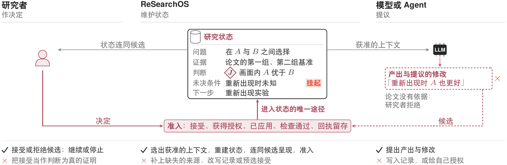
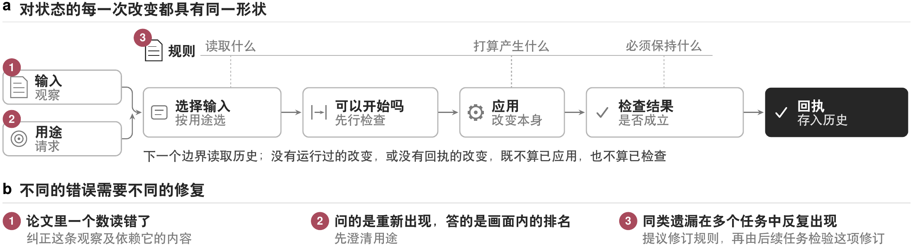
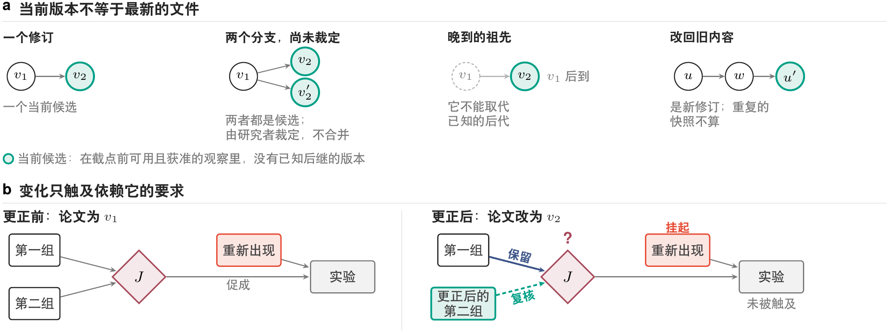
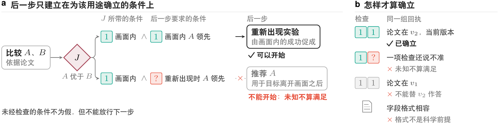
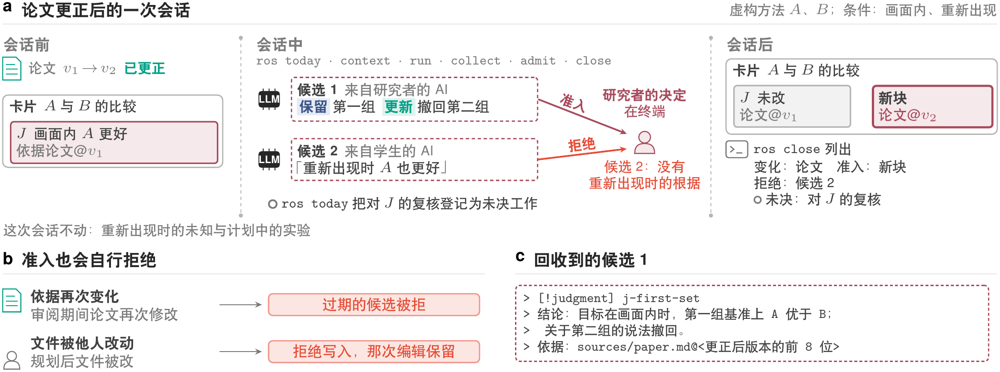
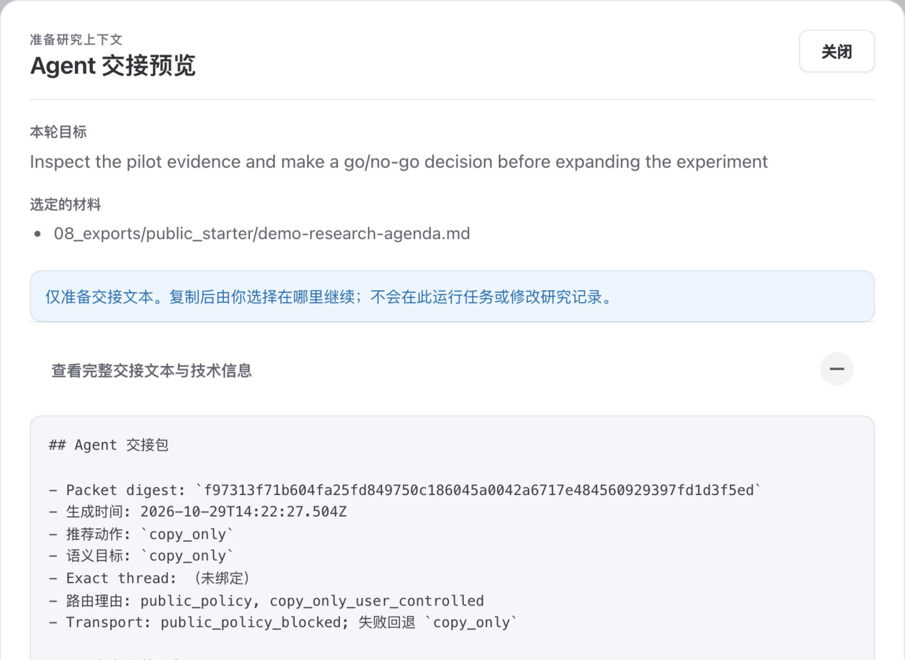
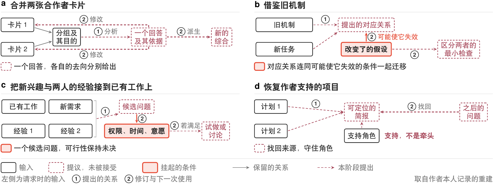

[English](technical-report.en.md)

# ReSearchOS：面向持续科研的人机协作参考架构

Shiyu Hu[^author-note] · 技术报告 · 2026 年 10 月 29 日 · 未经同行评审

新加坡南洋理工大学物理与数学科学学院

[shiyu.hu@ntu.edu.sg](mailto:shiyu.hu@ntu.edu.sg)

> 当执行越来越容易被委托，研究者更需要决定：什么值得追问，什么足以成为根据，以及什么值得留下。

## Agent Summary

在跨越许多次 AI 辅助会话的研究里，一篇研究者依赖的论文在几周后被更正。这时要做三件事：更正没有触及的判断，连同根据一起保留；被触及的部分要更新，而且只更新那一部分；证据还不能裁定的问题要挂起，等研究者来回答。哪部分保留、更新或挂起，应由研究者决定，而不是模型或另一个会话：要留住的是研究状态，不是研究文件。ReSearchOS 就是按这个思路建的环境，由研究者拥有，以本地文件为主。模型的产出一直只是候选，研究者准入之后才进入研究状态，也就是问题、证据、带范围的已接受判断、未决条件和下一步。本报告给出三部分内容：规定这样的环境必须保住什么的设计原则，让保留、更新与挂起可以检查的研究状态模型，以及参考架构，附命令行原型和一个可以安装、只复制的公开 starter。原型在下一条命令时发现来源变化，为依赖它的判断登记复核；审阅期间来源变了的候选，它拒绝准入；写入之前被别人改过的内容，它也不覆盖。在贯穿会话里，研究者把收窄的判断作为新块准入在原判断旁边，并拒绝了一个没有依据的提议。原型只实现了一部分：更正触及判断的哪一部分，由候选写明，原型并不计算；研究者的决定也只在终端上强制执行。使用研究与「强模型加一页交接」的比较都还没有做，所以本文不主张任何科研收益。

**关键词：**人机协作；研究状态维护；参考架构；判断连续性；可扩展性。

## 1. 研究状态，而不是研究文件

跨越许多次 AI 辅助会话的研究，每一步都建立在早先的判断之上，而判断依据的来源会变。研究跨越许多会话时，只把眼下这一步做对还不够，从前面带下来的东西是否仍然成立，也必须核查。来源变了，研究环境该做什么？先看一个例子。

一位研究者想知道两种方法 $A$ 和 $B$ 哪个更好。找到的一篇论文做了两组基准测试，两组里都是 $A$ 更好，于是记下结论：$A$ 优于 $B$。不过论文只测了一种情形，换一种情形 $A$ 是否仍然更好，论文没有说，只能留待以后自己做实验。

几周后论文被更正：第二组测试的数字算错了，改过来以后，$A$ 在这一组上的优势消失了。同一周，研究者的学生让 AI 助手在另一个会话里读了更正后的论文，AI 助手说：在没测过的那种情形下，$A$ 也会更好。

结论该怎么处理？第一组测试没有错，它对结论的支持照旧，要**保留**（keep）。第二组变了，结论里靠它的那部分要**更新**（update），别的不动。没测过的那种情形，现在还没有答案，要继续**挂起**（hold），留给计划中的实验；AI 助手的说法在论文里找不到依据，不能收下。保留、更新与挂起，问的其实是同一个问题：新证据碰到了什么。

这些事为什么不能交给工具自动去做？在构建系统里，输出是输入的函数：输入一变，依赖它的部分就重建，不必问任何人（图 1a）。判断却不是来源的函数。同一次更正，可以让判断的一部分照旧成立，让另一部分需要改，还留下一部分无法裁定；哪部分归哪一种，要由读懂证据的人来判断（图 1b）。模型和别的会话可以提出看法，学生的 AI 助手那条提议就是例子，但它们和文件都不该替研究者作这些决定。系统能做的，是找出哪些判断依赖变了的来源、把它们交还研究者，未经研究者决定，不把任何东西准入长期状态（图 1c）。

后文把这条结论记作 $J$。例子里的两种方法是目标跟踪方法，即在视频里一直跟住某个目标。论文只测了目标始终留在画面内的情形，所以 $J$ 完整地说是「目标在画面内时，$A$ 优于 $B$」。没测过的，是目标离开画面又回来的情形。报告把这两种情形分别称为画面内条件和重新出现条件。


这样一次变化之后要留住的，正是研究状态（research state）：问题、证据及其关系、带范围的已接受判断、未决条件，以及有依据的下一步。在例子里，它们依次是在 $A$ 与 $B$ 之间的选择、论文的两组基准、适用于画面内的判断 $J$、未决的重新出现条件，以及计划中的实验。笔记若只写「用 $A$」，这些都会丢失，连未决条件和接下来的实验也不例外。本报告的回答由此而来：要留住的是研究状态，而不是研究文件；来源发生变化时，哪部分保留、更新或挂起，由研究者决定，而非模型或另一个会话。[^lineage]

研究状态会以三种方式变化，例子里三种都有。时间在推移：论文被更正，会话结束，其间使用的工具和模型也可能被替换。条件在变化：用途转向目标重新出现的情形。参与者也在变化：另一个会话送来提议，什么算作正确须有人来决定。研究者已在用的工具会保留、会更新，有的也会把变化了的来源、或建立在它上面的主张提示给人。不过，第 5.1 节对照的几类工具中，没有一类按范围与依据版本保存判断，并只把变化触及的部分交回研究者决定。该节把同一次更正放到这些工具中对照。

ReSearchOS 就是为来源变化的这一时刻建的环境，由研究者拥有、以本地为主。前面说系统能做的最后一件事，即未经研究者决定就不把任何东西准入长期状态，在它这里落成一条权威规则：机器的产出一律先作为候选（candidate），即尚未准入的产出，只有研究者能把候选准入研究状态。准入（admission）是把候选变为长期状态的一步，须经这个决定，并留下回执（receipt），即做了什么、查了什么的记录（第 3.1 节）。

**ReSearchOS** 的名字取自 Re Search：带着新问题重返材料，并保留这次考察带来的变化。[^name]研究者与计算辅助系统在其中围绕共享研究对象，跨会话形成问题、审查证据并修订判断。它所服务的设计要求，我们称为判断连续性（judgment continuity）：恢复早期工作的根据，并重新判断其是否仍然适用。这个环境保管共享记录与未完成的工作，工作本身则在 Agent 会话、命令行或专业工具中进行。它不编排这些工具。

对研究者来说，这条规则落在一个闭环里：恢复此刻要紧的状态，在实际开展工作的客户端中推进研究，只确认值得进入长期状态的变化。客户端（client）指开展工作的任何入口，例如命令行、Dashboard 或 Agent 会话，所有客户端面对的是同一套记录。恢复只为手头的工作选取最少的上下文，而非整个仓库。确认则问这次会话产生了什么值得未来继承的真实变化，没有就不写回。第 4.1 节把这个闭环展示为一次会话中的六条命令。

### 三项贡献

本报告有三项贡献，分别在第 2、3、4 节。第一项是设计原则（第 2 节），它们规定环境必须保住什么，保留、更新还是挂起才始终由研究者决定：人的判断、带条件的组合、比工具活得久的记录、可纠正的积累。在例子中，原则要求未决的重新出现条件始终与 $J$ 记在一起，学生的 AI 助手所作的提议也只有经研究者接受才能成为状态。

原则要变得可以检查，靠第二项贡献，即模型（第 3 节）。它讲明研究状态，以及保留、更新与挂起对维护工作的要求，三者各设一个小节（3.1–3.3）。再在有界目标上把三者组合起来，有界目标是带冻结范围与明确结果的维护工作单元（3.4）。在例子中，模型说明 $J$ 何时可以支持重新出现实验，论文的更正对这种支持有何影响，以及工作何时算作完成。

模型还要落到研究者实际运行的命令上，这是第三项贡献：参考架构与原型（第 4 节），它们在命令行上承载变化发现、复核和研究者的决定。在例子中，原型恢复这次比较，论文一经更正就把 $J$ 标为待复核。在终端上，它只凭研究者的决定准入收窄的判断，而且是作为 $J$ 旁边的新判断块，不改动 $J$ 本身。它拒绝审阅期间来源发生变化的候选，也不覆盖他人的修改。报告还给出一个可以安装的公开 starter，它默认是只复制的版本：回收候选，但从不准入。

**本报告怎么读。** 初读可读本节及其术语表（表 1）、表 2 中的原则和第 4.1 节的贯穿会话。正在考虑是否试用的读者请先读第 5.2 节，该节陈述了以「强模型加一页交接」代替本环境的理由；如果交接胜出，ReSearchOS 应收缩为最小形态。第 3 节借贯穿例子讲解模型。附录 A 列出模型的对象和要求的生命周期，补充说明 5 给出每条定义的精确表述，并论证两条命题。附录 B 是实现记录，补充说明 6 列出全部差距。

表 1 给出初读者在第 3 节之前会遇到的词及其平常含义。模型自身的术语，如要求、检查、挂起与等待，在第 3 节首次用到时结合例子讲解；附录 A 的表 8 连同状态列出它们，补充说明 5 给出精确定义。多数名称与原型的代码和命令一致；代码把有界目标称为 episode。

<!-- table: 全文用到的术语 -->
| 术语 | 在本报告中的含义 |
| --- | --- |
| 研究状态 | 研究要带下去的东西：问题、证据及其关系、带范围的已接受判断、未决条件与下一步（第 3.1 节） |
| 客户端 | 开展工作的任何入口，例如命令行、Dashboard 或 Agent 会话；所有客户端面对的是同一套记录 |
| 卡片 | 一份 Markdown 记录，例如承载 $J$ 的那一份 |
| 候选 | 尚未准入的模型产出或草稿 |
| 准入 | 候选进入研究状态的一步；它需要研究者的决定（第 3.1 节） |
| 回执 | 做了什么、查了什么的记录 |
| 有界目标 | 带冻结范围、冻结规格和明确结果的维护工作单元；原型里由一次会话近似代替它（第 3.4 节） |
| 公开 starter | 读者能够安装的版本，默认只复制：回收候选，但从不准入。私有版在此之上加入准入与 Dashboard 写回 |

**主张边界。** 第 3 节的模型是规格，两条命题只在与之一起陈述的假设下成立，这些假设见[补充说明 5](technical-report-supplement.zh.md#%E8%A1%A5%E5%85%85%E8%AF%B4%E6%98%8E-5-%E5%BD%A2%E5%BC%8F%E8%A7%84%E6%A0%BC)。第 4 节描述的原型只实现了一部分，对应的提交列在附录 B.3，贯穿会话写明这些提交做了什么。原型只在终端上以研究者的决定为准（差距 1、2），第 4.5 节列出它尚未做到什么。原型只有一位用户，即作者本人；作者同时是开发者，也评价了本文报告的每一项结果，所以这些结果没有一项独立于作者。使用研究尚未进行，与「强模型加一页交接」的比较也还没有做；本文不确立真人验收或科研收益。本文面向已有来源核查习惯、需要跨会话工作的研究者，新手学习与团队分歧需要另外研究。

## 2. 研究环境必须保住什么

要让第 1 节那个决定始终留在研究者手里，研究环境必须保住什么？设计的出发点是一句话：把研究分解到能作判断，再组合回可以继续的状态。状态一旦变化，这句话要问的就是保留、更新与挂起：哪些照旧成立，哪些要修订，哪些要等回答。

四项原则各防这三个动作的一种出错，顺序跟着一条判断的经历走：作出、复用、跨工具保存、纠正。模型的产出没人决定接受就成了状态，这是保留了从未被接受的东西（第 2.1 节）。后一步接着建在一个从未确立的结果上，这是在未知上更新（第 2.2 节）。记录只有一种工具读得了，那种工具一旦不在了，本该保留的东西也跟着丢了（第 2.3 节）。纠正靠抹掉历史而不是收窄主张，这是用删除来更新（第 2.4 节）。效率、控制与长期留存发生冲突时，原则优先保证四件事：研究者的重要判断、带条件的组合、比工具活得久的记录、可纠正的积累。图 2 画出从原则一路推到代码的顺序。


这些原则不规定统一的目录、方法、界面或审阅安排。解释要花时间读、花力气维护，审阅也可能打断工作，或者久而久之流于习惯，所以检查集中放在要紧的转变处，常规工作在约定范围内照常进行。

四项原则来自作者自己的设计史：这段历史第一天记下的第一个请求，就已在理解研究判断与模仿措辞之间划了界线。规则本身写在作者的六份内部设计文件里。在那里，每条规则只由一处负责，一份冻结的合同把它与检验它的测试连在一起；本节是对照这些文件核对过的概括。表 2 列出每项原则回答的问题、规定与机制。[补充说明 1](technical-report-supplement.zh.md#%E8%A1%A5%E5%85%85%E8%AF%B4%E6%98%8E-1-%E5%8E%9F%E5%88%99%E7%9A%84%E6%9D%A5%E6%BA%90%E4%B8%8E%E4%BE%8B%E5%AD%90) 给出各项原则的例子与来源，[补充说明 3](technical-report-supplement.zh.md#%E8%A1%A5%E5%85%85%E8%AF%B4%E6%98%8E-3-%E8%BF%87%E7%A8%8B%E4%B8%8E%E7%BB%84%E4%BB%B6%E5%90%88%E5%90%8C) 完整复述这些条款，并注明每条由谁负责。

<!-- table: 四项设计原则及其机制落点 -->
| 原则 | 它回答的问题 | 规定 | 机制落点 |
| --- | --- | --- | --- |
| 人的判断 | 由谁接受判断？ | 只有研究者决定什么成为长期状态；机器的产出一律先是候选 | 候选、决定、修改、检查与回执分别记录 |
| 带条件的组合 | 结果在什么条件下可复用？ | 后一步只在前一步的实际结果确立其前提时才开始；未知不充当满足 | 带声明前提与检查的规则应用、组合（第 3.4 节）与三值检查 |
| 比工具活得久的记录 | 更换工具后保留什么？ | 本地可读、可版本化的来源为准；模型、客户端、插件可替换 | 来源归属、上下文与外发回执、依据钉在来源版本上 |
| 可纠正的积累 | 纠错后哪些判断需要改变？ | 纠正只收窄受影响的主张，不抹掉历史；失败、未知与未验证如实保留 | 判断修订、回滚回执、能力证据跨会话累积 |

### 只有研究者能把候选变成状态

第一种出错是保留从未被接受的东西。在例子中，学生的 AI 助手提出 $A$ 在目标重新出现后也更好；这一提议若未经研究者决定就被准入，$J$ 就会扩展到论文并不支持的情形。所以只有研究者决定什么成为长期状态。模型依据可见材料作出解释，提出候选；研究者判断证据是否充分、哪些问题值得追求、何时转向。接受与否由研究者决定，而不是由提出它的模型决定，被接受也不意味着它正确。因此，长期保留推荐、扩大范围或把材料交给新的接收者之前，都须经过审阅。承载这项原则的是准入：准入的五个条件全部成立，候选才能进入研究状态，第一个条件就是研究者的决定（第 3.1 节）。

这项原则借鉴的研究不止三类，这里说其中三类。认知强制方面的研究 [To Trust or to Think](https://doi.org/10.1145/3449287) 表明，不加选择地接受，容易导致过度依赖。Clark 与 Brennan 关于共同基础（grounding）的论述 [Grounding in communication](https://doi.org/10.1037/10096-006) 认为，理解到什么程度算够，取决于当前目的需要什么，而不是反复确认。QOC 记法 [Questions, Options, and Criteria](https://doi.org/10.1207/s15327051hci0603&4_2) 记下问题、选项与标准，这里的决定也一样，连同根据与范围一起保留：比如选方法时，要留下的是为什么可复现性比报告里那点微小的精度差异更重要。准入确定的是谁接受了候选，而不是候选对不对。人接受了，后面的检查照样要做；回答一致，也不能证明科学判断正确；有权修订判断，也不等于有权改变由谁来接受判断。

### 后一步只在前一步确立的结果上运行

第二种出错是在未知上更新。在例子中，目标留在画面内时的优势可以促成重新出现实验，但把 $A$ 推荐到目标离开之后，就是在实验要回答的那个未知上更新。所以后一步只在前一步的实际结果确立其前提时才开始。组合把条件、未知与失败带到下一步（第 3.4 节）。三值检查（three-valued check）的结果有通过、不通过和还说不准三种，还说不准从不当作满足（第 3.3 节）。独立是另一回事。把文献检索与实验分别交给不同执行者，并不会使二者独立，因为检索可能改变假设，也可能表明实验测量的构念并不合适。任务分解找出决定性的未知及相应检查，核对这些结果共同支持什么，继续细分不再改变这一判断时即停止。

细分到不再改变判断就停，这是 Simon 的有限理性 [A Behavioral Model of Rational Choice](https://doi.org/10.2307/1884852) 用在研究者管得过来的证据上。协调理论 [The Interdisciplinary Study of Coordination](https://ccs.mit.edu/papers/CCSWP157.html) 把协调看作管理活动之间的依赖，原则从中取了三条：先就要决定什么达成共识；把工作分成各自能独立推进的部分；事先定好什么情况下要重新分工。问题一旦改变，计划就要重新审视。执行可以委托出去，综合仍是研究者的责任。前一步的字段与后一步的要求对得上，只说明信息传得过去，既不说明它有效，也不说明可以用它；依赖同一项有争议假设而得到的一致输出，也不构成相互独立的验证。

### 记录比写下它的工具活得久

第三种出错是丢失本该保留的东西。如果 $J$ 及其根据只存在于产生它们的那次对话里，论文后来被更正时，就看不出这次更正触及了 $J$。早先的记录应当在对话窗口关掉、产生它的插件不再运行之后，照样读得懂。所以以本地可读、可版本化的来源为准，模型、客户端与插件都可以替换。长期来源、运行时的临时数据、能从来源重建的视图（例如 Dashboard 上的卡片与日历），三者各有分工：视图上显示「已完成」，并不等于已被接受；缓存也不会变成另一个事实来源。在原型中，$J$ 写在一张卡片上，依据钉在来源版本上。原型还把上下文连同回执一起交付（第 4.1 节）；适配器不另建事实存储（第 4.2 节）。

记录归研究者所有，取自 local-first 软件 [Local-first software](https://doi.org/10.1145/3359591.3359737)，但本地为主的存储并不声称实现完整的 local-first 复制模型。按最可能变化的决策划分边界，取自 Parnas [Parnas](https://doi.org/10.1145/361598.361623)。此外，留存不等于检索：记录连同使用条件一起保存，后来的工作才能判断它是否仍然适用，恢复的范围也由当前决定界定。

### 纠正只收窄主张，不抹掉历史

第四种出错是用删除来更新。在例子中，更正只触及第二组基准，删掉 $J$ 却既会抹掉更正并未触及的第一组根据，也会抹掉第二组上的主张曾被接受过的记录。所以纠正只收窄受影响的主张，不抹掉历史，失败、未知与未验证的状态都如实保留。它保留改了什么、为什么改以及哪些部分仍然有用：收窄后的判断准入在 $J$ 旁边（第 4.1 节），对 $J$ 的复核只有经过记录的解决或取消才移出未决集合（第 3.2 节）。在例子之外，已经退役的推荐仍可能提供有价值的反例，所以结论、方法与失败经验都连同适用范围、复核触发与退役办法一起留存。

March 关于探索与利用的分析 [Exploration and Exploitation](https://doi.org/10.1287/orsc.2.1.71) 提醒，复用可能挤占探索，所以替代解释与反例都要保留。生成式 AI 与人类学习的研究 [GenAI and human learning](https://doi.org/10.1038/s41562-024-02004-5) 区分了工件的表现与研究者自身理解了什么。一次成功不确立规则；本文也不假定研究者的理解会因此受益；减少或停止辅助的根据也要保留。

## 3. 研究状态及其变化的模型

原则说了必须保住什么，却还没说怎样才算保住。为了能检查一次维护是否做到，这里在第 1 节的例子上，用文字把保留、更新与挂起说清楚。附录 A 列出模型中的对象、它们的状态以及由谁改变，并画出一项要求的生命周期。[补充说明 5](technical-report-supplement.zh.md#%E8%A1%A5%E5%85%85%E8%AF%B4%E6%98%8E-5-%E5%BD%A2%E5%BC%8F%E8%A7%84%E6%A0%BC) 给出每条定义的精确表述，并论证第 3.4 节的两条命题；各定义的实现现状见附录 B.1。

### 保留：研究状态与准入

几周之后要接着做那次比较，研究者需要找回什么？不是文件，而是五样东西：在回答的问题，用过的证据及其关系，接受的判断及其范围，仍然悬而未决的条件，以及打算采取的下一步。在例子里，这五样依次是在 $A$ 与 $B$ 之间的选择、论文的两组基准、目标在画面内时的判断 $J$、重新出现条件下的未知，以及针对这种情形的实验。**研究状态**（research state）就是从记录出发重建的这五样东西；未决条件里还记着冲突，以及判断不适用的情形。它是重建而不是概述，所以来源与状态都可以检查和纠正；它需要包含多少内容，取决于问题的要求，而不取决于材料的多少。有两类研究与它相关。分布式认知 [Distributed cognition](https://hci.ucsd.edu/hollan/Pubs/tochi-revised.pdf) 研究借助外部表示展开的推理，研究记录正是这样一种表示。溯源分析 [Provenance as dependency analysis](https://doi.org/10.1017/S0960129511000211) 研究结果如何依赖输入，研究状态里的证据要保存的正是这些依赖。

保留、更新与挂起，说的是有变化时这个状态怎样变。一条判断的根据若未被变化触及，它就连同根据与范围一起被**保留**。根据被触及的判断同样留着，但会有一项**要求**把它标为待复核；要求是一件登记在册的维护工作（第 3.2 节）。研究者准入一个收窄或替换它、并钉在来源新版本上的候选，它才算**更新**。在例子里，$J$ 是被更新而不是被删除：它在第一组上的根据未被触及，所以准入的候选是对它的收窄。准入这个候选本身并不关闭复核：要求还带有**检查**，即它必须通过的检验，复核的检查仍须通过（第 3.3 节）。模型只通过这项复核跟踪每条根据的保留与更新，并不计算变化触及了哪条根据。

**挂起**有两个落点，模型将二者分开。证据无法裁定的科学条件留在研究状态的未决条件里，例子中的重新出现条件自始至终就是这样。尚不能裁定的一步维护则处于挂起，并附带一个给研究者的问题，例子中更正之后对 $J$ 的复核就是这样（第 3.3 节）。

谁来改变这个状态？有三方作用于它（图 3）。环境，即图中的 ReSearchOS，从它可以使用的历史中选取上下文，重建研究状态，并连同候选一起呈现。模型提出产出与修改，研究者决定接下来发生什么。无论由哪一方发起，每一次改变都是同一形状：按用途选择输入，检查这次改变可以开始，应用改变，再检查结果。按带类型的图变换 [Graph Transformation in a Nutshell](https://www.cs.le.ac.uk/people/rh122/papers/2006/Hec06Nutshell.pdf) 的说法，我们把这样一次改变称为规则的一次**应用**（application），规则声明它读取什么、必须保持什么、打算产生什么。之所以要这个形状，是因为不同的错误需要不同的修复（图 4）。论文里一个数读错了，要纠正的是这条观察及依赖它的内容。问的是目标重新出现后的情形，答的却是画面内的排名，就要先澄清用途。只有同类遗漏在多个任务中反复出现，才有理由提议修订规则本身，而这项修订还要在后续任务中检验。





那么，候选怎样变成状态？只有经过**准入**，而且任何一方都无法单独完成。五个条件同时成立，候选才被准入：研究者接受这次修改；授权来自可信宿主或范围内的真实指令，候选自身的文字不能授权；修改确实已经应用；它的检查已经通过；**回执**，即做了什么、查了什么的记录，保存在下一个决策边界读取的历史里（第 3.2 节）。所以，没有运行过的修改，或没有回执的修改，既不算已应用，也不算已检查。接受也只表示操作层面的决定已经做出，并不使判断在科学上为真。

### 更新：来源变化触及什么

比较做完几周后，论文被更正，从版本 $v_1$ 变为 $v_2$。论文现在哪个版本算当前，这次变化又触及哪些工作？系统在**决策边界**上回答这两个问题。决策边界是系统查看已到达的内容、决定下一步的时刻，边界之间工作并不停止。每个边界有一个截点，截点之后到达的记录留到下一个边界再处理。原型里，变化要到下一次 `ros` 命令时才被看到（第 4.1 节）。

当前版本并不就是最新的文件。一个对象的**当前版本候选**，是任务可用的记录中没有已知后继的那些版本；所以彼此之间没有已知先后的两个版本会作为未消解的分支并存，在两者之间选择留给研究者（图 5a）。原型标识版本的方式与此不同（第 4.5 节）。在例子里，看到更正之后，论文的当前版本就是 $v_2$。

以对 $J$ 的复核为例。和每项要求一样，它有稳定的身份，在某一用途下登记，用途带有这项工作的科学条件与审阅依据。它还记下自己依赖的输入：这里是那篇论文，以及复核背后的规则与用途的版本。这些输入中只要有一个自上一边界以来有了新的当前版本，变化就**触及**这项已登记的要求。对 $J$ 的复核依赖这篇论文，所以这次更正触及了它；重新出现实验的根据是未决的重新出现条件，而不是这篇论文，所以不被触及（图 5b）。发现工作不只靠已登记的要求：初次建立工作或重跑有范围的核对时，扫描还会找出其他需要，包括遗漏的依赖。要求一旦被触及，就进入**未决集合**，只有经记录的解决或取消才能退出；延期、等待和没有依据的完成报告都不能让它退出，所以没人检查过的工作会延续到下一个边界。版本怎样比较、晚到的记录怎样处理、扫描受什么限制，其余规则见补充说明 5。

触及标出的是要查看什么，而不是要修改什么。它只沿已记录的依赖走，无法发现从未记录的依赖；文件变化只是需要查看的理由，而不是结论。假如这次更正只改了一个错字，对 $J$ 的复核照样被触及，$J$ 却没有需要修改之处。反过来，一项新研究即使不改动 $J$ 依赖的任何输入，也可能使 $J$ 不再可靠。



### 挂起：三值检查、挂起与等待的工作

论文更正后，对 $J$ 的复核能不能关掉？要看第一组上的结果是否仍然支持 $J$，而这件事只有研究者能判断。所以系统给每项检查三种结果：通过、不通过、还说不准，分别记作 1、0 和 ?。只有合格且当前有效的检查确立了，才算通过或不通过；证据缺失、过期或处在未消解的冲突中，就是还说不准，而还说不准从不算作通过。一项要求只有在同一组当前回执上全部检查都通过，才算**解决**。

如果没通过的检查都还说不准，而且每一项都只能由研究者来定呢？这时系统为每一项向研究者提一个选项有限的问题，检查依据的同一版本只问一次，工作就留在这里等回答，这就是**挂起**。有一项检查不通过，就不能挂起。在例子里，回答「仍然支持」，这项检查关闭；回答「不再支持」，复核重新打开；不回答，就一直挂着，不会被算成完成。这是模型对例子的解读，原型则让这项复核保持未决（第 4.1 节）。同一依据版本只问一次，原型的 `ros today` 又把开着的问题集中成一张清单，用意都是减轻审阅负担、防止审阅流于习惯（第 2 节）。但这两点都还没有经过检验，而且只改了一个错字的更正，照样会开启复核。

工作也可能处于**等待**（waiting），而不是挂起：它等一个会让它回来的触发条件，原因是研究者把它延期或收窄了，或者目标范围之外的东西阻塞了它。把重新出现实验延到预定日期，它就处于等待（第 3.4 节）。挂起与等待的工作留在视野里，但都不解决也不取消要求。只有解决，或取消，才把它移出未决集合；取消是另一个经记录的决定，即不再追求这项需要，它不算修复。图 6 画出各种检查组合允许什么，附录 A 的图 18 画出一项要求的完整生命周期。

就例子而言，有两条限制要紧。$v_1$ 上的旧回执不能替 $v_2$ 作答，所以不能用它关闭对 $J$ 的复核；关闭也从来不是永久的，论文之后再变，可以再次触及同一要求。检查、挂起与等待的其他限制见补充说明 5。


### 组合与有界目标

还剩两个问题：一步何时可以建立在另一步的结果之上，以及工作何时算做完。目标在画面内时的成功可以促成重新出现实验，却不能拿来在目标离开画面后推荐 $A$。一次应用要建立在另一次应用的结果之上，须有两组条件在当前用途下都已确立：前一次结果所带的条件，以及后一次对输入要求的条件。同一组当前回执通过用途为某个条件声明的每项检查，这个条件才算确立，这与解决是同一个检验。在例子里，比较的结果只对目标在画面内时确立，所以可以促成实验，却不足以在目标重新出现后推荐 $A$（图 7）。未经检查的条件不为假，但不能放行下一步。



围绕对 $J$ 的复核，工作什么时候算结束？这并不像听上去那样简单：早期原型里，清理宣布完成之后，问题仍会再次出现，前后经历了十轮清理、近两百次提交。所以模型把工作限定为一个**有界目标**（bounded goal），即一个带有冻结范围、冻结规格和明确结果的工作单元（图 8）。范围是目标能读什么：它所在项目拥有的记录，加上经其他项目声明的接口读入的少数输入。规格冻结问题、用途、范围、规则与检查的版本、必须保持的内容、授权、预算，以及带截点的来源版本；它和其他候选一样经过准入。这样，完成与否对照的就是运行中不会变的东西。

在有界目标里，做完和停下是两回事。目标里仍开着的工作，要么挂在问题上，要么在等触发，而且三类不得豁免的工作一项都没开着，目标才算 **Done**。这三类是：范围内运行从未求值的工作、无法重建的前次规格、绕过准入的直接修改仍欠着的确认（见补充说明 5）。它们可以暂时挂起或等待，但目标完成之前必须关闭，所以目标不会靠默认接受自己的结论来收场。目标在三种情况下停下：到了 Done，预算的某一部分用完，或研究者决定停止；停法不同，记法也不同。Done 且没有未决工作，记为完成（complete）。Done 但还有挂起或等待的工作，记为 complete_with_held：逐项列出这些仍开着的工作及其问题和触发条件，并报告目标已登记的要求里已解决的比例；比例为零记为延期（deferred），不算完成。否则，因预算用完而停，记为 budget_stopped；由研究者叫停，记为 human_stopped；两者都不报告完成。


图 8b–c 在一个设想下画出例子：研究者还在终端把重新出现实验延到预定日期。这时实验处于等待，对 $J$ 的复核挂起，第三项要求（图 8b 中的要求 1）的检查全部通过而得到解决。三项要求中解决了一项，在研究者回答之前目标就已 Done，结果为 complete_with_held，两者都仍然开着。这次延期只是设想：第 4.1 节的贯穿会话没有执行延期，所以那里的实验仍只是未决，目标也不算 Done。

这些定义能承诺多少？两条命题划出了界限，它们的假设与论证见补充说明 5。第一条说，在其假设下，冻结范围互不重叠的两个目标没有共同的要求，所以一个目标的完成不依赖另一个：比如一个无关项目上的目标，既不增加也不减少复核 $J$ 的那个目标的要求。第二条说，在给定条件下，目标经过有限步，要么到达 Done，要么耗尽预算；这需要一个调度上的条件，因为重开一项要求、或回答「不满足」，都会增加开着的工作。承诺也就到此为止。决策边界的预算有限，保证的是目标会停下，而不是会完成；两条命题都不证明完成可达，那需要每项未决要求都能在范围与预算内裁定，并且没有新的来源变化。

## 4. 原型：在命令行上保留、更新、挂起

这个模型有多少已经落到终端上？本节描述附录 B.3 所列两个提交上的本地原型，它们的测试情况也概述在那里。保留、更新、挂起这三个动作，以及研究者在其间所作的决定，原型在命令行上承载了其中一部分。

### 贯穿案例：论文更正后的一次会话

会话沿用第 1 节的例子，方法 $A$、$B$ 均为虚构，不报告任何真实方法的效果。图 9 画出这次会话。会话共六步，每一步是 `ros.py`（运行一次会话的程序）的一条命令。会话之前，研究者已把 $J$「目标在画面内时，$A$ 优于 $B$」绑定到论文的 $v_1$ 版本，根据是两组基准；还把重新出现条件下的未知留在未决条件中，并计划了重新出现实验。随后论文更正为 $v_2$：第二组的数字改变，第一组不变。

先说一处贯穿整个会话的、与模型的差别。按模型，对 $J$ 的复核挂在给研究者的问题上（第 3.3 节与图 6）；在这次会话里，原型却让它保持未决。原因在于原型能查什么。这项复核上原型能自行裁定的检查只有一项：依据是否钉在当前版本上。更正之后，这项检查不通过（返回 0）。不通过不是「还说不准」，没有可挂起的，复核就只是开着。第一组的结果是否仍支持 $J$，留给研究者判断（差距 34，语义检查；差距编号见第 4.5 节与补充说明 6）。原型只在遇到自己裁定不了、必须交给研究者的检查时才挂起：`ros today` 只问一次，研究者用 `ros answer` 回答之前，这项要求一直挂着。不过随附的规则里，没有哪一条声明了这种以研究者判断为依据的检查，所以挂起路径在会话内核的回归测试里走到过；在测试之外，只有要求的主体或依据无法解析时才会走到（附录 B.1）。



更正落到记录上的方式是：用户，或按用户指示行事的 Agent，替换记录这篇论文的本地文件，这里是 `sources/paper.md`；下一条 `ros` 命令便看到它变了的内容摘要。会话由 `ros today` 开始：它发现版本变化，把对 $J$ 的复核登记为未决工作。此时它并不提问，因为更正一个排印错误可能让判断依旧成立，保留还是更新尚未确定。

接着，`ros context` 交付获准使用的来源与当前状态，并附回执。然后，`ros run judgment --target <card> --executor copy_packet` 为承载 $J$ 的卡片写出一个任务包，不调用任何模型服务。任务包是装有任务与已交付上下文的 Markdown 文件，由用户粘贴到任一助手中。最后，`ros collect <run> --file draft.md` 把助手的草稿读回，作为候选。草稿中只读取一到三个判断块，其余内容一律忽略：

```
> [!judgment] j-first-set
> 结论：目标在画面内时，第一组基准上 A 优于 B；关于第二组的说法撤回。
> 依据：sources/paper.md@<更正后版本的前 8 位>
```

这里的依据把论文钉在 $v_2$ 上。依据按来源文件记录，即文件路径加内容摘要，所以原型看不到论文内部第一组与第二组的划分；更正触及哪一部分，由候选写明（差距 11）。不带版本的依据，按回收时的当前版本钉住；钉在已过期版本上的草稿会被拒绝。该候选不涉及重新出现条件与实验，因为二者另有独立根据：撤回 $A$ 的一部分优势，既不推出 $B$ 更好，也不推出实验应当取消。

接下来由研究者决定，`ros admit <候选>` 执行准入。只有在研究者审阅之后，它才把收窄后的判断作为新的判断块写在 $J$ 旁边；由于确认是在终端作出的，这次准入记为研究者的决定。所以在原型中，更新就是这一步：$J$ 仍留在卡片上，依据仍钉在 $v_1$，保留与更新都落在旁边那个新块上，原型不修改 $J$ 本身。

同一次会话中，又从学生的 AI 助手那里回收了第二个候选「目标重新出现后 $A$ 也更好」，依据同样钉在 $v_2$。论文没有报告目标重新出现后的任何结果，研究者便在终端拒绝了它。拒绝记为研究者的决定，不写入任何内容，状态也不变。会话以 `ros close` 结束，它比较会话起止时的来源，列出改动了什么、准入了什么、拒绝了什么、哪些候选仍未决定，以及哪些事项仍未关闭。

准入也会自行拒绝，情形有两种。候选审阅期间若论文再次修改，准入以依据过期为由拒绝该候选，并要求在当前材料上重新提议。若承载 $J$ 的文件在写入计划形成之后、实际写入之前被他人编辑，文件的前像（形成写入计划时所依据的内容）就不再相符，系统于是拒绝写入，不覆盖那次编辑。审阅期间他人所作的编辑则会保留，因为写入计划要到决定作出之后，才按文件当时的内容形成。两种拒绝都不是科学判断。

公开 starter 在默认的只复制模式下，于自己的虚构夹具（经 `--root` 指定）上运行同样的命令，因此它的运行不能作为这次私有会话的证据。如表 3 所示，starter 可以在本机写入运行态、任务包与候选，但只产出可复制的候选或拟议差异，从不准入候选，也从不改动研究者的来源：

<!-- table: 贯穿会话与默认公开候选路径 -->
| 命令 | 本次私有终端会话 | 默认公开 starter |
| --- | --- | --- |
| `ros today` | 观察来源变化，把判断标为待复核 | 查看虚构来源，维护 Git 忽略的工作状态 |
| `ros context` | 交付获准来源与重建状态，留存回执 | 交付获准虚构上下文，留存回执 |
| `ros run judgment --target <card> --executor copy_packet` | 准备任务包，不调用模型服务 | 准备可复制任务包，仍拒绝 provider 派发 |
| `ros collect` | 将草稿回收为绑定来源版本的候选 | 回收候选，不准入长期来源 |
| `ros admit` | 经研究者终端决定准入；过期依据或冲突前像被拒绝 | 通过复制回退显示拟议差异，不写入来源 |
| `ros close` | 列出变化、已准入、已拒绝、待决候选和仍开着的工作 | 记录本机会话与残留工作，不向长期来源准入 |

### 职责划分与稳定内核

这些命令背后，谁拥有什么？第 2.3 节要求模型、客户端和插件可以替换，而研究者的来源始终是权威。图 10 画出为这一要求设定的目标划分，共分五行：客户端、方法、稳定内核、适配器与记录。研究者持有长期来源。稳定内核从适配器提供的快照计算变化与未决要求，从不直接读取来源。客户端负责组织呈现。适配器经既有服务处理文件、执行与回执，不另建事实存储。模型输出可以提议，但不能授予写权。在原型中，运行第 4.1 节命令的会话内核是 `ros.py`。在它背后，治理（规定什么可以成为长期状态）与协调（规定现在要处理什么）的合同同属一个包。不过，准入本身仍由 `ros.py` 而非该包执行，所以图中单一的稳定内核仍是目标，而非现有代码（差距 3）。[补充说明 2](technical-report-supplement.zh.md#%E8%A1%A5%E5%85%85%E8%AF%B4%E6%98%8E-2-%E4%BC%9A%E8%AF%9D%E6%93%8D%E4%BD%9C%E4%B8%8E%E5%AE%9E%E7%8E%B0%E6%98%A0%E5%B0%84) 收录本节背后的命令、记录表与逐步记录。


内核背后有四样东西：记录图（即记录及其之间的链接）、规则、未决要求和执行轨迹。它们是逻辑上的结构，不是四套数据库。长期来源仍是 Markdown 文件和明确作出的决定；要求处于什么状态，由已有的轨迹推导出来，缓存只是让恢复更快。轨迹能确立决定了什么、尝试了什么、观察到什么、检查了什么，但不能确立从未记录的依赖，对长期来源也没有权威。原型还有其他内部用语，补充说明 2 逐一列出，并写明各自承担的合同；只有带着不同的合同或生命周期，才值得另立一类。实现是否守住这些边界，仍须检查。

### 会话协议与准入

第 4.1 节的收窄判断为什么不能像一条事实那样直接写入？事实与判断经由不同的路径进入长期状态（图 11）。事实可以在既有任务授权内更新；判断则要经过候选、决定、实际修改、检查与回执，每一步分别记录。候选经 `ros collect` 或 `ros propose` 记录时，它所依赖的每项依据都按完整的来源版本冻结。审阅期间若依据发生变化，准入拒绝过期的候选并要求重新提议。已存在的判断只有经显式的重新确认，才能重新绑定依据。


写回还必须落在形成计划时的那份内容上。准入、重新确认、关闭 episode 卡片（`ros propose episode-close`）和规则修订这四条路径，写入都分两步：先由暂存服务保管计划中的写入，不碰来源；再由升格把它写进来源。episode 卡片是一张 Markdown 卡片，它记录的状态标明一段工作开着还是已关闭。形成写入计划时，这些路径把原文件摘要交给暂存服务，摘要就是那份内容（第 4.1 节所说的前像）的指纹。升格时前像若不符，就拒绝写入，保留其间的编辑，也不发出成功回执，这就是第 4.1 节说的那种拒绝。这些检查保护内置的写回路径，但不验证任意规则须保持的部分（差距 9）。


唯一的权威规则只在终端路径上得到执行。在终端确认的判断准入记为研究者的决定，由 Agent 执行的准入则记为调用方的断言。对能使用 shell 的 Agent 而言，这只是归属与审计记录，而不是阻断。终端靠交互式提示来识别，分配了伪终端的进程也能应答这个提示，应答随后同样记为研究者的决定：记录证明的是通道，而不是人（差距 1）。Dashboard 是原型的图形客户端，其生命周期写入绕过准入。若写入发生在会话期间，`ros close` 把其中承载判断的字段（state 与 priority）登记为未确认的修改，研究者确认之前不会关闭。这两条路径目前都没有被阻断（差距 1、2）。图 11 画出这两条路径与三个入口。

关闭一项要求则更严格。`ros decide … cancel/confirm` 与 `ros answer … cancel/satisfied` 只在终端接受，Agent 的转述只记为调用方的断言，要求仍不关闭。对未经准入就写下的块作事后确认也遵循同一规则：由 Agent 执行的 `ros admit --confirm` 只记为调用方的断言，确认要求仍不关闭。有些承载判断的字段在同一会话内已由完整的决定与成功的回执覆盖，收尾时不再要求研究者确认第二次；之后的直接修改或不完整的变化链仍需确认。因此，一次准入既不要求研究者把刚作出的决定再作一遍，也不授权之后的任意修改。

### 客户端、方法与公开边界

终端之外的客户端又处在什么位置？命令行是明确使用内核结果的客户端。Dashboard 上的卡片、选择与日历是投影，也就是记录的视图：它们既不建立科学关系，也不算接受。方法可以声明输入、输出与检查，但声明并不给它接受的权力。已有种类的规则只要一个 JSON 文件；新种类的可执行检查却要改内核、过架构审查，在那之前，它留下的未评估工作会挡住完成（差距 12）。各客户端是否守住这些边界，要逐个检查。不带界面的回归测试，既不说明图形交互能通过验收，也不说明外部 Agent 受到控制，这些 Agent 的宿主保留各自的权限。私有部署与公开部署的科学含义相同，权限不同；任务包复制出去，不带走任何权限。

Dashboard 首页的设计起初考虑以问题、根据、未决条件与下一步作为主入口。作者日常更习惯日历和资源卡片，所以首页保留了这一熟悉的入口，研究状态则放在选中事项的详情中。把资源选入交接只是临时组装上下文，而记录它支持某个结论则是需经准入的断言，所以二者不宜共用同一个拖拽动作。作者的偏好与实现检查都不能说明其他研究者会认为哪种安排更好。

**试用。** 公开 starter 是只复制的版本。它出厂的 config/ros.json 设定 `runtime_scope: public_starter`，下文所述行为在这一配置下成立。在它的虚构夹具 `examples/scheduler-demo` 上，第一次会话按第 4.1 节的步骤进行，命令取表 3 的公开一栏。starter 不向任何模型 provider 派发，也不向长期来源（即算作权威的记录）准入任何内容。因此，用户能够体验恢复、上下文交付与候选回收，但体验不到准入。图 12 是公开 starter 的研究工作台，图 13 是它的 Agent 交接，公开 starter 只能预览和复制交接包。两张截图展示的是呈现方式，不表示任务已完成或判断已被接受，也不说明界面的可用性。



私有版增加了准入与 Dashboard 写回。其会话内核还可以把一次有界运行交给本地 runner，即 Codex CLI 或 Claude Code CLI，二者各自须在 `providers` 下声明为可派发。两者都从空的临时工作目录启动。Codex 使用只含登录凭据的临时配置目录，在只读沙箱中运行，网络关闭。Claude Code 在受限模式下运行，因此不读取用户设置，也不启用工具。公开版在 CI 中以 CPython 3.10 与 3.13 测试，私有版以 CPython 3.11 测试（附录 B.3）。

私有版运行在作者本人的记录上，不对外分发。想在自己的 Markdown 笔记上使用的用户，可以用 personal-vault 模式启动公开 starter。这一模式从这些笔记生成本机的 Dashboard 视图，经用户确认后把 Dashboard 的修改写入 `personal_vault/`；自行配置后，还可以启动本机安装的 Codex CLI。即便如此，`ros` 不随这一模式改变，`ros admit` 仍只显示拟议差异。`ros` 不拦截普通的 Agent 会话，这些会话照常进行；只有经 `ros collect` 回收或经 `ros propose` 登记的判断块，才进入候选路径。安装耗时与每次会话的投入尚未测量。

### 原型还不会做什么

原型离第 3 节还有多远？第 3 节是规格，其精确表述见补充说明 5；当前代码提供其中若干可运行路径，实现覆盖按义务逐项登记，不由测试数量推断。表 4 按主题列出最要紧的差距，[补充说明 6](technical-report-supplement.zh.md#%E8%A1%A5%E5%85%85%E8%AF%B4%E6%98%8E-6-%E5%AE%9E%E7%8E%B0%E5%B7%AE%E8%B7%9D%E5%85%A8%E8%A1%A8)给出全部 39 项及其完整说明。这些差距限制的是实现方面的主张，不改变第 3 节的模型、它的定义及其条件论证；同样，第 4.2 节的架构规定谁对什么负责，并不表示每种组合或客户端都已存在。

对原型使用者而言，最要紧的差距有三项。只有终端路径执行权威规则：Dashboard 写入与 Agent 执行的准入只被记录、不被阻断（差距 1、2）。来源变化要到下一次 `ros` 命令时才被看到，因为目前没有文件监听，变化也不会跨多跳传播（差距 34）。研究者在终端用 `ros decide … defer` 确认的延期确会产生等待（附录 B.2），但还没有机制会因范围外依赖而产生等待（差距 17）。

除挂起路径（第 4.1 节）外，原型还在另外几处偏离模型。一次更正触及判断的哪些部分，由候选写明、由研究者决定，原型并不计算（差距 11）。原型也不能替换或撤回 $J$，$J$ 由研究者手动修改或删除。按模型，重新出现条件下的未知仍留在未决条件中，实验仍是一项未决要求；不过，原型没有规则登记研究者陈述的条件或计划的实验，所以 `ros close` 不列出它们（差距 12）。只有研究者在终端用 `ros decide … defer` 把实验延期，实验才处于等待，贯穿会话没有这样做。此外，原型只按内容摘要标识版本，所以改回原先的内容算回到原先那个版本，而不是一个新修订（附录 B.1）。它没有实现完整的条件组合（差距 10），会话只近似有界目标（差距 15），跨客户端集成也仍未验证。

两类证据要分开。内核与写回的回归测试在临时夹具上演练来源变化、提议冻结、准入、并发写入拒绝与收尾记录。测试通过所确立的，是这些输入下的执行性质。至于画面内条件与重新出现条件下的判断是否正确、实验是否值得做、研究者是否理解得更多，则须由实际任务和独立证据来回答。

<!-- table: 按主题分组的已披露实现差距 -->
| 主题 | 差距编号（对应补充说明 6） | 对原型使用者意味着什么 |
| --- | --- | --- |
| 准入与写回 | 1、2、9 | 研究者的决定已被记录，但尚未在每条路径上强制执行：Agent 执行的准入与 Dashboard 写入都绕过它，内置检查也不验证任意规则须保持的部分。 |
| 有界目标与完成 | 15、17、18 | 会话只近似有界目标：规格冻结不完整，范围外依赖的等待尚未产生，过期依据上的挂起问题仍可能让会话报告 complete_with_held。 |
| 组合与维护 | 3、10、11、12、34 | 单一的稳定内核仍是目标，因为准入仍由 `ros.py` 自行执行。通用组合检查、更正时对有独立支持部分的保护、陈述条件与计划实验的登记、文件监听与多跳传播都只停留在规格。 |
| 验收与收益 | 13、14 | 界面的真人验收、真实模型的隔离、长期恢复与科研收益都尚未验证。 |

## 5. 相近系统、最强反证与结论

即便原型补齐了这些差距，还有一个问题：研究者已在使用的工具，是否已经做到 ReSearchOS 要做的事？本节先把它放到这些工具之间（第 5.1 节），再指出什么结果会使它变得不必要（第 5.2 节），最后说明本报告已经表明了什么、还有什么尚待证明（第 5.3 节）。这些对照都回答不了这个环境究竟是否必要；这要靠与一页交接的比较来检验，而这项比较尚未进行。

### 相近系统

最接近的替代品不是科研 Agent，而是研究者已经在使用的工具。表 5 从三个方面逐类比较这些工具：保留什么、来源变化时更新什么、能挂起什么。每一行描述的是该类中点名的或典型的系统所报告的做法，并不涵盖该类的每个系统；下文只补充表中一行无法说明的内容。版本控制保留每个版本，用乐观并发控制 [Optimistic concurrency control](https://doi.org/10.1145/319566.319567) 拒绝过期写入，还像版本向量 [Version vectors](https://doi.org/10.1109/TSE.1983.236733) 那样检测并发分支。乐观并发控制也正是原型前像检查所用的机制。但是，版本控制不区分事实与判断，对冲突的处理方式是合并。ReSearchOS 则把冲突分支保留为当前版本候选（[补充说明 5](technical-report-supplement.zh.md#%E8%A1%A5%E5%85%85%E8%AF%B4%E6%98%8E-5-%E5%BD%A2%E5%BC%8F%E8%A7%84%E6%A0%BC)），把选择留给研究者。

真值维护系统 [Truth maintenance system](https://doi.org/10.1016/0004-3702%2879%2990008-0) 记下每条信念为什么成立，并沿这些理由修订信念：撤回某个假设的理由一旦失效，这个假设就恢复；还有别的有效理由支撑的信念，则继续成立。基于逻辑的真值维护系统 [Logic-based TMS](https://cdn.aaai.org/AAAI/1990/AAAI90-164.pdf) 把信念标为真、假或未知；基于假设的真值维护系统 [ATMS](https://doi.org/10.1016/0004-3702%2886%2990080-9) 同时保留所有相容的语境，不必撤回。第 3.3 节的检查用的也是这三个值；第 3.2 节的被触及集更简单，只沿已记录的依赖走一步，标出被触及的要求。两者的区别在于由谁给值。真值维护系统由系统自己重新标注，「未知」是指传播既没推出真，也没推出假；ReSearchOS 里，系统裁定不了的检查，在冻结范围内由研究者给值，所以一次变化可以让判断挂起、留给研究者。AGM 传统的信念修正 [AGM](https://doi.org/10.2307/2274239) 用受一组公设约束的函数，定义理论怎样改变；本文的保留、更新与挂起说的则是研究者的记录发生了什么，不是修正算子。

把发生变化的来源提示给人，并不始于本报告。IBM Engineering Lifecycle Management 这类需求管理工具在链接两端任一制品的内容发生变化时，把追踪链接标为可疑，再由团队成员标为有效或无效 [Link validity](https://www.ibm.com/docs/en/engineering-lifecycle-management-suite/lifecycle-management/7.0.3?topic=management-link-validity)。在 GitHub 上，受保护分支可以设置为：新提交改变了已批准的 diff 之后，这次批准即作废，改动须有人重新批准后才能合并 [Protected branches](https://docs.github.com/en/repositories/configuring-branches-and-merges-in-your-repository/managing-protected-branches/about-protected-branches)。活体系统综述以类似的方式把研究结论交回作者，通常是在发现新证据时。作者判断新研究是否可能对综述的结论产生重要影响，在整合新证据期间，读者会被告知更新尚待完成 [Cochrane living systematic reviews](https://resources.cochrane.org/sites/resources.cochrane.org/files/uploads/inline-files/Transform/201912_LSR_Revised_Guidance.pdf)。2026 年 6 月，Cochrane 宣布正在把已撤稿的研究与纳入它们的综述对应起来。它还宣布将联系作者、在评估影响期间为受影响的综述加编辑注，结论如何处理则交由编辑决定 [Cochrane retracted publications](https://www.cochrane.org/about-us/news/cochrane-strengthens-systems-manage-retracted-publications-its-published-reviews)。

更接近单条主张的是一篇论文的定量主张台账 [Provable discourse](https://arxiv.org/abs/2603.10450)：它为每条主张所依据的数据记下指纹。数据一旦变化，即使主张仍然通过也标为过期，并阻断依赖于某条未通过主张的其他主张。这些工具挂起的是一条链接、一次待合并的改动、一整篇综述或一整条主张。没有一个按范围与依据版本保存已准入的研究判断、只经研究者准入的候选更新变化触及的部分、并把带问题的检查挂起给研究者。反过来，一项新研究即使不改动判断所依赖的任何输入，也可能使判断不再可靠（第 3.2 节）。活体综述正是为这种情形而设计的，ReSearchOS 则察觉不到这种情形。

构建系统 [Build systems à la carte](https://doi.org/10.1145/3236774) 决定一个输入变化会使什么失效；支持提前截止的系统在重算值未变时即停止，这就是对工件的更新动作。但被暂停的构建任务等待的是依赖就绪，而不是人的判断。科研知识图谱 [Open Research Knowledge Graph](https://doi.org/10.1145/3360901.3364435) 会把论文及其比较做成一等对象，并为存储的数据保留版本与溯源。本文的判断协议在此之上加入范围、检查与权威，用来决定建立在这项比较上的判断是否仍然成立。实验跟踪器与溯源存储保留运行与谱系；它们回答执行过什么，而不回答判断是否仍然成立。

Agent 记忆保留并检索。Graphiti [Zep](https://arxiv.org/abs/2501.13956) 不删除被反驳的事实，而是使其失效。GitHub Copilot Memory [Copilot Memory](https://github.blog/ai-and-ml/github-copilot/building-an-agentic-memory-system-for-github-copilot/) 在使用一条记忆之前，先对照当前分支核对它所引用的代码位置；PACMI [PACMI](https://arxiv.org/abs/2610.05732) 把依赖于已变化证据的记忆标为待核实。三者都由系统设定新的状态，不询问任何人。GovMem [GovMem](https://arxiv.org/abs/2607.02579) 把有疑问的候选记忆交给人审阅，但只在写入之前，也没有描述记忆写入后的再次核查。AI 科学家系统在自身的权威下保留、更新并产出工件。Agent Laboratory [Agent Laboratory](https://aclanthology.org/2025.findings-emnlp.320/) 在每个阶段接受研究者的反馈；Kosmos [Kosmos](https://arxiv.org/abs/2511.02824) 在最长十二小时的一次运行内，为报告中的每条陈述标出代码或文献出处。它们都不记录经过准入、带有范围、来源变化后会被重新打开的判断。表 5 中 ReSearchOS 这一行描述的是设计机制。第 4.5 节说明其可执行覆盖，图 14 画出同一次更正落在六类系统上的情形。


<!-- table: 按三个动作比较相近系统 -->
| 系统类别 | 保留什么 | 来源变化时更新什么 | 保持开放的是什么 |
| --- | --- | --- | --- |
| 个人知识库与笔记工具 | 笔记与链接 | 来源变化时不更新；研究者手改，或让助手改 | 无；未决问题只是一条笔记 |
| 带乐观并发的版本控制 | 每个版本；拒绝过期写入 | 合并，或报告冲突 | 分支，但不说分支意味着什么 |
| 真值维护系统（JTMS、LTMS、ATMS） | 结论及其论证 | 自行沿论证重新标注；仍有别的有效论证的结论继续成立 | 未知标签（LTMS）或同时保留多个相容语境（ATMS），由系统处理，不交给研究者 |
| 撤稿处理与主张台账 | 综述及其纳入的研究，或带证据指纹的主张 | 提示被撤稿的研究，或在数据变化时把主张标为过期 | 一整篇综述（Cochrane 宣布将为其加编辑注），或作者更新之前的一整条主张；不按范围，也没有待准入的候选 |
| 构建系统与科研工作流 | 键、值及其输入 | 重建被变化失效的部分 | 无；人在环外 |
| 科研知识图谱与实验跟踪器 | 比较记录、运行与谱系 | 记录本身，不是判断的依据 | 无 |
| Agent 记忆（RAG、A-MEM、Mem0、MemOS、Graphiti、PACMI） | 检索与压缩后的上下文 | 覆盖、重排，或由 Agent 判定失效 | 至多是系统设定的待核实标记；不交给研究者 |
| AI 科学家系统（AI Scientist、Agent Laboratory、Co-Scientist、Kosmos、Denario） | 假设、实验与工件 | 在自己的权威下重跑；研究者可对某一阶段给出反馈 | 没有由研究者决定的东西 |
| ReSearchOS | 带范围与依据版本的判断 | 只更新被触及的部分，经研究者准入的候选 | 未决的科学条件，以及带一个给研究者的问题的检查 |


在研究者权威方面，一个先例是 OmniScientist 的 OSP 协议 [OmniScientist](https://arxiv.org/abs/2511.16931)，它把人对某个工件的批准连同该工件的版本哈希，记入中心 Hub 上的溯源链。被批准的是 Agent 提交审阅的工件，而不是带有范围、来源变化后会被重新打开的判断。在贯穿例子中，若批准的只是「$A$ 优于 $B$」这一排名本身并把它传给下一项任务，就会掩盖未检验的重新出现条件。两个新近的系统在研究者权威上更接近。Magnolia [Magnolia](https://arxiv.org/abs/2610.27230) 提出的跨项目规则，要等研究者逐条确认之后才会应用；ResearchLoop [ResearchLoop](https://arxiv.org/abs/2605.28282) 只在门槛（gate）所批准的范围内准入一条主张，门槛由研究者或预先指定的协议文件编写。但两篇论文都没有描述在来源后来发生变化时把已准入的结果交回研究者。在 Magnolia 中，工具版本被取代后，绑定在旧版本上的规则会一直保留，直到研究者修订或停用它。在 ResearchLoop 中，复查是运行时对门槛的确定性评估，证据链缺失或不匹配的主张会被降级或阻断。图 15 按来源变化之后保持开放的是什么、由谁处理，摆放表 5 中的多数类别和本节点名的几个系统。

比较到这里，还有两点要交代。其一，上面的比较记录的是来源所报告的机制，而不是接入或性能；[补充说明 4](technical-report-supplement.zh.md#%E8%A1%A5%E5%85%85%E8%AF%B4%E6%98%8E-4-%E7%A0%94%E7%A9%B6%E5%9F%BA%E7%A1%80%E8%AF%A6%E8%BF%B0) 给出完整综述，其中也包括表 5 背后的检索、记忆与 AI 科学家系统，以及提供了设计若干部分的其他工作。其二，积累还必须容纳纠正，也不能与人的学习混为一谈。因此，生成式 AI 与学习的研究 [GenAI and human learning](https://doi.org/10.1038/s41562-024-02004-5)、人机组合研究 [Human–AI combinations](https://doi.org/10.1038/s41562-024-02024-1) 与反馈循环研究 [Human–AI feedback loops](https://doi.org/10.1038/s41562-024-02077-2) 都支持分开评价三件事：工件、策略复用，以及研究者学到了什么。这些比较都回答不了的，是这个环境究竟是否必要，而这正是最强反证要追问的问题。

### 最强反证与最小形态


什么结果会使本报告大部分内容变得不必要？第 2 节背后的设计文件指明了一项比较：让一个能直接读写文件的强模型配上一页版本化交接，与 ReSearchOS 在足够多的自然研究任务上比较，两边的来源、工具、模型与预算相同。如果模型能在声明的质量界与关键错误界之内恢复当前问题、关键根据、已接受的判断、未决边界与下一步行动，并且总投入更低、在连续两次比较中都能做到，交接即算胜出。交接胜出时，ReSearchOS 应收缩为版本化研究状态、最小上下文路由、研究者权威、溯源和带回滚的安全写回。届时 Dashboard、低价值插件、复杂状态与单独的「操作系统」叙事都可以退役。收缩是这些原则所允许的成功，而不是失败（图 16）。

迄今的证据两方面都有，不足以作出任何裁定。一方面是作者重建的九十天设计史中的四个请求，列于表 6，绘于图 17。已知在每个请求中，续接的线程都缺少上次会话记录没有带过来的条件或去向。它们是迄今仅有的此类案例，所缺的恰恰是一页交接必须补上的内容。这四个请求都不是来源变化，所以本报告建议，这项比较的自然任务中包括一项来源发生变化的任务，就像贯穿例子中的论文那样。

<!-- table: 四个历史请求及续接时缺了什么 -->
| 请求 | 续接时缺了什么 | 设计回应 |
| --- | --- | --- |
| 选中两张协作者卡片做组合，任务看似完成 | 看不到产出，也看不到改动该落在哪里 | 返回带根据的回答，并分别标明每个候选去向；来源可以只读不改 |
| 借鉴早期一个记忆相关机制来完善设计说明，同时不把旧结构强行套进新任务 | 旧机制解决的是什么问题，哪项变了的前提可能让迁移失效 | 写明拟议对应、变化的前提和最小区分性检查；候选可以被放弃 |
| 把一个新的应用兴趣和两位潜在合作者的经验接到已有工作上 | 资源访问、时间和参与意愿，当时问题和团队都还没定 | 把这些列为候选问题的可行性条件；经验能解释为何建议某个角色，不代表对方已经同意 |
| 为作者承担支持角色的项目整理两份方案文档的理解，并能在以后找到 | 来源位置、角色边界和尚未解决的问题 | 把文档和支持角色接到一份可定位的项目说明上；频繁参与不悄然变成牵头 |



表 6 各行改写自作者本人的记录，是作者的回顾性重构。它们只作为需求来源的先例，而不是恢复出的执行轨迹，也不衡量收益。它们同样不表明一份维护良好的交接在这些情形下会失败。同一段历史还记录了反复提出的、希望界面少一些杂乱的请求，所记下的设计回应是：在扩展界面之前，先在同一事件上，用能读写文件的强模型加一份维护良好的交接做对照。另一方面，一个拿到参与者包的无历史 Agent 在冻结的评分表上得到 10/10，没有硬失败（附录 B.1）。这是作者评分的单一案例，既不证明仅凭交接就已足够，也不证明它跨任务或跨模型可靠。

下一步是协调策略，即环境中在每个决策边界决定检查什么、启动什么、询问什么、什么不去管的那一部分。这一步还需要一个任务，用来检验策略能否长期保持正确的状态。与交接基线的比较和第一项使用研究（参与者是作者以外的研究者）都尚未进行，第 2–4 节也没有预设它们的结果。在它们完成之前，实际的建议是先用一页交接开展两周的真实工作，只在交接丢失条件或去向之处才安装原型；读者能够安装的公开 starter 回收候选，但不准入候选（第 4.4 节）。

### 结论

在 ReSearchOS 看来，科研的连续性是一个状态问题：要紧的是研究要带下去的状态，而不是文件。它用三个相互约束的部分回答这个问题。原则说明一次变化之后什么必须保住，模型定义研究状态及作用于它的三个动作，参考架构与原型再把这些动作分配给记录、内核与客户端。在贯穿会话中，原型恢复了比较，在来源变化时把判断标为待复核，并且只在研究者决定之后才准入收窄的判断。它还记录了研究者对无依据提议的拒绝，收尾时复核仍然开着。这些是终端上可检查的起始路径。

表 7 把每项贡献、本报告给出的证据和尚待证明的部分并列。

<!-- table: 贡献、证据与尚待证明 -->
| 贡献 | 本报告给出的证据 | 尚待证明 |
| --- | --- | --- |
| 设计原则（第 2 节） | 表 6 的四个请求（作为需求来历的先例），以及促成每项原则的文献 | 能否改善真实研究中的理解与决定；使用研究尚未进行 |
| 研究状态模型（第 3 节） | 定义，以及在所述假设下论证的两条命题（补充说明 5） | 原型没有实现完整的条件组合；两条命题都不证明完成可达 |
| 参考架构与原型（第 4 节） | 贯穿会话、内核回归测试与附录 B.3 的 CI 运行 | 未实现：陈述的条件与计划的实验的登记，范围外依赖的等待。未验证：跨客户端集成。未进行：与「强模型加一页交接」的比较 |

长期收益尚未得到证明。第 5.2 节所说的两项研究都还没有进行；在主张任何价值之前，应先用每项研究的结果修订模型或原型。在清晰的交接已经够用之处，应选择更简单的安排。额外的结构只有在帮助研究者注意到条件变化、修订判断、避免重复工作之处才值得保留。这也回到报告开头的回答：要留住的是研究状态，而不是研究文件；来源变化时，哪一部分保留、更新或挂起，由研究者决定，而不是由模型或另一个会话决定。

**可用性与伦理。** 参考工件使用公开文献与虚构例子。第 5.2 节提到的四个设计请求，重建自作者本人记录的九十天历史；这段历史包含合作者与学生的消息和未发表的工作。这段历史只在本地处理，其符号投影不带标识，也没有任何内容对外分发。个人与项目标识、原始私有文档、未发表的技术细节、私有来源和记录图都不随公开报告分发，本文也不宣布数据集或基准发布。当前软件许可为非商业、源码可见，不主张 OSI 认可的开源。工件获取仍受仓库可见性限制。任何参与者研究都需要知情同意、适用的机构审查、数据最小化与退出安排，安全实验则需要与真实外部效果隔离。

**声明。** AI 辅助参与了来源发现、起草、翻译、制图与排版；科学主张与投稿元数据由作者负责。参考文献中包含相关的合作研究作为方法来源，不把其结果当作对 ReSearchOS 的验证。本文不报告参与者结果或长期因果收益。

## 附录 A. 对象与要求的生命周期

第 3 节在例子上逐个引入模型的对象，本附录把它们放在一起。表 8 列出模型维护的每一类对象、它可能处于的状态、它在什么条件下转移，以及让它转移的一方或机制。各方是研究者、系统（即内核与第 4 节的命令）和模型；模型的产出只能以候选身份进入。[补充说明 5](technical-report-supplement.zh.md#%E8%A1%A5%E5%85%85%E8%AF%B4%E6%98%8E-5-%E5%BD%A2%E5%BC%8F%E8%A7%84%E6%A0%BC) 给出这些定义的精确表述，并论证第 3.4 节的两条命题。

<!-- table: 对象、状态与由谁改变 -->
| 对象 | 状态 | 条件 | 由谁改变 |
| --- | --- | --- | --- |
| 来源或记录的版本 | 当前版本候选，或已被取代 | 它是截点前可用且获准的观察中没有已知后继的已记录修订时，就是当前的；只有可见历史确立了的后继才算已知，所以若干未消解的分支可以同时是当前的 | 系统，在每个决策边界；原型里在下一次 `ros` 命令时 |
| 候选 | 已回收待决定、已准入或已拒绝 | 只有准入的五个条件同时成立（第 3.1 节）才被准入，第一个条件就是研究者的决定；由研究者拒绝，或在审阅期间依据变化时由准入以过期为由自行拒绝。文件前像不再相符时，被拒绝的是这次写入，而不是候选 | 由 `ros collect` 或 `ros propose` 回收并冻结其依据；由研究者准入或拒绝；以过期为由由准入自行拒绝 |
| 判断 | 保留、标为待复核或已更新 | 变化没有触及它的任何根据时保留；它上面的一项要求被触及时标为待复核；只有钉在已变化来源版本上、收窄或替换它的候选被准入，才算更新 | 系统标记它；研究者的准入更新它。原型中的更新是旧判断旁边的新块；原型既不能替换也不能撤回旧判断，由研究者手动修改或删除（差距 11） |
| 要求（一件维护工作） | 未决、已解决或已取消；挂起与等待是未决工作的两种 | 变化触及它的某个已记录输入或扫描发现它时，它成为未决。在当前版本上的同一组合格回执上每项检查都为 1 时解决；由经记录的决定取消。之后的变化可以再次触及它 | 系统登记并解决它；研究者取消、延期或回答 |
| 挂起的要求 | 挂在问题上 | 它有会让它重开的触发条件、至少一项检查为 ?，且凡不为 1 的检查都是只有研究者能去除的 ?、各带自己的在册问题时，处于挂起 | 研究者的回答或触发：确立满足的回答关闭该检查，确立不满足的回答让工作回到未决，触发让它重开 |
| 等待的要求 | 带触发等待 | 它最近一次记录的转移是等待或延期、带有触发条件，并且被范围外的依赖阻塞或由研究者延期或收窄时，处于等待 | 研究者的延期或收窄、或范围外的阻塞让它进入等待；触发让它重开 |
| 检查 | 1（通过）、0（不通过）或 ?（还说不准）；从未求值的检查没有取值 | 只有合格且当前有效的检查确立满足或不满足时，才取 1 或 0；证据缺失、过期或处在未消解的冲突中时为 ?；从未求值的检查是阻止完成的未评估工作 | 依据为机械过程的检查由机制给值；依据为人的检查由研究者的决定及其理由给值 |
| 有界问题 | 待处理、已提出或已回答；因版本变化而作废 | 检查依据的每个版本只问一次，带有限选项；截点前处于待处理或已提出时为在册问题；因版本变化而作废的问题不算回答过 | 系统提问；研究者回答 |
| 有界目标（原型中为一次会话） | 运行中；停止，结果为 `complete`、`complete_with_held`、`deferred`、`budget_stopped` 或 `human_stopped` | 开始时冻结规格，并像任何候选一样经过准入；在 Done、某一预算分量耗尽或研究者决定停止时停止；结果在第一次 Stop 时读出 | 系统冻结规格（原型中为 `ros today`），并判定 Done 与耗尽；研究者可以叫停 |

这些对象中，承载维护工作的是要求，图 18 画出它的生命周期。挂起与等待让要求留在视野里而不关闭它：只有解决和取消才把它移出未决集合。挂起或等待的工作仍允许目标 Done，结果记为 complete_with_held；若没有一项要求得到解决，则记为 deferred。


## 附录 B. 实现与工程记录

第 4 节讲原型做什么，本附录记录它落在哪些提交、命令与测试上。B.1 把第 3 节背后的每条定义对到承载它的命令与回归测试，B.2 说明一次会话怎样代替有界目标，B.3 给出这些提交（与第 4 节同一组）及其测试；全部已披露的差距见补充说明 6。设计义务、形式定义、已实现路径与证据是不同的主张，本附录不把任何未实现的机制当作运行能力。凡未注明针对这些提交的实现陈述，都沿用此前验证时的范围，没有在这些提交上重新验收。仓库中保留但不在开发之中的组件（如插件体系）按现状描述，本报告不为它们增加功能。

### 从定义到命令

表 9 就第 3 节背后的每条定义回答三件事：它经哪些命令到达研究者，`evals/test_ros_kernel.py` 里哪些内核回归测试演练它，原型还差什么。带编号的定义见[补充说明 5](technical-report-supplement.zh.md#%E8%A1%A5%E5%85%85%E8%AF%B4%E6%98%8E-5-%E5%BD%A2%E5%BC%8F%E8%A7%84%E6%A0%BC)。

<!-- table: 第 3 节的定义在原型中的落点 -->
| 第 3 节的定义 | 命令 | 内核回归测试 | 原型还差什么 |
| --- | --- | --- | --- |
| 研究状态（第 3.1 节） | `ros state`、`ros context` | `test_state_reports_q_e_j_b_n`；`test_cr2_ros_context_emits_context_receipt_with_egress_service` | 研究者陈述的条件与计划的实验不登记（差距 12）；Agent 的直接读取没有回执（差距 7） |
| 准入（第 3.1 节） | `ros collect`、`ros propose`、`ros admit` | `test_hj1_ros_admission_requires_human_decision_record`；`test_proposal_freezes_unpinned_basis_and_admit_rejects_later_change`；`test_admission_does_not_overwrite_an_edit_after_planning` | `test_hj1_…` 检查的是调用渠道被记录，不是要求研究者的决定；Agent 执行的准入与 Dashboard 写入只记录、不阻断（差距 1、2）；不验证任意规则须保持的部分（差距 9） |
| 当前版本候选（定义 5.1） | `ros today` | `test_cr16_exact_replay_adds_no_observation_work_or_question`；`test_today_explains_exact_changes_and_related_requirements` | 版本是内容摘要，每个边界每条记录一个，所以定义 5.1 的次序、分支与晚到祖先都不计算。所引回归测试只检验重放与变化发现；没有文件监听，变化要到下一次 `ros` 命令才被看到（差距 34） |
| 被触及与未决的要求（定义 5.2–5.3） | `ros today` | `test_basis_change_opens_then_reconfirm_resolves_and_replay_is_deterministic`；`test_a_b_a_reopens_and_generation_advances_on_new_read_set` | 改回原先的内容算回到原先版本并解决复核，不同于定义 5.1 的新修订；不跨多跳传播（差距 34）；新要求的归因不完整（差距 23–25） |
| 三值检查与解决（定义 5.4–5.5） | `ros today`；终端上的 `ros decide … cancel` | `test_a_requirement_closes_on_its_declared_check_bound_to_the_current_version`；`test_cc3_unknown_check_never_resolves_and_stays_apart_from_coverage_unknown`；`test_b8_only_the_terminal_closes_a_requirement_by_decide` | 只执行脚本检查，新种类的可执行检查须改动内核（差距 12、25） |
| 挂起与等待的工作（定义 5.6–5.10） | `ros today`、`ros answer`、`ros decide … defer` | `test_hj6_undecidable_unknown_is_asked_once_and_waits_outside_open_work`；`test_cc7_defer_channel_controls_completion_and_terminal_decline_does_not_write` | 随附规则没有声明以人为依据的检查，所以只有要求的主体或依据无法解析时才走到挂起路径。还没有机制会因范围外依赖而产生等待（差距 17）；过期问题上的挂起可能留存（差距 18） |
| 组合（定义 5.11） | 无 | 无 | 没有支持通用后继、并行或汇合检查的执行消费者（差距 10） |
| 有界目标、Done 与 Stop（定义 5.20） | `ros today`（含 `--for`）、`ros close` | `test_cc6_episode_spec_is_frozen_and_scan_stays_inside_it`；`test_cc7_special_requirements_exclude_done_in_every_unclosed_state`；`test_cc10_waiting_spends_boundaries_and_an_exhausted_session_stops` | 会话只近似有界目标（差距 15、16）；预算没有完整计量（差距 19–22）；比例为零的规则没有执行（差距 18） |

每一行从一条定义读到研究者输入的命令、在临时夹具上运行这条命令的回归测试，以及限定这一主张的差距。回归测试确立的是所列夹具上的执行性质。它们不确立定义已完整实现、判断正确或研究者有所收获。因此覆盖按定义、按差距来读，从不按测试数量来读。组合是唯一没有命令的定义；有界目标只由会话近似承载（B.2）。

这里还有一项结果，它关系到第 5.2 节的反证，而不是某条定义。一个无历史的本地 Agent 使用参与者包与获准来源，在冻结的 10 分制评分表上得 10/10，没有硬失败。这不证明仅凭交接就已足够，也不证明它跨任务或跨模型可靠、对参与者有价值。

### 以会话近似有界目标

原型没有单独的目标对象，由一次会话代替第 3.4 节的有界目标。`ros today` 开启会话并冻结它的规格：用途和版本，对象、范围和摘要，规则和保持字段，授权、预算，以及来源和截点。同一天对同一对象再次运行时沿用这份快照并报告差异，已准入的修订只从下一次目标生效。`--for` 把会话收窄到一项承诺、它的判断、承载这些判断的卡片、它的来源卡与依据卡。对象不存在或不唯一时不开会话；范围为空或没有快照时，不能报 complete 或 complete_with_held（差距 16）。

预算覆盖边界、提问与重开，随规格冻结。每个边界计入所属会话，即使某个边界上只剩等待在继续，也照样计入，所以预算数的是边界，不是经过的时间。预算耗尽时停止提问、派发和后续边界，但不停止要求维护与重开记录。此时未完成就收尾，结果为 budget_stopped，除非旧的挂起问题提供豁免。差距 19–22 记录计量与核算的缺口。

等待只有在研究者带着尚未到期的触发把它放进去时，才获得完成豁免：经研究者本人的渠道、带着触发条件延期或收窄，或在终端确认 `ros decide … defer`。所以终端确认的延期确实会产生等待，而还没有机制会因范围外依赖而产生等待（差距 17）。不在终端作出的延期（记为 `invoker_asserted`）、未经确认的旧延期、执行方延期、范围内依赖，以及没有触发或已到期的等待，都不能获得豁免。前次规格不可重建、break-glass 判断块或字段确认，以及范围内的未评估工作，始终阻止完成。已派出却无可用结果的任务（含失败且副作用未知的）也一样，派出前失败则不阻止。不过由回答触发的挂起项仍可能依赖无效的旧问题（差距 18）。明确放弃时如实记下副作用未知，不出回执，但允许收尾。

收尾按要求而非输入计数，只有范围内的未评估工作影响完成。未完成就提前收尾，记为 human_stopped；全部问题不论范围都会列出，不可核实的回执也不能排除范围内既有的要求。每个边界都冻结足够的输入，让后一个边界能区分前次规格下漏检的要求与由变化引起的要求。冷启动记为 initial；前次规格缺失也记为 initial，但这时漏检状态未知，系统登记唯一一条「规格不可重建」的要求，若它已关闭则重开。新要求按范围、来源与版本变化的归因不完整，语义缓存也尚未实现（差距 23–25）。

### 代码与测试

第 4 节与本附录描述的是公开 starter 的提交 f541cb6d161a 与私有原型的提交 4a9f696a6ebc。在 CI 中，公开 starter 的 661 项 Python 回归测试在 CPython 3.10 与 3.13 上通过，私有版的默认回归集在 CPython 3.11 上通过；不在开发之中的组件，其测试不在默认集内。这些是对所述提交的软件检查，既不构成人工验收，也不证明科学有效性。

[^lineage]: 作者在别的工作里研究过类似的问题，对象是跟踪系统和学习者。本报告只把这个问题用到科研实践上，并不把这个环境当作那些工作的成果。

[^name]: 另有公开项目也使用 ResearchOS 这一名称，如 `github.com/CognitiveAISystems/ResearcherOS` 与 `github.com/JRH89/researchos`；ReSearchOS 与它们无关。

[^author-note]: 本文介绍作者独立设计与实现的个人项目 ReSearchOS 的设计原则、研究状态模型与命令行原型。本文未经同行评审，原型只实现了一部分；其中的形式化内容是为了把设计说清楚、便于讨论，不构成经过评审的结论。本文用于理解与交流。
