[English](technical-report.en.md)

# ReSearchOS：面向持续科研的人机协作参考架构

Shiyu Hu[^author-note] · 技术报告 · 2026 年 11 月 10 日 · 未经同行评审

新加坡南洋理工大学物理与数学科学学院

[shiyu.hu@ntu.edu.sg](mailto:shiyu.hu@ntu.edu.sg)

> 当执行越来越容易被委托，研究者更需要决定：什么值得追问，什么足以成为证据，以及什么值得留下。

## 摘要

人与 AI 助手一起做研究，往往一做就是几周、几个月：后面的工作建立在早先的判断之上，而判断所依据的来源可能变化，例如论文被更正、数据被替换。这时若没有记录，就查不出哪些结论靠的是这份来源。同一次更正，可能让一条判断的一部分照样成立、一部分需要修改、一部分仍然定不下来；怎样区分是对证据的判断，不应由系统自己重新得出。ReSearchOS 的做法是：写下判断时，一并记下它依据的是哪份来源的哪个版本、在什么范围内成立。来源文件变了，系统沿着这些记录找出相关的判断，交回研究者，由研究者决定保留、收窄还是撤回。AI 助手写出的结论先只算草稿，研究者同意之后才写进记录。本报告给出这一做法的记录格式与规则、一个命令行原型，以及与相近工具的对照。报告描述的是第一阶段：一位研究者，记录是自己电脑上的文件，决定在终端上作出；在这个范围内，第 2 节的例子可以逐条命令走完，适用范围集中写在第 5 节。可下载版本走同样的步骤，写进记录的那一步由用户自己完成并确认（第 2 节）。原型目前只有作者一位用户，尚未开展使用研究，因此本报告不主张科研收益。

**关键词：**人机协作；来源变化；判断复核；研究记录；准入；参考架构。

## 1. 来源变化之后

设想一位研究者在比较两种视觉目标跟踪方法，也就是让程序在视频里持续跟住同一个目标的方法。研究者读完一篇论文，认定方法 $A$ 优于方法 $B$，并在笔记中记下“用 $A$”。这篇论文在两组基准上比较了两种方法，测的都是目标一直留在画面内的情形；目标离开画面、过后重新出现的情形，论文没有测。数周后论文被更正：第二组基准的数字有误，修正之后，$A$ 在这一组上的优势消失。此时没有任何记录显示哪些结论依赖这篇论文。同一周，研究者的学生让 AI 助手阅读更正后的论文，助手得出结论：目标重新出现之后，$A$ 同样更好，而这正是论文没有测过的情形。此后无论谁从“用 $A$”继续工作，都没有其他线索可循。

数周之后回到这项比较时，研究者需要的并不是文件本身，而是五项内容：正在回答的问题，用过的证据及其关系，已接受的判断及其范围，仍然未决的条件（包括冲突以及判断不适用的情形），以及计划采取的下一步。在例子中，这五项依次是 $A$ 与 $B$ 之间的选择、论文的两组基准、“用 $A$”这条判断、目标重新出现时的未知，以及针对这一情形的实验。五项之中判断最难维护：支持它的证据在它之外，来源变了，判断的文字不会有任何变化。

这个例子包含两个问题，本报告只处理第二个。第一个问题是记录：判断的理由若未写下，往往随对话结束而丢失。这个问题依靠更完整的笔记就能解决，并不需要新的系统。第二个问题是维护：即使理由已经写下，来源变化之后仍然需要有人查明哪些判断受到影响，并决定受影响的部分如何处理。

对于维护问题，现有工具大致有两种做法。一种是自行重算：软件工程中的构建系统在源文件改动后自动重新生成结果，人工智能中的真值维护系统在前提改变后自动改写结论。另一种是不作处理：笔记工具和多数 AI 助手的记忆功能都让笔记保持原样，直到有人想起来去改。也有工具已经把变化交回给人，例如需求追踪工具和持续更新的系统综述（活体综述），但交回的是一条链接或一整篇综述（第 6 节）。研究判断不适合前两种做法（图 1）。在上面的例子中，“$A$ 优于 $B$”有一部分依然成立，因为第一组基准没有错；有一部分需要修改，因为第二组的优势已经消失；而目标重新出现的情形论文从未测试，仍无法裁定，只能留待计划中的实验。这种区分是对证据的判断，AI 助手可以提议，接受与否由研究者负责，所以不应像构建系统那样自行重算。然而，这篇论文被哪些判断依赖，在写下判断时就可以记录下来，因此来源变化之后也不必等到有人想起。

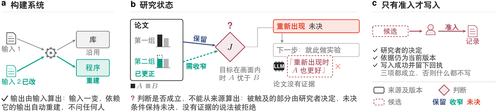

本报告主张的做法位于两者之间：系统沿记录下来的依赖找出相关判断，交回研究者重看；研究者决定保留、收窄或撤回，只有这一决定才写入记录。这样一件等研究者重看的事，下文称为一项复核。要做到这一点，需要满足三个条件。第一，判断要带着依据和适用范围写在研究者自己的文件中，依据指判断引用的来源以及该来源当时的版本；否则系统没有依赖可循。第二，AI 助手和其他对话写出的结论先只算草稿，下文称为候选；研究者点头之后才写进记录，这一步称为准入。否则学生助手那条没有证据支持的说法就可能直接改变结论。第三，复核一旦登记就一直留着，只有两种情况才关闭：研究者明确作出决定，或者系统能够自行核对的检查通过（例如判断的依据已经更新到来源的当前版本）。否则没有人看过的复核会悄然消失。第 2 节展示这三个条件在一次工作中的样子，第 3、4 节说明它们的理由与定义。

这里先说清它做什么、不做什么。它不会替研究者盯着期刊，也收不到更正或撤稿的通知。研究者知道某篇论文更正了，自己或请助手更新这篇论文的笔记之后，系统从这里接手：它告诉研究者哪几条判断靠的是这篇论文，需要重看。保留、收窄还是撤回，仍由研究者决定。

**ReSearchOS** 是按这一做法构建的研究环境，由研究者拥有，以本地文件为主。[^name] 本报告的贡献有三项：判断记录的格式与准入协议，一个命令行原型，以及与相近系统的逐类对照。读者可以下载一个版本，在自己的材料上试用，第 2 节说明怎样开始。第 4 节的定义是一份设计规格，原型实现了其中的一部分，适用范围集中写在第 5 节。本报告面向已经习惯核对来源、同一个项目隔几天或几周回来继续做的研究者；新手的学习和团队分歧的处理需要另行研究。这一做法是否比更简单的做法（一页交接文档，加一个能直接读写文件的强模型）更好，尚未比较，第 7 节说明怎样检验。

## 2. 一次会话

本节沿用第 1 节的例子，从研究者的角度走一遍更正之后的那次会话：研究者看到什么，决定什么，系统又记下了什么。一次会话，指研究者从开始工作到收工的这一段。方法 $A$、$B$ 均为虚构，不报告任何真实方法的效果。把第 1 节的结论写完整，判断 $J$ 是“目标在画面内时，$A$ 优于 $B$”。图 2 画出了这次会话，表 1 列出它用到的六条命令；命令在终端（电脑上输入文字命令的窗口）里输入，屏幕上的用词与本报告相同。

**怎样开始。** 读者可以下载一个版本，在自己的电脑上试用；本段以可下载版本 v1.1.0 的 README 为准。需要两样东西：Python 3.10 或更高版本，以及一个 AI 助手。本报告把研究者平时对话用的助手统称 AI 助手；其中能直接在电脑上读写文件、运行命令的，下文称 Agent，例如 Claude Code 或 Codex；AI 模型指这些助手背后的模型。最省事的是引导上手，这需要一个 Agent：用户对它说一句话，请它安装可下载版本并按其中的首次运行说明带着设置。它先在虚构的例子上说明系统做什么，再根据用户的发表清单、几篇论文、合作者和一个正在进行的项目建好用户自己的卡片，写入之前先把卡片清单交给用户过目。卡片是一份 Markdown 笔记，记一篇论文、一个项目或一位合作者。README 称这一过程约需十五到三十分钟，并另给出约十分钟的自行上手步骤：用户自己在终端里输入命令，从一个虚构例子的演示开始。

下面这次会话的各步，可下载版本照样做：发现来源的变化，把相关判断交回，准备交给助手的任务，把助手的回答收回来作为候选，收工时列出还剩什么。不同在写进记录的那一步：准入和重新确认都只把建议的改动显示出来，由用户自己或助手照着写进卡片，用户再在终端上确认；拒绝也不另作记录，收工时候选都列为尚未决定。也就是说，可下载版本默认不准入，它不替用户改卡片。不用 Agent 也能走完这些步骤：用户在 Mac 或 Linux 的终端里（Windows 要先装 WSL）自己输入用户手册第 3 节的命令；系统把要交给助手的任务写成一段文本，称为任务包，可以粘贴给任何助手，包括浏览器里的 ChatGPT 或 Claude；助手的回答存成文件，用 `ros collect … --file` 交回。只有引导式的安装需要 Agent。用户的卡片放在本机的 `personal_vault/` 文件夹中，这个文件夹被 Git 忽略，不随仓库上传；卡片是开头带一小段说明字段的 Markdown 文件，随附的模板给出格式。论文 PDF、数据这类原始材料可以留在原处、放在仓库之外，卡片记下它们的路径；系统比对的是卡片，原处的文件变了，要先更新对应的卡片。卡片本身是普通的 Markdown 文件，Obsidian 这类 Markdown 编辑器都能打开；手工改过的判断块，下一条 `ros` 命令会登记为待用户在终端上确认的事项。助手读到的文件会发给助手的服务商处理。平时用 Agent 做的其他工作照常进行，只有经 `ros collect` 回收或经 `ros propose` 登记的判断才进入候选这条路径。下面的例子按作者自己使用的原型来讲：在原型里，研究者在终端上确认之后由系统写入；原型运行在作者本人的记录上，不对外分发。可下载版本的运行方式与出厂配置见附录 B.4。

这次会话能够发生，靠的是研究者此前做过的一件事：把 $J$ 写在一张卡片上，并确认把它写入了记录。$J$ 在卡片上是一个判断块，即带标识的一段判断，其中的依据一行写明它引用的来源和版本，这里是论文的 $v_1$；下文把这叫作依据钉在 $v_1$ 上。系统只从这样的判断块出发寻找依赖，不从普通笔记中推断。随后论文更正为 $v_2$：第二组的数字改变，第一组不变。研究者知道之后，自己或请 Agent 更新了记录这篇论文的笔记文件 `01_knowledge/papers/paper.md`，系统从这里接手。

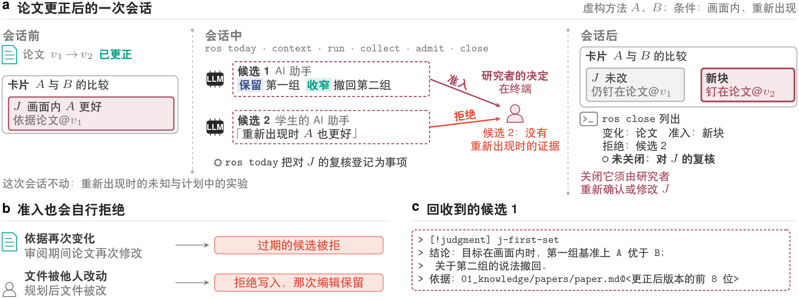

研究者开始工作时先运行 `ros today`。这是更正之后的第一条 `ros` 命令，它看到论文笔记的内容已经改变，于是在待判断一栏列出一项复核：$J$ 所依据的论文有了新版本，需要研究者重看。复核是系统登记的一件待办，这类待办下文统称事项。不管论文此后再改几次，都是同一项复核，只更新所对应的版本，不会重复登记，也不会因为关掉对话就消失。此时系统并不提问，也不判断更正是否重要：更正可能只改了一个错字，判断依旧成立。

接下来研究者请 AI 助手重读更正后的论文。`ros context` 列出这项工作可以使用的来源和当前记录，并留下一份回执，记下交付了哪些材料；`ros run` 为承载 $J$ 的卡片写出一个任务包，即装有任务和这些材料的一份 Markdown 文本，由用户粘贴给自己使用的助手，这一步不调用任何 AI 服务。任务包只含这张卡片，更正后的论文由用户一并交给助手。助手写出草稿后，`ros collect` 把草稿读回，作为候选。草稿中只有一到三个判断块会被读取，其余内容一律忽略：

```
> [!judgment] j-first-set
> 结论：目标在画面内时，第一组基准上 A 优于 B；关于第二组的说法撤回。
> 依据：01_knowledge/papers/paper.md@<更正后版本的前 8 位>
```

依据一行里 `@` 之后是版本的标识，由系统按文件内容算出，写出前 8 位即可；这个候选把依据钉在 $v_2$。系统按文件记录依据，看不到论文内部第一组与第二组的划分，所以“第二组的说法撤回”是候选写明、由研究者判断的内容，不是系统算出来的。回收时的几项细节检查见附录 B.4。

研究者审阅上面的候选之后运行 `ros admit` 并在终端上确认，系统把它作为新的判断块写在 $J$ 旁边，这次准入记为研究者的决定。同一次会话中，学生的 AI 助手给出的候选“目标重新出现后 $A$ 也更好”也被回收，依据同样钉在 $v_2$。论文没有报告这种情形的任何结果，研究者在终端拒绝了它；这一拒绝记录在案，不写入判断。论文若在审阅期间又改了一次，系统会拒绝候选，请研究者在当前材料上重新提议；这类由系统作出的拒绝都不是科学判断（附录 B.4）。

<!-- table: 一次会话的六条命令：研究者做什么，系统记下什么 -->
| 命令 | 研究者看到什么、决定什么 | 系统记下什么 |
| --- | --- | --- |
| `ros today` | 开始工作时看到待判断的事项，其中有来源变化后需要复核的判断 | 观察来源文件的变化，登记复核事项 |
| `ros context` | 得到这项工作获准使用的来源和当前记录 | 交付了哪些材料的回执 |
| `ros run` | 得到一个任务包，粘贴给自己使用的助手 | 任务包；这一步不调用 AI 服务 |
| `ros collect` | 把助手的草稿交回 | 草稿中的判断块成为候选，依据钉在版本上 |
| `ros admit` | 决定候选是否写入记录，并在终端上确认 | 准入的判断块与回执；依据已过期时拒绝 |
| `ros close` | 结束工作时看到变化、准入、拒绝、尚未决定的候选和仍未关闭的事项 | 会话的结果与残留工作 |

会话以 `ros close` 结束，它列出这次会话中的变化、准入、拒绝、尚未决定的候选和仍未关闭的事项。此时对 $J$ 的复核仍未关闭，因为新块的准入并不改变 $J$：$J$ 的依据仍钉在 $v_1$，收窄后的新块与原判断并存，$J$ 本身留给研究者处理。结局有三种。研究者认为 $J$ 在 $v_2$ 下仍然成立，就重新确认，把依据钉到 $v_2$，复核随之关闭。要改，就写下新的判断，再处理原来的 $J$（第 4 节）。暂时不处理，可以在终端上说明理由后取消这项复核；取消只针对当前的版本，$J$ 或它的依据再次变化时，复核重新打开。上述决定都在终端上作出，系统据此把它们记为研究者的决定；让 Agent 代为运行这些命令时怎样记录，见第 5 节。

可下载版本另有一个可选的图形界面 Dashboard，在浏览器里把一个条目的研究记录摆在一页上：进展，判断、边界与来源，以及下一步（图 3）。它还能把一个条目整理成一段交接文本，供用户复制给助手（图 4）。在出厂设置下，这个界面用于查看和复制：条目的生命周期在此不能保存，交接包只能预览和复制。这两张截图展示的是它如何呈现一个条目，并不表示任务已完成或判断已被接受，也不说明界面的可用性。用户若想在自己的卡片上使用 Dashboard，可以用 personal-vault 模式启动可下载版本：这一模式从 `personal_vault/` 中的卡片生成本机的 Dashboard 视图，经用户确认后把 Dashboard 的修改写入这个文件夹；经自行配置，还可以启动本机安装的 Codex CLI。`ros` 命令不随这一模式改变。

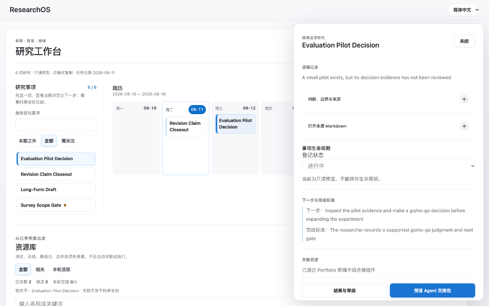

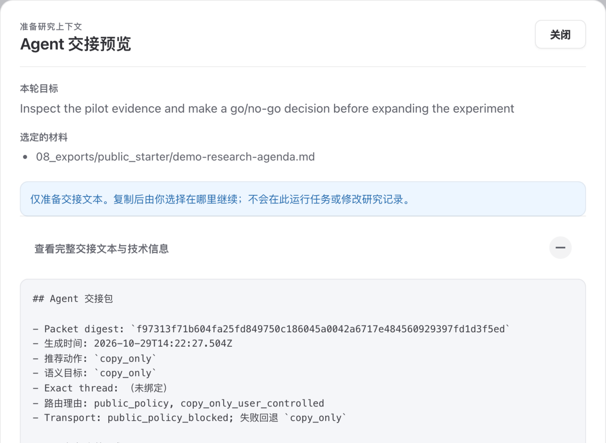

## 3. 环境要保住什么

第 2 节把关于 $J$ 的决定留给了研究者。这一决定要在数周之后、在更换 AI 模型和客户端之后依然留在研究者手中，环境就要保住三样东西：决定权，记录，以及被纠正的主张的历史。三项原则分别对应这三样东西。当效率、控制与长期留存相互牵制时，这些原则确定优先次序，并不规定统一的目录、方法、界面或审阅安排。研究记录需要时间阅读、需要精力维护，审阅也可能打断工作，或久而久之流于习惯，因此检查集中在关键的转变之处，常规工作则在约定的范围内照常进行。

第一项原则是只有研究者能把候选变成记录。学生的 AI 助手提出 $A$ 在目标重新出现后同样更好；这一说法若未经研究者决定就写入记录，$J$ 就会扩展到论文并不支持的情形。因此，AI 模型和其他会话的产出一律先作为候选，由研究者决定是否准入（第 4 节）。准入确定的是谁接受了候选，候选是否正确仍有待后续的检查，因为研究者的认同并不证明科学判断正确。这项原则在原型里落实到什么程度，见第 5 节。

第二项原则是记录独立于写下它的工具。如果 $J$ 及其依据只存在于产生它们的那次对话中，论文日后被更正时，就无从看出这次更正触及了 $J$。因此，权威的是研究者本地可读、可版本化的记录，AI 模型、客户端与插件都可以替换。在原型中，$J$ 写在一张卡片上，依据钉在来源的版本上，上下文连同回执一起交付（第 2 节）。相应地，界面上显示“已完成”并不等于已被接受，工具为加快速度临时存下的副本也不算另一份记录。留存不等于检索：记录要连同其适用范围一起保存，后续工作才能判断它是否仍然适用。

第三项原则是纠正只收窄主张，不抹掉历史。更正只触及第二组基准，若删除 $J$，既会抹去更正并未触及的第一组证据，也会抹去第二组上的主张曾被接受的记录。因此，失败、未知与未验证的状态都如实保留，改动的内容、改动的理由以及仍然有用的部分也一并留存。在第 2 节的会话中，收窄后的判断准入在 $J$ 旁边，而对 $J$ 的复核要等研究者处理 $J$ 本身才关闭（第 4 节）。

这三项原则来自作者自身的设计历程，本节概括自作者的内部设计文件，并已与之核对。表 2 列出三项原则回答的问题、作出的规定及其机制，[补充说明 1](technical-report-supplement.zh.md#%E8%A1%A5%E5%85%85%E8%AF%B4%E6%98%8E-1-%E5%8E%9F%E5%88%99%E7%9A%84%E6%9D%A5%E6%BA%90%E4%B8%8E%E4%BE%8B%E5%AD%90) 给出各项原则的例子与来源，以及一项因为还没有对应的命令和测试而未列入本节的原则，[补充说明 3](technical-report-supplement.zh.md#%E8%A1%A5%E5%85%85%E8%AF%B4%E6%98%8E-3-%E8%BF%87%E7%A8%8B%E4%B8%8E%E7%BB%84%E4%BB%B6%E5%90%88%E5%90%8C) 完整复述这些条款，并注明各条的负责方。

<!-- table: 三项设计原则及其机制 -->
| 原则 | 它回答的问题 | 规定 | 机制 |
| --- | --- | --- | --- |
| 人的判断 | 由谁接受判断？ | 只有研究者决定什么写入记录；机器的产出一律先作为候选 | 候选、决定、修改、检查与回执分别记录；研究者的决定只在终端上得到记录 |
| 比工具活得久的记录 | 更换工具后保留什么？ | 以本地可读、可版本化的记录为准；AI 模型、客户端、插件可替换 | 记录归研究者所有，上下文回执，依据钉在来源版本上 |
| 可纠正的积累 | 纠错后哪些判断需要改变？ | 纠正只收窄受影响的主张，不抹去历史；失败、未知与未验证如实保留 | 收窄的判断块与原判断并存，撤销写入时留下回执，事项跨会话保持未关闭 |

## 4. 触及、复核与关闭

第 3 节的原则说明了要保住什么，却没有说明怎样才算保住。本节给出使之可以检查的定义，仍用第 1 节的例子，只用四个词：判断、依据、候选、复核；其余对象与状态在正文中用普通的说法，完整列在附录 A。这些定义是一份设计规格，规定的是系统应当做到什么，[补充说明 5](technical-report-supplement.zh.md#%E8%A1%A5%E5%85%85%E8%AF%B4%E6%98%8E-5-%E5%BD%A2%E5%BC%8F%E8%A7%84%E6%A0%BC) 精确表述每条定义；原型实现到什么程度，集中在第 5 节说明。

第 1 节说过，数周之后回到一项工作时，研究者需要五项内容：问题，证据，判断，未决的条件，以及下一步。**研究状态**（research state）就是从研究者的记录重建出来的这五项内容。它是重建而不是概述，因此每一项都可以回到记录上检查和纠正；它包含多少内容，取决于问题需要什么，而不取决于材料的多少。

五项之中，**判断**（研究者已经接受的结论，连同它成立的范围）最难维护，因为支持判断的证据在判断之外，来源变了，判断的文字不会有任何变化。所以判断要写成判断块，并记下**依据**，即它引用的来源及该来源的版本；$J$ 的依据钉在论文的 $v_1$ 上。下文的一切都以这条记录为前提。判断是否成立不能从来源机械地推出，所以系统算不出它；系统能够找到依赖某个来源的判断，也只是因为这一依赖已经写下。

这样，第一个问题是变化牵涉哪些判断。论文从 $v_1$ 更正为 $v_2$ 之后，$J$ 钉定的版本不再是论文的当前版本，这时就说这次变化触及 $J$，系统为它登记一项**复核**，即询问 $J$ 是否仍然成立的事项。论文再次变化时，涉及的仍是这一项复核，不会另起一项。触及只沿记录下来的依赖传递：重新出现实验并不以这篇论文为依据，所以未被触及（图 5）。可见，触及标出的是需要查看什么，而不是需要修改什么。假如更正只改了一个错字，$J$ 同样被触及，却没有需要修改之处。

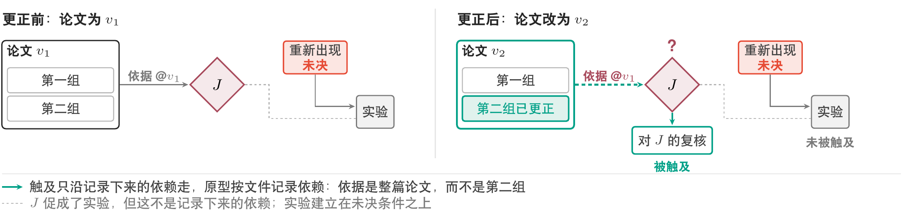

第二个问题是复核怎样才算结束。复核一经登记就保持未关闭，只有两种途径能关闭它：它的检查全部通过，或者研究者作出明确的决定。正因如此，它不随对话结束而消失。对 $J$ 的复核要回答的是 $J$ 在 $v_2$ 下是否仍然成立，这只有研究者能够判断，结局有三种。$J$ 仍然成立，研究者就重新确认（`ros admit --reconfirm`），把依据钉到 $v_2$，针对依据的检查随之通过，复核关闭。$J$ 需要收窄，研究者就像第 2 节那样在它旁边准入一个钉在 $v_2$ 上的新块，然后处理 $J$ 本身：手工修改它，再在终端上事后确认这次修改（`ros admit --confirm`）；或者删去它，这时系统向研究者提出一个选项有限的问题，复核等待回答。暂时不处理，研究者可以在终端上附理由取消复核（`ros decide … cancel`），或者把它推迟到某一日期；被推迟的复核和等待回答的复核都仍未关闭，`ros close` 会把它们列出（附录 A）。这些关闭都不是永久的：论文再次变化时，同一项复核重新打开。这里的检查有多强要说清楚：它通过只说明依据已钉到当前版本，并不说明有人读过这次更正。

第三个问题是新内容怎样进入记录。作用于研究状态的有三方（图 6）：环境从它可以使用的历史中选取上下文，重建研究状态，并连同候选一起呈现；AI 模型提出产出与修改；研究者决定接下来发生什么。AI 模型提出的内容是**候选**，即尚未进入记录的产出。按规格，候选进入研究者的记录只有准入一条途径，它有三个条件。第一个条件是研究者的决定，AI 模型的产出和候选自身的文字都不能代替它。其余两个条件不是决定，而是写入时的检查：依据必须仍是来源的当前版本，写入必须确实完成并留下回执（补充说明 5 的形式版本把这三个条件细分为五个，写入时的拒绝情形见附录 B.4）。准入确定的只是操作层面的决定：研究者的接受不使判断在科学上为真，软件检查通过既不确立研究者接受了什么，也不确立判断有效。

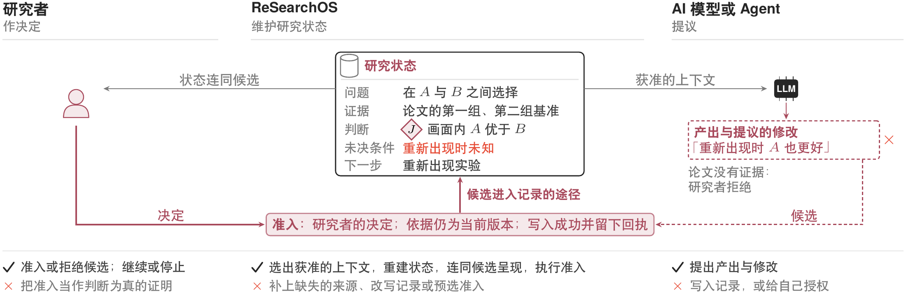

## 5. 原型

第 2 节的会话运行在一个命令行原型上，它实现了第 4 节规格的一部分。本节先讲原型做到了什么，再讲卡片可以经哪些入口写入、代码怎样构成，最后集中说明原型的适用范围；其他各节指到这里的限定，都写在“适用范围”中。本节所述的版本见附录 B.3，背后的命令与记录表见[补充说明 2](technical-report-supplement.zh.md#%E8%A1%A5%E5%85%85%E8%AF%B4%E6%98%8E-2-%E4%BC%9A%E8%AF%9D%E6%93%8D%E4%BD%9C%E4%B8%8E%E5%AE%9E%E7%8E%B0%E6%98%A0%E5%B0%84)。

原型做到了三件事，这几件事都由自动测试在虚构数据上演练过（附录 B.4）。第一，原型能发现来源的变化。检测从研究者写下的判断块和依据开始；多数 `ros` 命令开始时比较一次，因此来源文件的变化在下一条这样的命令时被发现，并登记为一项事项，来源再变也还是同一项。

第二，判断在进入记录的途中始终绑定它的来源。事实与判断经由不同的路径进入记录（图 7a）：事实可以在用户已同意的任务范围内直接更新，判断则要经过候选、决定、写入、检查与回执，每一步分别记录。候选登记时，它的每项依据都按当时的版本固定下来，依据若在审阅期间改变，准入就拒绝这个候选并要求重新提议。写入同样要核对：计划写入之后文件内容若已改变，系统拒绝写入，其间的编辑得以保留。

第三，关于事项的明确决定只在终端上接受。事项只经检查通过或明确决定关闭，取消与确认这类决定只有在终端输入才生效；同样的决定由 Agent 转述时，事项保持未关闭。没有经过准入就直接写下的判断块，会在下一条 `ros` 命令时登记为事项，等研究者事后确认，这一确认同样只在终端生效，因此直接写下的判断不会无人过问地留在记录中。

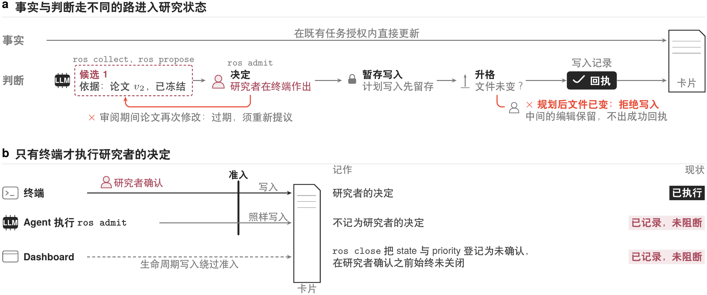

### 三个入口

能够写入同一张卡片的入口有三个，研究者的决定只在其中一个上得到记录（图 7b）。研究者在终端上作的决定，记为研究者的决定。让 Agent 替研究者运行这些命令时，不出现确认提示；准入与重新确认照样写入，重新确认还会使检查通过、复核随之关闭，但它们只记为 Agent 的操作，不记为研究者的决定。Dashboard 的写入不经过准入这一步。可见对 Agent 而言，这些记录是归属与可供事后查对的线索，而不是拦截。各入口的细节见附录 B.4。

### 代码结构与适用范围

入口之间的差别源于代码现有的构成（图 8）。研究者的记录是本地的 Markdown 卡片。负责计算的核心部分称为内核（代码中的内核包 `researchos_kernel`），它不直接读取卡片：它得到的是卡片的一份快照，从中计算变化、事项与检查，只写入自己的账本；对卡片的写入先暂存，核对之后才落到文件，并留下回执。终端和 Agent 运行的是同一个命令行入口 `scripts/ros.py`。与目标设计相比，现有代码有两处不同：准入仍由 `ros.py` 执行，而不在内核中；Dashboard 由本机的另一个服务提供，写入时不经过 `ros.py`，上述保护对它不起作用。各部分的名称与细节见附录 B.4。


**适用范围。** 第一阶段的范围，也就是原型的适用范围，是：一位研究者，记录是本机的 Markdown 文件，研究者的决定在自己的终端上作出。在这个范围内，有五点需要知道。（1）它只认判断块。依赖全部来自研究者写成判断块、带依据的记录，普通笔记里的结论系统不去推断；没有判断块，`ros today` 找不到需要复核的判断。它只读取配置中列出的目录下的 Markdown 文件，论文的 PDF 本身变化时，它看不到。（2）它按文件工作，不按论据。依据是一个文件及其内容摘要（由内容算出的一串标识），检查只问依据是否钉在当前版本上，看不到更正落在文件的哪一部分；检查通过只说明依据已钉到当前版本，并不说明有人读过这次更正。第一组的结果是否仍支持 $J$ 由研究者判断，这与定义一致；原型也没有可供参考的语义支持检查（补充说明 6），替换或撤回 $J$ 同样由研究者手工完成。因此，交回的是一整条判断，而不是其中被触及的那一部分；只交回被触及的部分目前还是设计。（3）它在命令运行时工作。没有文件监听，也没有后台进程，变化要到下一条 `ros` 命令才被看到，也不跨多跳传播。它不检索新研究，也不接收更正或撤稿的通知：一项新研究若没有改变任何已记录的输入，系统不会注意到它；它也不向研究者以外的读者显示某项判断正待复核。（4）只有终端上的确认记为研究者的决定。Agent 运行的准入与重新确认照样写入，Dashboard 的写入不经过准入（上一小节）。（5）研究者陈述的条件和计划中的实验不登记，它们只是卡片上的文字，`ros close` 不列出它们。可下载版本默认不准入，写入由用户完成并在终端上确认（第 2 节“怎样开始”）。

规格中还有几条路径第一阶段不包含。按规格，复核应带着一个问题等待研究者回答（补充说明 5）；第一阶段只有复核的对象已不存在时（例如 $J$ 被删除），系统才提问。研究者在终端上确认的延期确实生效，但还没有机制会因范围外的依赖产生延期。`ros admit` 启动之后、终端应答之前的变化不被拒绝：块按旧版本写入，同一命令随即登记复核。版本只按内容摘要标识，内容改回原样算回到原先的版本，复核也随之解决。内置检查只保护随附的写入路径；一条规则要求写入后保持不变的内容，它不逐一核对。跨客户端集成也尚未验证。这些路径的细节见附录 B.1 与 B.4。

第 4 节连同补充说明 5 是规格，当前代码只提供其中若干可运行路径；哪些做到了、哪些没有，是逐条登记的，不由测试数量推断。表 3 按主题归纳最要紧的条目，并说明每组对原型使用者意味着什么，完整清单见[补充说明 6](technical-report-supplement.zh.md#%E8%A1%A5%E5%85%85%E8%AF%B4%E6%98%8E-6-%E7%AC%AC%E4%B8%80%E9%98%B6%E6%AE%B5%E7%9A%84%E8%8C%83%E5%9B%B4)；表 3 与附录中的条目编号即该说明的编号。这些条目限定的是实现能够主张什么，定义本身并不因此改变。

<!-- table: 第一阶段的范围，按主题 -->
| 主题 | 条目编号（对应补充说明 6） | 对原型使用者意味着什么 |
| --- | --- | --- |
| 准入与写回 | 1、2、9 | Agent 执行的准入与重新确认、Dashboard 写入都只被记录、不被阻断；内置检查只保护随附的写入路径，一条规则要求写入后保持不变的内容，它不逐一核对。 |
| 会话与完成 | 15、17、18 | 会话开始时固定下来的范围与规则并不完整，范围外的依赖不产生延期；即使一项事项也没有解决，只要剩下的都在待答或延期，会话收尾时仍算作完成，只是列出这些事项，规格为这种情形另设的结果没有实现（附录 B.2）。 |
| 依赖与维护 | 3、10、11、12、34 | 单一的稳定内核仍是目标，因为准入仍由 `ros.py` 执行。前后步骤的通用检查、更正时对有独立支持部分的保护、陈述条件与计划实验的登记、文件监听与多跳传播都只停留在规格。 |
| 验收与收益 | 13、14 | 界面的真人验收、真实模型的隔离、长期恢复与科研收益都尚未验证。 |

上面所说的自动测试回答的是执行层面的问题。另一些问题需要另一类证据：收窄后的判断是否正确，实验是否值得进行，研究者是否理解得更多。这些问题需要实际任务和独立证据，软件检查既不构成验收，也不确立科学有效性；本报告也不假定研究者的理解会因此受益。作者是原型目前唯一的用户，同时是它的开发者和全部结果的评估者。使用研究尚未进行，原型也尚未与更简单的做法（一页交接文档加强模型，第 7 节）比较，因此本报告不主张科研收益。

## 6. 相近系统

本节把这一做法放回研究者已在使用的工具之中，先看它与这些工具相同的地方，再看不同的地方。这里让第 1 节的论文在每一类工具中都更正一次，表 4 记录更正之后发生什么。每一行描述的是该类中点名的或典型的系统所报告的机制，并不涵盖该类的每个系统，也不涉及接入情况或性能。ReSearchOS 在表中分为两行，因为规格不能与别人的实现比较：“原型”一行写第 5 节的代码所做的事，“设计”一行写第 4 节与[补充说明 5](technical-report-supplement.zh.md#%E8%A1%A5%E5%85%85%E8%AF%B4%E6%98%8E-5-%E5%BD%A2%E5%BC%8F%E8%A7%84%E6%A0%BC)所规定的事。

有些工具把变化交回给人，这种做法并不始于本报告；也有工具沿依赖找到受影响的主张。研究者熟悉的一个例子是活体系统综述：按 Cochrane 的指南，它每月检索新证据，作者判断新研究是否可能对结论产生重要影响 [Cochrane living systematic reviews](https://resources.cochrane.org/sites/resources.cochrane.org/files/uploads/inline-files/Transform/201912_LSR_Revised_Guidance.pdf)；2026 年 6 月，Cochrane 还宣布正把已撤稿的研究与纳入它们的综述相对应，并将在作者评估影响期间添加编辑注 [Cochrane retracted publications](https://www.cochrane.org/about-us/news/cochrane-strengthens-systems-manage-retracted-publications-its-published-reviews)。软件工程中也有同类做法：IBM Engineering Lifecycle Management 这类需求管理工具在链接任一端的内容变化时把追踪链接标为可疑，由团队成员标为有效或无效 [Link validity](https://www.ibm.com/docs/en/engineering-lifecycle-management-suite/lifecycle-management/7.0.3?topic=management-link-validity)；GitHub 的受保护分支可以要求，新提交改变已批准的改动之后须重新批准 [Protected branches](https://docs.github.com/en/repositories/configuring-branches-and-merges-in-your-repository/managing-protected-branches/about-protected-branches)。在单条主张的层面上，更接近的做法是一篇论文的定量主张台账，数据指纹一旦变化，主张就被标为过期 [Provable discourse](https://arxiv.org/abs/2603.10450)。本报告所见最接近第 4 节“触及”的机制，是 Zhang 为受监管场景中由语言模型维护的 wiki 所做的溯源层 [Provenance-native wiki](https://doi.org/10.53941/aiet.2026.100010)。它把主张绑定到证据段落，当某个来源被标为撤回、被取代或降级时，沿这些链接找到依赖它的主张、规则和决策，由系统按规则和阈值把主张标为有争议或暂停，并标记下游的决策（补充说明 4）。

其中两者做了 ReSearchOS 不做的事。活体综述检索新研究，向读者显示某项结论尚待更新，并有作者团队与编辑流程；ReSearchOS 不检索新研究，也不向研究者以外的读者显示待复核的判断（第 1 节；第 5 节适用范围（3）），本报告的做法不能代替活体综述。溯源层沿整条记录链传递，并报告了受控评估：在 112 篇文档的语料上进行五次模拟撤回，受影响的记录全部被找到。原型只沿已记录的依赖走一步，也还没有这样的评估。

另几类系统自行处理这次变化，或者不作处理（图 9）。在笔记工具中，笔记保持原样，直到研究者亲手或通过助手修改。版本控制通过乐观并发控制 [Optimistic concurrency control](https://doi.org/10.1145/319566.319567) 拒绝过期写入，原型拒绝已变文件所用的也是这一机制，但版本控制不区分事实与判断。真值维护系统 [Truth maintenance system](https://doi.org/10.1016/0004-3702%2879%2990008-0) 沿记录的理由自行重新标注信念：若把两组基准画作两条独立的理由，$J$ 凭第一组继续成立（图 9c）；ReSearchOS 则只报告依据不再是当前版本，判断是否仍然成立由研究者决定。构建系统 [Build systems à la carte](https://doi.org/10.1145/3236774) 重建被输入变化失效的结果。在 Agent 记忆中，Graphiti [Zep](https://arxiv.org/abs/2501.13956) 使被反驳的事实失效，PACMI [PACMI](https://arxiv.org/abs/2610.05732) 把依赖于已变化证据的记忆标为待核实，都不询问任何人；GovMem [GovMem](https://arxiv.org/abs/2607.02579) 把有疑问的候选记忆交给人审阅，但只发生在写入之前。AI 科学家系统的论文没有报告由来源更正触发的步骤。

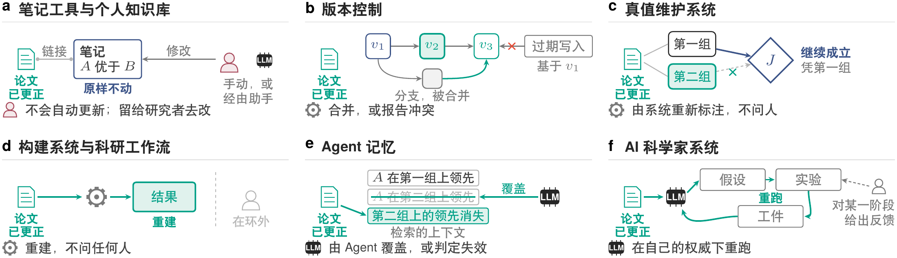

ReSearchOS 的不同之处，在于交回的是什么、由谁处理。在上述工具中，保持未决的是一条链接、一次待合并的改动、一整篇综述或一整条主张。溯源层由系统按规则和阈值为一整条主张设定状态，其论文既没有描述主张上的范围，也没有就哪部分仍然成立询问人。由研究者批准或确认也有先例，但都不涉及会被交回的判断：OmniScientist [OmniScientist](https://arxiv.org/abs/2511.16931) 记录人对工件及其版本的批准，被批准的是工件，而不是来源变化后会交回的判断；Magnolia [Magnolia](https://arxiv.org/abs/2610.27230) 的跨项目规则要等研究者逐条确认才启用，ResearchLoop [ResearchLoop](https://arxiv.org/abs/2605.28282) 只在研究者或预先指定的协议文件编写的门槛所批准的范围内准入主张；这两篇论文都没有描述在来源后来变化时把已准入的结果交回研究者。

在本报告考察的系统中，没有一个同时做到三件事：保存研究者准入的判断及其依据版本，来源变化时把判断作为一项事项交回研究者，并且只通过研究者准入的候选修改这条记录。ReSearchOS 的原型做到前两件；第三件只在终端上的确认成立，而且目前只及于新判断，已有的判断仍由研究者手工修改或重新钉定（第 5 节适用范围（2）（4））。

<!-- table: 论文更正之后，相近系统保留什么、发生什么、留下什么 -->
| 系统类别 | 保留什么 | 来源变化时发生什么 | 保持未决的是什么 |
| --- | --- | --- | --- |
| 个人知识库与笔记工具 | 笔记与链接 | 不发生变化；由研究者亲手或通过助手修改 | 无；未决问题只是一条笔记 |
| 带乐观并发的版本控制 | 每个版本；拒绝过期写入 | 合并，或报告冲突 | 分支，但不说分支意味着什么 |
| 真值维护系统（JTMS、LTMS、ATMS） | 结论及其理由 | 自行沿理由重新标注；仍有别的有效理由的结论继续成立 | 未知标签（LTMS）或同时保留多个相容语境（ATMS），由系统处理，不交给研究者 |
| 撤稿处理与主张台账 | 综述及其纳入的研究，或带证据指纹、绑定证据段落的主张 | 提示被撤稿的研究，在数据变化时把主张标为过期，或按阈值把主张标为有争议、在失去支持时暂停，并标记下游决策 | 一整篇综述（Cochrane 宣布将为其加编辑注），作者更新之前的一整条主张，或被系统暂停的一整条主张；不按范围，也没有待准入的候选 |
| 构建系统与科研工作流 | 键、值及其输入 | 重建被变化失效的部分 | 无；人在环外 |
| 科研知识图谱与实验跟踪器 | 比较记录、运行与谱系 | 记录本身更新，建立在记录之上的判断不变 | 无 |
| Agent 记忆（RAG、A-MEM、Mem0、MemOS、Graphiti、PACMI） | 检索与压缩后的上下文 | 覆盖、重排，或由 Agent 判定失效 | 至多是系统设定的待核实标记；不交给研究者 |
| AI 科学家系统（AI Scientist、Agent Laboratory、Co-Scientist、Kosmos、Denario） | 假设、实验与工件 | 未报告对来源变化的反应；研究者可以发起或引导一次运行 | 没有保持未决的内容 |
| ReSearchOS（原型） | 带依据版本的判断块，依据按文件记录；适用条件是原型不读取的文字 | 下一条命令时登记一项复核；只有准入的候选才写入，原判断不变，由研究者另行处理 | 对一整条判断的复核，直到检查通过或研究者在终端作出明确决定；不登记未决条件与计划的实验 |
| ReSearchOS（设计） | 带范围与依据版本的判断 | 只经研究者准入的候选更新被触及的部分 | 未决条件，以及等待研究者回答的检查 |

图 10 把这一比较摆在两条轴上：来源变化之后保持未决的是什么，取自表 4 与上文；以及由谁处理这次变化。科研知识图谱与实验跟踪器没有画入，因为表 4 没有说明由谁更新它们的记录。ReSearchOS 在图中出现两次：设计位于“被触及的部分”一列，原型交回的是一整条判断，位于研究者一行的“一整条主张”一列。

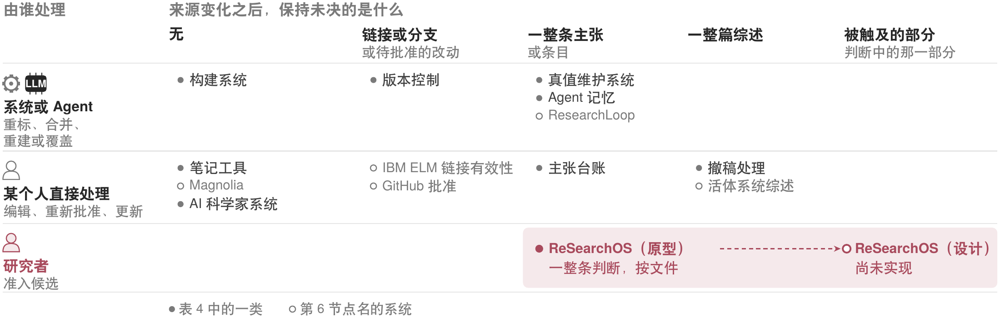

[补充说明 4](technical-report-supplement.zh.md#%E8%A1%A5%E5%85%85%E8%AF%B4%E6%98%8E-4-%E7%A0%94%E7%A9%B6%E5%9F%BA%E7%A1%80%E8%AF%A6%E8%BF%B0) 给出完整综述，其中也包括本节从略的系统。以上对照说明的是这些系统的机制不同；这种不同是否有用，是第 7 节的问题。

## 7. 适合谁，怎样检验

这种不同是否有用，首先取决于工作本身。这一设计针对的是有三个特点的工作，也就是第 1 节例子的三个特点：项目持续数周乃至数月，后续步骤建立在早先的判断之上；所用的来源中途可能被更正或替换；研究者之外还有人（学生或 AI 助手）写下可能进入记录的结论。原型多出的几项只在来源变化或有他人提出结论时才起作用，所以项目短、来源固定、每条结论都出自同一位作者时，清晰的交接（把工作现状写成一页文档，交给助手）已经够用，也更合适。三个特点俱全的工作，是它针对的情形。想试用的读者可以挑一个这样的真实项目，最好会持续几个月、所用的来源可能被更正或替换，把可下载版本和自己平时的交接方式对照着用。它是否比一页交接文档加一个强模型更好，尚未比较；这是作者接下来的检验工作，下面说明怎样做。

这项检验是一次比较（图 11）。两种对照都与原型使用相同的来源、工具、模型与投入预算，在足够多的真实研究任务上进行：一种是能直接读写文件的强模型配一页随版本保存的交接文档，另一种是同一模型配写在研究者文件中、带依据版本的判断块，但不使用原型。第二种是更贴近本报告主张的公平对照，因为依赖记录已经在判断块里，模型可以自行比对版本、找出过期的判断。原型比它多出的只有三项：事项的持久身份，对过期候选的拒绝，以及只经检查通过或终端决定才关闭复核。任务因此必须包含来源变化，并且变化要有机会落在审阅期间和两次会话之间，否则这三项无从起作用；迄今作者从自己九十天的记录中重建的四个历史请求（补充说明 1）都不涉及来源变化，不能代替这样的任务。

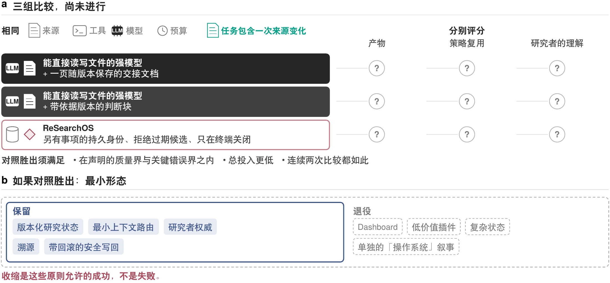

比较结果将决定哪些部分保留（图 11b）：额外的结构只有在帮助研究者注意到来源的变化、修订判断、避免重复工作时才值得保留。对照胜出的标准，以及那时哪些部分应当收缩，作者已事先写下，见补充说明 1「四个历史请求」一小节中讲这项比较的一段。

这项比较需要分开评价三件事：工件、策略复用，以及研究者的理解。产出的质量本身不能说明研究者理解了多少：生成式 AI 与学习的研究主张评估对认知与元认知的影响 [GenAI and human learning](https://doi.org/10.1038/s41562-024-02004-5)，元分析发现人机结合的平均表现低于人或 AI 中较优的一方 [Human–AI combinations](https://doi.org/10.1038/s41562-024-02024-1)，反馈循环实验发现 AI 会改变人的判断，而且人往往没有察觉 [Human–AI feedback loops](https://doi.org/10.1038/s41562-024-02077-2)。这项比较与第一项使用研究（参与者是作者以外的研究者）都尚未进行，第 2–5 节也没有预设它们的结果；在主张任何价值之前，应先用它们的结果修订定义或原型。

## 8. 结论

来源变化之后，研究判断不应由系统自行重算，因为哪部分仍然成立是对证据的判断，AI 模型可以提议，接受与否由研究者负责；也不必任其失效，因为只要判断写成带版本的判断块，它依赖哪些来源就有记录可循。本报告据此主张把这种交回做到单条研究判断上：系统沿记录下来的依赖找出判断，作为待复核的事项交回研究者，由研究者决定保留、收窄或撤回；机器的产出在研究者准入之前只是候选。原型实现的是这一做法的第一阶段：一位研究者，本机文件，终端上的决定。在这个范围内，来源文件的变化在下一条命令时被发现并登记为事项，依据已过期的候选被拒绝，取消和确认这类明确决定只在终端上生效；读者可以下载一个版本，在自己的材料上试用（第 2 节）。适用范围集中写在第 5 节，表 5 把每项贡献与已给出的证据、尚待证明的部分并列。长期收益属于尚待证明的部分：原型目前只有作者一位用户，第 7 节的比较和使用研究都还没有进行。无论结果如何，判断的哪部分保留、收窄或撤回，都应由研究者决定，而不是由 AI 模型或另一个会话决定。

<!-- table: 贡献、证据与尚待证明 -->
| 贡献 | 本报告给出的证据 | 尚待证明 |
| --- | --- | --- |
| 判断记录的格式与准入协议（第 3、4 节） | 第 4 节的定义；补充说明 5 的规格，以及在所述假设下论证的两条命题；补充说明 1 中促成各项原则的文献与四个历史请求（只作需求来历的先例） | 能否改善真实研究中的理解与决定，使用研究尚未进行；两条命题都不证明完成可达 |
| 命令行原型（第 2、5 节） | 第 2 节的虚构示例（只说明机制）；内核回归测试与附录 B.3 的 CI 运行。这些软件检查既不确立验收，也不确立有效性 | 未实现：按论据记录依赖，陈述的条件与计划实验的登记，文件监听，范围外依赖的等待，后一步对前一步结果的通用检查。未验证：跨客户端集成。终端之外，研究者的决定不被执行（表 3） |
| 与相近系统的逐类对照（第 6 节） | 表 4 与图 9、图 10，记录来源所报告的机制 | 接入情况与性能都未比较；第 7 节与两种对照的比较都未进行；不改动输入的新研究不会被察觉 |

**可用性与伦理。** 参考工件使用公开文献与虚构例子。补充说明 1 列出的四个历史请求重建自作者本人记录的九十天历史，这段历史包含合作者与学生的消息和未发表的工作。它只在本地处理，其符号投影不带标识，也没有任何内容对外分发。个人与项目标识、原始私有文档、未发表的技术细节、私有记录和记录图都不随本报告分发，本报告也不宣布数据集或基准发布。当前软件许可为非商业、源码可见，不主张属于开放源代码促进会（OSI）认可的开源许可。工件获取仍受仓库可见性限制。任何参与者研究都需要知情同意、适用的机构审查、数据最小化与退出安排，安全实验则需要与真实外部效果隔离。

**声明。** AI 辅助参与了来源发现、起草、翻译、制图与排版；科学主张与投稿元数据由作者负责。参考文献中包含相关的合作研究作为方法来源，不把其结果当作对 ReSearchOS 的验证。本报告没有给出参与者结果或长期因果收益。

## 附录 A. 对象与事项的生命周期

第 4 节只用四个词，其余用普通的说法；本附录给出每一类对象与状态的名称，并把它们并列在一起。表 6 列出每一类对象、它可能处于的状态、它在什么条件下转移，以及使它转移的一方。各方是研究者、系统（即内核与第 2、5 节的命令）和 AI 模型，其中 AI 模型的产出只能以候选身份进入。[补充说明 5](technical-report-supplement.zh.md#%E8%A1%A5%E5%85%85%E8%AF%B4%E6%98%8E-5-%E5%BD%A2%E5%BC%8F%E8%A7%84%E6%A0%BC) 给出这些定义的精确表述，以及版本分支、检查的记号、完成条件和两条命题。

**事项**是一件带有稳定身份的维护工作，对判断的复核就是一种事项：来源再次变化时，涉及的仍是这一项，不会另起一项。事项一经登记就保持**未关闭**，直到被关闭；未关闭的事项有两种子状态，两者都让它留在视野之内，`ros close` 把它们列出，但都不使它关闭。一种是**待答**：检查无从判定，系统向研究者提出一个选项有限的问题，事项等待回答。规格允许任何只能由研究者裁定的检查进入待答，随附规则却没有声明这样的检查，因此实际走到这一步的情形是事项的主体已不存在，例如 $J$ 被删除，此时由研究者在终端上取消复核。同一规则版本上的问题只问一次，`ros today` 又把未答的问题集中成一张清单，两者都意在减轻审阅负担，是否有效尚未检验。另一种是**延期**：研究者把事项推迟到某一日期，到期后它重新成为待办。在终端上确认的延期记为研究者的决定；Agent 执行的延期不记为研究者的决定，事项在收尾时仍算未完成。

`ros` 的输出与本报告用词相同：事项、未关闭、待答与延期。代码内部称事项为 issue，其状态取 `open`、`deferred`、`waiting`、`resolved` 与 `cancelled`，前三种即本报告所称的未关闭。待答在代码中是带 `answer:` 触发条件的 `waiting`，延期则是 `ros decide … defer` 产生的 `deferred`，或回答问题时产生的、带日期或事件的 `waiting`。

<!-- table: 对象、状态与由谁改变 -->
| 对象 | 状态 | 条件 | 由谁改变 |
| --- | --- | --- | --- |
| 来源的版本 | 当前，或已被取代 | 系统按内容摘要比较，文件内容变化后，判断钉定的旧版本不再是当前版本；内容改回原样时算回到原先的版本（附录 B.1）。规格中的版本分支与晚到记录见补充说明 5 | 系统，在下一条 `ros` 命令时 |
| 候选 | 已回收待决定、已准入或已拒绝 | 研究者决定接受、依据仍是当前版本、写入完成并留下回执时才被准入。审阅期间依据变化时，这次准入以过期为由被拒绝，须重新提议；文件在写入计划形成后已变时，被拒绝的是这次写入，而不是候选 | `ros collect` 或 `ros propose` 回收它并冻结其依据；研究者准入或拒绝。Agent 执行的准入同样写入，但不记为研究者的决定（条目 1） |
| 判断 | 依据为当前版本，或待复核；研究者可决定保留、收窄或撤回 | 保留：`ros admit --reconfirm` 把依据重新钉到当前版本。收窄：准入钉在新版本上的新块，新块与原判断并存，原判断仍待复核。撤回：研究者手工删去，复核转为待答；原型不保留被撤回判断的文字，这一点不及第三项原则 | 系统标记待复核；研究者决定。原型既不能替换也不能撤回已有判断，由研究者手工修改或删除（条目 11）。手工修改的块没有准入回执，系统另登记一项事后确认的事项，即使修改把依据钉到了当前版本 |
| 事项（一件维护工作，如对 $J$ 的复核） | 未关闭、已解决或已取消；待答与延期是未关闭的两种子状态 | 判断钉定的版本不再是当前版本时登记，身份由规则、判断与用途版本确定，不随来源变化。检查全部通过时解决；由经记录、附理由的决定取消。已解决的事项在条件再次出现时重新打开，已取消的事项在所读内容变化时重新打开 | 系统登记并解决；研究者取消、延期或回答。取消只在终端接受 |
| 待答的事项 | 等待研究者回答 | 检查无从判定，且只有研究者能够裁定。随附规则没有声明这类检查，实际走到这一步的情形是事项的主体已不存在，例如 $J$ 被删除。只是依据的文件被删除时，事项保持未关闭，不提问 | 研究者回答。以取消或确立满足关闭事项只在终端接受，Agent 的转述不改变状态；随附规则不提供确立满足这一选项 |
| 延期的事项 | 等待日期或事件 | 研究者用 `ros decide … defer` 推迟到某一日期，或回答问题时选择延期或收窄。日期到达时重新成为待办；事件发生后由研究者用 `ros decide … reopen` 重开。规格中的范围外阻塞尚未实现（条目 17） | 研究者。只有终端上确认的延期算研究者的决定；Agent 执行的延期不记为研究者的决定，事项在收尾时仍算未完成 |
| 检查 | 通过、不通过或无从判定；从未求值的检查没有结果 | 只有合格且当前有效的检查才给出通过或不通过；证据缺失、过期或处在未消解的冲突中时无从判定，这一结果从不算通过。没有结果的检查是阻止完成的未评估工作 | 机械检查由系统给出结果；需要人判断的检查由研究者的决定及其理由给出，随附规则没有这样的检查 |
| 问题 | 已提出、已回答或已撤回 | 选项有限；同一规则版本只问一次，规则改版才重问（`ros today` 的提示写作“同一依据版本”，指的是规则版本）；证据后来裁定了检查，或规则改版时，问题撤回：额度未用尽时按新版本重问，否则工作重新打开 | 系统提问；研究者回答 |
| 会话 | 进行中；收尾结果为 `complete`、`complete_with_held`、`budget_stopped` 或 `human_stopped` | `ros today` 开始并冻结范围与规则版本，`ros close` 收尾并读出结果。全部事项关闭为 `complete`，只剩待答或延期的事项为 `complete_with_held`，两者都要求冻结范围非空，其余按预算是否用尽分为后两种。规格的第五种结果 `deferred` 没有实现（条目 18），会话也只近似规格中的工作单元（条目 15） | 系统判定结果；研究者决定何时收尾 |

这些对象中，承载维护工作的是事项，图 12 展示其生命周期。判断钉定的版本不再是当前版本时，事项被登记或重新打开；规格中，在初次建立工作或重新运行有范围的核对时，扫描也可能发现事项（补充说明 5）。事项只有在检查全部通过，或由经记录、附理由的决定取消时才关闭。在此之前，待答与延期让它留在视野之内：研究者回答“确立不满足”或日期到达时，它回到普通的未关闭状态。检查不通过说明事项尚未解决，从未求值的检查则没有结果，记为未评估工作。因此，一次会话可以带着待答或延期的事项结束，结果记为 `complete_with_held`，并逐项列出这些事项。

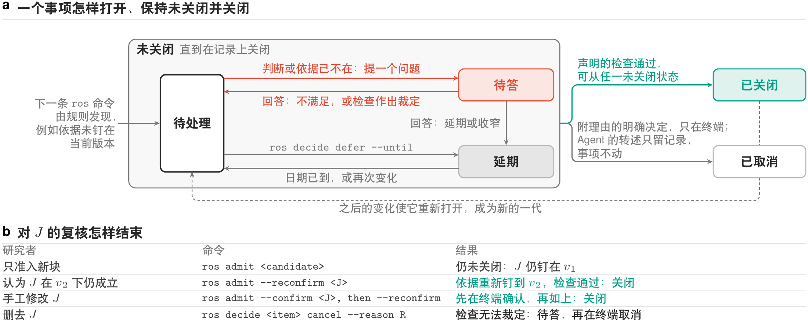

## 附录 B. 实现与工程记录

第 2、5 节说明原型做什么，本附录记录它对应的提交、命令与测试。B.1 把第 4 节背后的每条定义对应到承载它的命令与回归测试，B.2 说明一次会话如何代替补充说明 5 的有界目标，B.3 给出这些提交（与第 2、5 节同一组）及其测试，B.4 收纳正文为便于阅读而略去的工程细节；第一阶段范围的全部 37 个条目见补充说明 6。设计义务、形式定义、已实现路径与证据分作不同的主张，因此本附录不会把未实现的机制写成运行能力。凡未注明针对这些提交的实现陈述，都沿用此前验证时的范围，没有在这些提交上重新验收。仓库中保留但不在开发之中的组件（如插件体系）按现状描述，本报告不为它们增加功能。

### 从定义到命令

表 7 就第 4 节背后的每条定义回答三件事：它经哪些命令到达研究者，`evals/test_ros_kernel.py` 中哪些内核回归测试演练它，第一阶段不包含什么、证据的限度在哪里。带编号的定义见[补充说明 5](technical-report-supplement.zh.md#%E8%A1%A5%E5%85%85%E8%AF%B4%E6%98%8E-5-%E5%BD%A2%E5%BC%8F%E8%A7%84%E6%A0%BC)，组合与有界目标两个名称只在那里定义。

<!-- table: 第 4 节的定义在原型中的落点 -->
| 第 4 节的定义 | 命令 | 内核回归测试 | 第一阶段不包含什么、证据的限度 |
| --- | --- | --- | --- |
| 研究状态（第 4 节） | `ros state`、`ros context` | `test_state_reports_q_e_j_b_n`；`test_cr2_ros_context_emits_context_receipt_with_egress_service` | 研究者陈述的条件与计划的实验不登记（条目 12）；Agent 的直接读取没有回执（条目 7） |
| 准入（第 4 节） | `ros collect`、`ros propose`、`ros admit` | `test_hj1_ros_admission_requires_human_decision_record`；`test_proposal_freezes_unpinned_basis_and_admit_rejects_later_change`；`test_admission_does_not_overwrite_an_edit_after_planning` | `test_hj1_…` 检查的是调用渠道被记录，不是要求研究者的决定；Agent 执行的准入与 Dashboard 写入只记录、不阻断（条目 1、2）；不验证任意规则须保持的部分（条目 9） |
| 版本（定义 5.1） | `ros today` | `test_cr16_exact_replay_adds_no_observation_work_or_question`；`test_today_explains_exact_changes_and_related_requirements` | 版本是内容摘要，每个边界每条记录一个，因此定义 5.1 的次序、分支与晚到祖先都不计算。所引回归测试只检验重放与变化发现；没有文件监听，变化要到下一次 `ros` 命令才被看到（条目 34） |
| 被触及与未关闭的事项（定义 5.2–5.3） | `ros today` | `test_basis_change_opens_then_reconfirm_resolves_and_replay_is_deterministic`；`test_a_b_a_reopens_and_generation_advances_on_new_read_set` | 改回原先的内容算回到原先版本并解决复核，不同于定义 5.1 的新修订；不跨多跳传播（条目 34）；新事项的归因不完整（条目 24、25） |
| 三值检查与关闭（定义 5.4–5.5） | `ros today`；终端上的 `ros decide … cancel` | `test_a_requirement_closes_on_its_declared_check_bound_to_the_current_version`；`test_cc3_unknown_check_never_resolves_and_stays_apart_from_coverage_unknown`；`test_b8_only_the_terminal_closes_a_requirement_by_decide` | 只执行脚本检查，新种类的可执行检查须改动内核（条目 12、25） |
| 待答与延期的工作（定义 5.6–5.10） | `ros today`、`ros answer`、`ros decide … defer` | `test_hj6_undecidable_unknown_is_asked_once_and_waits_outside_open_work`；`test_cc7_defer_channel_controls_completion_and_terminal_decline_does_not_write` | 随附规则没有声明以人为依据的检查，因此在内核回归测试之外，只有事项的主体无法解析时才转为待答。还没有机制会因范围外依赖而产生延期（条目 17） |
| 组合（定义 5.11） | 无 | 无 | 没有支持通用后继、并行或汇合检查的执行消费者（条目 10） |
| 有界目标、Done 与 Stop（定义 5.20） | `ros today`（含 `--for`）、`ros close` | `test_cc6_episode_spec_is_frozen_and_scan_stays_inside_it`；`test_cc7_special_requirements_exclude_done_in_every_unclosed_state`；`test_cc10_waiting_spends_boundaries_and_an_exhausted_session_stops` | 会话只近似有界目标（条目 15）；预算没有完整计量（条目 19–22）；比例为零的规则没有执行（条目 18） |

每一行从一条定义读到研究者输入的命令、在临时夹具上运行这条命令的回归测试，以及限定这一主张的补充说明 6 条目。回归测试确立的是所列夹具上的执行性质；定义是否已完整实现、判断是否正确、研究者是否有所收获，都在它们能说明的范围之外。因此，覆盖情况按定义、按条目来读，从不按测试数量来读。组合是唯一没有命令的定义；有界目标只由会话近似承载（B.2）。

这里还有一项记录，它关系到第 7 节的比较，而不是某条定义。一个无历史的本地 Agent 使用参与者包与获准来源，在冻结的 10 分制评分表上得到 10/10，没有硬失败。这是由作者评分的单一案例，既不证明仅凭交接就已足够，也不证明它跨任务或跨模型可靠、对参与者有价值。

### 以会话近似有界目标

原型没有单独的目标对象，由一次会话代替补充说明 5 的有界目标。`ros today` 开启会话并冻结其规格：用途和版本，对象、范围和摘要，规则和保持字段，授权、预算，以及来源和截点。同一天对同一对象再次运行时沿用这份快照并报告差异，已准入的修订只从下一次目标起生效。`--for` 把会话收窄到一项承诺、它的判断、承载这些判断的卡片、它的来源卡与依据卡。对象不存在或不唯一时不开启会话；范围为空或没有快照时，不能报告 complete 或 complete_with_held，因为 Done 要求冻结范围非空（补充说明 5 的定义 5.20）。

预算覆盖边界、提问与重开，随规格冻结。每个边界计入所属会话，即使该边界上只有延期的事项在继续也照样计入，因此预算计算的是边界，而不是经过的时间。预算耗尽时停止提问、派发和后续边界，但不停止事项维护与重开记录；此时若未完成就收尾，结果为 budget_stopped，除非此前提出且未被撤回的待答问题提供豁免。条目 19–22 记录计量与核算的缺口。

延期只有在研究者带着尚未到期的触发条件作出时，才获得完成豁免：经研究者本人的渠道、带着触发条件延期或收窄，或在终端确认 `ros decide … defer`。因此，终端确认的延期确实获得豁免，而还没有机制会因范围外依赖而产生延期（条目 17）。不在终端作出的延期（记为 `invoker_asserted`）、未经确认的旧延期、执行方延期、范围内依赖，以及没有触发条件或已到期的延期，都不能获得豁免。

有几种情形始终阻止完成：前次规格不可重建，break-glass 判断块或字段确认，范围内的未评估工作，以及已派出却无可用结果的任务（含失败且副作用未知的）。派出前失败则不阻止。由回答触发的待答事项，若提问额度已经耗尽、问题又是在旧的规则版本下提出的，按补充说明 5 的定义 5.10 它已不再有效，旧问题会被撤回，工作重新打开；会话因此不会凭这个问题报告 complete_with_held。已解决比例为零的会话仍报告 complete_with_held，因为 `deferred` 这一结果没有实现（条目 18）。明确放弃时如实记录副作用未知，不生成回执，但允许收尾。

收尾按事项而非输入计数，只有范围内的未评估工作影响完成。未完成就提前收尾，记为 `human_stopped`；全部问题不论范围都会列出，不可核实的回执也不能排除范围内既有的事项。每个边界都冻结足够的输入，使后一个边界能够区分前次规格下漏检的事项与由变化引起的事项。冷启动记为 initial；前次规格缺失也记为 initial，但这时漏检状态未知，系统登记唯一一条「规格不可重建」的事项，若它已关闭则重开。冻结规格记录每个成员的归属，因此根和成员不变、只是内部归属移动时，按范围变化归因。新事项按范围、来源与版本变化的归因仍不完整，语义缓存也尚未实现（条目 24、25）。

### 代码与测试

第 2、5 节与本附录描述的是可下载版本发布 v1.1.0 所用的代码（提交 c79dd6c1b26c）与作者的原型的提交 9ef0713292e1。图 3、4 的截图取自为 v1.0.0 准备的提交 f541cb6d161a；此后 Dashboard 除虚构数据里的日期外没有变化。在 CI 中，可下载版本的 669 项 Python 回归测试在 CPython 3.10 与 3.13 上通过（提交 c79dd6c1b26c，运行 42940610219），作者的原型的默认回归集共 1012 项测试在 CPython 3.11 上通过（提交 9ef0713292e1，运行 42940719406）；不在开发之中的组件，其测试不在默认集内。这些是对所述提交的软件检查，既不构成人工验收，也不证明科学有效性。

### 正文从略的细节

本小节收纳正文为便于阅读而略去的工程细节，按正文的顺序排列。

**可下载版本的运行方式（第 2 节）。** 第 2 节的会话是作者的原型的行为，它运行在作者本人的记录上，不对外分发。可下载版本默认以只复制模式运行同样的六条命令，同样观察来源变化并登记复核事项，但不准入：`ros admit` 通过复制回退只显示拟议差异，不写入用户的记录；要留下的改动由用户或其助手照显示的内容写入，再由用户在自己的终端上确认（`ros admit --confirm`），这一确认记为事后确认，不算准入。其余命令只在 Git 忽略的工作状态中写入任务包、候选与会话记录，并且拒绝向任何 AI 模型 provider 派发；`ros run` 使用 `copy_packet` 执行方式，写出任务包不调用任何 AI 服务。这些行为在出厂配置（`config/ros.json` 中的 `runtime_scope: public_starter`）下成立。可下载版本随附的虚构夹具 `examples/scheduler-demo` 经 `--root` 指定，在它上面的运行不能作为第 2 节会话的证据。在 personal-vault 模式下，`ros admit` 仍只显示拟议差异。第 2 节“怎样开始”中的时间是 README 的说法，安装耗时与每次会话的投入尚未测量。Dashboard 复制出的交接包以摘要值与 copy_only 路由开头，随后依次是目标、会话来源与上下文路线。

**第 2 节的例子。** 例子假定 $J$ 属于一项活跃承诺；承诺指研究者登记的一个项目当前的下一步或下一个判断。`ros close` 比较会话起止时的文件。研究者若认为 $J$ 在 $v_2$ 下仍然成立而重新确认，随之通过的是原型能够自行裁定的那一项检查。研究者手工修改过 $J$ 之后，重新确认会被拒绝，须先在终端上用 `ros admit --confirm` 事后确认这次修改。

**回收与准入时的拒绝（第 2、4 节）。** 草稿中不带版本的依据按回收时的当前版本钉住，钉在过期版本上的草稿在回收时就被拒绝；任务包要求只引用其中的来源，第 2 节的候选引用了更正后的论文，超出了这个范围，`ros collect` 并不检查。准入本身也会拒绝，情形有两种，都不是科学判断：论文若在审阅期间再次修改，准入以依据过期为由拒绝候选，需要在当前材料上重新提议；承载 $J$ 的文件若在写入计划形成之后、实际写入之前被他人编辑，系统拒绝写入，不覆盖那次编辑，也不发出成功回执。`ros collect` 或 `ros propose` 登记候选时，它的每项依据都按完整版本冻结。遇到并发修改时，原型并不比版本控制更强：它只拒绝写入，不保留冲突的两个版本。

**原型能看到什么（第 4 节）。** 检测从研究者手写的判断块和依据字段开始，已确认的关系也一样。依据的内容摘要不含判断块与关系。已关闭 episode 卡片上的判断不再登记复核。按规格，$J$ 在 $v_2$ 下是否仍然成立是只有研究者才能裁定的检查，复核应带着一个问题等待研究者回答。原型只声明了一项检查，即 $J$ 的依据是否钉在当前版本上，研究者的判断通过这项检查落到记录上。更正之后这项检查不通过，而不通过不等于无法裁定，所以复核只是保持未关闭，并不提问；只有复核的对象已不存在时（例如 $J$ 被删除），系统才会提问。随附的规则都没有声明取决于研究者判断的检查，所以在回归测试之外，只有事项的主体无法解析时 `ros today` 才提问（B.1）。

**三个入口（第 5 节）。** 在终端上，`ros admit` 提示研究者确认，确认后的准入记为研究者的决定。能够使用 shell 的 Agent 运行同一条命令时不出现提示；这次准入照样写入，记为调用者的断言，这是原型给不在终端上运行的 `ros` 命令所加的标记。Agent 对未经改动的已准入或已确认判断块运行 `ros admit --reconfirm` 也是如此：依据钉到当前版本，检查随之通过，复核也就关闭。Agent 直接改写依据版本同样使检查通过，只多出一项事后确认的事项。Dashboard 是原型的图形客户端，它的生命周期写入绕过准入；若这类写入发生在会话期间，`ros close` 把其中承载判断的字段（state 与 priority）登记为未确认的修改，这些修改在研究者确认之前不会关闭。`ros` 也不拦截普通的 Agent 会话：Agent 直接编辑卡片时文件不会回滚，只有经 `ros collect` 回收或经 `ros propose` 登记的判断块才走候选路径。可见，对能够使用 shell 的 Agent 而言，这些记录是归属与审计线索，而不是阻断：终端规则只约束明确的决定，并不阻止 Agent 使检查通过。终端记录本身证明的也是通道，而不是人。原型只判断标准输入和标准错误是否连着终端，分配了伪终端的进程同样能够应答提示，其应答随后也记为研究者的决定。`ros decide … cancel/confirm` 与 `ros answer … cancel/satisfied` 只有在终端输入才生效；没有准入回执的判断块会在下一条 `ros` 命令时登记为事项，用 `ros admit --confirm` 事后确认同样只在终端生效。研究者在终端用 `ros decide … defer` 确认的延期确实生效。

**代码的构成（第 5 节，图 8）。** 适配器把记录读成快照，交给内核包 `researchos_kernel`；内核包从快照计算变化、事项与检查，只读取规则表与数据合同，只写入自己的账本，因此从不直接读取卡片。写入由适配器暂存，核对之后才落到文件，并留下回执。命令行入口 `scripts/ros.py` 把这些部分连接起来，终端和 Agent 会话（如 Codex、Claude Code）运行的都是它。账本记录决定了什么、尝试了什么、检查了什么，但不能确立从未记录的依赖，对研究者的记录也没有权威。与补充说明 2 的目标划分相比，现有代码有两处不同。准入仍由 `ros.py` 执行，而不在内核包中，所以单一的稳定内核仍是目标。Dashboard 由本机服务提供，写入时不经过 `ros.py`，第 5 节所述的保护对它不起作用。

**测试与截图（第 2、5 节）。** 第 5 节所说原型做到的三件事，每一件都由内核与写回的回归测试在临时夹具上演练，测试通过确立的是这些输入下的执行性质。当前代码的覆盖情况按义务逐项登记，补充说明 6 给出全部 37 个条目。图 3、图 4 的截图取自可下载版本为 v1.0.0 准备的提交 f541cb6（B.3）。

[^name]: **ReSearchOS** 的名字取自 Re Search：带着新问题重返材料，并保留这次考察带来的变化。另有公开项目也使用 ResearchOS 这一名称，如 `github.com/CognitiveAISystems/ResearcherOS` 与 `github.com/JRH89/researchos`；ReSearchOS 与它们无关。

[^author-note]: 本文介绍作者独立设计与实现的个人项目 ReSearchOS 的设计原则、研究状态的定义与命令行原型。本文未经同行评审，原型只实现了一部分；其中的形式化内容是为了把设计说清楚、便于讨论，不构成经过评审的结论。本文用于理解与交流。
