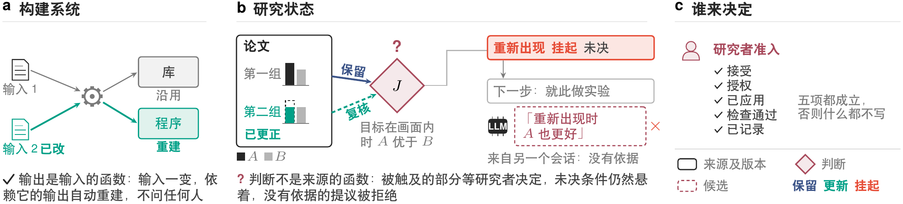
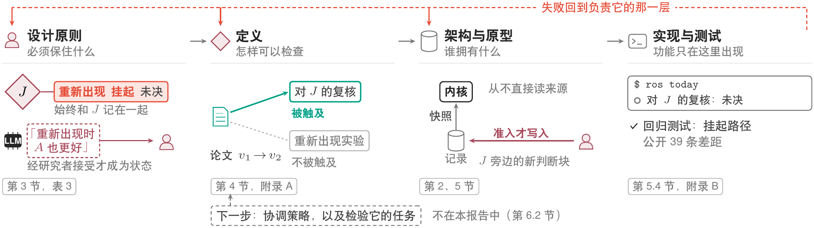
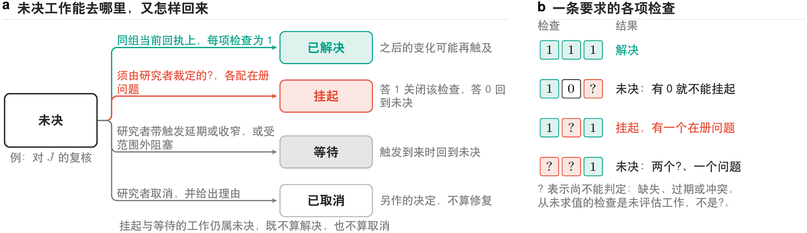
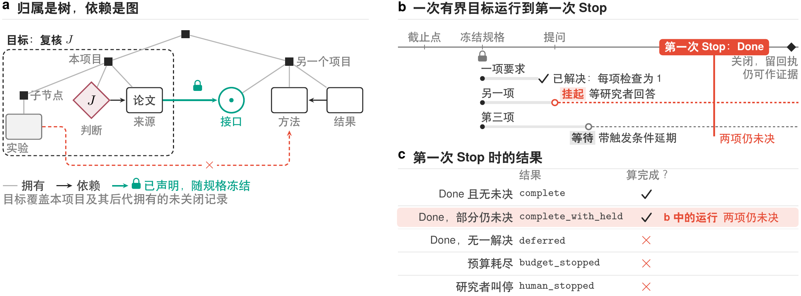
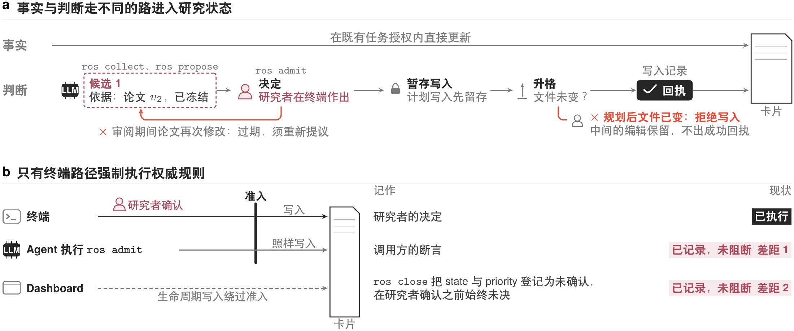
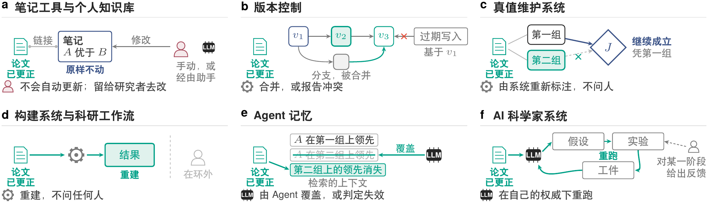
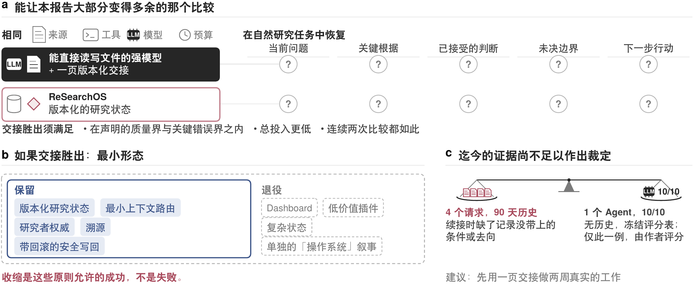
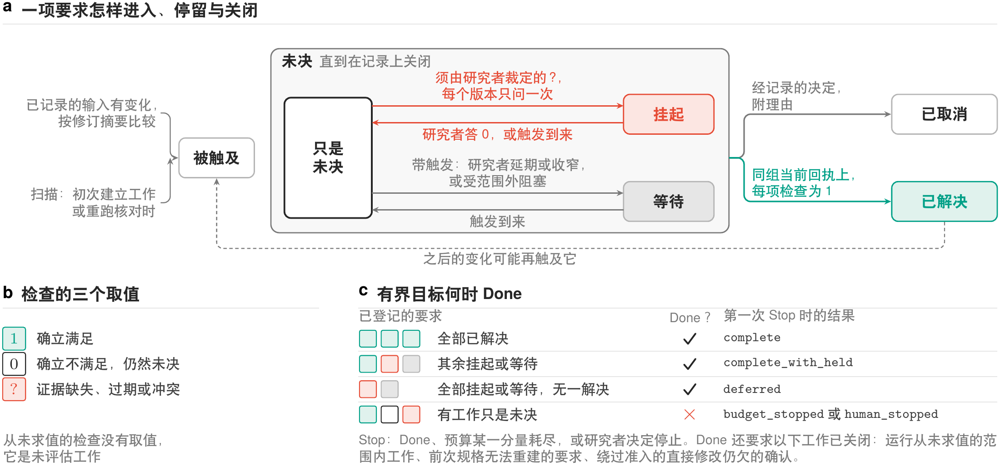

[English](technical-report.en.md)

# ReSearchOS：面向持续科研的人机协作参考架构

Shiyu Hu[^author-note] · 技术报告 · 2026 年 10 月 30 日 · 未经同行评审

新加坡南洋理工大学物理与数学科学学院

[shiyu.hu@ntu.edu.sg](mailto:shiyu.hu@ntu.edu.sg)

> 当执行越来越容易被委托，研究者更需要决定：什么值得追问，什么足以成为根据，以及什么值得留下。

## Agent Summary

在持续数周乃至数月的人机协作研究中，后续工作建立在早先的判断之上。然而，这些判断的理由和适用条件若未专门记录，往往随对话结束而丢失，其所依赖的来源也可能发生变化。例如，研究者依赖的一篇论文在数周后被更正，此时已有判断既不能全部沿用，也不宜全部推翻：（1）更正未触及的部分，应连同其根据保留；（2）只有被触及的部分需要更新；（3）证据尚不能裁定的问题则保持未决，等待研究者回答。区分这三种情况需要理解证据，无法像构建系统那样随输入变化自动重算，因此决定应由研究者作出，系统负责找出记录中依赖该来源的判断并交还研究者。基于这一思路，本报告提出 ReSearchOS，一个由研究者拥有、以本地文件为主的研究环境：它保存判断及其根据与适用范围，AI 模型的产出在研究者准入之前始终只是候选。本报告给出这一环境的设计原则、使上述三种操作可以检查的定义和参考架构，并提供命令行原型与可下载试用的版本。原型能够在下一条命令时发现来源变化，登记相关判断的复核，并拒绝审阅期间来源再次变化的候选；可下载版本默认只回收候选，不改动研究者的记录。目前原型仅实现了部分设计，实际效果尚待用户研究检验，也有待与更简单的做法比较。

**关键词：**人机协作；研究状态维护；参考架构；判断连续性；可扩展性。

## 1. 研究状态，而不是研究文件

在持续数周乃至数月的人机协作研究中，研究者往往要跨越许多次会话，有时还要与多人协作，后续工作都建立在早先的判断之上。这些判断所依赖的来源会随时间变化，所以仅把眼前这一步做对并不够，从前面继承下来的内容也需要重新核查。

然而，核查所需的信息很容易丢失。判断的理由若未专门记录，往往随对话结束而消失；文件虽然保留下来，却并不说明结论如何得出、在什么条件下适用、还有哪些问题尚未解决。例如，研究者读完一篇论文，认定方法 $A$ 优于方法 $B$，并记下一句「用 $A$」。数周后论文被更正，却没有任何记录显示哪些结论依赖于它。同一周，研究者的学生在另一个会话中让 AI 助手阅读更正后的论文，AI 助手得出结论：在论文未曾测试的情形下，$A$ 同样更好。此后无论谁从那句记录继续工作，都没有别的根据可循。

更完整的记录有所帮助，但仍无法决定来源变化之后应当怎么办，因为判断并不是来源的函数。在构建系统中，输出是输入的函数：输入一旦变化，依赖它的部分自动重建，无需询问任何人（图 1a）。判断则不同：同一次更正可能使判断的一部分依然成立，使另一部分需要修改，还留下一部分无法裁定，而区分这三种情况需要有人理解证据（图 1b）。

因此，系统能够做的是找出记录中依赖已变来源的判断并交还研究者，决定则应由研究者作出。同样，AI 模型或另一个会话的产出都只能作为候选，须经研究者准入（图 1c）；它们和文件都不应代替研究者作出这些选择。准入的对象不是文件，而是判断，它要带着根据和限度，因此需要保存的是研究状态：这些判断以及尚未解决的问题，存放在研究者自己拥有的文件中。

研究者需要决定的内容，可以通过前述论文具体说明。该论文做了两组基准测试，$A$ 在两组中都更好，但论文只测试了一种情形；换一种情形后 $A$ 是否仍然更好，论文没有说明，只能留待研究者日后自行实验。这次更正发现第二组测试的数字有误，修正之后，$A$ 在这一组上的优势消失了。

更正之后，结论的各个部分需要分别处理。第一组测试没有错，它对结论的支持不受影响，应当**保留**（keep）。第二组的结果发生了变化，结论中依赖这一组的部分需要**更新**（update），其余部分不作改动。未曾测试的那种情形仍然没有答案，只能**挂起**（hold），使其保持未决，留待计划中的实验。至于 AI 助手的说法，论文中找不到支撑，不能接受。保留、更新与挂起问的其实是同一个问题：新证据触及了什么。

后文把这条结论记作 $J$。例子中的两种方法是目标跟踪方法，即在视频中持续跟住某个目标的方法。论文只测试了目标始终留在画面内的情形，因此 $J$ 的完整表述是「目标在画面内时，$A$ 优于 $B$」，而未曾测试的是目标离开画面后又重新出现的情形。本报告把这两种情形分别称为画面内条件和重新出现条件，图 1 用全文沿用的记号画出了这个例子。



由此可以更完整地说明研究状态（research state）：这样一次变化之后需要留住的，是问题、证据及其关系、带范围的已接受判断、未决条件，以及有根据的下一步。若笔记只写「用 $A$」，这些内容都会丢失，连未决条件和接下来的实验也不例外。本报告的回答由此而来：应当留住的是研究状态，而不是研究文件；来源发生变化时，哪一部分保留、更新或保持未决，由研究者决定，而不是由 AI 模型或另一个会话决定。[^lineage]

研究状态的变化有三种方式，例子中都已出现：随着时间推移，论文被更正，会话结束，其间使用的工具和 AI 模型也可能更换；用途转向目标重新出现的情形时，条件发生了变化；另一个会话送来提议、需要有人决定什么算正确时，参与者发生了变化。面对这些变化，研究者已在使用的工具也能保留和更新记录，其中一些还会把发生变化的来源，或建立在该来源之上的主张，提示给人。然而，第 6.1 节对照的几类工具中，没有一类按范围与依据版本保存判断，并只把变化触及的部分交回研究者决定；该节把同一次更正逐一放进这些工具加以对照。

ReSearchOS 正是为来源发生变化的这一时刻而建的环境，由研究者拥有，以本地为主。它唯一的权威规则就是上文推出的这一条：机器的产出一律先作为候选（candidate），即尚未准入的产出，只有研究者能把候选准入研究状态。准入（admission）是把候选变为研究状态的一步，须经这一决定，并留下回执（receipt），即做了什么、查了什么的记录（第 4.1 节）。

**ReSearchOS** 的名字取自 Re Search：带着新问题重返材料，并保留这次考察带来的变化。[^name]研究者与计算辅助系统在这一环境中围绕共享研究对象，跨会话形成问题、审查证据并修订判断。它所服务的目标，我们称为判断连续性（judgment continuity）：恢复早期工作的根据，并重新判断这些根据是否仍然适用。环境保管共享记录与未完成的工作，工作本身则在 Agent 会话、命令行或专业工具中进行，环境并不编排这些工具。

对研究者而言，这条规则体现为一个闭环：恢复此刻要紧的研究状态，在实际开展工作的客户端中推进研究，只确认值得进入研究状态的变化。恢复时只为手头的工作选取最少的上下文，而不是整个仓库；确认时则要问这次会话产生了什么值得未来继承的真实变化，如果没有，就不写回。第 2 节把这个闭环展示为一次会话中的六条命令。

### 三项贡献

第一项贡献是设计原则（第 3 节），规定环境必须保住什么，才能使保留、更新还是挂起的选择始终由研究者作出：人的判断、带条件的组合、比工具活得久的记录和可纠正的积累。

第二项贡献是一组使这些原则可以检查的定义（第 4 节）。它们说明什么是研究状态，以及保留、更新与挂起各自对维护工作提出什么要求，三者各占一个小节（4.1–4.3）；在此基础上，定义在有界目标内组合这三者，有界目标是带冻结范围与明确结果的维护工作单元（4.4）。

第三项贡献是参考架构与原型（第 2、5 节），它们把这些定义落实为研究者实际运行的命令。原型在下一条命令时发现来源变化，并为依赖该来源的判断登记复核。在终端上，它只凭研究者的决定准入收窄后的判断，并将其作为新的判断块写在原判断旁边；对审阅期间来源发生变化的候选，它会拒绝，他人的修改它也不会覆盖。读者可以下载试用，可下载版本默认只复制：回收候选，但从不准入。

**本报告怎么读。** 第 2 节展示一次会话，第 3 节说明环境为什么这样建，第 4 节给出定义，第 5 节说明原型如何构成以及尚缺什么，第 6 节对照相近系统并陈述反方理由。初读可读本节、第 2 节和表 3 中的原则。正在考虑是否试用的读者，请先读第 6.2 节：该节陈述了让能直接读写文件的强 AI 模型配上一页版本化交接、以此代替本环境的理由；如果交接胜出，ReSearchOS 应收缩为最小形态。附录 A 列出定义涉及的对象和要求的生命周期，附录 B 是实现记录。补充说明 5 给出每条定义的精确表述并论证两条命题，补充说明 6 列出全部差距。

表 1 给出初读者在第 4 节之前会遇到的词及其平常含义。挂起与等待在第 4 节首次用到时结合例子讲解；附录 A 的表 8 连同状态列出这些术语，补充说明 5 给出精确定义。多数名称与原型的代码和命令一致。

<!-- table: 全文用到的术语 -->
| 术语 | 在本报告中的含义 |
| --- | --- |
| 研究状态 | 研究需要延续下去的内容：问题、证据及其关系、带范围的已接受判断、未决条件与下一步（第 4.1 节） |
| 客户端 | 开展工作的任何入口，例如命令行、Dashboard 或 Agent 会话；所有客户端面对的是同一套记录 |
| 卡片 | 一份 Markdown 记录，例如承载 $J$ 的那一份 |
| 候选 | 尚未准入的 AI 模型产出或草稿 |
| 准入 | 候选进入研究状态的一步；它需要研究者的决定（第 4.1 节） |
| 回执 | 做了什么、查了什么的记录 |
| 根据 | 判断所依赖的理由，例如 $J$ 所依赖的第一组基准 |
| 依据 | 判断中记录下来的字段，把来源钉在某个版本上，写作 `依据：` |
| 要求 | 一项登记下来的维护工作（第 4.2 节） |
| 复核 | 判断所依赖的来源变化之后，询问这条判断是否仍然成立的那项要求，例如对 $J$ 的复核（第 4.2 节） |
| 检查 | 对一项要求所作的检验，结果有三种：通过、不通过、尚不能判定，分别写作 1、0、?（第 4.3 节） |
| 有界目标 | 带冻结范围、冻结规格和明确结果的维护工作单元；原型中以一次会话近似代替，代码中称为 episode（第 4.4 节） |
| 可下载版本 | 读者能够安装的版本，默认只复制：回收候选，但从不准入。作者的原型在此之上加入准入与 Dashboard 写回 |

**主张边界。** 第 4 节的定义是规格，两条命题只在与之一起陈述的假设下成立，这些假设见[补充说明 5](technical-report-supplement.zh.md#%E8%A1%A5%E5%85%85%E8%AF%B4%E6%98%8E-5-%E5%BD%A2%E5%BC%8F%E8%A7%84%E6%A0%BC)。第 2、5 节描述的原型只实现了一部分，对应的提交列在附录 B.3，第 2 节的会话展示的正是这些提交所做到的事。原型只在终端上以研究者的决定为准（差距 1、2；差距编号见第 5.4 节与补充说明 6），其余尚未做到的内容列在第 5.4 节。

就证据而言，到目前为止原型只有作者一位用户；原型由作者开发，本文报告的每一项结果也由作者评价，因此没有一项结果独立于作者。使用研究尚未开展，与「强 AI 模型加一页交接」的比较也尚未进行，所以本文不确立真人验收或科研收益。这个环境面向已有来源核查习惯、需要跨会话工作的研究者；新手如何借助它学习、团队如何在其中处理分歧，需要另行研究。

## 2. 论文更正后的一次会话

本节的会话沿用第 1 节的例子，方法 $A$、$B$ 均为虚构，不报告任何真实方法的效果。图 2 画出这次会话，共六步，每一步是 `ros.py`（运行一次会话的程序）的一条命令。会话开始之前，研究者已把 $J$「目标在画面内时，$A$ 优于 $B$」绑定到论文的 $v_1$ 版本，其根据是两组基准；重新出现条件下的未知留在未决条件中，重新出现实验也已计划好。随后论文更正为 $v_2$：第二组的数字改变，第一组不变。


这次更正进入记录的方式是：用户，或按用户指示行事的 Agent，替换记录这篇论文的本地文件，这里是 `sources/paper.md`；下一条 `ros` 命令便会看到其内容摘要已经改变。会话由 `ros today` 开始，它发现版本变化，把对 $J$ 的复核登记为未决工作，但此时并不提问。更正可能只改了一个错字，判断依旧成立，保留还是更新尚未确定。

接着，`ros context` 交付获准使用的来源与当前的研究状态，并附回执；`ros run judgment --target <card> --executor copy_packet` 为承载 $J$ 的卡片写出一个任务包，不调用任何 AI 服务。任务包是装有任务与已交付上下文的 Markdown 文件，由用户粘贴到任一助手中。随后，`ros collect <run> --file draft.md` 把助手的草稿读回，作为候选。草稿中只有一到三个判断块会被读取，其余内容一律忽略：

```
> [!judgment] j-first-set
> 结论：目标在画面内时，第一组基准上 A 优于 B；关于第二组的说法撤回。
> 依据：sources/paper.md@<更正后版本的前 8 位>
```

这里的依据把论文钉在 $v_2$ 上。由于依据按来源文件记录，即文件路径加内容摘要，原型看不到论文内部第一组与第二组的划分；更正触及哪一部分，由候选写明、研究者决定（差距 11）。不带版本的依据，按回收时的当前版本钉住；钉在已过期版本上的草稿会被拒绝。该候选不改动重新出现条件与实验，因为二者另有独立根据：撤回 $A$ 的一部分优势，既不推出 $B$ 更好，也不推出实验应当取消。

接下来由研究者决定，`ros admit <candidate>` 执行准入。它要等研究者审阅之后，才把收窄后的判断作为新的判断块写在 $J$ 旁边；由于确认是在终端作出的，这次准入记为研究者的决定。在原型中，更新指的就是这一步：$J$ 仍留在卡片上，依据仍钉在 $v_1$，保留与更新都写在旁边的新块中，原型不修改 $J$ 本身。

同一次会话中，又从学生的 AI 助手那里回收了第二个候选「目标重新出现后 $A$ 也更好」，依据同样钉在 $v_2$。论文没有报告目标重新出现后的任何结果，研究者因此在终端拒绝了它。拒绝记为研究者的决定，不写入任何内容，研究状态也不变。会话以 `ros close` 结束：它比较会话起止时的来源，列出改动了什么、准入了什么、拒绝了什么、哪些候选仍未决定，以及哪些事项仍未关闭。

除研究者的拒绝之外，准入本身也会拒绝，情形有两种，都不是科学判断。若论文在候选审阅期间再次修改，准入以依据过期为由拒绝该候选，需要在当前材料上重新提议。若承载 $J$ 的文件在写入计划形成之后、实际写入之前被他人编辑，写入计划所针对的内容便不再相符，系统于是拒绝写入，不覆盖那次编辑。审阅期间他人所作的编辑则会保留，因为写入计划要到决定作出之后，才按文件当时的内容形成。

以上是作者的原型的行为；可下载版本则在默认的只复制模式下，于自己的虚构夹具（经 `--root` 指定）上运行同样的命令，因此它的运行不能作为这次会话的证据。如表 2 所示，它可以在本机写入运行态、任务包与候选，但只产出可复制的候选或拟议差异，从不准入候选，也从不改动研究者的来源：

<!-- table: 贯穿会话与可下载版本的默认行为 -->
| 命令 | 作者的原型（本次会话） | 可下载版本（默认） |
| --- | --- | --- |
| `ros today` | 观察来源变化，把判断标为待复核 | 查看虚构来源，维护 Git 忽略的工作状态 |
| `ros context` | 交付获准来源与重建的研究状态，留存回执 | 交付获准虚构上下文，留存回执 |
| `ros run judgment --target <card> --executor copy_packet` | 准备任务包，不调用 AI 服务 | 准备可复制任务包，仍拒绝 provider 派发 |
| `ros collect` | 将草稿回收为绑定来源版本的候选 | 回收候选，不作准入 |
| `ros admit` | 经研究者终端决定准入；依据过期或文件在规划写入后已变，都会被拒绝 | 通过复制回退显示拟议差异，不写入来源 |
| `ros close` | 列出变化、已准入、已拒绝、待决候选和仍未决的工作 | 记录本机会话与残留工作，不作准入 |

对照第 1 节，这次会话的结果可以归为三项。研究者保留了第一组的结果，它连同画面内的范围留在新块中；同时更新了结论，在同一个新块中撤回关于第二组的说法。挂起在这里表现为不作改动：这次会话不改动重新出现条件和实验，原型也不登记这两者（差距 12），被拒绝的提议同样没有改变它们。到 `ros close` 时，对 $J$ 的复核仍列为未关闭。

## 3. 研究环境必须保住什么

第 2 节把关于 $J$ 的决定留给了研究者，设计研究环境时，就要让这一决定始终留在研究者手中。设计的出发点是一句话：把研究分解到能够作出判断，再组合回可以继续推进的研究状态。当研究状态发生变化时，这句话所要求的正是保留、更新与挂起：哪些内容依然成立，哪些需要修订，哪些须等待回答。

这三种操作都可能出错，四项原则各防范其中一种错误，其先后顺序与一条判断的经历一致，即作出、复用、跨工具保存和纠正。当效率、控制与长期留存相互牵制时，这些原则优先保证四个方面：研究者的重要判断、带条件的组合、比工具活得久的记录以及可纠正的积累。图 3 展示从这些原则经定义和架构直至代码的推导过程。



这些原则确定的是上述优先次序，并不规定统一的目录、方法、界面或审阅安排。解释需要时间阅读、需要精力维护，审阅也可能打断工作，或久而久之流于习惯，因此检查集中在关键的转变之处，常规工作则在约定的范围内照常进行。

四项原则来自作者自身的设计历程，其规则写在六份内部设计文件中；本节是对这些文件的概括，并已与之核对。表 3 列出每项原则回答的问题、作出的规定及其机制，[补充说明 1](technical-report-supplement.zh.md#%E8%A1%A5%E5%85%85%E8%AF%B4%E6%98%8E-1-%E5%8E%9F%E5%88%99%E7%9A%84%E6%9D%A5%E6%BA%90%E4%B8%8E%E4%BE%8B%E5%AD%90) 给出各项原则的例子与来源，[补充说明 3](technical-report-supplement.zh.md#%E8%A1%A5%E5%85%85%E8%AF%B4%E6%98%8E-3-%E8%BF%87%E7%A8%8B%E4%B8%8E%E7%BB%84%E4%BB%B6%E5%90%88%E5%90%8C) 完整复述这些条款，并注明各条的负责方。

<!-- table: 四项设计原则及其机制落点 -->
| 原则 | 它回答的问题 | 规定 | 机制落点 |
| --- | --- | --- | --- |
| 人的判断 | 由谁接受判断？ | 只有研究者决定什么成为研究状态；机器的产出一律先作为候选 | 候选、决定、修改、检查与回执分别记录 |
| 带条件的组合 | 结果在什么条件下可复用？ | 后一步只在前一步的实际结果确立其前提时才开始；未知不算满足 | 带声明前提与检查的规则应用、组合（第 4.4 节）与三值检查 |
| 比工具活得久的记录 | 更换工具后保留什么？ | 以本地可读、可版本化的来源为准；AI 模型、客户端、插件可替换 | 来源归属、上下文与外发回执、依据钉在来源版本上 |
| 可纠正的积累 | 纠错后哪些判断需要改变？ | 纠正只收窄受影响的主张，不抹去历史；失败、未知与未验证如实保留 | 判断修订、回滚回执、能力证据跨会话累积 |

### 只有研究者能把候选变成状态

第一种错误是保留从未被接受的内容。在例子中，学生的 AI 助手提出 $A$ 在目标重新出现后同样更好；这一提议若未经研究者决定就被准入，$J$ 就会扩展到论文并不支持的情形。因此，只有研究者才能决定什么成为研究状态。这项原则由准入承载：准入的五个条件全部成立，候选才能进入研究状态，其中第一个条件就是研究者的决定（第 4.1 节）。然而，准入确定的是谁接受了候选，候选本身是否正确仍有赖于后续的检查，因为认同并不证明科学判断正确。

### 后一步只在前一步确立的结果上运行

第二种错误是在未知之上作更新。在例子中，目标留在画面内时的优势可以促成重新出现实验，但把 $A$ 推荐到目标离开之后的情形，就是在实验要回答的那个未知之上作更新。因此，后一步只有在前一步的实际结果确立其前提时才开始。为此，组合把条件、未知与失败带到下一步（第 4.4 节），三值检查（three-valued check）的结果则分为通过、不通过和尚不能判定三种，其中尚不能判定从不当作满足（第 4.3 节）。两步之间的字段相互匹配可以使信息传递过去，但这既不说明信息有效，也不说明可以使用它。

### 记录比写下它的工具活得久

第三种错误是丢失本应保留的内容。如果 $J$ 及其根据只存在于产生它们的那次对话中，论文日后被更正时，就无从看出这次更正触及了 $J$。在对话窗口关闭、产生记录的插件停止运行之后，记录应当依然可读，因此以本地可读、可版本化的来源为准，AI 模型、客户端与插件都可以替换。相应地，视图上显示「已完成」并不等于已被接受，缓存也不会成为另一个事实来源。

在原型中，$J$ 写在一张卡片上，依据钉在来源版本上；上下文连同回执一起交付（第 2 节），适配器也不另建事实存储（第 5.1 节）。留存并不等于检索：记录连同其使用条件一起保存，后续工作才能判断它是否仍然适用。

### 纠正只收窄主张，不抹掉历史

第四种错误是以删除来更新。在例子中，更正只触及第二组基准，若删除 $J$，既会抹去更正并未触及的第一组根据，也会抹去第二组上的主张曾被接受的记录。因此，纠正只收窄受影响的主张而不抹去历史：失败、未知与未验证的状态都如实保留，改动的内容、改动的理由以及仍然有用的部分也一并留存。收窄后的判断准入在 $J$ 旁边（第 2 节），而对 $J$ 的复核只有经记录的解决或取消才能移出未决集合（第 4.2 节）。此外，一次成功并不确立规则，本报告也不假定研究者的理解会因此受益。

## 4. 保留、更新、挂起要求什么

上述原则说明了必须保住什么，却尚未说明怎样才算保住。本节给出使原则可以检查的定义：在第 1 节的例子上用文字阐明保留、更新与挂起，并沿论文的那次更正逐步展开。[补充说明 5](technical-report-supplement.zh.md#%E8%A1%A5%E5%85%85%E8%AF%B4%E6%98%8E-5-%E5%BD%A2%E5%BC%8F%E8%A7%84%E6%A0%BC) 给出每条定义的精确表述，并论证第 4.4 节的两条命题；附录 A 将各个对象并列，并画出一项要求的生命周期；各定义的实现现状见附录 B.1。

### 保留：研究状态与准入

数周之后继续那次比较时，研究者需要的并不是文件本身，而是五项内容：正在回答的问题，用过的证据及其关系，已接受的判断及其范围，仍然未决的条件，以及计划采取的下一步。在例子中，这五项依次是 $A$ 与 $B$ 之间的选择、论文的两组基准、目标在画面内时的判断 $J$、重新出现条件下的未知，以及针对这一情形的实验。

**研究状态**（research state）就是从记录重建出来的这五项内容，其中未决条件还记录冲突以及判断不适用的情形。正因为它是重建而不是概述，研究状态的来源与状态都可以检查和纠正；它包含多少内容，取决于问题的要求，而不取决于材料的多少。

来源发生变化时研究状态如何随之改变，正是保留、更新与挂起要回答的问题。一条判断的根据若未被变化触及，它就连同根据与范围一起被**保留**。根据被触及的判断同样继续存在，只是会有一项**要求**，即一件登记在册的维护工作，把它标为待复核（第 4.2 节）；只有当研究者准入一个收窄或替换它、并钉在来源新版本上的候选时，它才算被**更新**。因此在例子中，$J$ 是被更新而不是被删除：它在第一组上的根据未被触及，所准入的候选是对它的收窄。

然而，准入这个候选本身并不关闭对 $J$ 的复核，因为要求还带有**检查**，即它必须通过的检验，而对 $J$ 的复核仍须通过它的检查（第 4.3 节）。这些定义也不计算变化触及了哪条根据：每条根据的保留与更新只通过这项复核跟踪。

挂起有两种情形，定义将二者区分开来。证据无法裁定的科学条件在研究状态中保持未决，例子中的重新出现条件自始至终如此。尚不能判定的一步维护则处于挂起，并附带一个向研究者提出的问题；按这些定义，更正之后对 $J$ 的复核即处于挂起（第 4.3 节）。

作用于研究状态的有三方（图 4）。环境，即图中的 ReSearchOS，从它可以使用的历史中选取上下文，重建研究状态，并连同候选一起呈现；AI 模型提出产出与修改；研究者则决定接下来发生什么。无论由哪一方发起，每一次改变都具有同一形状：按用途选择输入，检查这次改变可以开始，应用改变，再检查结果。本报告沿用带类型的图变换 [Graph Transformation in a Nutshell](https://www.cs.le.ac.uk/people/rh122/papers/2006/Hec06Nutshell.pdf) 的说法，把这样一次改变称为规则的一次**应用**（application），规则声明它读取什么、必须保持什么、打算产生什么。

采用这一形状，是因为不同的错误需要在不同的步骤上修复（图 5）。例如，若读错了论文中的一个数字，需要纠正的是这条观察及依赖它的内容；若问的是目标重新出现后的情形，得到的回答却是画面内的排名，则需要先澄清用途。只有当同类遗漏在多个任务中反复出现时，才有理由提议修订规则本身，而这项修订还须在后续任务中检验。


候选进入研究状态的唯一途径是**准入**，而且任何一方都无法单独完成。准入要求五个条件同时成立：研究者接受这次修改；授权来自可信宿主或范围内的真实指令，候选自身的文字不能授权；修改确实已经应用；它的检查已经通过；**回执**，即做了什么、查了什么的记录，保存在下一个决策边界读取的历史中（第 4.2 节）。因此，没有运行过的修改或没有回执的修改，既不算已应用，也不算已检查。研究者的接受确定的是操作层面的决定，判断在科学上是否为真，并不因此而确定。

### 更新：来源变化触及什么

比较完成数周后，论文被更正，从版本 $v_1$ 变为 $v_2$。此时需要确定两件事：论文的哪个版本算作当前版本，以及这次变化触及哪些工作。系统在**决策边界**上确定这两件事。决策边界是系统查看已到达的内容并决定下一步的时刻，边界之间工作照常进行；每个边界有一个截点，截点之后到达的记录留待下一个边界处理。在原型中，变化要到下一次 `ros` 命令时才被看到（第 2 节）。

当前版本并不等同于最新的文件。一个对象的**当前版本候选**，是任务可用的记录中没有已知后继的那些版本；因此，彼此之间没有已知先后的两个版本作为未消解的分支并存，两者之间的选择留给研究者（图 6a）。原型标识版本的方式与此不同（第 5.4 节）。在例子中答案很直接：看到更正之后，论文的当前版本就是 $v_2$。

至于这次更正触及哪些工作，则取决于每项要求记录了什么，对 $J$ 的复核就是一例。与每项要求一样，它具有稳定的身份，并在某一用途下登记，用途带有这项工作的科学条件以及审阅时所凭借的内容。它还记录自身依赖的输入，这里是那篇论文，以及复核背后的规则与用途的版本。这些输入中只要有一个自上一边界以来有了新的当前版本，变化就**触及**这项已登记的要求。对 $J$ 的复核依赖这篇论文，因此这次更正触及了它；重新出现实验的根据是未决的重新出现条件，而不是这篇论文，因此未被触及（图 6b）。

已登记的要求并不是发现工作的唯一途径：在初次建立工作或重新运行有范围的核对时，扫描还会找出其他需要，包括遗漏的依赖。版本的比较、晚到记录的处理和扫描的限制等其余规则见补充说明 5。要求一旦被触及，就进入**未决集合**，只有经记录的解决或取消才能退出；延期、等待和没有根据的完成报告都不能使它退出，因此无人检查过的工作会延续到下一个边界。

可见，触及标出的是需要查看什么，而不是需要修改什么。它只沿已记录的依赖传递，无法发现从未记录的依赖。假如这次更正只改了一个错字，对 $J$ 的复核同样被触及，$J$ 却没有需要修改之处；反过来，一项新研究即使不改变 $J$ 依赖的任何输入，也可能使 $J$ 不再可靠。文件变化只是需要查看的理由，而不是结论。


### 挂起：三值检查、挂起与等待的工作

论文更正之后，对 $J$ 的复核能否关闭，取决于第一组上的结果是否仍然支持 $J$，而这只有研究者能够判断。因此，系统为每项检查规定三种结果：通过、不通过和尚不能判定，分别记作 1、0 和 ?。只有合格且当前有效的检查确立了结果，才算通过或不通过；证据缺失、过期或处于未消解的冲突中，结果就是尚不能判定，而这一结果从不算作通过。一项要求只有在同一组当前回执上全部检查都通过，才算**解决**。正因如此，$v_1$ 上的旧回执不能替 $v_2$ 作答，也就不能用来关闭对 $J$ 的复核。

有时，未通过的检查全部尚不能判定，而且每一项都只能由研究者裁定。此时系统就每一项向研究者提出一个选项有限的问题，检查依据的同一版本只问一次，工作在得到回答之前停留于此，这就是**挂起**；只要有一项检查不通过，就不能挂起。就对 $J$ 的复核而言，若回答「仍然支持」，这项检查关闭；若回答「不再支持」，复核重新开启；若不回答，复核就一直处于挂起，不会被算作完成。

同一依据版本只问一次，原型的 `ros today` 又把未决的问题集中为一张清单，两者都意在减轻审阅负担、防止审阅流于习惯（第 3 节）。然而，这两点都尚未经过检验，而且只改一个错字的更正同样会开启复核。

工作也可能处于**等待**（waiting）而不是挂起：它等待一个使其恢复的触发条件，原因是研究者将其延期或收窄，或者目标范围之外的因素阻塞了它。例如，把重新出现实验延至预定日期，它就处于等待。图 7 展示各种检查组合允许什么，附录 A 的图 18 画出一项要求的完整生命周期，检查、挂起与等待的其他限制见补充说明 5。

挂起与等待的工作都保持可见，但两者既不解决也不取消要求。只有解决或取消才能把要求移出未决集合，其中取消是另一项经记录的决定，即不再追求这项需要，它不算修复。即便要求已经关闭，这种关闭也不是永久的：论文此后再次变化时，可以再次触及同一要求。



### 组合与有界目标

对 $J$ 的复核处于挂起，实验也尚未进行，此时还剩下两个问题：一步何时可以建立在另一步的结果之上，以及工作何时算作完成。对于第一个问题，例子已经给出答案：目标在画面内时的成功可以促成重新出现实验，却不能用来在目标离开画面后推荐 $A$。一般而言，一次应用要建立在另一次应用的结果之上，须有两组条件在当前用途下都已确立，即前一次结果所带的条件，以及后一次对输入要求的条件。

一个条件只有在同一组当前回执通过用途为它声明的每项检查时才算确立，这与解决是同一个检验。在例子中，比较的结果只对目标在画面内的情形确立，因此可以促成实验，却不足以在目标重新出现后推荐 $A$（图 8）。未经检查的条件并不为假，但不能放行下一步。


第二个问题，即围绕 $J$ 的这次复核，工作何时算结束，并不像表面看来那样简单：在早期原型中，清理宣布完成之后问题仍会再次出现，前后经历了十轮清理、近两百次提交。因此，这些定义把工作限定为一个**有界目标**（bounded goal），即带有冻结范围、冻结规格和明确结果的工作单元（图 9）。规格冻结问题、用途、范围、规则与检查的版本、必须保持的内容、授权、预算，以及带截点的来源版本；它与其他候选一样经过准入。这样，判断完成与否所对照的就是运行中不会改变的内容。

其中，范围规定目标能够读取什么。归属是一棵树，按记录所在的位置给每条记录一个归属，依赖则可以连接任意记录。目标覆盖其所在项目节点及其下各节点的未关闭记录，以及经其他项目声明的接口读入的少数输入，这些接口随规格一起冻结；绕过接口的读取处于冻结范围之外（补充说明 5）。

在有界目标中，完成工作与停止运行是两回事。只有当目标中仍然未决的工作或者因问题而挂起，或者在等待触发，并且三类不得豁免的工作没有一项未决时，目标才算 **Done**。这三类工作是：范围内运行从未求值的工作、无法重建的前次规格，以及绕过准入的直接修改仍欠缺的确认（见补充说明 5）。它们可以暂时挂起或等待，但在到达 Done 之前必须关闭，因此目标不会以默认接受自身结论的方式结束。

目标在三种情况下停止：到达 Done，预算的某一部分耗尽，或研究者决定停止；停止的方式不同，记录的结果也不同。到达 Done 且没有未决工作，记为完成（complete）。目标也可以在挂起或等待的工作仍然未决时到达 Done，如图 9b，此时记为 complete_with_held，它逐项列出这些工作及其问题和触发条件，并报告目标已登记的要求中已解决的比例；比例为零则记为延期（deferred），不算完成。否则，因预算耗尽而停止的记为 budget_stopped，由研究者决定停止的记为 human_stopped，两者都不报告完成。



这些定义保证什么，由两条命题说明，其假设与论证见补充说明 5。第一条命题指出，冻结范围互不重叠的两个目标没有共同的要求，因此一个目标的完成不依赖另一个：例如，一个无关项目上的目标，既不增加也不减少复核 $J$ 的那个目标的要求。第二条命题指出，目标经过有限步后，或者到达 Done，或者耗尽预算；除了假设之外，它还需要一个调度方面的条件，因为重新开启一项要求或回答「不满足」，都会增加未决的工作。

两条命题都只在这些条件下成立，而有限的决策边界预算保证的是目标会停止，而不是目标会完成。两条命题也都不证明完成可达，因为这还需要每项未决要求都能在范围与预算内裁定，并且没有新的来源变化。

## 5. 原型：怎样构成，还不会做什么

运行第 2 节会话的原型并未实现第 4 节的全部定义。保留、更新、挂起这三种操作，连同研究者在其间所作的决定，目前各有一部分已实现为命令行命令。因此，本节在说明原型如何构成的同时，也说明它与这些定义的距离；所述内容以附录 B.3 所列两个提交为准，这两个提交的测试情况也概述于该附录。

### 职责划分与稳定内核

第 3.3 节要求 AI 模型、客户端和插件都可以替换，同时研究者的来源始终是权威。为此，图 10 给出目标划分，共分五行：客户端、方法、稳定内核、适配器与记录。在这一划分中，来源归研究者所有，稳定内核从适配器提供的快照计算变化与未决要求，从不直接读取来源。适配器经既有服务处理文件、执行与回执，不另建事实存储，按这一划分，其写入也只以带回执的暂存编辑进行。客户端负责组织呈现；AI 模型的输出可以提议，但不能授予写权，因此只作为候选进入。

原型与这一目标划分尚有差别。运行第 2 节命令的会话内核是 `ros.py`，其背后的治理合同（规定什么可以成为研究状态）与协调合同（规定现在需要处理什么）同属一个包；然而，准入本身仍由 `ros.py` 而非该包执行，因此图中单一的稳定内核仍是目标，而非现有代码（差距 3）。客户端中的 Agent 会话包括 Codex、Claude Code 等，配置为 `config/ros.json`。本节背后的命令、记录表与逐步记录收录于 [补充说明 2](technical-report-supplement.zh.md#%E8%A1%A5%E5%85%85%E8%AF%B4%E6%98%8E-2-%E4%BC%9A%E8%AF%9D%E6%93%8D%E4%BD%9C%E4%B8%8E%E5%AE%9E%E7%8E%B0%E6%98%A0%E5%B0%84)。


内核背后有四种结构：记录图（即记录及其之间的链接）、规则、未决要求和执行轨迹。它们是逻辑结构，而不是四套数据库：Markdown 文件和明确作出的决定仍是研究者的来源，要求的状态由已有轨迹推导，缓存仅用于加快恢复。其中，轨迹能够确立决定了什么、尝试了什么、观察到什么、检查了什么，但不能确立从未记录的依赖，对研究者的来源也没有权威。原型另有一些内部用语，补充说明 2 逐一列出并写明各自承担的合同；一种用语只有带着不同的合同或生命周期，才值得另立一类。以上边界都是设计上的承诺，实现是否遵守，需要在具体实现中检查。

### 会话协议与准入

事实与判断经由不同的路径进入研究状态（图 11），因此第 2 节收窄的判断经过了准入，而没有像事实那样直接写入。事实可以在既有任务授权内更新；判断则要经过候选、决定、实际修改、检查与回执，每一步分别记录。这条路径从候选开始就绑定来源：候选经 `ros collect` 或 `ros propose` 记录时，其所依赖的每项依据都按完整的来源版本冻结。若依据在审阅期间发生变化，准入将拒绝过期的候选并要求重新提议；已存在的判断则只有经显式的重新确认，才能重新绑定依据。



与此类似，写回必须作用于形成计划时的那份内容。若写入时这份内容已发生变化，写入即被拒绝，其间的编辑得以保留，也不发出成功回执。这正是第 2 节所述的拒绝，其具体机制与适用路径见补充说明 2。这些检查保护内置的写回路径，但并不验证任意规则须保持的部分（差距 9）。


一次准入记录的是谁的决定，取决于它经由哪个入口。在终端确认的判断准入记为研究者的决定；由 Agent 执行的准入则记为调用方的断言，但仍会写入，因此对能够使用 shell 的 Agent 而言，这是归属与审计记录，而不是阻断。终端上的记录也有其限度：终端通过交互式提示识别，而分配了伪终端的进程同样能够应答该提示，其应答随后也记为研究者的决定。可见，记录证明的是通道，而不是人（差距 1）。

第三个入口是 Dashboard，即原型的图形客户端，其生命周期写入绕过准入。若这类写入发生在会话期间，`ros close` 会把其中承载判断的字段（state 与 priority）登记为未确认的修改，这些修改在研究者确认之前不会关闭（差距 2）。图 11b 画出了这三个入口。

关闭一项要求的规则更为严格。`ros decide … cancel/confirm` 与 `ros answer … cancel/satisfied` 只在终端接受；Agent 的转述只记为调用方的断言，要求仍不关闭。对未经准入而写下的块作事后确认，也遵循同一规则：由 Agent 执行的 `ros admit --confirm` 只记为调用方的断言，确认要求仍不关闭。另一方面，收尾时不会重复提问：承载判断的字段若在同一会话内已由完整的决定与成功的回执覆盖，就不再交由研究者第二次确认，而之后的直接修改或不完整的变化链仍需确认。因此，一次准入既不要求研究者重复刚作出的决定，也不授权之后的任意修改。

### 客户端、方法与试用

上述决定在命令行上作出，命令行也是明确使用内核结果的客户端。Dashboard 上的卡片、选择与日历则是投影，即记录的视图，因此既不建立科学关系，也不构成接受。方法的处境与此类似：方法可以声明输入、输出与检查，但声明本身并不赋予它接受的权力。在规则方面，已有种类的规则只需一个 JSON 文件，新种类的可执行检查则需要修改内核并通过架构审查，在此之前，它留下的未评估工作会阻止完成（差距 12）。

各客户端是否遵守这些边界，需要逐一检查。例如，不带界面的回归测试既不能说明图形交互可以通过验收，也不能说明外部 Agent 受到控制，这些 Agent 的宿主保留各自的权限。作者的原型与可下载版本之间同样存在权限之别：二者的科学含义相同，权限不同；任务包被复制出去时，也不带走任何权限。

Dashboard 首页的设计起初考虑以问题、根据、未决条件与下一步作为主入口。由于作者日常更习惯使用日历和资源卡片，首页保留了这一熟悉的入口，研究状态则放在选中事项的详情中。在资源的选取上，把资源选入交接只是临时组装上下文，而记录它支持某个结论则是需经准入的断言，因此二者不宜共用同一个拖拽动作。其他研究者认为哪种安排更好，目前尚不清楚，作者的偏好与实现检查都不能说明这一点。

**试用。** 可下载版本默认只复制。其出厂的 `config/ros.json` 设定 `runtime_scope: public_starter`，下文所述行为在这一配置下成立。在其虚构夹具 `examples/scheduler-demo` 上，第一次会话按第 2 节的步骤进行，命令取表 2 的右栏。由于可下载版本不向任何 AI 模型 provider 派发，也不向研究者的来源（即算作权威的记录）准入任何内容，用户可以体验恢复、上下文交付与候选回收，但体验不到准入。

图 12 展示可下载版本的研究工作台，事项的生命周期在此不能保存；图 13 展示其 Agent 交接，交接包只能预览和复制。复制出的交接包以摘要值与 copy_only 路由开头，随后依次是目标、会话来源与上下文路线。这两张截图展示的是它如何呈现一个事项，并不表示任务已完成或判断已被接受，也不说明界面的可用性。


与可下载版本相比，作者的原型增加了准入与 Dashboard 写回。其会话内核还可以把一次有界运行交给本地 runner，即 Codex CLI 或 Claude Code CLI，二者各自须在 `providers` 下声明为可派发。两者都从空的临时工作目录启动，设置与权限均受到限制，细节见补充说明 2。可下载版本与作者的原型的测试环境也不同：前者在 CI 中以 CPython 3.10 与 3.13 测试，后者以 CPython 3.11 测试（附录 B.3）。

作者的原型运行在作者本人的记录上，不对外分发；用户若想在自己的 Markdown 笔记上使用，可以用 personal-vault 模式启动可下载版本。这一模式从这些笔记生成本机的 Dashboard 视图，经用户确认后把 Dashboard 的修改写入 `personal_vault/`；经自行配置，还可以启动本机安装的 Codex CLI。然而，`ros` 本身不随这一模式改变，`ros admit` 仍只显示拟议差异。`ros` 也不拦截普通的 Agent 会话，这些会话照常进行；只有经 `ros collect` 回收或经 `ros propose` 登记的判断块，才进入候选路径。安装耗时与每次会话的投入尚未测量。

### 原型还不会做什么

第 2 节的会话与第 4 节的定义有一处差别，这一差别贯穿整个会话。按定义，对 $J$ 的复核处于挂起，并附带一个给研究者的问题（第 4.3 节与图 7）；在会话中，它只是未决，并未挂起。这一差别源于原型所能检查的内容。在这项复核上，原型能够自行裁定的检查只有一项，即依据是否钉在当前版本上，而更正之后这项检查不通过（返回 0）。不通过并不等于尚不能判定，而挂起针对的只是后者，因此这里没有可挂起的内容，复核只是保持未决。至于第一组的结果是否仍支持 $J$，则留给研究者判断（差距 34，语义检查）。

与此相对，原型只有在遇到自身无法裁定、必须交由研究者的检查时才会挂起：`ros today` 只询问一次，在研究者用 `ros answer` 回答之前，这项要求一直处于挂起。然而，随附的规则中没有任何一条声明这种取决于研究者判断的检查。因此，挂起路径在会话内核的回归测试中得到执行；在测试之外，只有当要求的主体或依据无法解析时才会进入这条路径（附录 B.1）。

这处差别是定义与代码之间一般关系的一个实例。第 4 节是规格，其精确表述见补充说明 5；当前代码提供其中若干可运行路径，实现覆盖按义务逐项登记，不由测试数量推断。表 4 按主题列出最要紧的差距，[补充说明 6](technical-report-supplement.zh.md#%E8%A1%A5%E5%85%85%E8%AF%B4%E6%98%8E-6-%E5%AE%9E%E7%8E%B0%E5%B7%AE%E8%B7%9D%E5%85%A8%E8%A1%A8) 给出全部 39 项及其完整说明，编号与全文所用一致。这些差距限定的是实现能够主张什么，第 4 节的定义及其条件论证并不因此改变；同样，第 5.1 节的架构规定谁对什么负责，并不表示每种组合或客户端都已存在。

对原型使用者而言，最要紧的差距有三项。其一，只有终端路径执行权威规则：Dashboard 写入与 Agent 执行的准入如第 5.2 节所述被记录下来，但不被阻断（差距 1、2）。其二，来源变化要到下一次 `ros` 命令时才会被发现，因为目前没有文件监听，变化也不会跨多跳传播（差距 34）。其三涉及等待：研究者在终端用 `ros decide … defer` 确认的延期确实会产生等待（附录 B.2），但目前还没有机制会因范围外依赖而产生等待（差距 17）。

原型还在另外几处偏离定义。除了一次更正触及哪部分由候选写明（第 2 节，差距 11）之外，原型也不能替换或撤回 $J$，$J$ 由研究者手动修改或删除。按定义，重新出现条件下的未知仍留在未决条件中，实验仍是一项未决要求；然而，原型没有规则登记研究者陈述的条件或计划的实验，因此 `ros close` 不列出它们（差距 12）。实验只有在研究者于终端用 `ros decide … defer` 延期时才处于等待。这次会话没有作这样的延期，因此实验仍只是未决，目标也不算 Done。

此外，原型只按内容摘要标识版本，因此内容改回原样时算作回到原先那个版本，而不是一个新修订（附录 B.1）。原型也没有实现完整的条件组合（差距 10），会话只近似有界目标（差距 15），跨客户端集成仍未验证。

评价这一原型时，需要区分两类证据。内核与写回的回归测试在临时夹具上演练来源变化、提议冻结、准入、并发写入拒绝与收尾记录，测试通过确立的是这些输入下的执行性质。至于画面内条件与重新出现条件下的判断是否正确、实验是否值得进行、研究者是否理解得更多，则需要由实际任务和独立证据回答。

<!-- table: 按主题分组的已披露实现差距 -->
| 主题 | 差距编号（对应补充说明 6） | 对原型使用者意味着什么 |
| --- | --- | --- |
| 准入与写回 | 1、2、9 | Agent 执行的准入与 Dashboard 写入只被记录、不被阻断；内置检查也不验证任意规则须保持的部分。 |
| 有界目标与完成 | 15、17、18 | 会话只近似有界目标：规格冻结不完整，范围外依赖的等待尚未产生，过期依据上的挂起问题仍可能让会话报告 complete_with_held。 |
| 组合与维护 | 3、10、11、12、34 | 单一的稳定内核仍是目标，因为准入仍由 `ros.py` 自行执行。通用组合检查、更正时对有独立支持部分的保护、陈述条件与计划实验的登记、文件监听与多跳传播都只停留在规格。 |
| 验收与收益 | 13、14 | 界面的真人验收、真实模型的隔离、长期恢复与科研收益都尚未验证。 |

## 6. 相近系统、最强反证与结论

补齐这些差距之后，还剩两个问题：其一，研究者已在使用的工具是否已经做到 ReSearchOS 要做的事；其二，如果把工作现状写成一页随版本保存的交接文档，再交给一个能直接读写文件的强模型，是否就已足够。第一个问题可以通过把 ReSearchOS 与相近系统逐类对照来回答；第二个问题只有第 6.2 节所说的那项比较才能回答。

### 相近系统

与 ReSearchOS 最接近的替代品不是科研 Agent，而是研究者已经在使用的工具。为了与这些工具比较，这里让贯穿例子中的论文在每一类工具里都更正一次。表 5 逐类记录保留什么、来源变化时更新什么、什么能够保持未决；每一行描述的是该类中点名的或典型的系统所报告的做法，并不涵盖该类的每个系统。图 14 展示这次更正在其中六类系统中的处理过程，而这六类系统都没有让这次变化保持未决、作为问题留给研究者，表 5 的最后一列记录的也是如此。

在笔记工具中，论文更正不会引起任何改变：记录 $J$ 的笔记保持原样，直到研究者亲手或通过助手修改。版本控制保留论文记录的每个版本，合并并发分支，并拒绝过期写入。它依靠乐观并发控制 [Optimistic concurrency control](https://doi.org/10.1145/319566.319567) 实现拒绝，原型拒绝已变文件所用的也是这一机制；检测并发分支的方式则类似版本向量 [Version vectors](https://doi.org/10.1109/TSE.1983.236733)。然而，版本控制不区分事实与判断，遇到冲突时的处理方式是合并。ReSearchOS 则把冲突分支保留为当前版本候选（[补充说明 5](technical-report-supplement.zh.md#%E8%A1%A5%E5%85%85%E8%AF%B4%E6%98%8E-5-%E5%BD%A2%E5%BC%8F%E8%A7%84%E6%A0%BC)），并把选择留给研究者。

另有几类系统则自行处理这次更正。在真值维护系统中，若把两组基准画作两条独立的理由，第二组这条理由失效之后，$J$ 凭第一组继续成立（图 14c）。这类系统 [Truth maintenance system](https://doi.org/10.1016/0004-3702%2879%2990008-0) 记录每条信念成立的理由，并沿这些理由修订信念：撤回某个假设的理由一旦失效，该假设即恢复；还有其他有效理由支撑的信念则继续成立。基于逻辑的真值维护系统 [Logic-based TMS](https://cdn.aaai.org/AAAI/1990/AAAI90-164.pdf) 把信念标为真、假或未知；基于假设的真值维护系统 [ATMS](https://doi.org/10.1016/0004-3702%2886%2990080-9) 同时保留所有相容的语境，无需撤回。

第 4.3 节的检查使用的也是这三个值；第 4.2 节的被触及集合则更简单，只沿已记录的依赖前进一步，标出被触及的要求。真值维护系统与 ReSearchOS 的区别在于由谁给值。在真值维护系统中，系统自行重新标注，「未知」是指传播既未推出真，也未推出假。在 ReSearchOS 中，系统无法裁定的检查在冻结范围内由研究者给值，因此一次变化可以使对判断的复核挂起、留给研究者。AGM 传统的信念修正 [AGM](https://doi.org/10.2307/2274239) 用受一组公设约束的函数定义理论如何改变，而本报告的保留、更新与挂起描述的是研究者的记录发生了什么，并不是修正算子。

构建系统重建结果，人在环外。这类系统 [Build systems à la carte](https://doi.org/10.1145/3236774) 决定一个输入的变化会使什么失效，支持提前截止的系统在重算值未变时即停止，这就是对工件的更新操作；然而，被暂停的构建任务等待的是依赖就绪，而不是人的判断。

Agent 记忆负责保留与检索；论文变化时，由 Agent 决定覆盖旧片段或判定其失效。Graphiti [Zep](https://arxiv.org/abs/2501.13956) 不删除被反驳的事实，而是使其失效；GitHub Copilot Memory [Copilot Memory](https://github.blog/ai-and-ml/github-copilot/building-an-agentic-memory-system-for-github-copilot/) 在使用一条记忆之前，先对照当前分支核对它所引用的代码位置；PACMI [PACMI](https://arxiv.org/abs/2610.05732) 把依赖于已变化证据的记忆标为待核实。这三者都由系统设定新的状态，不询问任何人。GovMem [GovMem](https://arxiv.org/abs/2607.02579) 把有疑问的候选记忆交给人审阅，但只发生在写入之前，也没有描述记忆写入后的复核。

AI 科学家系统在自身的权威下重跑，并保留、更新和产出工件。Agent Laboratory [Agent Laboratory](https://aclanthology.org/2025.findings-emnlp.320/) 在每个阶段接受研究者的反馈；Kosmos [Kosmos](https://arxiv.org/abs/2511.02824) 在最长十二小时的一次运行内，为报告中的每条陈述标出代码或文献出处。这些系统，连同上文的构建系统与 Agent 记忆，都不记录经过准入、带有范围、并在来源变化后重新打开的判断。

科研知识图谱与实验跟踪器更新的是论文的记录，而不是建立在记录之上的判断的根据。科研知识图谱 [Open Research Knowledge Graph](https://doi.org/10.1145/3360901.3364435) 会把论文及其比较作为一等对象，并为存储的数据保留版本与溯源；本报告的判断协议在此之上加入范围、检查与权威，用来决定建立在这项比较之上的判断是否仍然成立。实验跟踪器与溯源存储保留运行与谱系，它们回答的是执行过什么，而不是判断是否仍然成立。

另一些工具把变化交回给人，这种做法并不始于本报告。IBM Engineering Lifecycle Management 这类需求管理工具在链接任一端制品的内容发生变化时，把追踪链接标为可疑，再由团队成员标为有效或无效 [Link validity](https://www.ibm.com/docs/en/engineering-lifecycle-management-suite/lifecycle-management/7.0.3?topic=management-link-validity)。在 GitHub 上，受保护分支可以设置为：新提交改变了已批准的 diff 之后，这次批准即告作废，改动须经重新批准才能合并 [Protected branches](https://docs.github.com/en/repositories/configuring-branches-and-merges-in-your-repository/managing-protected-branches/about-protected-branches)。

活体系统综述以类似的方式把研究结论交回作者，通常发生在发现新证据时。作者判断新研究是否可能对综述的结论产生重要影响；在整合新证据期间，读者会被告知更新尚待完成 [Cochrane living systematic reviews](https://resources.cochrane.org/sites/resources.cochrane.org/files/uploads/inline-files/Transform/201912_LSR_Revised_Guidance.pdf)。2026 年 6 月，Cochrane 宣布正在把已撤稿的研究与纳入这些研究的综述相对应，还宣布将联系作者、在评估影响期间为受影响的综述添加编辑注，结论如何处理则交由编辑决定 [Cochrane retracted publications](https://www.cochrane.org/about-us/news/cochrane-strengthens-systems-manage-retracted-publications-its-published-reviews)。

在单条主张的层面上，更接近的做法是一篇论文的定量主张台账 [Provable discourse](https://arxiv.org/abs/2603.10450)：它为每条主张背后的数据记录指纹。数据一旦变化，即使主张仍然通过也会被标为过期；依赖于某条未通过主张的其他主张则被阻断。

最近有一个系统把撤回沿整条记录链向下传递。在一个面向受监管场景、由语言模型维护的 wiki 中，Zhang 的溯源层 [Provenance-native wiki](https://doi.org/10.53941/aiet.2026.100010) 把主张绑定到证据段落。当某个来源被标为撤回、被取代或降级时，该系统沿这些链接找到依赖它的主张、规则和决策。还有其他支持的主张重新计算置信度，低于阈值即标为有争议；没有其他支持的主张被暂停；下游决策一律被标记，其中置信度低于下限的决策还要转人工审查。在 112 篇文档的语料上进行五次模拟撤回，受影响的记录全部被找到。

这是本报告所见最接近第 4.2 节被触及集合的机制，而且它报告了受控评估，这一点 ReSearchOS 尚未做到。两者的区别在于由谁处理、处理的对象是什么：该系统按阈值为一整条主张设定状态，其论文既没有描述主张上的范围，也没有就哪部分仍然成立询问人。

这些工具保持未决的是一条链接、一次待合并的改动、一整篇综述或一整条主张。没有一个工具按范围与依据版本保存已准入的研究判断、只经研究者准入的候选更新变化触及的部分，并把检查挂起、附问题留给研究者。反过来看，一项新研究即使不改动判断所依赖的任何输入，也可能使判断不再可靠（第 4.2 节）。活体综述正是为这种情形设计的，ReSearchOS 则不会察觉这种情形。表 5 中 ReSearchOS 这一行写的是设计机制，其中多少已经可以运行，见第 5.4 节。



<!-- table: 按三种操作比较相近系统 -->
| 系统类别 | 保留什么 | 来源变化时更新什么 | 保持未决的是什么 |
| --- | --- | --- | --- |
| 个人知识库与笔记工具 | 笔记与链接 | 来源变化时不更新；由研究者亲手或通过助手修改 | 无；未决问题只是一条笔记 |
| 带乐观并发的版本控制 | 每个版本；拒绝过期写入 | 合并，或报告冲突 | 分支，但不说分支意味着什么 |
| 真值维护系统（JTMS、LTMS、ATMS） | 结论及其理由 | 自行沿理由重新标注；仍有别的有效理由的结论继续成立 | 未知标签（LTMS）或同时保留多个相容语境（ATMS），由系统处理，不交给研究者 |
| 撤稿处理与主张台账 | 综述及其纳入的研究，或带证据指纹、绑定证据段落的主张 | 提示被撤稿的研究，在数据变化时把主张标为过期，或按阈值把主张标为有争议或暂停、并标记下游决策 | 一整篇综述（Cochrane 宣布将为其加编辑注），作者更新之前的一整条主张，或被系统暂停的一整条主张；不按范围，也没有待准入的候选 |
| 构建系统与科研工作流 | 键、值及其输入 | 重建被变化失效的部分 | 无；人在环外 |
| 科研知识图谱与实验跟踪器 | 比较记录、运行与谱系 | 记录本身，不是判断的根据 | 无 |
| Agent 记忆（RAG、A-MEM、Mem0、MemOS、Graphiti、PACMI） | 检索与压缩后的上下文 | 覆盖、重排，或由 Agent 判定失效 | 至多是系统设定的待核实标记；不交给研究者 |
| AI 科学家系统（AI Scientist、Agent Laboratory、Co-Scientist、Kosmos、Denario） | 假设、实验与工件 | 在自己的权威下重跑；研究者可对某一阶段给出反馈 | 没有由研究者决定的东西 |
| ReSearchOS | 带范围与依据版本的判断 | 只经研究者准入的候选更新被触及的部分 | 未决的科学条件，以及带一个给研究者的问题的检查 |

研究者权威本身也有先例，而衡量每个先例的关键在于：论文更正之后，那次批准会发生什么。OmniScientist 的 OSP 协议 [OmniScientist](https://arxiv.org/abs/2511.16931) 把人对某个工件的批准连同该工件的版本哈希记入中心 Hub 上的溯源链。被批准的是 Agent 提交审阅的工件，而不是带有范围、来源变化后会重新打开的判断。在贯穿例子中，若批准的只是「$A$ 优于 $B$」这一排名本身并把它传给下一项任务，就会掩盖未检验的重新出现条件。

两个新近的系统在研究者权威上更为接近。Magnolia [Magnolia](https://arxiv.org/abs/2610.27230) 提出的跨项目规则要等研究者逐条确认之后才会应用；ResearchLoop [ResearchLoop](https://arxiv.org/abs/2605.28282) 只在门槛（gate）所批准的范围内准入一条主张，门槛由研究者或预先指定的协议文件编写。然而，两篇论文都没有描述在来源后来发生变化时把已准入的结果交回研究者。在 Magnolia 中，工具版本被取代后，绑定在旧版本上的规则会一直保留，直到研究者修订或停用它；在 ResearchLoop 中，复核是运行时对门槛的确定性评估，证据链缺失或不匹配的主张会被降级或阻断。

图 15 按两条轴摆放表 5 中的多数类别和本节点名的几个系统。一条轴是来源变化之后保持未决的是什么，取自表 5 的最后一列或描述该系统的段落。另一条轴是由谁处理这次变化：可以是系统或 Agent，它们重新标注、合并、重建、重跑或覆盖；可以是某个人，直接编辑、重新批准或更新整个对象；也可以是研究者，为判断中被触及的部分准入候选。科研知识图谱与实验跟踪器没有画入，因为表 5 没有说明由谁更新它们的记录。只有 ReSearchOS 让被触及的部分保持未决，并通过准入加以处理。


上面的比较记录的是来源所报告的机制，而不是接入情况或性能；[补充说明 4](technical-report-supplement.zh.md#%E8%A1%A5%E5%85%85%E8%AF%B4%E6%98%8E-4-%E7%A0%94%E7%A9%B6%E5%9F%BA%E7%A1%80%E8%AF%A6%E8%BF%B0) 给出完整综述，其中也包括表 5 背后的检索、记忆与 AI 科学家系统，以及为设计的若干部分提供基础的其他工作。第 3.4 节的一点在这里同样适用：积累还必须容纳纠正，也不能与人的学习混为一谈。生成式 AI 与学习的研究 [GenAI and human learning](https://doi.org/10.1038/s41562-024-02004-5)、人机组合研究 [Human–AI combinations](https://doi.org/10.1038/s41562-024-02024-1) 与反馈循环研究 [Human–AI feedback loops](https://doi.org/10.1038/s41562-024-02077-2) 都支持分开评价三件事：工件、策略复用，以及研究者学到了什么。然而，这个环境究竟是否必要，不在这些比较能够回答的范围之内，这正是最强反证要追问的问题。

### 最强反证与最小形态



有一个结果会使本报告的大部分内容变得不必要，第 3 节背后的设计文件指明了可能得出这一结果的比较：让一个能直接读写文件的强模型配上一页随版本保存的交接文档，与 ReSearchOS 在足够多的自然研究任务上比较，双方的来源、工具、模型与预算相同。如果模型能在声明的质量界与关键错误界之内恢复当前问题、关键根据、已接受的判断、未决边界与下一步行动，并且总投入更低、在连续两次比较中都能做到，交接即算胜出。在这种情况下，ReSearchOS 应收缩为版本化研究状态、最小上下文路由、研究者权威、溯源和带回滚的安全写回，Dashboard、低价值插件、复杂状态与单独的「操作系统」叙事届时都可以退役。这样的收缩是这些原则所允许的成功，而不是失败（图 16）。

迄今的证据两方面都有，不足以作出任何裁定。一方面是作者重建的九十天设计史中的四个请求，列于表 6，并沿用图 1 的画法绘于图 17。已知在每个请求中，续接的线程都缺少上次会话记录并未写下的条件或去向。它们是迄今仅有的此类案例，所缺的恰恰是一页交接必须补上的内容。这四个请求都不是来源变化，因此本报告建议，这项比较的自然任务中应包括一项来源发生变化的任务，如同贯穿例子中的论文。

<!-- table: 四个历史请求及续接时缺了什么 -->
| 请求 | 续接时缺了什么 | 设计回应 |
| --- | --- | --- |
| 选中两张合作者卡片做组合，任务看似完成 | 看不到产出，也看不到改动应归于何处 | 返回带根据的回答，并分别标明每个候选去向；来源可以只读不改 |
| 借鉴早期一个记忆相关机制来完善设计说明，同时不把旧结构强行套进新任务 | 旧机制解决的是什么问题，哪项变了的前提可能让迁移失效 | 写明拟议对应、变化的前提和最小区分性检查；候选可以被放弃 |
| 把一个新的应用兴趣和两位潜在合作者的经验与已有工作相联系 | 资源访问、时间和参与意愿，当时问题和团队均未确定 | 把这些列为候选问题的可行性条件；经验能解释为何建议某个角色，不代表对方已经同意 |
| 为作者承担支持角色的项目整理两份方案文档的理解，并能在以后找到 | 来源位置、角色边界和尚未解决的问题 | 把文档和支持角色关联到一份可定位的项目说明；频繁参与不会悄然变成牵头 |


表 6 各行改写自作者本人的记录，是作者事后的重构。它们只作为需求来历的先例，既不是恢复出的执行轨迹，也不衡量收益，同样不表明一份维护良好的交接在这些情形下会失败。同一段历史还记录了反复提出的、希望界面少一些杂乱的请求，所记下的设计回应是：在扩展界面之前，先在同一次会话上，用能读写文件的强模型加一份维护良好的交接进行对照。

另一方面，一个拿到参与者包的无历史 Agent 在冻结的评分表上得到 10/10，没有硬失败（附录 B.1）。这是由作者评分的单一案例，既不证明仅凭交接就已足够，也不证明它跨任务或跨模型可靠、对参与者有价值。

下一步的工作是协调策略，即环境中在每个决策边界决定检查什么、启动什么、询问什么、什么不予处理的部分，同时还需要一个任务，用来检验策略能否长期保持正确的研究状态。与交接基线的比较（强模型配一页随版本保存的交接文档与 ReSearchOS 在相同条件下对照）和第一项使用研究（参与者是作者以外的研究者）都尚未进行，第 2–5 节也没有预设它们的结果。在它们完成之前，实际的建议是先采用交接的做法：把工作现状写成一页随版本保存的文档，交给能直接读写文件的强模型，开展两周的真实工作；只在这种做法丢失条件或去向之处，才安装可下载版本。可下载版本回收候选，但不准入候选（第 5.3 节）。

### 结论

ReSearchOS 把科研的连续性理解为研究状态的延续，而不是文件的延续。这一理解由三个相互约束的部分展开：原则说明一次变化之后什么必须保住，定义说明研究状态是什么、三种操作各要求什么，参考架构与原型再把这些操作分配给记录、内核与客户端。在贯穿会话中，原型恢复了比较，在来源变化时把判断标为待复核，并且只在研究者决定之后才准入收窄的判断；它还记录了研究者对无根据的提议的拒绝，收尾时复核仍然未决。这些是起始路径，都可以在终端上检查。

为区分已给出的证据与尚待证明的部分，表 7 把每项贡献及这两方面的内容并列。

<!-- table: 贡献、证据与尚待证明 -->
| 贡献 | 本报告给出的证据 | 尚待证明 |
| --- | --- | --- |
| 设计原则（第 3 节） | 表 6 的四个请求（作为需求来历的先例），以及促成每项原则的文献 | 能否改善真实研究中的理解与决定；使用研究尚未进行 |
| 研究状态的定义（第 4 节） | 这些定义，以及在所述假设下论证的两条命题（补充说明 5） | 原型没有实现完整的条件组合；两条命题都不证明完成可达 |
| 参考架构与原型（第 5 节） | 贯穿会话（第 2 节）、内核回归测试与附录 B.3 的 CI 运行 | 未实现：陈述的条件与计划的实验的登记，范围外依赖的等待。未验证：跨客户端集成。未进行：与能读写文件的强模型配一页随版本保存的交接文档的比较（第 6.2 节） |

长期收益尚未得到证明。第 6.2 节所说的两项研究都还没有进行：一项让强模型配上一页随版本保存的交接文档，在相同条件下与 ReSearchOS 对照，另一项由作者以外的研究者实际使用；在主张任何价值之前，应先用各自的结果修订定义或原型。清晰的交接已经够用之处，应选择更简单的安排；额外的结构只有在帮助研究者注意到条件变化、修订判断、避免重复工作时才值得保留。这也回到报告开头的回答：需要保存的是研究状态，而不是研究文件；来源发生变化时，哪部分保留、更新或保持未决，由研究者决定，而不是由 AI 模型或另一个会话决定。

**可用性与伦理。** 参考工件使用公开文献与虚构例子。第 6.2 节提到的四个设计请求重建自作者本人记录的九十天历史，这段历史包含合作者与学生的消息和未发表的工作。它只在本地处理，其符号投影不带标识，也没有任何内容对外分发。个人与项目标识、原始私有文档、未发表的技术细节、私有来源和记录图都不随公开报告分发，本报告也不宣布数据集或基准发布。当前软件许可为非商业、源码可见，不主张 OSI 认可的开源。工件获取仍受仓库可见性限制。任何参与者研究都需要知情同意、适用的机构审查、数据最小化与退出安排，安全实验则需要与真实外部效果隔离。

**声明。** AI 辅助参与了来源发现、起草、翻译、制图与排版；科学主张与投稿元数据由作者负责。参考文献中包含相关的合作研究作为方法来源，不把其结果当作对 ReSearchOS 的验证。本报告没有给出参与者结果或长期因果收益。

## 附录 A. 对象与要求的生命周期

第 4 节在例子上逐个引入这些对象，本附录把它们并列在一起。表 8 列出这些定义涵盖的每一类对象、它可能处于的状态、它在什么条件下转移，以及使它转移的一方或机制。各方是研究者、系统（即内核与第 2、5 节的命令）和 AI 模型，其中 AI 模型的产出只能以候选身份进入。[补充说明 5](technical-report-supplement.zh.md#%E8%A1%A5%E5%85%85%E8%AF%B4%E6%98%8E-5-%E5%BD%A2%E5%BC%8F%E8%A7%84%E6%A0%BC) 给出这些定义的精确表述，并论证第 4.4 节的两条命题。

<!-- table: 对象、状态与由谁改变 -->
| 对象 | 状态 | 条件 | 由谁改变 |
| --- | --- | --- | --- |
| 来源或记录的版本 | 当前版本候选，或已被取代 | 它是截点前可用且获准的观察中没有已知后继的已记录修订时，就是当前的；只有可见历史确立了的后继才算已知，因此若干未消解的分支可以同时是当前的 | 系统，在每个决策边界；原型里在下一次 `ros` 命令时 |
| 候选 | 已回收待决定、已准入或已拒绝 | 只有准入的五个条件同时成立（第 4.1 节）才被准入，第一个条件就是研究者的决定；审阅期间依据变化时以过期为由被拒绝。文件在规划写入后已变时，被拒绝的是这次写入，而不是候选 | `ros collect` 或 `ros propose` 回收它并冻结其依据；研究者准入或拒绝；准入自身以过期为由拒绝 |
| 判断 | 保留、标为待复核或已更新 | 变化没有触及它的任何根据时保留；它上面的一项要求被触及时标为待复核；只有钉在已变化来源版本上、收窄或替换它的候选被准入，才算更新 | 系统标记它；研究者的准入更新它。原型中的更新是旧判断旁边的新块；原型既不能替换也不能撤回旧判断，由研究者手动修改或删除（差距 11） |
| 要求（一件维护工作） | 未决、已解决或已取消；挂起与等待是未决工作的两种 | 变化触及它的某个已记录输入或扫描发现它时，它成为未决。在当前版本上的同一组合格回执上每项检查都为 1 时解决；由经记录的决定取消。之后的变化可以再次触及它 | 系统登记并解决它；研究者取消、延期或回答 |
| 挂起的要求 | 挂起于问题 | 它有会让它重开的触发条件、至少一项检查为 ?，且凡不为 1 的检查都是只有研究者能去除的 ?、各带自己的在册问题 | 研究者的回答或触发：确立满足的回答关闭该检查，确立不满足的回答让工作回到未决，触发让它重开 |
| 等待的要求 | 带触发等待 | 它最近一次记录的转移是等待或延期、带有触发条件，并且被冻结范围外的依赖阻塞或由研究者延期或收窄 | 研究者的延期或收窄、或范围外的阻塞让它进入等待；触发让它重开 |
| 检查 | 1（通过）、0（不通过）或 ?（尚不能判定）；从未求值的检查没有取值 | 只有合格且当前有效的检查确立满足或不满足时，才取 1 或 0；证据缺失、过期或处在未消解的冲突中时为 ?；没有取值的检查是阻止完成的未评估工作 | 依据为机械过程的检查由机制给值；依据为人的检查由研究者的决定及其理由给值 |
| 有界问题 | 待处理、已提出或已回答；因版本变化而作废 | 检查依据的每个版本只问一次，带有限选项；截点前处于待处理或已提出时为在册问题；因版本变化而作废的问题不算回答过 | 系统提问；研究者回答 |
| 有界目标（原型中为一次会话） | 运行中；停止，结果为 `complete`、`complete_with_held`、`deferred`、`budget_stopped` 或 `human_stopped` | 开始时冻结规格，并像任何候选一样经过准入；在 Done、某一预算分量耗尽或研究者决定停止时停止；结果在第一次 Stop 时读出 | 系统冻结规格（原型中为 `ros today`），并判定 Done 与耗尽；研究者可以叫停 |

这些对象中，承载维护工作的是要求，图 18 展示其生命周期。要求的某个已记录输入发生变化（按修订摘要比较），或在初次建立工作、重跑有范围的核对时被扫描发现，它就被触及。只有绑定当前版本的同一组回执上每项检查都为 1，或由经记录、附理由的决定取消，它才关闭。在此之前，回答为 0 或触发到来时，挂起的工作回到普通的未决；触发到来时，等待的工作重新打开。



挂起与等待使要求留在视野之内而不关闭它，因为只有解决和取消才把它移出未决集合。0 表示已确立不满足，工作仍然未决；从未求值的检查没有取值，记为未评估工作。有界目标中每项未决的已登记要求都已挂起或等待，且没有未评估工作、无法重建的前次规格或仍欠的确认处于未决时，目标即为 Done。因此，带着挂起或等待的工作，目标仍可以到达 Done，结果记为 complete_with_held；若没有一项要求得到解决，则记为 deferred。

## 附录 B. 实现与工程记录

第 2、5 节说明原型做什么，本附录记录它对应的提交、命令与测试。B.1 把第 4 节背后的每条定义对应到承载它的命令与回归测试，B.2 说明一次会话如何代替有界目标，B.3 给出这些提交（与第 2、5 节同一组）及其测试；全部已披露的差距见补充说明 6。设计义务、形式定义、已实现路径与证据分作不同的主张，因此本附录不会把未实现的机制写成运行能力。凡未注明针对这些提交的实现陈述，都沿用此前验证时的范围，没有在这些提交上重新验收。仓库中保留但不在开发之中的组件（如插件体系）按现状描述，本报告不为它们增加功能。

### 从定义到命令

表 9 就第 4 节背后的每条定义回答三件事：它经哪些命令到达研究者，`evals/test_ros_kernel.py` 中哪些内核回归测试演练它，原型尚缺什么。带编号的定义见[补充说明 5](technical-report-supplement.zh.md#%E8%A1%A5%E5%85%85%E8%AF%B4%E6%98%8E-5-%E5%BD%A2%E5%BC%8F%E8%A7%84%E6%A0%BC)。

<!-- table: 第 4 节的定义在原型中的落点 -->
| 第 4 节的定义 | 命令 | 内核回归测试 | 原型尚缺什么 |
| --- | --- | --- | --- |
| 研究状态（第 4.1 节） | `ros state`、`ros context` | `test_state_reports_q_e_j_b_n`；`test_cr2_ros_context_emits_context_receipt_with_egress_service` | 研究者陈述的条件与计划的实验不登记（差距 12）；Agent 的直接读取没有回执（差距 7） |
| 准入（第 4.1 节） | `ros collect`、`ros propose`、`ros admit` | `test_hj1_ros_admission_requires_human_decision_record`；`test_proposal_freezes_unpinned_basis_and_admit_rejects_later_change`；`test_admission_does_not_overwrite_an_edit_after_planning` | `test_hj1_…` 检查的是调用渠道被记录，不是要求研究者的决定；Agent 执行的准入与 Dashboard 写入只记录、不阻断（差距 1、2）；不验证任意规则须保持的部分（差距 9） |
| 当前版本候选（定义 5.1） | `ros today` | `test_cr16_exact_replay_adds_no_observation_work_or_question`；`test_today_explains_exact_changes_and_related_requirements` | 版本是内容摘要，每个边界每条记录一个，因此定义 5.1 的次序、分支与晚到祖先都不计算。所引回归测试只检验重放与变化发现；没有文件监听，变化要到下一次 `ros` 命令才被看到（差距 34） |
| 被触及与未决的要求（定义 5.2–5.3） | `ros today` | `test_basis_change_opens_then_reconfirm_resolves_and_replay_is_deterministic`；`test_a_b_a_reopens_and_generation_advances_on_new_read_set` | 改回原先的内容算回到原先版本并解决复核，不同于定义 5.1 的新修订；不跨多跳传播（差距 34）；新要求的归因不完整（差距 23–25） |
| 三值检查与解决（定义 5.4–5.5） | `ros today`；终端上的 `ros decide … cancel` | `test_a_requirement_closes_on_its_declared_check_bound_to_the_current_version`；`test_cc3_unknown_check_never_resolves_and_stays_apart_from_coverage_unknown`；`test_b8_only_the_terminal_closes_a_requirement_by_decide` | 只执行脚本检查，新种类的可执行检查须改动内核（差距 12、25） |
| 挂起与等待的工作（定义 5.6–5.10） | `ros today`、`ros answer`、`ros decide … defer` | `test_hj6_undecidable_unknown_is_asked_once_and_waits_outside_open_work`；`test_cc7_defer_channel_controls_completion_and_terminal_decline_does_not_write` | 随附规则没有声明以人为依据的检查，因此在内核回归测试之外，只有要求的主体或依据无法解析时才走到挂起路径。还没有机制会因范围外依赖而产生等待（差距 17）；过期问题上的挂起可能留存（差距 18） |
| 组合（定义 5.11） | 无 | 无 | 没有支持通用后继、并行或汇合检查的执行消费者（差距 10） |
| 有界目标、Done 与 Stop（定义 5.20） | `ros today`（含 `--for`）、`ros close` | `test_cc6_episode_spec_is_frozen_and_scan_stays_inside_it`；`test_cc7_special_requirements_exclude_done_in_every_unclosed_state`；`test_cc10_waiting_spends_boundaries_and_an_exhausted_session_stops` | 会话只近似有界目标（差距 15、16）；预算没有完整计量（差距 19–22）；比例为零的规则没有执行（差距 18） |

每一行从一条定义读到研究者输入的命令、在临时夹具上运行这条命令的回归测试，以及限定这一主张的差距。回归测试确立的是所列夹具上的执行性质；定义是否已完整实现、判断是否正确、研究者是否有所收获，都在它们能说明的范围之外。因此，覆盖情况按定义、按差距来读，从不按测试数量来读。组合是唯一没有命令的定义；有界目标只由会话近似承载（B.2）。

这里还有一项结果，它关系到第 6.2 节的反证，而不是某条定义。一个无历史的本地 Agent 使用参与者包与获准来源，在冻结的 10 分制评分表上得到 10/10，没有硬失败；这个单一案例能说明什么、不能说明什么，见第 6.2 节。

### 以会话近似有界目标

原型没有单独的目标对象，由一次会话代替第 4.4 节的有界目标。`ros today` 开启会话并冻结其规格：用途和版本，对象、范围和摘要，规则和保持字段，授权、预算，以及来源和截点。同一天对同一对象再次运行时沿用这份快照并报告差异，已准入的修订只从下一次目标起生效。`--for` 把会话收窄到一项承诺、它的判断、承载这些判断的卡片、它的来源卡与依据卡。对象不存在或不唯一时不开启会话；范围为空或没有快照时，不能报告 complete 或 complete_with_held（差距 16）。

预算覆盖边界、提问与重开，随规格冻结。每个边界计入所属会话，即使该边界上只有等待在继续也照样计入，因此预算计算的是边界，而不是经过的时间。预算耗尽时停止提问、派发和后续边界，但不停止要求维护与重开记录；此时若未完成就收尾，结果为 budget_stopped，除非旧的挂起问题提供豁免。差距 19–22 记录计量与核算的缺口。

等待只有在研究者带着尚未到期的触发将其放入时，才获得完成豁免：经研究者本人的渠道、带着触发条件延期或收窄，或在终端确认 `ros decide … defer`。因此，终端确认的延期确实会产生等待，而还没有机制会因范围外依赖而产生等待（差距 17）。不在终端作出的延期（记为 `invoker_asserted`）、未经确认的旧延期、执行方延期、范围内依赖，以及没有触发或已到期的等待，都不能获得豁免。

有几种情形始终阻止完成：前次规格不可重建，break-glass 判断块或字段确认，范围内的未评估工作，以及已派出却无可用结果的任务（含失败且副作用未知的）。派出前失败则不阻止。不过，由回答触发的挂起项仍可能依赖无效的旧问题（差距 18）。明确放弃时如实记录副作用未知，不生成回执，但允许收尾。

收尾按要求而非输入计数，只有范围内的未评估工作影响完成。未完成就提前收尾，记为 `human_stopped`；全部问题不论范围都会列出，不可核实的回执也不能排除范围内既有的要求。每个边界都冻结足够的输入，使后一个边界能够区分前次规格下漏检的要求与由变化引起的要求。冷启动记为 initial；前次规格缺失也记为 initial，但这时漏检状态未知，系统登记唯一一条「规格不可重建」的要求，若它已关闭则重开。新要求按范围、来源与版本变化的归因不完整，语义缓存也尚未实现（差距 23–25）。

### 代码与测试

第 2、5 节与本附录描述的是可下载版本的提交 f541cb6d161a 与作者的原型的提交 4a9f696a6ebc。在 CI 中，可下载版本的 661 项 Python 回归测试在 CPython 3.10 与 3.13 上通过，作者的原型的默认回归集在 CPython 3.11 上通过；不在开发之中的组件，其测试不在默认集内。这些是对所述提交的软件检查，既不构成人工验收，也不证明科学有效性。

[^lineage]: 作者在其他工作中研究过类似的问题，对象是跟踪系统和学习者。本报告只把这一问题用于科研实践，并不把这个环境当作那些工作的成果。

[^name]: 另有公开项目也使用 ResearchOS 这一名称，如 `github.com/CognitiveAISystems/ResearcherOS` 与 `github.com/JRH89/researchos`；ReSearchOS 与它们无关。

[^author-note]: 本文介绍作者独立设计与实现的个人项目 ReSearchOS 的设计原则、研究状态的定义与命令行原型。本文未经同行评审，原型只实现了一部分；其中的形式化内容是为了把设计说清楚、便于讨论，不构成经过评审的结论。本文用于理解与交流。
