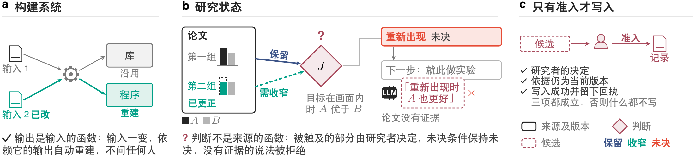
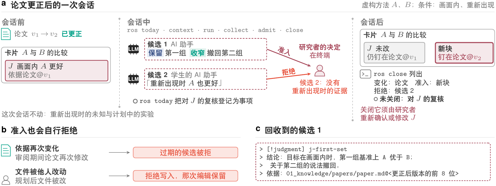
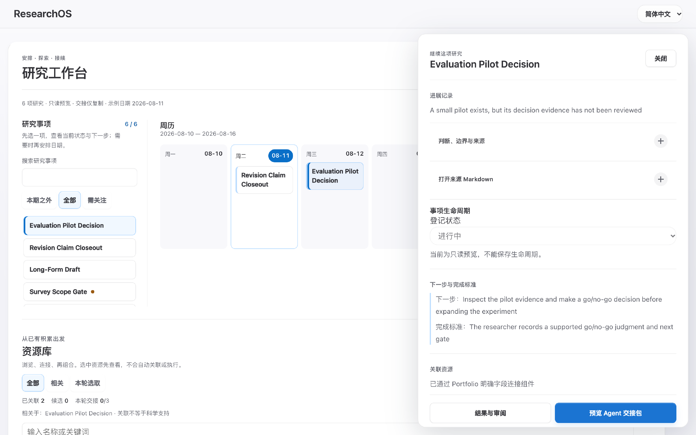
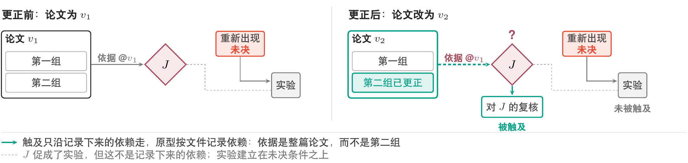
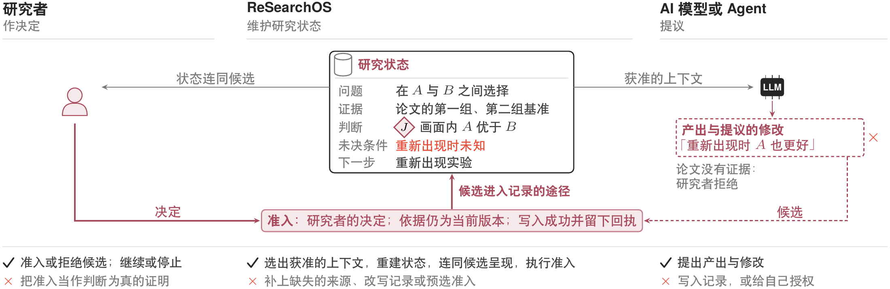
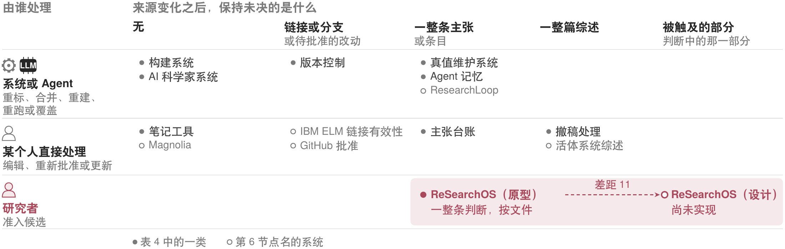
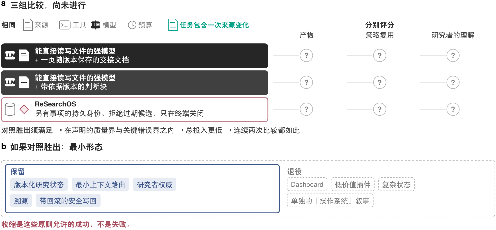
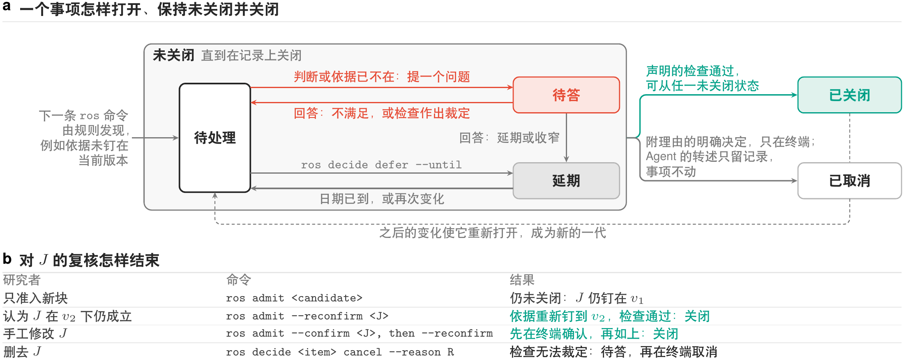

[English](technical-report.en.md)

# ReSearchOS：面向持续科研的人机协作参考架构

Shiyu Hu[^author-note] · 技术报告 · 2026 年 10 月 30 日 · 未经同行评审

新加坡南洋理工大学物理与数学科学学院

[shiyu.hu@ntu.edu.sg](mailto:shiyu.hu@ntu.edu.sg)

> 当执行越来越容易被委托，研究者更需要决定：什么值得追问，什么足以成为证据，以及什么值得留下。

## 摘要

在持续数周乃至数月的人机协作研究中，后续工作建立在早先的判断之上，而判断所依赖的来源可能发生变化，例如论文被更正或数据被替换。对于这种变化，现有工具大致有两种做法：构建系统和真值维护系统自行重算，笔记工具和多数 Agent 记忆则不作处理。研究判断不适合这两种做法。同一次更正可能使判断的一部分依然成立、一部分需要修改，而论文从未测试的情形仍无法裁定；这种区分是对证据的判断，AI 模型可以提议，接受与否由研究者负责，因此不能由系统重算；而判断依赖哪些来源是可以记录的，因此也不必任其失效。本报告主张第三种做法：判断连同依据版本和适用范围写入研究者自己的文件，来源变化时，系统沿记录下来的依赖找出相关判断，作为待复核的事项交回研究者，由研究者决定保留、收窄或撤回；AI 模型的产出在研究者准入之前只是候选。报告给出这一做法所需的记录格式与准入协议、一个命令行原型，以及与相近系统的逐类对照。原型能够在下一条命令时发现来源文件的变化并登记复核，拒绝审阅期间依据再次变化的候选，并且不接受 Agent 转述的取消或确认（Agent 直接运行的重新确认仍会写入并关闭复核）；它按文件而不是按论据记录依赖，也不登记研究者陈述的条件与计划中的实验。可下载版本默认只回收候选，不改动研究者的记录。原型目前只有作者一位用户，尚未开展使用研究，也未与更简单的做法比较，因此本报告不主张科研收益。

**关键词：**人机协作；来源变化；判断复核；研究记录；准入；参考架构。

## 1. 来源变化之后

研究者读完一篇论文，认定方法 $A$ 优于方法 $B$，并在笔记中记下“用 $A$”。数周后论文被更正：第二组基准的数字有误，修正之后，$A$ 在这一组上的优势消失。此时没有任何记录显示哪些结论依赖这篇论文。同一周，研究者的学生让 AI 助手阅读更正后的论文，AI 助手得出结论：在论文未曾测试的情形下，$A$ 同样更好。此后无论谁从“用 $A$”继续工作，都没有其他线索可循。

这个例子包含两个问题，本报告只处理第二个。第一个问题是记录：判断的理由若未写下，往往随对话结束而丢失。这个问题依靠更完整的笔记就能解决，并不需要新的系统。第二个问题是维护：即使理由已经写下，来源变化之后仍然需要有人查明哪些判断受到影响，并决定受影响的部分如何处理。

现有工具对维护问题大致有两种做法。构建系统在输入变化后重建依赖它的部分，无需询问任何人，因为输出是输入的函数；真值维护系统沿记录的理由重新标注信念，道理相同。笔记工具和多数 Agent 记忆则不作处理，笔记保持原样，直到研究者亲手或通过助手修改。研究判断不适合这两种做法（图 1）。在上面的例子中，“$A$ 优于 $B$”有一部分依然成立，因为第一组基准没有错；有一部分需要修改，因为第二组的优势已经消失；而目标离开画面后重新出现的情形论文从未测试，仍无法裁定，只能留待计划中的实验。这种区分是对证据的判断，AI 模型可以提议，接受与否由研究者负责。然而，这篇论文被哪些判断依赖，在写下判断时就可以记录下来，因此来源变化之后也不必等到有人想起。



本报告主张的做法位于两者之间：系统沿记录下来的依赖找出相关判断，作为待复核的事项交回研究者；研究者决定保留、收窄或撤回，只有这一决定才写入记录。要做到这一点，需要满足三个条件。第一，判断要带着依据版本和适用范围写在研究者自己的文件中，否则系统没有依赖可循。第二，AI 模型和其他会话的产出要先作为候选，经研究者准入才进入记录，否则学生助手那条没有证据支持的说法就可能直接改变结论。第三，复核一旦登记，只能经检查通过或研究者的明确决定关闭，否则无人检查过的事项会悄然消失。第 2 节展示这三个条件在一次会话中的样子，第 3、4 节说明它们的理由与定义。

**ReSearchOS** 是按这一做法构建的研究环境，由研究者拥有，以本地文件为主。[^name] 本报告的贡献有三项：判断记录的格式与准入协议，一个命令行原型，以及与相近系统的逐类对照。第 4 节是一份规格；第 5 节描述的原型按文件而不是按论据记录依赖。研究者的决定只在终端上得到执行：Agent 执行的准入和重新确认同样会写入，只是记为调用者的断言，后者还会使复核的检查通过；Dashboard 的生命周期写入也绕过准入（第 5 节）。作者是原型目前唯一的用户，同时是它的开发者和全部结果的评估者。本报告面向已经习惯核对来源、跨会话工作的研究者；新手的学习和团队分歧的处理需要另行研究。

这一主张面临一个有力的替代做法。研究者可以把工作现状写成一页随版本保存的交接文档，交给能够直接读写文件的强模型，模型也许同样能够在来源变化后找出受影响的判断。本报告不能排除这种可能，第 7 节说明如何比较。在比较完成之前，本报告只主张设计与原型，不主张科研收益。

## 2. 一次会话

本节沿用第 1 节的例子，方法 $A$、$B$ 均为虚构，不报告任何真实方法的效果。把上述结论写完整，判断 $J$ 是“目标在画面内时，$A$ 优于 $B$”。下文用到六个词：判断块是卡片（一份 Markdown 记录）上带标识的一段判断，依据是判断块中把来源钉在某个版本上的字段，候选是尚未准入的产出，准入是候选写入研究者记录的一步，复核是来源变化之后询问判断是否仍然成立的事项，回执是做了什么、查了什么的记录。图 2 画出了这次会话。



会话开始之前，研究者已把 $J$ 以判断块的形式写在卡片上并完成准入，依据钉在论文的 $v_1$ 版本。这是下面一切的前提：原型的检测从判断块和它的依据字段出发，不会从笔记中推断依赖，卡片上若没有这样的记录，`ros today` 就不会登记复核。随后论文更正为 $v_2$：第二组的数字改变，第一组不变。这次更正进入记录的方式是用户，或按用户指示行事的 Agent，替换记录这篇论文的本地文件 `01_knowledge/papers/paper.md`。原型只观察配置中列出的目录下的 Markdown 文件，本例中论文的记录位于 `01_knowledge/` 之下；论文的 PDF 本身变化时，原型看不到。

会话由 `ros today` 开始。这是更正之后的第一条 `ros` 命令，它看到文件的内容摘要已经改变，于是为 $J$ 登记一项复核事项，并把这项事项列入待判断一栏（本例假定 $J$ 属于一项活跃承诺）。事项有稳定的身份：论文此后无论再改几次，它都是同一项事项，只更新所对应的版本，不会重复登记，也不随对话结束而消失。此时系统并不提问，也不判断更正是否重要：更正可能只改了一个错字，判断依旧成立。接着，`ros context` 交付获准使用的来源和当前记录，并留下回执；`ros run judgment --target <card> --executor copy_packet` 为承载 $J$ 的卡片写出一个任务包，即装有任务与已交付上下文的 Markdown 文件，不调用任何 AI 服务，由用户粘贴到任一助手中。任务包只含这张卡片，更正后的论文由用户一并交给助手。`ros collect <run> --file draft.md` 把助手的草稿读回，作为候选。草稿中只有一到三个判断块会被读取，其余内容一律忽略：

```
> [!judgment] j-first-set
> 结论：目标在画面内时，第一组基准上 A 优于 B；关于第二组的说法撤回。
> 依据：01_knowledge/papers/paper.md@<更正后版本的前 8 位>
```

这个候选把依据钉在 $v_2$。草稿中不带版本的依据按回收时的当前版本钉住，钉在过期版本上的草稿在回收时就被拒绝。依据按文件记录，原型看不到论文内部第一组与第二组的划分，所以“第二组的说法撤回”是候选写明、由研究者判断的内容，不是系统算出来的。研究者审阅之后，`ros admit <candidate>` 把它作为新的判断块写在 $J$ 旁边；由于确认是在终端作出的，这次准入记为研究者的决定。

同一次会话中，学生的 AI 助手给出的候选“目标重新出现后 $A$ 也更好”也被回收，依据同样钉在 $v_2$。论文没有报告这种情形的任何结果，研究者在终端拒绝了它。这一拒绝记录在案，不写入判断。

准入本身也会拒绝，情形有两种，都不是科学判断。若论文在审阅期间再次修改，准入以依据过期为由拒绝候选，需要在当前材料上重新提议。若承载 $J$ 的文件在写入计划形成之后、实际写入之前被他人编辑，系统拒绝写入，不覆盖那次编辑。

会话以 `ros close` 结束，它比较会话起止时的文件，列出其间的变化、准入、拒绝、尚未决定的候选和仍未关闭的事项。此时对 $J$ 的复核仍未关闭，因为新块的准入并不改变 $J$：$J$ 的依据仍钉在 $v_1$，原型能够自行裁定的这项检查继续不通过。要关闭这项复核，研究者需要处理 $J$ 本身。若研究者认为 $J$ 在 $v_2$ 下仍然成立，可以用 `ros admit --reconfirm` 把依据重新钉到 $v_2$，检查随之通过；若研究者手工修改了 $J$，须先在终端上用 `ros admit --confirm` 事后确认，才能重新钉定；若研究者删去 $J$，系统无法裁定，复核转为待答，由研究者在终端上取消。研究者也可以不动 $J$，在终端上说明理由后用 `ros decide … cancel` 取消复核；这一取消只针对当前的版本，$J$ 或它的依据再次变化时，事项重新打开。

这次会话中有三件事原型没有做。它不按论据区分更正触及的部分，这一区分由候选写明、由研究者判断（差距 11）。它不登记重新出现条件和计划中的实验，这两者只写在卡片的文字中，`ros close` 不会列出（差距 12）。它也不替研究者处理 $J$：收窄后的新块与原判断并存，直到研究者作出上述选择。

这次会话的结果还依赖两件原型并不保证的事。更正之所以被发现，是因为有人替换了那个文件：原型不监视文件，变化要到下一条 `ros` 命令才被看到（差距 34），一项新研究若没有改动任何已记录的输入，也不会被发现。研究者的决定也只在终端上得到执行：Agent 转述的确认或取消不会关闭事项，但 Agent 若直接运行 `ros admit --reconfirm`，写入照常发生，只记为调用者的断言，检查通过后事项随之关闭（差距 1）。

以上是作者的原型的行为。可下载版本在默认的只复制模式下，于自己的虚构夹具（经 `--root` 指定）上运行同样的命令，因此它的运行不能作为这次会话的证据。如表 1 所示，它可以在本机写入运行态、任务包与候选，但只产出可复制的候选或拟议差异，从不准入候选，也从不改动研究者的记录：

<!-- table: 同一组命令在作者的原型与可下载版本中的默认行为 -->
| 命令 | 作者的原型（本次会话） | 可下载版本（默认） |
| --- | --- | --- |
| `ros today` | 观察来源变化，登记复核事项 | 查看虚构记录，维护 Git 忽略的工作状态 |
| `ros context` | 交付获准使用的来源和当前记录，留下回执 | 交付获准使用的虚构上下文，留下回执 |
| `ros run judgment --target <card> --executor copy_packet` | 准备任务包，不调用 AI 服务 | 准备可复制的任务包，仍拒绝向 provider 派发 |
| `ros collect` | 把草稿回收为钉定依据版本的候选 | 回收候选，不作准入 |
| `ros admit` | 经研究者在终端决定后准入；依据过期或文件在写入计划形成后已变，都会拒绝 | 通过复制回退显示拟议差异，不写入研究者的记录 |
| `ros close` | 列出变化、准入、拒绝、尚未决定的候选和仍未关闭的事项 | 记录本机会话与残留工作，不作准入 |

**试用。** 可下载版本默认只复制。其出厂的 `config/ros.json` 设定 `runtime_scope: public_starter`，下文所述行为在这一配置下成立。在其虚构夹具 `examples/scheduler-demo` 上，第一次会话按本节的步骤进行，命令取表 1 的右栏。由于可下载版本不向任何 AI 模型 provider 派发，也不向研究者的记录准入任何内容，用户可以体验恢复、上下文交付与候选回收，但体验不到准入。

图 3 展示可下载版本的研究工作台，条目的生命周期在此不能保存；图 4 展示其 Agent 交接，交接包只能预览和复制。复制出的交接包以摘要值与 copy_only 路由开头，随后依次是目标、会话来源与上下文路线。这两张截图展示的是它如何呈现一个条目，并不表示任务已完成或判断已被接受，也不说明界面的可用性。




作者的原型运行在作者本人的记录上，不对外分发；用户若想在自己的 Markdown 笔记上使用，可以用 personal-vault 模式启动可下载版本。这一模式从这些笔记生成本机的 Dashboard 视图，经用户确认后把 Dashboard 的修改写入 `personal_vault/`；经自行配置，还可以启动本机安装的 Codex CLI。然而，`ros` 本身不随这一模式改变，`ros admit` 仍只显示拟议差异。`ros` 也不拦截普通的 Agent 会话，这些会话照常进行；只有经 `ros collect` 回收或经 `ros propose` 登记的判断块，才进入候选路径。安装耗时与每次会话的投入尚未测量。

## 3. 环境要保住什么

第 2 节把关于 $J$ 的决定留给了研究者。这一决定要在数周之后、在更换 AI 模型和客户端之后依然留在研究者手中，环境就要保住三样东西：决定权，记录，以及被纠正的主张的历史。三项原则分别对应这三样东西。当效率、控制与长期留存相互牵制时，这些原则确定优先次序，并不规定统一的目录、方法、界面或审阅安排。研究记录需要时间阅读、需要精力维护，审阅也可能打断工作，或久而久之流于习惯，因此检查集中在关键的转变之处，常规工作则在约定的范围内照常进行。

第一项原则是只有研究者能把候选变成记录。学生的 AI 助手提出 $A$ 在目标重新出现后同样更好；这一说法若未经研究者决定就写入记录，$J$ 就会扩展到论文并不支持的情形。因此，AI 模型和其他会话的产出一律先作为候选，由研究者决定是否准入（第 4 节）。准入确定的是谁接受了候选，候选是否正确仍有待后续的检查，因为研究者的认同并不证明科学判断正确。这项原则目前只在终端上得到执行：Agent 执行的准入同样会写入，只是记为调用者的断言（第 5 节）。

第二项原则是记录独立于写下它的工具。如果 $J$ 及其依据只存在于产生它们的那次对话中，论文日后被更正时，就无从看出这次更正触及了 $J$。因此，权威的是研究者本地可读、可版本化的记录，AI 模型、客户端与插件都可以替换。在原型中，$J$ 写在一张卡片上，依据钉在来源的版本上，上下文连同回执一起交付（第 2 节）。相应地，视图上显示“已完成”并不等于已被接受，缓存也不会成为另一份记录。留存不等于检索：记录要连同其适用范围一起保存，后续工作才能判断它是否仍然适用。

第三项原则是纠正只收窄主张，不抹掉历史。更正只触及第二组基准，若删除 $J$，既会抹去更正并未触及的第一组证据，也会抹去第二组上的主张曾被接受的记录。因此，失败、未知与未验证的状态都如实保留，改动的内容、改动的理由以及仍然有用的部分也一并留存。在第 2 节的会话中，收窄后的判断准入在 $J$ 旁边，而对 $J$ 的复核要等研究者处理 $J$ 本身才关闭（第 4 节）。本报告也不假定研究者的理解会因此受益。

这三项原则来自作者自身的设计历程，其规则写在六份内部设计文件中；本节是对这些文件的概括，并已与之核对。设计文件中还有一项原则，规定后一步只在前一步确立的结果上开始；这项原则目前没有对应的命令，也没有检验它的测试，因此不列在这里。表 2 列出三项原则回答的问题、作出的规定及其机制，[补充说明 1](technical-report-supplement.zh.md#%E8%A1%A5%E5%85%85%E8%AF%B4%E6%98%8E-1-%E5%8E%9F%E5%88%99%E7%9A%84%E6%9D%A5%E6%BA%90%E4%B8%8E%E4%BE%8B%E5%AD%90) 给出未列入的那项原则以及各项原则的例子与来源，[补充说明 3](technical-report-supplement.zh.md#%E8%A1%A5%E5%85%85%E8%AF%B4%E6%98%8E-3-%E8%BF%87%E7%A8%8B%E4%B8%8E%E7%BB%84%E4%BB%B6%E5%90%88%E5%90%8C) 完整复述这些条款，并注明各条的负责方。

<!-- table: 三项设计原则及其机制 -->
| 原则 | 它回答的问题 | 规定 | 机制 |
| --- | --- | --- | --- |
| 人的判断 | 由谁接受判断？ | 只有研究者决定什么写入记录；机器的产出一律先作为候选 | 候选、决定、修改、检查与回执分别记录；研究者的决定只在终端上得到记录 |
| 比工具活得久的记录 | 更换工具后保留什么？ | 以本地可读、可版本化的记录为准；AI 模型、客户端、插件可替换 | 记录归研究者所有，上下文回执，依据钉在来源版本上 |
| 可纠正的积累 | 纠错后哪些判断需要改变？ | 纠正只收窄受影响的主张，不抹去历史；失败、未知与未验证如实保留 | 收窄的判断块与原判断并存，回滚回执，事项跨会话保持未关闭 |

## 4. 触及、复核与关闭

第 3 节的原则说明了要保住什么，却没有说明怎样才算保住。本节给出使之可以检查的定义。这些定义是一份规格，规定的是系统应当做到什么；[补充说明 5](technical-report-supplement.zh.md#%E8%A1%A5%E5%85%85%E8%AF%B4%E6%98%8E-5-%E5%BD%A2%E5%BC%8F%E8%A7%84%E6%A0%BC) 精确表述每条定义，原型做到了多少由第 5 节和附录 B.1 说明。本节在第 1 节的例子上只解释维护一条判断所必需的内容，原型与规格不同之处就地注明。

数周之后继续那次比较时，研究者需要的并不是文件本身，而是五项内容：正在回答的问题，用过的证据及其关系，已接受的判断及其范围，仍然未决的条件（包括冲突以及判断不适用的情形），以及计划采取的下一步。在例子中，这五项依次是 $A$ 与 $B$ 之间的选择、论文的两组基准、判断 $J$、目标重新出现时的未知，以及针对这一情形的实验。**研究状态**（research state）就是从研究者的记录重建出来的这五项内容。它是重建而不是概述，因此每一项都可以回到记录上检查和纠正；它包含多少内容，取决于问题需要什么，而不取决于材料的多少。

五项之中，判断最难维护，因为支持判断的证据在判断之外，来源变了，判断的文字不会有任何变化。所以判断要写成判断块，并记下**依据**，即它引用的来源及该来源的版本；$J$ 的依据钉在论文的 $v_1$ 上。下文的一切都以这条记录为前提。判断不是来源的函数，所以系统不能算出判断是否成立；系统能够找到依赖某个来源的判断，也只是因为这一依赖已经写下。这些判断块由研究者写下，或由研究者准入的候选写下，没有它们，`ros today` 不会为任何判断登记复核。依赖的粒度也由这条记录决定：依据是一个文件及其内容摘要，而不是文件中的某一条论据（差距 11）。

这样，第一个问题是变化牵涉哪些工作。论文从 $v_1$ 更正为 $v_2$ 之后，$J$ 钉定的版本不再是论文的当前版本，这次变化就**触及** $J$，系统为它登记一项**复核**。复核是一种**事项**，即一件带有稳定身份的维护工作：论文再次变化时，涉及的仍是这一项，不会另起一项。触及只沿记录下来的依赖传递。重新出现实验并不以这篇论文为依据，所以未被触及（图 5）。



可见，触及标出的是需要查看什么，而不是需要修改什么。假如更正只改了一个错字，$J$ 同样被触及，却没有需要修改之处；由于依赖记到文件一级，系统也说不出更正改动的是第一组还是第二组。反过来，从未记录的依赖无法被发现，一项新研究只要没有改变 $J$ 所依据的文件，即使使 $J$ 不再可靠，也不会被注意到。原型在这里还有两处限制。它没有文件监听，变化要到下一条 `ros` 命令时才被看到（差距 34）；它也不登记研究者陈述的条件和计划中的实验，这两者在规格中是未决的工作，在原型中只是卡片上的文字（差距 12）。

第二个问题是复核怎样才算结束。事项一经登记就保持**未关闭**，只有两种途径能关闭它：它的检查全部通过，或者研究者作出明确的决定。正因如此，无人处理过的事项不会消失，没有证据支持的完成报告也不能使它关闭。对 $J$ 的复核要回答的是 $J$ 在 $v_2$ 下是否仍然成立，这只有研究者能够判断；系统能够自行裁定的只是 $J$ 的依据是否钉在当前版本上，这也是原型声明的唯一一项检查（差距 34）。因此在原型中，研究者的判断通过这项检查落到记录上。研究者认为 $J$ 仍然成立，就用 `ros admit --reconfirm` 把依据重新钉到 $v_2$，检查随之通过，复核关闭。准入收窄后的新块不能代替这一步，因为 $J$ 的依据仍钉在 $v_1$。研究者若手工修改了 $J$，重新确认会被拒绝，须先用 `ros admit --confirm` 在终端上事后确认这次修改。研究者若删去 $J$，检查无从判定，复核转为待答。研究者也可以不处理 $J$，在终端上用 `ros decide … cancel` 附理由取消复核。这些关闭都不是永久的：论文再次变化时，同一项事项重新打开。

这项检查的强度需要说清楚。它通过只说明依据已钉到当前版本，并不说明有人读过这次更正。`ros admit --reconfirm` 由 Agent 执行时同样写入，只是记为调用者的断言，检查随后通过，复核也随之关闭（差距 1）。Agent 直接改写依据版本同样使检查通过，只多出一项事后确认事项。明确的决定则守得更严：取消事项或事后确认修改只在终端接受，Agent 转述时记为调用者的断言，事项保持原状态。

未关闭的事项有两种子状态，两者都让它留在视野之内，`ros close` 把它们列出，但都不使它关闭。一种是**待答**：检查无从判定，系统向研究者提出一个选项有限的问题，事项等待回答。规格允许任何只能由研究者裁定的检查进入待答，随附规则却没有声明这样的检查，因此实际走到这一步的情形是事项的主体已不存在，例如 $J$ 被删除，此时由研究者在终端上取消复核。同一规则版本上的问题只问一次，`ros today` 又把未答的问题集中成一张清单，两者都意在减轻审阅负担，是否有效尚未检验。另一种是**延期**：研究者把事项推迟到某一日期，到期后它重新成为待办。在终端上确认的延期记为研究者的决定；Agent 执行的延期记为调用者的断言，事项在收尾时仍算未完成。

第三个问题是新内容怎样进入记录。作用于研究状态的有三方（图 6）：环境从它可以使用的历史中选取上下文，重建研究状态，并连同候选一起呈现；AI 模型提出产出与修改；研究者决定接下来发生什么。按规格，候选进入研究者的记录只有**准入**一条途径，它有三个条件。第一个条件是研究者的决定，AI 模型的产出和候选自身的文字都不能代替它。其余两个条件不是决定，而是写入时的检查。依据必须仍是来源的当前版本，否则准入以过期为由被拒绝。写入必须确实完成并留下**回执**，即做了什么、查了什么的记录；若写入计划形成之后目标文件已被编辑，写入即被拒绝，不覆盖那次编辑。补充说明 5 的形式版本把这三个条件细分为五个。



准入确定的只是操作层面的决定。研究者的接受不使判断在科学上为真，软件检查通过既不确立研究者接受了什么，也不确立判断有效。原型的执行还弱于规格：研究者的决定只在终端上得到记录，Agent 执行的准入同样写入，只是记为调用者的断言，Dashboard 的生命周期写入则绕过准入（差距 1、2）；可下载版本不准入，只显示拟议的改动。

## 5. 原型

运行第 2 节会话的原型只实现了第 4 节的一部分。本节所述以附录 B.3 所列两个提交为准，背后的命令与记录表见[补充说明 2](technical-report-supplement.zh.md#%E8%A1%A5%E5%85%85%E8%AF%B4%E6%98%8E-2-%E4%BC%9A%E8%AF%9D%E6%93%8D%E4%BD%9C%E4%B8%8E%E5%AE%9E%E7%8E%B0%E6%98%A0%E5%B0%84)。原型与定义之间最要紧的差距在于，研究者的决定只在一个入口上得到执行。

### 三个入口

事实与判断经由不同的路径进入记录（图 7a）。事实可以在既有任务授权内直接更新，判断则要经过候选、决定、写入、检查与回执，每一步分别记录。这条路径从候选开始就绑定来源：`ros collect` 或 `ros propose` 登记候选时，它的每项依据都按完整版本冻结，依据若在审阅期间改变，准入就拒绝这个候选并要求重新提议。写入同样绑定形成计划时的那份内容：内容若在写入时已经改变，写入即被拒绝，其间的编辑得以保留，也不发出成功回执。这些检查保护内置的写回路径，但不验证任意规则须保持的部分（差距 9）。


这条路径只约束经过它的写入，而能够写入同一张卡片的入口有三个（图 7b）。在终端上，`ros admit` 提示研究者确认，确认后的准入记为研究者的决定。能够使用 shell 的 Agent 运行同一条命令时不出现提示，这次准入记为调用方的断言，但仍会写入（差距 1）。Dashboard 是原型的图形客户端，它的生命周期写入绕过准入；若这类写入发生在会话期间，`ros close` 把其中承载判断的字段（state 与 priority）登记为未确认的修改，这些修改在研究者确认之前不会关闭（差距 2）。`ros` 也不拦截普通的 Agent 会话：Agent 直接编辑卡片时文件不会回滚，只有经 `ros collect` 回收或经 `ros propose` 登记的判断块才走候选路径。

由此可以划定终端规则的范围。它能够执行的是关闭：`ros decide … cancel/confirm` 与 `ros answer … cancel/satisfied` 只在终端接受，Agent 的转述只记为调用方的断言，事项保持未关闭。没有准入回执的判断块会在下一条 `ros` 命令时登记为事项，用 `ros admit --confirm` 事后确认同样只在终端生效，因此直接写下的判断不会无人过问地留在记录中。

它不能执行的是写入本身。Agent 可以准入候选，也可以对未经改动的已准入或已确认判断块运行 `ros admit --reconfirm`。后者把依据钉到当前版本，检查随之通过，复核也就关闭，记录中只多了一条调用方的断言。因此，“Agent 的转述不能关闭事项”只约束明确的决定，并不阻止 Agent 使检查通过。终端记录本身也有限度：原型只判断标准输入和标准错误是否连着终端，分配了伪终端的进程同样能够应答提示，其应答随后也记为研究者的决定。可见记录证明的是通道，而不是人（差距 1）。对能够使用 shell 的 Agent 而言，这些记录是归属与审计线索，而不是阻断。可下载版本默认不发生上述准入：同样的命令只显示拟议差异，从不准入。

### 代码结构

入口之间的差别源于代码现有的构成（图 8）。研究者的记录是本地的 Markdown 卡片。适配器把记录读成快照，交给内核包 `researchos_kernel`；内核包从快照计算变化、事项与检查，只读取规则表与数据合同，只写入自己的账本，因此从不直接读取卡片。写入由适配器暂存，核对之后才落到文件，并留下回执。命令行入口 `scripts/ros.py` 把这些部分连接起来，终端和 Agent 会话（如 Codex、Claude Code）运行的都是它。账本记录决定了什么、尝试了什么、检查了什么，但不能确立从未记录的依赖，对研究者的记录也没有权威。

与补充说明 2 的目标划分相比，现有代码有两处不同。准入仍由 `ros.py` 执行，而不在内核包中，所以单一的稳定内核仍是目标（差距 3）。Dashboard 由本机服务提供，写入时不经过 `ros.py`，上述保护对它不起作用（差距 2）。


这一构成决定了原型能够发现什么。依赖全部来自记录：检测从研究者手写的判断块和依据字段开始（已确认的关系也一样），没有这些内容，`ros today` 找不到需要复核的判断。依赖按文件记录：依据是一个文件及其内容摘要，检查只问依据是否钉在当前版本上，看不到更正落在文件的哪一部分（差距 11）。发现要等到命令运行：原型没有文件监听，也没有后台进程，多数 `ros` 命令开始时比较一次，变化要到下一条这样的命令才被看到，也不跨多跳传播（差距 34）。一项新研究若没有改变任何已记录的输入，系统不会注意到它。

### 差距与证据

第 2 节的复核自始至终没有转为待答，这是会话与定义之间的一处差别。按定义（补充说明 5），$J$ 在 $v_2$ 下是否仍然成立是研究者才能裁定的检查，复核应转为待答并附一个问题。在原型中，能够自行裁定的检查只有一项，即依据是否钉在当前版本上，而更正之后这项检查不通过；不通过不等于无法裁定，所以复核只是保持未关闭。只有遇到无法裁定的检查时，`ros today` 才提出一个问题（同一规则版本下不重复），事项在研究者用 `ros answer` 作答之前一直待答。随附的规则都没有声明取决于研究者判断的检查，所以在回归测试之外，只有事项的主体无法解析时（例如 $J$ 被删除）才会走到这条路径（附录 B.1）。第一组的结果是否仍支持 $J$，目前完全留给研究者（差距 34，语义检查）。

第 4 节连同补充说明 5 是规格，当前代码只提供其中若干可运行路径，覆盖情况按义务逐项登记，不由测试数量推断。表 3 按主题列出最要紧的差距，[补充说明 6](technical-report-supplement.zh.md#%E8%A1%A5%E5%85%85%E8%AF%B4%E6%98%8E-6-%E5%AE%9E%E7%8E%B0%E5%B7%AE%E8%B7%9D%E5%85%A8%E8%A1%A8) 给出全部 39 项及其完整说明，编号与全文一致。这些差距限定的是实现能够主张什么，定义本身并不因此改变。

除此之外，原型还有几处不及定义。它不能替换或撤回 $J$，这由研究者手工完成（差距 11）。它不登记研究者陈述的条件和计划中的实验，所以 `ros close` 不列出它们（差距 12）。研究者在终端用 `ros decide … defer` 确认的延期确实生效，但还没有机制会因范围外的依赖产生延期（差距 17）。版本只按内容摘要标识，内容改回原样算回到原先的版本，而不是新的修订（附录 B.1）。跨客户端集成也尚未验证。

<!-- table: 按主题分组的已披露实现差距 -->
| 主题 | 差距编号（对应补充说明 6） | 对原型使用者意味着什么 |
| --- | --- | --- |
| 准入与写回 | 1、2、9 | Agent 执行的准入与重新确认、Dashboard 写入都只被记录、不被阻断；内置检查也不验证任意规则须保持的部分。 |
| 会话与完成 | 15、17、18 | 会话的规格冻结不完整，范围外的依赖不产生延期，过期依据上的待答问题仍可能让会话报告 `complete_with_held`。 |
| 依赖与维护 | 3、10、11、12、34 | 单一的稳定内核仍是目标，因为准入仍由 `ros.py` 执行。前后步骤的通用检查、更正时对有独立支持部分的保护、陈述条件与计划实验的登记、文件监听与多跳传播都只停留在规格。 |
| 验收与收益 | 13、14 | 界面的真人验收、真实模型的隔离、长期恢复与科研收益都尚未验证。 |

评价这一原型时，需要区分两类证据。第一类是内核与写回的回归测试，它们在临时夹具上演练来源变化、候选冻结、准入、并发写入的拒绝与收尾记录，测试通过确立的是这些输入下的执行性质。在这个范围内，主张是明确的：文件层面的来源变化在下一条命令时被发现，并登记为身份稳定的事项；审阅期间依据已变的候选和计划之后内容已变的写入都被拒绝；事项只经检查通过或终端上的明确决定关闭，Agent 的转述不能关闭它。第二类证据回答另一些问题：收窄后的判断是否正确，实验是否值得进行，研究者是否理解得更多。这些问题需要实际任务和独立证据，软件检查既不构成验收，也不确立科学有效性。原型目前只有作者一位用户，使用研究与第 7 节的比较都尚未进行，因此本报告不主张科研收益。

## 6. 相近系统

原型止于上述边界。接下来的问题是：研究者已在使用的工具是否已经做到同样的事。为此，这里让第 1 节的论文在每一类工具中都更正一次，看更正之后发生什么。表 4 记录每一类的结果，每一行描述的是该类中点名的或典型的系统所报告的机制，并不涵盖该类的每个系统，也不涉及接入情况或性能。ReSearchOS 在表中分为两行，因为规格不能与别人的实现比较：“原型”一行写第 5 节的代码所做的事，“设计”一行写第 4 节与[补充说明 5](technical-report-supplement.zh.md#%E8%A1%A5%E5%85%85%E8%AF%B4%E6%98%8E-5-%E5%BD%A2%E5%BC%8F%E8%A7%84%E6%A0%BC)所规定的事。

在笔记工具中，这次更正不引起任何改变，记录 $J$ 的笔记保持原样，直到研究者亲手或通过助手修改。版本控制保留每个版本，并通过乐观并发控制 [Optimistic concurrency control](https://doi.org/10.1145/319566.319567) 拒绝过期写入，原型拒绝已变文件所用的也是这一机制；但它不区分事实与判断，遇到并发修改时只合并或报告冲突。原型在这一点上并不更强：它只拒绝写入，不保留冲突的两个版本。

另几类系统自行处理这次更正。真值维护系统 [Truth maintenance system](https://doi.org/10.1016/0004-3702%2879%2990008-0) 沿记录的理由修订信念：若把两组基准画作两条独立的理由，第二组这条理由失效之后，$J$ 凭第一组继续成立（图 9c）。区别在于由谁给值：这类系统自行重新标注，ReSearchOS 只报告依据不再是当前版本，判断是否仍然成立由研究者决定。构建系统 [Build systems à la carte](https://doi.org/10.1145/3236774) 重建被输入变化失效的结果，被暂停的任务等待的是依赖就绪，不是人的判断。在 Agent 记忆中，Graphiti [Zep](https://arxiv.org/abs/2501.13956) 使被反驳的事实失效，PACMI [PACMI](https://arxiv.org/abs/2610.05732) 把依赖于已变化证据的记忆标为待核实，都由系统设定新的状态，不询问任何人；GovMem [GovMem](https://arxiv.org/abs/2607.02579) 把有疑问的候选记忆交给人审阅，但只发生在写入之前。AI 科学家系统则在自身的权威下重跑。图 9 展示这六类系统对这次更正的处理，它们都没有把变化作为问题留给研究者。

另一些工具把变化交回给人，这种做法并不始于本报告。IBM Engineering Lifecycle Management 这类需求管理工具在链接任一端的内容变化时把追踪链接标为可疑，由团队成员标为有效或无效 [Link validity](https://www.ibm.com/docs/en/engineering-lifecycle-management-suite/lifecycle-management/7.0.3?topic=management-link-validity)；GitHub 的受保护分支可以设置为，新提交改变已批准的 diff 之后，改动须经重新批准才能合并 [Protected branches](https://docs.github.com/en/repositories/configuring-branches-and-merges-in-your-repository/managing-protected-branches/about-protected-branches)。

活体系统综述把研究结论交回作者，而且做了 ReSearchOS 没有做的事。按 Cochrane 的指南，这类综述每月检索新证据，作者判断新研究是否可能对结论产生重要影响，读者每月得知综述的状态，并在整合新证据期间被告知更新尚待完成 [Cochrane living systematic reviews](https://resources.cochrane.org/sites/resources.cochrane.org/files/uploads/inline-files/Transform/201912_LSR_Revised_Guidance.pdf)。2026 年 6 月，Cochrane 还宣布把已撤稿的研究与纳入它们的综述相对应，并在评估影响期间为综述添加编辑注，结论如何处理交由编辑决定 [Cochrane retracted publications](https://www.cochrane.org/about-us/news/cochrane-strengthens-systems-manage-retracted-publications-its-published-reviews)。ReSearchOS 不做这些事。它不检索新研究，也不接收撤稿信息：原型只看记录来源的本地文件是否改变，而替换这个文件的是用户或按用户指示行事的 Agent，因此一项新研究即使使判断不再可靠，只要没有改动判断所依赖的任何输入，原型就不会察觉。它不向研究者以外的读者显示某项判断正待复核，也没有作者团队与编辑流程。活体综述正是为这些情形设计的，本报告的做法不能代替它。

在单条主张的层面上，更接近的做法是一篇论文的定量主张台账 [Provable discourse](https://arxiv.org/abs/2603.10450)：数据指纹一旦变化，即使主张仍然通过也会被标为过期。

最近有一个系统把撤回沿整条记录链向下传递。在一个面向受监管场景、由语言模型维护的 wiki 中，Zhang 的溯源层 [Provenance-native wiki](https://doi.org/10.53941/aiet.2026.100010) 把主张绑定到证据段落。当某个来源被标为撤回、被取代或降级时，该系统沿这些链接找到依赖它的主张、规则和决策。还有其他支持的主张重新计算置信度，低于阈值即标为有争议；没有其他支持的主张被暂停；下游决策一律被标记，其中置信度低于下限的决策还要转人工审查。在 112 篇文档的语料上进行五次模拟撤回，受影响的记录全部被找到。

这是本报告所见最接近第 4 节“触及”的机制，而且它走得更远：它沿整条记录链传递，原型只沿已记录的依赖走一步（差距 34）；它报告了受控评估，这一点 ReSearchOS 尚未做到。两者的区别在于由谁处理、处理的对象是什么：该系统按阈值为一整条主张设定状态，其论文既没有描述主张上的范围，也没有就哪部分仍然成立询问人。

研究者权威也有先例，问题是论文更正之后这项批准是否失效。OmniScientist [OmniScientist](https://arxiv.org/abs/2511.16931) 记录人对工件及其版本哈希的批准，被批准的是工件，而不是来源变化后会交回研究者的判断。Magnolia [Magnolia](https://arxiv.org/abs/2610.27230) 的跨项目规则要等研究者逐条确认才启用，ResearchLoop [ResearchLoop](https://arxiv.org/abs/2605.28282) 只在研究者或预先指定的协议文件编写的门槛所批准的范围内准入主张；两篇论文都没有描述在来源后来变化时把已准入的结果交回研究者。

这些工具保持未决的是一条链接、一次待合并的改动、一整篇综述或一整条主张。在本报告考察的系统中，没有一个同时做到三件事：保存研究者准入的判断及其依据版本，来源变化时把判断作为一项事项交回研究者，并且只通过研究者准入的候选修改这条记录。原型做到了前两件事；第三件只及于新判断，已有判断只能手工修改或重新钉定。而且范围很窄：依赖按文件记录，交回的是一整条判断，这在粒度上并不比可疑链接或主张台账更细；只更新被触及的部分目前只是设计（差距 11）；研究者的决定只在终端上得到执行（差距 1、2）。


<!-- table: 论文更正之后，相近系统保留什么、发生什么、留下什么 -->
| 系统类别 | 保留什么 | 来源变化时发生什么 | 保持未决的是什么 |
| --- | --- | --- | --- |
| 个人知识库与笔记工具 | 笔记与链接 | 不发生变化；由研究者亲手或通过助手修改 | 无；未决问题只是一条笔记 |
| 带乐观并发的版本控制 | 每个版本；拒绝过期写入 | 合并，或报告冲突 | 分支，但不说分支意味着什么 |
| 真值维护系统（JTMS、LTMS、ATMS） | 结论及其理由 | 自行沿理由重新标注；仍有别的有效理由的结论继续成立 | 未知标签（LTMS）或同时保留多个相容语境（ATMS），由系统处理，不交给研究者 |
| 撤稿处理与主张台账 | 综述及其纳入的研究，或带证据指纹、绑定证据段落的主张 | 提示被撤稿的研究，在数据变化时把主张标为过期，或按阈值把主张标为有争议或暂停、并标记下游决策 | 一整篇综述（Cochrane 宣布将为其加编辑注），作者更新之前的一整条主张，或被系统暂停的一整条主张；不按范围，也没有待准入的候选 |
| 构建系统与科研工作流 | 键、值及其输入 | 重建被变化失效的部分 | 无；人在环外 |
| 科研知识图谱与实验跟踪器 | 比较记录、运行与谱系 | 记录本身更新，建立在记录之上的判断不变 | 无 |
| Agent 记忆（RAG、A-MEM、Mem0、MemOS、Graphiti、PACMI） | 检索与压缩后的上下文 | 覆盖、重排，或由 Agent 判定失效 | 至多是系统设定的待核实标记；不交给研究者 |
| AI 科学家系统（AI Scientist、Agent Laboratory、Co-Scientist、Kosmos、Denario） | 假设、实验与工件 | 在自己的权威下重跑；研究者可对某一阶段给出反馈 | 没有由研究者决定的东西 |
| ReSearchOS（原型） | 带依据版本的判断块，依据按文件记录；适用条件是原型不读取的文字 | 下一条命令时登记一项复核；只有准入的候选才写入，原判断不变，由研究者另行处理 | 对一整条判断的复核，直到检查通过或研究者在终端作出明确决定；不登记未决条件与计划的实验 |
| ReSearchOS（设计） | 带范围与依据版本的判断 | 只经研究者准入的候选更新被触及的部分 | 未决条件，以及等待研究者回答的检查 |

图 10 把这一比较摆在两条轴上：来源变化之后保持未决的是什么，取自表 4 的最后一列或上文描述该系统的段落；由谁处理这次变化，取系统或 Agent、某个人直接处理、研究者准入候选三种。科研知识图谱与实验跟踪器没有画入，因为表 4 没有说明由谁更新它们的记录。图中“被触及的部分”一列只有 ReSearchOS，但这是设计的位置；原型交回的是一整条判断，位于研究者一行的“一整条主张”一列。



[补充说明 4](technical-report-supplement.zh.md#%E8%A1%A5%E5%85%85%E8%AF%B4%E6%98%8E-4-%E7%A0%94%E7%A9%B6%E5%9F%BA%E7%A1%80%E8%AF%A6%E8%BF%B0) 给出完整综述，其中也包括本节从略的系统。以上对照只说明这些系统的机制不同，并不说明这种不同有用。

## 7. 怎样检验

机制上的不同是否有用，要由比较来回答，第 1 节的反证问的也是这件事。这项比较设两种对照，两者都与原型使用相同的来源、工具、模型与预算，在足够多的自然研究任务上进行。第一种对照是能直接读写文件的强模型配一页随版本保存的交接文档。第二种对照是同一模型配写在研究者文件中的判断块，块中带依据版本，但不使用原型。

第二种对照是针对本报告窄主张的公平对照，因为依赖记录已经在判断块里，模型可以自行比对版本、找出过期的判断。原型比它多出的只有三项：事项的持久身份，对过期候选的拒绝，以及只经检查通过或终端决定才关闭复核。比较要回答的就是这三项是否值得保留。任务因此必须包含来源变化，并且变化要有机会落在审阅期间和两次会话之间，否则这三项无从起作用。迄今重建的四个历史请求都不是来源变化（补充说明 1），不能代替这样的任务。



第一种对照的胜出标准如下。如果模型能在声明的质量界与关键错误界之内恢复当前问题、关键证据、已接受的判断、未决边界与下一步行动，并且总投入更低、在连续两次比较中都能做到，交接即算胜出。在这种情况下，ReSearchOS 应收缩为版本化研究状态、最小上下文路由、研究者权威、溯源和带回滚的安全写回，Dashboard、低价值插件、复杂状态与单独的“操作系统”叙事届时都可以退役。这样的收缩是这些原则所允许的成功，而不是失败（图 11）。同一标准也适用于第二种对照：如果判断块本身就能达到，原型多出的三项便没有保留的理由。

这项比较需要分开评价三件事：工件、策略复用，以及研究者的理解。生成式 AI 与学习的研究 [GenAI and human learning](https://doi.org/10.1038/s41562-024-02004-5)、人机结合效果的研究 [Human–AI combinations](https://doi.org/10.1038/s41562-024-02024-1) 与反馈循环研究 [Human–AI feedback loops](https://doi.org/10.1038/s41562-024-02077-2) 都支持这样区分，因为产出变好并不表示研究者理解得更多。

这项比较与第一项使用研究（参与者是作者以外的研究者）都尚未进行，第 2–5 节也没有预设它们的结果。在它们完成之前，实际的建议是先采用更简单的做法：把工作现状写成一页随版本保存的文档，交给能直接读写文件的强模型，开展两周的真实工作；只在这种做法漏掉来源变化之处，才安装可下载版本。可下载版本在默认模式下回收候选，但不准入候选。

## 8. 结论

来源变化之后，研究判断不能由系统重算，因为哪部分仍然成立是对证据的判断，AI 模型可以提议，接受与否由研究者负责；也不必任其失效，因为判断依赖哪些来源可以在写下判断时记录。本报告据此主张第三种做法：系统沿记录下来的依赖找出判断，作为待复核的事项交回研究者，由研究者决定保留、收窄或撤回；机器的产出在研究者准入之前只是候选。

原型实现了这一做法中最窄的一段，并且可以在终端上检查。来源文件的变化在下一条命令时被发现，并登记为身份稳定的事项；审阅期间依据再次变化的候选被拒绝，写入计划形成之后内容已变的写入也被拒绝；事项只经检查通过或明确决定关闭，而取消和确认这类明确决定只在终端上生效，Agent 转述的决定不关闭事项。Agent 执行的重新确认则是例外，它照样写入并使检查通过，只是记为调用者的断言（差距 1）。在第 2 节的会话中，新判断只在研究者决定之后才准入，无证据支持的提议被拒绝并记录在案，收尾时对 $J$ 的复核仍未关闭。为区分已给出的证据与尚待证明的部分，表 5 把每项贡献及这两方面的内容并列。

<!-- table: 贡献、证据与尚待证明 -->
| 贡献 | 本报告给出的证据 | 尚待证明 |
| --- | --- | --- |
| 判断记录的格式与准入协议（第 3、4 节） | 第 4 节的定义；补充说明 5 的规格，以及在所述假设下论证的两条命题；补充说明 1 中促成各项原则的文献与四个历史请求（只作需求来历的先例） | 能否改善真实研究中的理解与决定，使用研究尚未进行；两条命题都不证明完成可达 |
| 命令行原型（第 2、5 节） | 第 2 节的虚构示例（只说明机制）；内核回归测试与附录 B.3 的 CI 运行。这些软件检查既不确立验收，也不确立有效性 | 未实现：按论据记录依赖（差距 11），陈述的条件与计划实验的登记（差距 12），文件监听（差距 34），范围外依赖的等待（差距 17），后一步对前一步结果的通用检查（差距 10）。未验证：跨客户端集成。终端之外，研究者的决定不被执行（差距 1、2） |
| 与相近系统的逐类对照（第 6 节） | 表 4 与图 9、图 10，记录来源所报告的机制 | 接入情况与性能都未比较；第 7 节与两种对照的比较都未进行；不改动输入的新研究不会被察觉 |

长期收益尚未得到证明。作者是原型目前唯一的用户，同时是它的开发者和全部结果的评估者；第 7 节的比较和使用研究都还没有进行，在主张任何价值之前，应先用各自的结果修订定义或原型。清晰的交接已经够用之处，应选择更简单的安排；额外的结构只有在帮助研究者注意到来源的变化、修订判断、避免重复工作时才值得保留。无论结果如何，本报告只主张一点：来源变化时，判断的哪部分保留、收窄或撤回，由研究者决定，而不是由 AI 模型或另一个会话决定。

**可用性与伦理。** 参考工件使用公开文献与虚构例子。补充说明 1 列出的四个设计请求重建自作者本人记录的九十天历史，这段历史包含合作者与学生的消息和未发表的工作。它只在本地处理，其符号投影不带标识，也没有任何内容对外分发。个人与项目标识、原始私有文档、未发表的技术细节、私有记录和记录图都不随本报告分发，本报告也不宣布数据集或基准发布。当前软件许可为非商业、源码可见，不主张 OSI 认可的开源。工件获取仍受仓库可见性限制。任何参与者研究都需要知情同意、适用的机构审查、数据最小化与退出安排，安全实验则需要与真实外部效果隔离。

**声明。** AI 辅助参与了来源发现、起草、翻译、制图与排版；科学主张与投稿元数据由作者负责。参考文献中包含相关的合作研究作为方法来源，不把其结果当作对 ReSearchOS 的验证。本报告没有给出参与者结果或长期因果收益。

## 附录 A. 对象与事项的生命周期

第 4 节在例子上逐个引入这些对象，本附录把它们并列在一起。表 6 列出每一类对象、它可能处于的状态、它在什么条件下转移，以及使它转移的一方。各方是研究者、系统（即内核与第 2、5 节的命令）和 AI 模型，其中 AI 模型的产出只能以候选身份进入。[补充说明 5](technical-report-supplement.zh.md#%E8%A1%A5%E5%85%85%E8%AF%B4%E6%98%8E-5-%E5%BD%A2%E5%BC%8F%E8%A7%84%E6%A0%BC) 给出这些定义的精确表述，以及版本分支、检查的记号、完成条件和两条命题。

`ros` 的输出沿用较早的用语：它把本报告所称的事项印作“要求”（requirement），把未关闭印作“未决”（open），把待答印作“挂起”（held），把延期印作“等待”（waiting）。代码内部称事项为 issue，其状态取 `open`、`deferred`、`waiting`、`resolved` 与 `cancelled`，前三种即本报告所称的未关闭。待答在代码中是带 `answer:` 触发条件的 `waiting`，延期则是 `ros decide … defer` 产生的 `deferred`，或回答问题时产生的、带日期或事件的 `waiting`。

<!-- table: 对象、状态与由谁改变 -->
| 对象 | 状态 | 条件 | 由谁改变 |
| --- | --- | --- | --- |
| 来源的版本 | 当前，或已被取代 | 系统按内容摘要比较，文件内容变化后，判断钉定的旧版本不再是当前版本；内容改回原样时算回到原先的版本（附录 B.1）。规格中的版本分支与晚到记录见补充说明 5 | 系统，在下一条 `ros` 命令时 |
| 候选 | 已回收待决定、已准入或已拒绝 | 研究者决定接受、依据仍是当前版本、写入完成并留下回执时才被准入。审阅期间依据变化时，这次准入以过期为由被拒绝，须重新提议；文件在写入计划形成后已变时，被拒绝的是这次写入，而不是候选 | `ros collect` 或 `ros propose` 回收它并冻结其依据；研究者准入或拒绝。Agent 执行的准入同样写入，记为调用者的断言（差距 1） |
| 判断 | 依据为当前版本，或待复核；研究者可决定保留、收窄或撤回 | 保留：`ros admit --reconfirm` 把依据重新钉到当前版本。收窄：准入钉在新版本上的新块，新块与原判断并存，原判断仍待复核。撤回：研究者手工删去，复核转为待答；原型不保留被撤回判断的文字，这一点不及第三项原则 | 系统标记待复核；研究者决定。原型既不能替换也不能撤回已有判断，由研究者手工修改或删除（差距 11）。手工修改的块没有准入回执，系统另登记一项事后确认的事项，即使修改把依据钉到了当前版本 |
| 事项（一件维护工作，如对 $J$ 的复核） | 未关闭、已解决或已取消；待答与延期是未关闭的两种子状态 | 判断钉定的版本不再是当前版本时登记，身份由规则、判断与用途版本确定，不随来源变化。检查全部通过时解决；由经记录、附理由的决定取消。已解决的事项在条件再次出现时重新打开，已取消的事项在所读内容变化时重新打开 | 系统登记并解决；研究者取消、延期或回答。取消只在终端接受 |
| 待答的事项 | 等待研究者回答 | 检查无从判定，且只有研究者能够裁定。随附规则没有声明这类检查，实际走到这一步的情形是事项的主体已不存在，例如 $J$ 被删除。只是依据的文件被删除时，事项保持未关闭，不提问 | 研究者回答。以取消或确立满足关闭事项只在终端接受，Agent 的转述不改变状态；随附规则不提供确立满足这一选项 |
| 延期的事项 | 等待日期或事件 | 研究者用 `ros decide … defer` 推迟到某一日期，或回答问题时选择延期或收窄。日期到达时重新成为待办；事件发生后由研究者用 `ros decide … reopen` 重开。规格中的范围外阻塞尚未实现（差距 17） | 研究者。只有终端上确认的延期算研究者的决定；Agent 执行的延期记为调用者的断言，事项在收尾时仍算未完成 |
| 检查 | 通过、不通过或无从判定；从未求值的检查没有结果 | 只有合格且当前有效的检查才给出通过或不通过；证据缺失、过期或处在未消解的冲突中时无从判定，这一结果从不算通过。没有结果的检查是阻止完成的未评估工作 | 机械检查由系统给出结果；需要人判断的检查由研究者的决定及其理由给出，随附规则没有这样的检查 |
| 问题 | 已提出、已回答或已撤回 | 选项有限；同一规则版本只问一次，规则改版才重问（`ros today` 的提示写作“同一依据版本”，指的是规则版本）；证据后来裁定了检查时，问题撤回 | 系统提问；研究者回答 |
| 会话 | 进行中；收尾结果为 `complete`、`complete_with_held`、`budget_stopped` 或 `human_stopped` | `ros today` 开始并冻结范围与规则版本，`ros close` 收尾并读出结果。全部事项关闭为 `complete`，只剩待答或延期的事项为 `complete_with_held`，其余按预算是否用尽分为后两种。规格的第五种结果 `deferred` 没有实现（差距 18），会话也只近似规格中的工作单元（差距 15） | 系统判定结果；研究者决定何时收尾 |

这些对象中，承载维护工作的是事项，图 12 展示其生命周期。判断钉定的版本不再是当前版本时，事项被登记或重新打开；规格中，在初次建立工作或重新运行有范围的核对时，扫描也可能发现事项（补充说明 5）。事项只有在检查全部通过，或由经记录、附理由的决定取消时才关闭。在此之前，待答与延期让它留在视野之内：研究者回答“确立不满足”或日期到达时，它回到普通的未关闭状态。检查不通过说明事项尚未解决，从未求值的检查则没有结果，记为未评估工作。因此，一次会话可以带着待答或延期的事项结束，结果记为 `complete_with_held`，并逐项列出这些事项。



## 附录 B. 实现与工程记录

第 2、5 节说明原型做什么，本附录记录它对应的提交、命令与测试。B.1 把第 4 节背后的每条定义对应到承载它的命令与回归测试，B.2 说明一次会话如何代替补充说明 5 的有界目标，B.3 给出这些提交（与第 2、5 节同一组）及其测试；全部已披露的差距见补充说明 6。设计义务、形式定义、已实现路径与证据分作不同的主张，因此本附录不会把未实现的机制写成运行能力。凡未注明针对这些提交的实现陈述，都沿用此前验证时的范围，没有在这些提交上重新验收。仓库中保留但不在开发之中的组件（如插件体系）按现状描述，本报告不为它们增加功能。

### 从定义到命令

表 7 就第 4 节背后的每条定义回答三件事：它经哪些命令到达研究者，`evals/test_ros_kernel.py` 中哪些内核回归测试演练它，原型尚缺什么。带编号的定义见[补充说明 5](technical-report-supplement.zh.md#%E8%A1%A5%E5%85%85%E8%AF%B4%E6%98%8E-5-%E5%BD%A2%E5%BC%8F%E8%A7%84%E6%A0%BC)，组合与有界目标两个名称只在那里定义。

<!-- table: 第 4 节的定义在原型中的落点 -->
| 第 4 节的定义 | 命令 | 内核回归测试 | 原型尚缺什么 |
| --- | --- | --- | --- |
| 研究状态（第 4 节） | `ros state`、`ros context` | `test_state_reports_q_e_j_b_n`；`test_cr2_ros_context_emits_context_receipt_with_egress_service` | 研究者陈述的条件与计划的实验不登记（差距 12）；Agent 的直接读取没有回执（差距 7） |
| 准入（第 4 节） | `ros collect`、`ros propose`、`ros admit` | `test_hj1_ros_admission_requires_human_decision_record`；`test_proposal_freezes_unpinned_basis_and_admit_rejects_later_change`；`test_admission_does_not_overwrite_an_edit_after_planning` | `test_hj1_…` 检查的是调用渠道被记录，不是要求研究者的决定；Agent 执行的准入与 Dashboard 写入只记录、不阻断（差距 1、2）；不验证任意规则须保持的部分（差距 9） |
| 版本（定义 5.1） | `ros today` | `test_cr16_exact_replay_adds_no_observation_work_or_question`；`test_today_explains_exact_changes_and_related_requirements` | 版本是内容摘要，每个边界每条记录一个，因此定义 5.1 的次序、分支与晚到祖先都不计算。所引回归测试只检验重放与变化发现；没有文件监听，变化要到下一次 `ros` 命令才被看到（差距 34） |
| 被触及与未关闭的事项（定义 5.2–5.3） | `ros today` | `test_basis_change_opens_then_reconfirm_resolves_and_replay_is_deterministic`；`test_a_b_a_reopens_and_generation_advances_on_new_read_set` | 改回原先的内容算回到原先版本并解决复核，不同于定义 5.1 的新修订；不跨多跳传播（差距 34）；新事项的归因不完整（差距 23–25） |
| 三值检查与关闭（定义 5.4–5.5） | `ros today`；终端上的 `ros decide … cancel` | `test_a_requirement_closes_on_its_declared_check_bound_to_the_current_version`；`test_cc3_unknown_check_never_resolves_and_stays_apart_from_coverage_unknown`；`test_b8_only_the_terminal_closes_a_requirement_by_decide` | 只执行脚本检查，新种类的可执行检查须改动内核（差距 12、25） |
| 待答与延期的工作（定义 5.6–5.10） | `ros today`、`ros answer`、`ros decide … defer` | `test_hj6_undecidable_unknown_is_asked_once_and_waits_outside_open_work`；`test_cc7_defer_channel_controls_completion_and_terminal_decline_does_not_write` | 随附规则没有声明以人为依据的检查，因此在内核回归测试之外，只有事项的主体无法解析时才转为待答。还没有机制会因范围外依赖而产生延期（差距 17）；过期问题上的待答可能留存（差距 18） |
| 组合（定义 5.11） | 无 | 无 | 没有支持通用后继、并行或汇合检查的执行消费者（差距 10） |
| 有界目标、Done 与 Stop（定义 5.20） | `ros today`（含 `--for`）、`ros close` | `test_cc6_episode_spec_is_frozen_and_scan_stays_inside_it`；`test_cc7_special_requirements_exclude_done_in_every_unclosed_state`；`test_cc10_waiting_spends_boundaries_and_an_exhausted_session_stops` | 会话只近似有界目标（差距 15、16）；预算没有完整计量（差距 19–22）；比例为零的规则没有执行（差距 18） |

每一行从一条定义读到研究者输入的命令、在临时夹具上运行这条命令的回归测试，以及限定这一主张的差距。回归测试确立的是所列夹具上的执行性质；定义是否已完整实现、判断是否正确、研究者是否有所收获，都在它们能说明的范围之外。因此，覆盖情况按定义、按差距来读，从不按测试数量来读。组合是唯一没有命令的定义；有界目标只由会话近似承载（B.2）。

这里还有一项记录，它关系到第 7 节的比较，而不是某条定义。一个无历史的本地 Agent 使用参与者包与获准来源，在冻结的 10 分制评分表上得到 10/10，没有硬失败。这是由作者评分的单一案例，既不证明仅凭交接就已足够，也不证明它跨任务或跨模型可靠、对参与者有价值。

### 以会话近似有界目标

原型没有单独的目标对象，由一次会话代替补充说明 5 的有界目标。`ros today` 开启会话并冻结其规格：用途和版本，对象、范围和摘要，规则和保持字段，授权、预算，以及来源和截点。同一天对同一对象再次运行时沿用这份快照并报告差异，已准入的修订只从下一次目标起生效。`--for` 把会话收窄到一项承诺、它的判断、承载这些判断的卡片、它的来源卡与依据卡。对象不存在或不唯一时不开启会话；范围为空或没有快照时，不能报告 complete 或 complete_with_held（差距 16）。

预算覆盖边界、提问与重开，随规格冻结。每个边界计入所属会话，即使该边界上只有延期的事项在继续也照样计入，因此预算计算的是边界，而不是经过的时间。预算耗尽时停止提问、派发和后续边界，但不停止事项维护与重开记录；此时若未完成就收尾，结果为 budget_stopped，除非旧的待答问题提供豁免。差距 19–22 记录计量与核算的缺口。

延期只有在研究者带着尚未到期的触发条件作出时，才获得完成豁免：经研究者本人的渠道、带着触发条件延期或收窄，或在终端确认 `ros decide … defer`。因此，终端确认的延期确实获得豁免，而还没有机制会因范围外依赖而产生延期（差距 17）。不在终端作出的延期（记为 `invoker_asserted`）、未经确认的旧延期、执行方延期、范围内依赖，以及没有触发条件或已到期的延期，都不能获得豁免。

有几种情形始终阻止完成：前次规格不可重建，break-glass 判断块或字段确认，范围内的未评估工作，以及已派出却无可用结果的任务（含失败且副作用未知的）。派出前失败则不阻止。不过，由回答触发的待答事项仍可能依赖无效的旧问题（差距 18）。明确放弃时如实记录副作用未知，不生成回执，但允许收尾。

收尾按事项而非输入计数，只有范围内的未评估工作影响完成。未完成就提前收尾，记为 `human_stopped`；全部问题不论范围都会列出，不可核实的回执也不能排除范围内既有的事项。每个边界都冻结足够的输入，使后一个边界能够区分前次规格下漏检的事项与由变化引起的事项。冷启动记为 initial；前次规格缺失也记为 initial，但这时漏检状态未知，系统登记唯一一条「规格不可重建」的事项，若它已关闭则重开。新事项按范围、来源与版本变化的归因不完整，语义缓存也尚未实现（差距 23–25）。

### 代码与测试

第 2、5 节与本附录描述的是可下载版本的提交 f541cb6d161a 与作者的原型的提交 4a9f696a6ebc。在 CI 中，可下载版本的 661 项 Python 回归测试在 CPython 3.10 与 3.13 上通过，作者的原型的默认回归集在 CPython 3.11 上通过；不在开发之中的组件，其测试不在默认集内。这些是对所述提交的软件检查，既不构成人工验收，也不证明科学有效性。

[^name]: **ReSearchOS** 的名字取自 Re Search：带着新问题重返材料，并保留这次考察带来的变化。另有公开项目也使用 ResearchOS 这一名称，如 `github.com/CognitiveAISystems/ResearcherOS` 与 `github.com/JRH89/researchos`；ReSearchOS 与它们无关。

[^author-note]: 本文介绍作者独立设计与实现的个人项目 ReSearchOS 的设计原则、研究状态的定义与命令行原型。本文未经同行评审，原型只实现了一部分；其中的形式化内容是为了把设计说清楚、便于讨论，不构成经过评审的结论。本文用于理解与交流。
