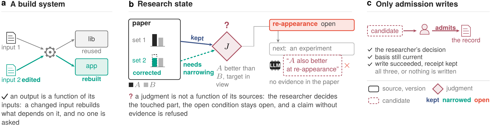
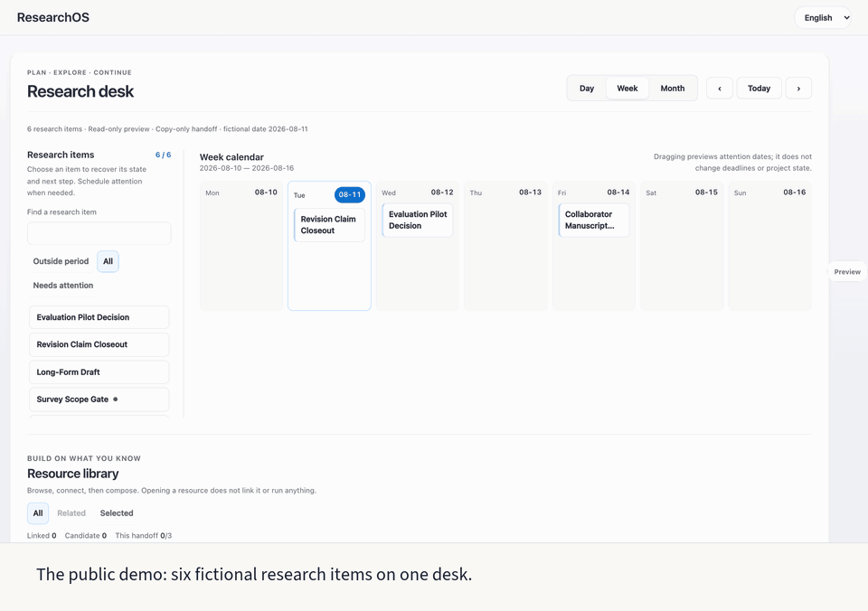

<p align="right">
  <strong>English</strong> | <a href="user-manual.zh.md">中文</a>
</p>

# ResearchOS User Manual

This manual follows a reader from the first session to a private vault of their own: what this repository is and the words its output uses, how to run one research loop in an agent client, how to try the session scheduler, what the optional Dashboard shows, and how to replace the fictional demo with your own material. For a first run, follow the [first-run guide](../08_exports/public_starter/onboarding-step-by-step.md); this manual is the reference behind it. The [System Reference](system-reference.en.md) defines states, governance boundaries, architecture, code owners and directories. The [Governance and Extension Guide](governance-guide.en.md) covers publication, customization, plugins, contribution and the license.

## 1. What this repository is

ResearchOS Public Starter is a public-safe reference implementation of a small, file-based tool for individual researchers who want their judgment to stay continuous across tools, projects and time. An agent client such as Claude Code or Codex, or another file-aware CLI, is the primary execution route and also the complete default route: you state one goal, provide the minimum source, receive an answer or artifact, and any durable change waits for your approval and validation. The first loop needs no Dashboard, plugin, model setting or knowledge of the whole repository. The optional Dashboard makes attention, linked material and review boundaries visible, but it does not accept judgments or enlarge execution permissions.

The researcher chooses the question and judges what the evidence supports. Models and tools carry out bounded parts of the work, and ResearchOS keeps their results connected to sources, acceptance status, unresolved dependencies and the next action; when a source changes, the judgments that depend on it come back for a recheck. It is not a hosted service, an autonomous scientist, a complete personal knowledge base, a question-answering tool detached from evidence, or a polished all-in-one product, and an empty vault will not understand a research domain for you. Literature search, experiment execution and general agent runtimes belong to specialized tools; [Related Research Tools](reference/RELATED_RESEARCH_TOOLS.md) describes adjacent tools and where ResearchOS stays narrow.

This release is copy-only. It shares its kernel with the prototype in the technical report, ships fictional data, and its `config/ros.json` sets `runtime_scope: public_starter`: it can inspect, validate, prepare handoffs and show planned changes, but it cannot claim that work was executed or that durable memory changed. Attention writes, admission writeback, maintenance writes and completion recording stay in the prototype in the report. The [technical report](technical-report.en.md) describes that prototype, whose execution paths are broader than this release; its claims are not a public capability checklist. The table compares the three ways to run the code:

| Capability | This repository | Personal-vault mode (Section 5) | Prototype in the report |
| --- | --- | --- | --- |
| Data | Fictional and public-safe | Your real material under the git-ignored `personal_vault/` | Your real local research material |
| Portfolio, task routing and Library cards | Yes | Yes | Yes |
| Immediate result | Copyable execution brief only; no local answer or model run | Inline local answer or artifact from local Codex | Inline local answer or artifact |
| Review action | Candidate handoff only; no durable execution | Copy or controlled execution | Copy or controlled execution |
| Local runner and execution settings | Disabled; registered maintenance actions only | Locally installed Codex CLI, writing only under `personal_vault/` | Available with workspace-write controls |
| Sibling private-system federation | Not included: no discovery, calls or shared runtime state | Not included | Private deployment only, under local authority |
| Durable write-back | No | Dashboard writes under `personal_vault/` after your confirmation; `ros` stays copy-only | Researcher-approved and validated only, including `ros admit` |
| Public export | Demo-safe content | Separate safe-export review required | Separate safe-export review required |

You need Python 3.10 or newer, and a modern browser for the Dashboard; CI tests CPython 3.10 and 3.13. Nothing has to be installed: no package, API key, database, Node.js, server or cloud account. Obtain the repository through Git, GitHub Desktop or GitHub's **Download ZIP**, open a terminal in the folder, and use `python3`. macOS and Linux are supported; on Windows, run it inside WSL (Windows Subsystem for Linux), because the file locks it relies on are not available in native Windows Python. Keep real, sensitive or unpublished material out of the tracked files; Section 5 explains where it goes.

### Words you will meet

The demo output and these guides use a few words in a narrow sense. For a first run, the line next to each word is all you need; the [technical report](technical-report.en.md) uses the same words and defines them precisely.

| Word | What it means here |
| --- | --- |
| commitment | A project's one current next step or next judgment, written in `06_active_context/research-portfolio.md`. It, not the whole project, is what gets scheduled. |
| card | A Markdown file with frontmatter about one project, paper, person or other source. Commitments and judgments point to cards as their evidence. |
| research state | The question, the evidence, the accepted judgments with their scope, the open conditions and the next step. `ros state` prints them as Q, E, J, B and N. |
| candidate | A model's output or a draft that has not been accepted yet. |
| admission, admit | The researcher accepting a candidate into research state. This repository only shows the planned change; it never admits. |
| judgment block | The `> [!judgment]` Markdown block that records one accepted judgment with its basis. |
| requirement | A registered piece of maintenance work, such as rechecking a judgment after its source changed. |
| held, waiting | Held work waits for the researcher's answer to one question. Waiting work waits for a trigger, such as a date. |
| receipt | The record of what was done and checked. |
| decision boundary | The moment the system looks at what has arrived and decides what to do next. The output calls it a "ros boundary". |
| copy fallback, copy-only | This repository prepares text you copy into your own assistant instead of running or writing anything. |
| `personal_vault/` | The git-ignored folder in your clone for your own material. |

Three phrases in the demo output follow from these words, and none of them is an error. "No admission receipt yet" means that the fixture's judgment was written straight into the file: nobody admitted it, so no receipt of an admission exists, and `today` asks you to confirm it. "Confirmed … after the fact", together with "not an admission" or "not admitted", means that you said yes to a judgment that was already written; that closes the request to confirm it, but it does not admit anything. "Copy fallback" means that `ros` printed the change `admit` would make, as a diff, and wrote nothing.

## 2. One loop in your agent client

Open the folder in Claude Code, Codex, Gemini CLI or another file-aware assistant. A first run needs four things: a goal, meaning what should be answered, organized or produced now; a source, meaning one file you provide or one explicit public link; a result, which is an answer, an openable artifact or a reviewable diff; and a boundary with a next step, saying what is sourced, what remains a candidate and what happens next. If you are unsure where to begin, or do not use a terminal yet, let the assistant guide you and copy only the command it gives:

```text
I do not know how to use ResearchOS Public Starter yet. Act as my first-run guide. Read AGENTS.md only; if the environment already loaded it, do not reread it or scan the repository. Then explain in plain language: 1. what this project is for; 2. which path I should take now; 3. the next file or command; 4. what I should not put into a public repository. Do not write files yet; ask me at most two questions if needed.
```

With a concrete task, hand over the source directly:

```text
I have a PDF: [link or local path]. It is [public / submitted / internal / boundary unclear].

Use ResearchOS to help me understand it and relate it to [my task]. Read AGENTS.md first and only the smallest workflow or target files needed. Return the source boundary, a short reading note, candidate claims, proposed save target, and what needs my confirmation. Do not write durable memory until I approve the candidate and its evidence boundary.
```

The assistant should say what it read and what it intentionally left unread, which route fits, which privacy or export boundary applies, and whether its result is an answer, an artifact or a proposed durable change. A useful reading note gives sourced facts, candidate interpretations, a limitation, one missing fact and one next action, and it separates what the source supports from what remains untested.

If the ordinary answer is enough, stop there. In any case, stop once you can identify the source, the candidate, the open condition and the next safe action. Retain a candidate only when it carries a useful durable increment and a named save target; approval and validation remain separate steps. To move on to your own material, follow Section 5, and tell the assistant not to write files until you confirm.

Leave these out of the first use; they remain available once the first loop works: plugin marketplaces and installation tutorials, system maps and full architecture, maintenance commands and code, complete people graphs, mandatory model or provider setup, and importing every paper, project and relationship at once.

Without a Dashboard the route stays fixed:

```text
goal + minimum source
  -> bounded agent-client work or deterministic CLI action
  -> answer | artifact | writeback candidate
  -> researcher checks source, uncertainty, sensitivity, and effect
  -> optional approved mutation -> validation -> receipt -> rollback coordinate
```

Four rules keep the loop honest. Agent output starts as candidate content. Task completion does not confirm evidence. The Dashboard and generated JSON are projections, not authority. Private material does not become public export without a separate review. The [state and authority model](system-reference.en.md#state-and-authority-model) separates the workflow, evidence, authority and sensitivity states behind these rules; a source path names input evidence and is never a save target.

### Keep the reading set small

Reading tiers limit both the number of files and the estimated tokens of the first pass:

| Tier | First-pass files | Estimated total tokens | Use when |
| --- | ---: | ---: | --- |
| `Quick` | 1 | about 10k | You have an exact source or a narrow question. |
| `Standard` | up to 5 | about 35k | The task needs one workflow and a little project context. |
| `Evidence` | up to 8 targeted | about 60k | A formal claim or public output needs verification. |

Start in `Quick`; when you give an exact paper, draft or target path, Quick starts there. Standard may add one workflow, a project page and a few canonical files. Evidence adds only audits, reading notes or source files that answer the current verification question. Raise the tier only when you can name the missing fact or judgment, and when either limit would be exceeded, choose a smaller subset and work in batches. This keeps token use and unrelated context down while the long-term library stays complete. Reading tier and reasoning effort solve different problems: raise the tier when context is missing, and raise reasoning effort in the agent client when the judgment chain is complex. The model and reasoning effort belong to the agent client or a configured local runtime. The output type, whether answer, artifact or writeback proposal, is inferred from the task and the result contract, so you do not classify it in advance. Open discussion, reasoning and drafting happen in the assistant through the repository instructions and need no handoff.

### What survives a source correction

This fictional comparison reuses the [worked session in Section 4.1 of the report](technical-report.en.md) to show the state before and after a source correction. The candidate states which part is affected and the researcher decides; the prototype does not compute the partial semantic impact on its own.

| Stage | Source, judgment and open condition | What to check |
| --- | --- | --- |
| Before | Two benchmark sets support A over B while the target stays in view; re-appearance is untested and its experiment is planned | Keep the evidence, scope, unknown and next action together |
| Source correction | A's advantage disappears on the second set; the first set is unchanged | A source change triggers recheck, not a scientific verdict |
| Candidate | Retain the first-set claim with its evidence, withdraw the second-set claim, and leave the re-appearance experiment open | Review a candidate on the corrected source version |
| Decision boundary | In the report's session a change is admitted only after the researcher decides; default public operation prepares candidates or planned differences without admission | Separate a proposed change from accepted durable state |



*Figure 1 of the report. A build system rebuilds on its own; research state waits for the researcher. When the paper's second benchmark set (set 2) is corrected, the evidence the judgment J draws from set 1 is kept, the evidence from set 2 must be rechecked, the re-appearance condition stays open, and another session's proposal, which the paper does not support, is refused. Only the researcher's admission writes.*

The runnable public check in Section 3 uses a different fictional fixture and does not execute the report's private admission or partial narrowing. Neither example establishes a benefit over a versioned handoff.

### Resume after an interruption

If useful work has to survive an interruption, keep the result and a short handoff in `personal_vault/`: the question; source references and versions; the last confirmed judgment, or none; the candidate and its unresolved boundary; the next safe action; and the actual decision, mutation and validation evidence. A handoff is not permission to promote the candidate. On return, recheck changed sources before continuing. Reuse an existing valid authorization within its scope rather than asking again because a workflow phase changed.

Receipts can be read and checked without a Dashboard or browser state. `receipt_cli.py validate` and `inspect` check structure only, and their output separates asserted states from checked states: producer trust is unverified, source freshness is not checked and human decisions are not authenticated. A historical receipt stays readable after its source changes, which does not establish that the current source matches. Before continuing from a handoff, run

```bash
python3 scripts/receipt_cli.py --root . recheck-source --input handoff.json --source result.md
```

with the exact relative file reference used to create the handoff. It checks identity and the current file hash and rejects missing, changed or mismatched sources; a matching checksum authenticates neither the receipt's producer nor a human decision. Keep the result file, the task plan (including extension version and resume command) and the handoff together. They are artifacts and evidence, not automatically admitted memory.

Profile-specific task-family IDs cannot be replayed across runtimes as if they were identical. To classify a portable intent again in the destination runtime, use `python3 scripts/plan_context.py --intent-json intent.json --reroute-intent`. It discards old family suggestions, the authority owner and commitment and thread IDs, cannot reuse a prior receipt and grants no mutation or external permission; the destination rechecks sources and may ask for clarification. This is a new routing decision, not seamless continuation and not permission to export private material.

### Changes made outside ResearchOS

The headless CLI builds plans, checks sources and records candidate handoffs. It does not sign human decisions or perform canonical promotion. The policy and staging kernel can support controlled host actions, but arbitrary agent edits do not pass through it automatically. For an authorized change made by an external agent, keep the proposed diff, the explicit user decision in the host, the exact targets, the revisions before and after, the validation result and the rollback coordinate. Where no trusted binding exists, label the execution evidence as external-host, or unmanaged by the ResearchOS machine gateway. The label does not deny the user's authorization; it prevents a machine grant from being invented after the fact, and a synthesized decision reference must never be called verified. A fully machine-governed external-host mutation chain requires a trusted host integration, which this release does not claim to have.

### Judging whether it helped

Use a real task and a natural return after 24 to 72 hours. The competing baseline is the same current model, materials and budget with a one-page versioned handoff. Record missed evidence, recovery and correction effort, critical errors, changed judgments and maintenance burden, and keep unsuccessful comparisons. A successful installation, a synthetic test or an engineering check counts neither as human acceptance nor as demonstrated research benefit. The report explains this evidence boundary; its synthetic example illustrates the protocol and is not evidence of measured productivity or researcher growth.

## 3. The session scheduler and command-line checks

`python3 scripts/ros_demo.py` (or `--lang zh-CN`) runs on a temporary copy of a fictional research graph. A source card changes and the dependent judgment is flagged for recheck; the researcher then requests reconfirmation, which this repository shows as a planned change without admitting it, and at session close the recheck is still listed as pending. Stop when you can identify the source change, the candidate or plan, the open work and the next action. If a word in the output is unfamiliar, see [Words you will meet](#words-you-will-meet) in Section 1.

The scheduler and the Dashboard use two separate fictional worlds. The scheduler fixture in `examples/scheduler-demo/` is one research graph about an occlusion paper: two commitments, two cards and one judgment. The Dashboard demo in Section 4 shows six fictional agenda items from `08_exports/public_starter/demo-research-agenda.md`. Neither refers to the other.

### Walk through a session

`ros` is the scheduler's command-line client. Every `ros …` that the CLI prints stands for `python3 scripts/ros.py --root <folder> …`, and `--root` goes before the subcommand. Run these from the repository folder:

```bash
python3 scripts/ros.py --root examples/scheduler-demo today
python3 scripts/ros.py --root examples/scheduler-demo context commitment:occlusion-paper
python3 scripts/ros.py --root examples/scheduler-demo run judgment --target commitment:occlusion-paper --executor copy_packet
```

`today` opens a session and lists what needs a decision, `context` prints the commitment with the cards it rests on, and `run` writes a task packet for your own assistant. `run` ends by printing a run id of the form `ros-run-…` and the `collect` command for it. Normally you give the packet to your assistant and save its reply in a file. To try the loop without an assistant, use the sample answer that ships with the fixture. The ids below are examples: `ros-run-aee8c1335137` stands for the run id your `run` printed, so type yours in its place:

```bash
python3 scripts/ros.py --root examples/scheduler-demo collect ros-run-aee8c1335137 --file examples/scheduler-demo/sample-answer.md
```

`collect` reads the answer back as a candidate and prints its id, of the form `c-…`, with the `admit` command. Again, `c-3f9a1d20` stands for the id your `collect` printed:

```bash
python3 scripts/ros.py --root examples/scheduler-demo admit c-3f9a1d20
python3 scripts/ros.py --root examples/scheduler-demo close
```

`admit` prints the change it would make to `06_active_context/research-portfolio.md` and writes nothing. `close` ends the session and lists the candidate as still undecided.

Two things in the output come from the date rather than from the fixture. Run on today's date, the walk-through flags the fixture's commitments as not recently verified, whereas `ros_demo.py` pins its date. On a fresh clone the first `today` may also report a source as "changed after verification", because the check compares the file's modification time, which the clone has just set, with the commitment's `last_verified` date. Without `--root`, `ros` reads this repository's own graph, which has no commitments.

### What `ros` writes in this repository

Under the shipped `runtime_scope: public_starter`:

- Every `ros` command writes its packets, candidates and session records only under the git-ignored `06_active_context/work_state/` of the `--root`. No command writes a durable source.
- `run` accepts only `--executor copy_packet` and refuses every provider. Personal-vault mode (Section 5) does not change this.
- `admit <candidate>` and `admit --reconfirm` show the planned difference through copy fallback without asking first, so nothing is admitted into the durable sources.
- `admit --confirm` records an after-the-fact confirmation in the git-ignored local ledger only when you answer at your own terminal. Relayed by an agent, it is recorded as asserted and the confirmation request stays open. Either way it writes no source and is not an admission.
- `close` lists the candidates returned or proposed since the session started that are still undecided. Here they stay undecided, because `admit` neither admits nor records a refusal.

The admission and dispatch code ships but stays off. Only a `config/ros.json` that sets `runtime_scope: "private"` explicitly turns it on; a missing key, a misspelling or any other value runs as copy-only. The prototype in the technical report runs with admission and dispatch on. A vault copied from the fixture keeps the fixture's `config/ros.json`, so it runs copy-only as well.

All 13 subcommands exist in this repository. Most commands first run one boundary, recorded in the same git-ignored ledger; `receipt`, `propose rule`, `admit --rollback`, `collect --abandon` and `attend` do not. None writes a durable source:

| Command | In this repository |
| --- | --- |
| `today` | Copy-only fallback: lists changes and open requests and opens a session, but no attention schedule ships, so every commitment reads as unscheduled |
| `close` | Same as the prototype in the report; the listed candidates stay undecided |
| `propose judgment`, `episode-close`, `rule` | Same: registers a candidate |
| `admit` | Copy-only fallback: `<candidate>` and `--reconfirm` show the planned difference; `--confirm` records a confirmation without writing, and applies only when you answer at your own terminal; `--rollback` is refused, because this repository writes no source and rolls none back |
| `decide` | Same: records the decision; `cancel` and `confirm` apply only when you answer at your own terminal |
| `answer` | Same: records the answer; `satisfied` and `cancel` close the request, so they apply only when you answer at your own terminal; `satisfied` is offered only where a check's basis is the researcher's judgment, which none of the shipped rules declares |
| `state`, `context`, `rules`, `receipt` | Same; they only read |
| `run` | Copy-only fallback: `--executor copy_packet` only; every provider is refused |
| `collect` | Same, except that no run-state ledger is kept |
| `attend` | Copy-only fallback: shows the planned attention action and writes nothing |

For an engineering check, run `python3 scripts/validate_headless.py`. It verifies the complete no-dashboard profile, which must pass with the `dashboard/` directory absent: routing, receipts, runtime and provider boundaries, task extensions, public safety, links and focused zero-dashboard behavior, without weakening authority checks. It is not a prerequisite for reading a source in your agent client. The CLI route prepares the same loop of goal, source, result and boundary without starting a server or Dashboard; the second command names the one file to read for a first run, the [first-run guide](../08_exports/public_starter/onboarding-step-by-step.md):

```bash
python3 scripts/start_researchos.py --mode cli
python3 scripts/plan_context.py first_run_onboarding --lang en
```

The responsibility portfolio is a declared-scope ledger of lead or support responsibility, commitment state, priority, freshness, owner and role, one next step and the authority source. A commitment is a project's one current next step or next judgment; it, not the whole project, is what gets scheduled, and it keeps one bounded state and one next safe action whichever client is used to view or continue it. To ask how many tasks you lead, run `python3 scripts/query_research_agenda.py --view lead-active`, or use `lead-all`, `support-active`, `support-all`, `waiting`, `queued`, `conditional`, `paused`, `review`, `unclassified` or `all` for an explicit slice. Missing or invalid responsibility fails closed to `unclassified`. A count is complete only while the coverage receipt is current and has no unresolved candidate; otherwise it describes registered items only. Time buckets order the list but do not define the portfolio.

## 4. The optional Dashboard

The Dashboard is optional and frozen: it can be used as described here, but it is not under development. Start the demo from the repository root:

```bash
python3 scripts/start_researchos.py --mode dashboard --port 8880
```



Then open `http://127.0.0.1:8880/`. It shows six fictional agenda items from `08_exports/public_starter/demo-research-agenda.md`, a different fictional world from the scheduler fixture in Section 3, and needs no real API key. The demo is set on a fixed fictional date, 2026-08-11, shown in the page's status line, so its calendar and freshness read the same on any day you open it. Ordinary startup serves the shipped public-safe projection and does not rewrite tracked files; it rebuilds only when that projection is missing, and maintainers rebuild explicitly with `python3 scripts/build_public_starter_data.py --write` after changing demo sources. The launcher reuses a listener only when `/session-config` identifies the matching runtime, so a public demo is never mistaken for a personal vault, the prototype in the report or an unrelated process on the same port; startup stops and suggests another port instead. `--mode public-starter` only reports the public runtime status and starts no server. The remaining modes are:

```bash
python3 scripts/start_researchos.py --mode public-starter --check --provider codex
python3 scripts/start_researchos.py --mode cli
python3 scripts/start_researchos.py --mode gui --port 8880
python3 scripts/start_researchos.py --mode public-starter
```

The Dashboard is a persistent attention and control surface beside the agent client, not a second chat and not a prerequisite for the agent route. It has one Unified Desk with Now and Library semantic areas: Now allocates attention across commitments and holds the calendar, while Library connects sources and relations through one or a few commitment lenses. Work and Review are states of an exact item and open only in that item's drawer, never as a third screen. The [System Reference](system-reference.en.md#primary-route-and-supporting-surfaces) defines each surface and its route rules. You can try a first loop by judging one fictional commitment, or by opening the optional direct agent input with only a goal; the default composer asks for nothing more than a goal and an optional source, and the Dashboard exposes no model, reasoning-effort or output-type control. A first visit goes like this:

1. Select a task card in the Unified Desk and check its current evidence and next action.
2. Drag it to a calendar date to preview attention; cancel or reload to discard the preview.
3. Inspect linked resources in the right-hand rail, then preview and copy the agent handoff.
4. Execute only in your separate private assistant task.
5. Review the returned result, and propose any durable update through the normal researcher-confirmed workflow. Copying alone does not create an executed task or an accepted result.

The calendar uses days as its smallest unit and has no hourly grid. `+N` expands a day; a Plan card can be dragged, or moved with `Alt + Arrow`, to another day as an in-memory preview that is labeled unsaved and resets on refresh. Only a write-enabled private runtime persists the date through its reversible schedule owner. Review, deadline and lifecycle markers never move. `Complete step`, `End Work Session` and `Complete project` close different things: the current commitment, the execution session and the durable project lifecycle. A Work Session is one bounded execution session with your agent client, and ending it does not complete the project. Three further distinctions stay apart. Lifecycle says whether a project is submitted, under review, in rebuttal, under revision or complete. In progress, To advance, Not advancing and Closed say how the whole project is managed. Today, Tomorrow, Future and Parked say only when its next step should take attention again. A project under review stays available among the linked resources, and a real event or review date can return its next action to the desk.

This repository is copy-only. It never starts the local Codex or Claude Code CLI, probes no local provider, calls no remote API, writes no durable memory (the two kinds of file it may write are listed at the end of this section), executes no Inbox write-back task and accepts no arbitrary shell command. Submitting a task prepares a packet for a separate private assistant; the desk always produces a copyable execution brief. Private and personal-vault runtimes are the controlled execution routes. The surfaces divide the work as follows:

| Surface | Owns | Does not own |
| --- | --- | --- |
| Agent client | Interpreting intent, deep reading, reasoning, editing files, creating artifacts, iterating with you and running validation | Confirming evidence, mutating durable memory on your behalf, maintaining Today projections |
| CLI | Deterministic route, query, receipt, validation and maintenance commands | Open-ended research judgment or a second authority |
| Canonical Markdown and Git | Durable facts, decisions, provenance and recovery coordinates | Generated or runtime-only state |
| Dashboard | A rebuildable projection: triage of near-term attention, resources and relations, scheduling by day, choosing an execution route, showing status and results | Product truth, required onboarding, open-ended discussion, model selection, deep reasoning, cross-file editing, or acceptance of durable change |

Background preparation runs only bounded work whose result can return in place. Open-ended discussion or a complex edit uses a complete copied task packet that you paste into a new agent task, and "Continue existing task" is enabled only for a verifiable binding. The Dashboard does not copy your chat; it shows bounded session state. Ordinary card selection stays in place, while a suggestion can start a Work Session directly. A separate private Codex runner suits deep reading, file changes, artifact creation, validation, background queues, item-by-item execution and isolated writes.

```text
Now: restore one bounded research focus
  -> Library: context on demand
  -> Now / your agent: continue the work
  -> bounded agent read when needed
  -> visible answer, artifact, or diff
  -> Review: inspect the result, candidate change, receipt, and handoff
  -> researcher decision
  -> validated writeback in a private vault
```

One loop makes three things explicit. The Work Session holds the current goal, on-demand sources, the current result, a collapsed process log, the working deck and the frozen prompt and template language; browser coordination state and recent-task summaries are not durable memory. The candidate handoff is a bounded task carrying source cards, evidence state, sensitivity, the proposed authority change, its impact scope and validation state. The Review boundary reminds you that task completion is not evidence confirmation and that a source path is not a write-back target. In a private vault the next steps are execution, evidence review, your decision, validated write-back and a resume packet; they stay controlled, and this repository does not pretend they are automatic.

Review is not only where proposed write-backs go. Its [full reception scope](system-reference.en.md#shared-governance-boundaries) also covers bounded unknowns, break-glass confirmation, results, validation failures, rollback and handoffs required before closure; durable, sensitive, public or destructive changes always pass through it. The public runtime never executes durable write-back.

The page language selector changes visible UI copy. A new Work Session freezes that language as its answer and task-packet language, and changing the UI language mid-task does not rewrite the task. The content language, set in `config/researchos.runtime.example.json`, controls generated records and prompts:

```json
"public_starter": {
  "content_language": "en",
  "available_content_languages": ["en", "zh-CN"],
  "alternate_language_files": "reference_only_do_not_read_by_agent"
}
```

Rebuild with `python3 scripts/build_public_starter_data.py --language en --write` or `--language zh-CN --write`. The selected language feeds `08_exports/public_starter/generated-public-starter-data.json` and `dashboard/data/researchos-dashboard.json`. Alternate-language files stay in the repository as reference, and agents do not read them during normal operation unless you ask for translation, comparison or bilingual maintenance.

```text
Browser dashboard
  -> local Python server on 127.0.0.1
  -> selected demo or personal-vault projection / provider status
  -> copyable task packet for a separate private assistant
```

The agent route and the Dashboard depend on the same Markdown and confirmation rules, and this repository keeps the copy-only boundary described above; it rejects every `/codex-runner` submission without starting a thread or command. Personal-vault and private runtimes may return a local answer or artifact to Review, and local Codex starts only after you submit a task. In the public demo every local endpoint that saves feedback, inbox entries or card groups, withdraws a confirmation or runs an update returns 403 `public_starter_writeback_blocked`; those run only in personal-vault mode. The public demo writes only two kinds of file: uploads into the Git-ignored session workspace, and the demo projection when you run the registered `build_public_starter_data` action (unchanged demo sources give the same bytes). The local HTTP endpoints serve the Dashboard and are not internet APIs; the [System Reference](system-reference.en.md#local-http-endpoints) lists them.

Local **Open** and **Reveal** use Finder on macOS, Explorer on Windows and `xdg-open` on Linux when available; without a desktop opener the server returns a clear failure and leaves the path for manual opening.

## 5. Your own material

Your own material lives in `personal_vault/`, a folder inside your clone. Git ignores it, so nothing in it is committed, and both `ros` and the Dashboard's personal-vault mode read it. Still, never push a clone that contains real material to a public remote. If you want version control for the vault, keep a private copy of the repository instead, with no public remote, and remove `personal_vault/` from that copy's `.gitignore`. Everything below uses the same `personal_vault/` layout either way.

### Start your own

1. Copy the scheduler fixture:

   ```bash
   python3 scripts/ros_demo.py --init personal_vault
   ```

   It copies the fixture's commitments, cards and `config/ros.json`, leaves out the records a walk-through from Section 3 left in the fixture, its sample answer and its fictional judgment, and prints these next steps. It also works when `personal_vault/` already exists, for example because you started the personal-vault Dashboard first, and keeps any file already there; it refuses when the folder already has a `06_active_context/research-portfolio.md`.

2. Edit `personal_vault/06_active_context/research-portfolio.md`. Replace the two fictional commitments with one of your own; your own judgments enter later as candidates, as in Section 3. A commitment needs a heading, an id, your responsibility and state, one question, one next step, the date you last checked it, and the card it rests on; the Dashboard also reads who is accountable, your role and the project's phase:

   ```markdown
   ### Thesis chapter 2

   - id: thesis-ch2
   - responsibility: lead
   - accountable_owner: You
   - role_summary: Author of the chapter
   - lifecycle_phase: writing
   - state: mainline
   - priority: P0
   - question: Does the baseline still hold on the new split?
   - next_step: Rerun the baseline on the new split
   - last_verified: 2026-10-29
   - stale_after_days: 14
   - source_path: 01_knowledge/projects/thesis-ch2.md
   ```

   `responsibility` is `lead` or `support`; `state` is one of `mainline`, `queued`, `conditional`, `waiting`, `paused` or `closed`; `last_verified` is a `YYYY-MM-DD` date and `source_path` is relative to `personal_vault/`. `lifecycle_phase` is one of `scoping`, `planned`, `experiment_preparation`, `production`, `gated_operation`, `writing`, `release_preparation`, `submitted`, `under_review`, `rebuttal`, `decision`, `revision`, `accepted`, `published`, `paused`, `completed`; `submitted`, `under_review` and `decision` also need an `activation_trigger`, the event that brings the item back. The ids and paths are yours to choose. A value `ros` cannot use is listed under "Portfolio problems" in `today` and in `ros rules --check`, instead of the commitment silently dropping out of the checks. `ros` does not read `lifecycle_phase` or `activation_trigger`, so a phase outside this list or a missing trigger is flagged only in the Dashboard's personal-vault projection.

3. Replace the two fictional cards under `personal_vault/01_knowledge/` with one card of your own at the path that `source_path` names. Start from a template in `09_templates/`, such as `project-template.md` or `paper-template.md`; they carry the frontmatter, the Agent Summary and the evidence-boundary sections a card needs. `ros` shows a card under its frontmatter `title`, or else under its first `#` heading; the Dashboard also accepts the templates' `name` or `project_name`. So fill in `project_name` and replace the template's `# Project Name` heading, or add a `title:`.

4. Run the scheduler on your vault:

   ```bash
   python3 scripts/ros.py --root personal_vault today
   ```

5. Optionally, open the Dashboard on the same folder:

   ```bash
   python3 scripts/start_researchos.py --mode personal-vault --port 8881
   ```

   Then open `http://127.0.0.1:8881/`. This mode reads `personal_vault/06_active_context/research-portfolio.md` and the frontmatter-bearing cards under `personal_vault/00_identity/` to `personal_vault/06_active_context/`, and it never shows the fictional demo data. The server reads the cards when it starts, so a new or edited card appears after you restart it. The first start creates only some of the layer folders (`00_identity/`, `01_knowledge/papers/` with its `own_papers/reading_notes/` and `source_files/` subfolders, `01_knowledge/projects/`, `04_people/collaborators/` and `06_active_context/`); create others such as `02_decisions/` or `05_workflows/` when you need them.

You do not need to disable the demo data to use a personal vault. The [first-run guide](../08_exports/public_starter/onboarding-step-by-step.md) walks through these steps with the output you should see at each one and what to do when it looks different; this section stays the reference for the fields.

### Growing the vault

A candidate card is an interpretation; writing it does not make it durable memory or public fact. Start with one source and one card that records its source boundary, evidence state and one missing fact, and add project history, talks, decision rationale and other sources only after reviewing that first result. [Card Maturity and Enhancement](reference/CARD_MATURITY_AND_ENHANCEMENT.md) explains the M/I/R/G labels and how to turn a card gap into a bounded Work task, once you need it.

Inside `personal_vault/`, a short current state goes in `06_active_context/`, source-grounded summaries in `01_knowledge/`, decisions and tradeoffs in `02_decisions/`, people context in `04_people/` and reusable methods in `05_workflows/`. [Where to Put New Materials](reference/WHERE_TO_PUT_NEW_MATERIALS.md) has the full placement table. Raw material stays where it is, outside the repository: a card records the path, which is often enough, and raw files should not be copied merely so that the Dashboard can see them. Nothing from the vault becomes public without a separate review under the [Safe Export Policy](reference/SAFE_EXPORT_POLICY.md).

Cards are context objects, not a prerequisite. A supplied source becomes the first working card, and Library is searched only when the current evidence is insufficient. Each card carries a sensitivity label of public, internal, sensitive or private. The personal-vault projection is written to the git-ignored `dashboard/data/researchos-local.json` because it may contain private derived metadata; public demo and personal-vault modes never share a generated data file. In this mode server-side Review state, selected working copies, runner receipts and the local Codex writable sandbox all use `personal_vault/` as their write root. The agent may read this repository as reference but cannot use personal-vault `workspace-write` to modify tracked demo files. Personal-vault mode still does not turn task completion into evidence confirmation: a durable change needs a named target, an evidence check, your approval and validation after writeback.

Stop after one successful loop: a larger vault helps only when each new file has a clear owner and evidence boundary. Useful long-term memory still needs your own papers, notes, projects, talks, decisions or relationship context with traceable boundaries, added only when it improves the judgment at hand.

### Turning off the demo case (maintainers)

This step is optional and only changes the public demo projection. `python3 scripts/build_public_starter_data.py --disable-cases` previews the projection without the fictional case; adding `--write` rewrites the tracked files `08_exports/public_starter/generated-public-starter-data.json` and `dashboard/data/researchos-dashboard.json`, so do not commit the result unless you mean to ship the demo without its case. `python3 scripts/build_public_starter_data.py --write` restores them. Disabling deletes no files; the examples stay as references for fields and placement.

### Local execution providers

Besides the agent route and the Dashboard, you can read the Markdown directly in an editor or on GitHub to understand the directories, cases and manuals. The Codex app suits AI-assisted reading and editing, and the Codex CLI executes small handoffs and records logs; ResearchOS has no remote API provider. ResearchOS does not include Codex, and the public Dashboard never starts it. To execute a copied packet in a separate private agent task, install OpenAI's Codex app or CLI following its current official instructions, and check it with `command -v codex` and `codex --version`. The macOS desktop app may bundle the CLI at `/Applications/Codex.app/Contents/Resources/codex`; if `codex --version` fails but that file exists, add it to `PATH` or set `alias codex="/Applications/Codex.app/Contents/Resources/codex"`. Never write login tokens, API keys or account details into the repository.

This repository registers two local providers, `codex` and `claude_code`, and both are `copy_only` here. `python3 scripts/runtime_profile_cli.py list --scope public_starter` shows the public copy-only profile and `show --profile codex --scope public_starter` shows how one reserved provider projects in this edition; neither needs credentials or network access. The public Dashboard defaults to:

```json
{
  "provider_mode": "copy_only",
  "allow_local_codex": false,
  "execution_scope": "none",
  "maintenance_scope": "registered_actions",
  "allow_real_api": false
}
```

Do not turn the public Dashboard into an execution host. To use one of the two local CLI providers, first switch to a private or personal-vault runtime, keep its configuration untracked, run the provider checks and enable it there; the CLI keeps its own login outside the repository. The checks are `python3 scripts/validate_runtime_config.py` and `python3 scripts/start_researchos.py --mode public-starter --check --provider codex`.

## 6. Safety and common mistakes

Do not expose the Dashboard to the public internet. Do not commit API keys, tokens, `.env` files or local runtime configuration, and do not add real sensitive people, unpublished manuscripts, real relationship notes, raw corpus payloads or personal runtime logs to this repository. Before a release, `python3 scripts/validate_public_safety.py` checks for these.

The public demo is about 19 MB of tracked files, roughly 100 MB with Git history, and does not copy a private vault. ResearchOS does not govern your disk space: in personal-vault and private runtimes the local Work Session intake accepts the research materials you select without a product-level file-type, size, count or age quota and is limited only by the local filesystem and runtime, while the public demo accepts uploads of up to 1 GiB per file. Neither deletes your materials because of a space threshold. It bounds only the debris it generates, as listed in the [low-redundancy runtime contract](system-reference.en.md#low-redundancy-runtime-contract); low free space or substantial session copies produce a non-blocking advisory.

The usual mistakes are scanning the whole repository before the task is clear, treating an agent answer as confirmed memory, treating Dashboard JSON or browser state as authority, adding real material outside `personal_vault/` or pushing a clone that contains it to a public remote, writing secrets into Markdown or tracked configuration, deleting the fictional examples, and expecting an empty vault to understand a research domain. You are using the system correctly when the assistant names what it read and skipped, each source has a boundary, every interpretation begins as a candidate, and each durable change ends with either a validation result or a named missing-evidence item.
