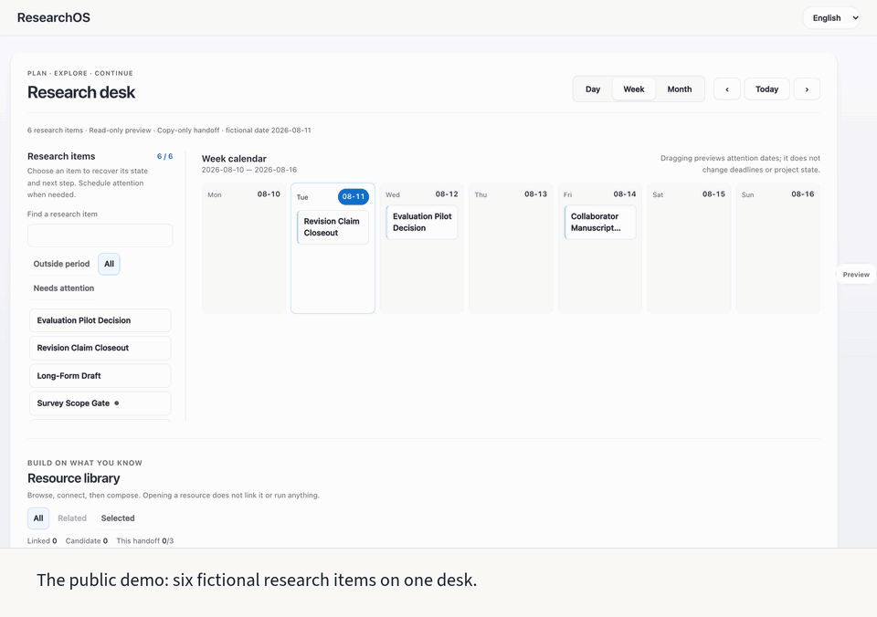
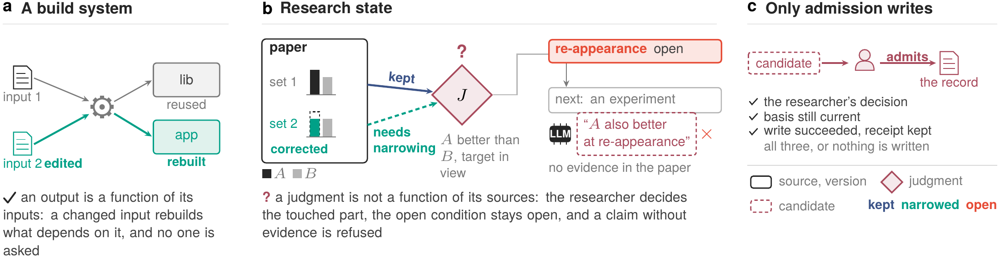

<p align="right">
  <strong>English</strong> | <a href="user-manual.zh.md">中文</a>
</p>

# ResearchOS User Manual

This manual follows the order in which you get started, in five steps: see what this repository is, build your own vault, live through a first source change, let the vault grow, and then add your working style, maturity labels and the vault check. It works like a tutorial that walks you through once: each step says what you will use, what to do, what you should see and what you can do afterwards, and every command can be copied as a whole line. Section 6 collects the uses that sit outside this main line, including a browser-only setup, the optional Dashboard and picking up after an interruption; the appendices are reference material. For the shortest route, follow the [first-run guide](../08_exports/public_starter/onboarding-step-by-step.md), which takes you from running the demo to seeing one source change in your own vault; this manual is the reference behind it. The [System Reference](system-reference.en.md) defines states, governance boundaries, architecture, code owners and directories. The [Governance and Extension Guide](governance-guide.en.md) covers publication, customization, plugins, contribution and the license.

This is the first stage of ResearchOS: one person, files on your own computer, decisions made at your own terminal. What the first stage includes and does not include is set out in one place in this manual, [Appendix D](#appendix-d-what-the-first-stage-covers), and again in the [README](../README.md#what-the-first-stage-includes-and-does-not-include), with the full list in Supplementary Note 6 of the technical report.

## 1. Step 1: What this repository is

ResearchOS Public Starter is the public starter edition of ResearchOS: a small, file-based tool for individual researchers. Your research is recorded in cards, and a card is an ordinary file on your computer; the examples that ship with it are all fictional. It does one thing: it keeps the judgments you have made usable after you change tools, change projects or come back weeks later. Day to day you use it inside an AI assistant such as Claude Code or Codex, or another command-line tool that can read and write local files; this is the primary execution route, and it is complete on its own: you state one goal, provide the minimum source, receive an answer or artifact, and any durable change waits for your approval and a check. The first loop needs no Dashboard, plugin, model setting or knowledge of the whole repository. The Dashboard is an optional web page that shows what you have in hand, the related material and what is waiting for your review, but it does not accept judgments for you or let the assistant do more.

The work is divided like this. You choose the question and judge what the evidence supports. Models and tools do parts of the work within a stated scope. ResearchOS remembers which source each result came from, whether you accepted it, what is still undecided and what comes next; when a source changes, the judgments that depend on it come back for you to recheck. It is not a hosted service, it does not do research by itself, it is not a complete personal knowledge base or a question-answering tool that works without evidence, and it is not a product that covers everything; while the vault is empty, it will not understand a research domain for you. Literature search, running experiments and general agent runtimes belong to specialized tools; [Related Research Tools](reference/RELATED_RESEARCH_TOOLS.md) describes the adjacent tools and why ResearchOS covers only this small part.

This step builds nothing. You watch one demo: within five minutes you see how a judgment comes back to the researcher after the source it rests on has changed.

### What you will use in this step

Besides Python 3.10 or newer, you install nothing else: no package, API key, database, Node.js, server or cloud account; the Dashboard also needs a modern browser. Automated tests (CI) run on Python 3.10 and 3.13. Get the repository through Git, GitHub Desktop or GitHub's **Download ZIP**, open a terminal in the folder, and use `python3`. macOS and Linux are supported; on Windows, run it inside WSL (Windows Subsystem for Linux), because the file locks it relies on are not available in native Windows Python. Keep real, sensitive or unpublished material out of the tracked files; Step 2 explains where it goes.

### Do it

1. Check the Python version, which should be 3.10 or newer:

   ```bash
   python3 --version
   ```

2. Run the demo. It runs on a temporary copy of a fictional demo vault and changes no file in the repository you downloaded:

   ```bash
   python3 scripts/ros_demo.py
   ```

### What you should see

The output has six numbered steps, each starting with `━━`, and ends with a short "What next". In the first two steps the researcher confirms a judgment that the demo vault already holds. In step 3 the source card that this judgment rests on changes, and `today` flags the judgment for recheck with three options:

```text
━━ 3. A source changes (the benchmark protocol is revised); ros today flags the judgment that depends on it
…
    · [b5d4e33c7c] The basis of judgment "Compare A and B under occlusion first; do not enlarge the dataset yet." changed
        Basis changed: Example Occlusion Benchmark (fictional) (01_knowledge/papers/example-benchmark.md)
        A Still holds after re-checking: pin the new versions and reconfirm → ros admit --reconfirm j-occlusion-scope
        B Judgment needs revising: write a new judgment block → ros propose judgment --file <draft> --target <card or commitment:id>
        C Keep as is for now → ros decide b5d4e33c7c defer --until <date>
```

In step 5 the researcher asks to reconfirm, which this repository shows as a planned change without admitting it; at the close in step 6 the recheck is still listed as pending. You can stop this step once you can identify the source change, the candidate or plan, the open work and the next action. "No admission receipt yet", "not an admission" and "copy fallback" in the output are expected, not errors; the word list below says what they mean.

### If it looks different

- **`python3` is not found, or the script reports a syntax error.** Check that `python3 --version` is 3.10 or newer.
- **It does not run on Windows.** Run it inside WSL; "What you will use in this step" above gives the reason.
- **You want the output in Chinese.** Add `--lang zh-CN`; without it the output is in English.

### Words you will meet

The demo output and these guides use a few words in a narrow sense. For a first run, the line next to each word is all you need, and the output phrases listed here are normal, not errors. The [technical report](technical-report.en.md) uses the same words and defines them precisely.

| Word | What it means here |
| --- | --- |
| commitment | A project's one current next step or next judgment. It, not the whole project, is what gets scheduled. |
| commitment list | The file `06_active_context/research-portfolio.md`: one block per project, holding its current commitment. |
| card | A Markdown file with frontmatter about one project, paper, person or other source. Commitments and judgments point to cards as their evidence. |
| research state | The question, the evidence, the accepted judgments with their scope, the open conditions and the next step. `ros state` prints them as Q, E, J, B and N. |
| candidate | A model's output or a draft that has not been accepted yet. |
| admission, admit | The researcher accepting a candidate into research state. This repository only shows the planned change; it never admits. |
| judgment block | The `> [!judgment]` Markdown block that records one accepted judgment with its basis. |
| item | A registered piece of maintenance work, such as rechecking a judgment after its source changed. |
| waiting on your answer, deferred | Work waiting on your answer waits for the researcher's answer to one question. Deferred work waits for a trigger, such as a date. |
| receipt | The record of what was done and checked. |
| complete, complete_with_held, human_stopped, budget_stopped | The four outcomes `close` reports, in this order: everything was dealt with; only things waiting on your answer or deferred are left; you ended the session with things still unfinished; the session's budget ran out. Ending with unfinished work is normal and is not an error. |
| decision boundary | Each time you run a `ros` command, the system looks at what has changed since the previous command and decides what to bring to your attention; that moment is a decision boundary. The output calls it "the last ros command". |
| copy fallback, copy-only | `ros` only prints the change it would make, such as the change `admit` prints, and you or your assistant apply it to the file; it runs and writes nothing itself. |
| "No admission receipt yet" | The judgment was written straight into the file without going through an admission, so `today` asks you to confirm it. |
| "Confirmed … after the fact", "not an admission", "not admitted" | The judgment was already in the file and you said yes to it afterwards: `today` stops asking you to confirm it, but this is not an admission and nothing was admitted. |
| `personal_vault/` | The git-ignored folder in your clone for your own material. |
| vault | The folder of cards and the commitment list that `--root` points to: `personal_vault/` is your own vault, and `examples/scheduler-demo/` is the fictional demo vault. Technical documents also call a vault a research graph, and the demo vault the fixture. |
| public, internal, sensitive, private | A card's `sensitivity` label, which decides whether `ros context` packs the card for the assistant: public and internal cards are packed; a sensitive card is packed only after you confirm in your own terminal, and not when the assistant runs the command for you; private and unlabeled cards are never packed. |

### What you can do now

You can say what ResearchOS takes care of: when a source changes, the judgments that depend on it come back for you to decide. You also recognize the words in the output. In the next step you build your own vault and write your first commitment, your first paper card and your first judgment.

## 2. Step 2: Build your own vault

Step 1 showed a fictional example. This step replaces it with your own: one commitment, the cards it rests on, and one judgment that names its basis. It takes about half an hour to an hour and fits in a day.

Your own material lives in `personal_vault/`, a folder inside the repository you downloaded. Git ignores it, so nothing in it is committed, and both `ros` and the Dashboard's personal-vault mode read it. Because it is not in Git, you back it up yourself: a deleted judgment block or card cannot be restored from this repository. [Step 5](#5-step-5-working-style-maturity-and-the-vault-check) shows how. Still, never push a clone that contains real material to a public remote.

### What you will use in this step

- An assistant that can run commands on your computer, such as Claude Code or Codex, or your own terminal. Both routes produce the same vault.
- Your publication list, three to five papers or other sources that matter most to your current work, and one project you are working on.
- One line you do not cross: nothing on the README's "What to keep away from the assistant" list goes into this folder or to the assistant.

### Do it

**Route one: let an assistant lead.** This is the least effort. Send your assistant the one sentence from the README ("Try it: one sentence to your AI assistant"), and it leads you through the "First Run" section of [`AGENTS.md`](../AGENTS.md) one step at a time: it runs the demo from Step 1, asks for your publication list, a few papers, your collaborators and one project, and from these drafts a profile, paper cards, collaborator cards, one commitment with its project card, a research identity page and a direction summary, and finally one judgment. Before it writes anything it shows you a list of the cards it will create; it writes only after you agree, and only inside `personal_vault/`. A few steps need you to type a command in your own terminal; the assistant gives you the whole line and says why it has to be you.

If you have not decided which route to take, or do not use a terminal yet, let the assistant act as a guide first and copy only the command it gives:

```text
I do not know how to use ResearchOS Public Starter yet. Act as my guide. Read AGENTS.md only; if the environment already loaded it, do not reread it or scan the repository. Then explain in plain language: 1. what this project is for; 2. which path I should take now; 3. the next file or command; 4. what I should not put into a public repository. Do not write files yet; ask me at most two questions if needed.
```

**Route two: do it yourself.** The six steps below do the same thing as the assistant, with only the minimum set of files.

1. Copy the demo vault:

   ```bash
   python3 scripts/ros_demo.py --init personal_vault
   ```

   It copies the demo vault's commitments, cards and `config/ros.json`, leaves out the records a walk-through from Step 3 left in the demo vault, its sample answer and its fictional judgment, and prints the next steps. It also works when `personal_vault/` already exists, for example because you started the personal-vault Dashboard first, and keeps any file already there; it refuses when the folder already has a `06_active_context/research-portfolio.md`.

2. Write your first commitment. Open the commitment list, `personal_vault/06_active_context/research-portfolio.md`, keep the frontmatter and heading at the top, and replace the two fictional commitments with one of your own. A commitment needs a heading, an id, your responsibility and state, one question, one next step, the date you last checked it, and the card it rests on; the Dashboard also reads who is accountable, your role and the project's phase. This is the smallest complete form; change the values to your own and set `last_verified` to today:

   ```markdown
   ### Thesis chapter 2

   - id: thesis-ch2
   - responsibility: lead
   - accountable_owner: You
   - role_summary: Author of the chapter
   - lifecycle_phase: writing
   - state: mainline
   - priority: P0
   - question: Does the baseline still hold on the new split?
   - next_step: Rerun the baseline on the new split
   - last_verified: 2026-10-29
   - stale_after_days: 14
   - source_path: 01_knowledge/projects/thesis-ch2.md
   ```

   The ids and paths are yours to choose, and `source_path` is relative to `personal_vault/`. The values each field accepts are in [Appendix A](#commitment-fields-and-their-values).

3. Create the project card. Delete the two fictional cards under `personal_vault/01_knowledge/` (`projects/occlusion-tracking.md` and `papers/example-benchmark.md`), and start your own from a skeleton at the path that `source_path` names:

   ```bash
   cp 09_templates/basic/project.md personal_vault/01_knowledge/projects/thesis-ch2.md
   ```

   Fill in `title` and give the `# Project name` heading the same name: `ros` shows a card under its frontmatter `title`, or else under its first `#` heading. Each skeleton in `09_templates/basic/` carries the frontmatter, an Agent Summary, the fact and view sections and an evidence boundary, with a short note on where the file goes and what each value means. [examples/starter-cards/en/](../examples/starter-cards/en/README.md) shows every kind of card filled in.

4. Create one paper card. It is the basis of the judgment in the next step, and the card Step 3 works on:

   ```bash
   cp 09_templates/basic/paper.md personal_vault/01_knowledge/papers/split-benchmark.md
   ```

   Fill in the title, authors, venue, the version you read and the main claim, and write only what the source says. The same skeleton fits a questionnaire, an archive catalogue, a dataset's documentation or a protocol. Use `sensitivity: internal` for most cards and `sensitive` for people and for records of what others said; [Step 4](#4-step-4-let-the-vault-grow) explains what the label does.

5. Run the scheduler on your vault, which opens a session:

   ```bash
   python3 scripts/ros.py --root personal_vault today
   ```

   `--init` writes the output language given by `--lang` into the vault's `config/ros.json`, English by default; to switch for one command, add `--lang en` or `--lang zh-CN`.

6. Write your first judgment. Without a judgment, `today` has nothing to hand back to you when a source changes. Write your current view into a draft file outside the repository, for example `~/Desktop/judgment-draft.md`, and base it on the card it rests on:

   ```text
   > [!judgment] j-baseline-split
   > Conclusion: Rerun the baseline on the new split before deciding whether to change the method.
   > Basis: 01_knowledge/papers/split-benchmark.md
   ```

   Register the draft. It becomes a candidate, and the command prints the next one. `thesis-ch2` in the command is the commitment id from the example above; use your own:

   ```bash
   python3 scripts/ros.py --root personal_vault propose judgment --file ~/Desktop/judgment-draft.md --target commitment:thesis-ch2
   ```

   ```text
   Registered 1 candidate(s):
     ros admit c-6fc5597d
   ```

   Run the line it gives, with the candidate id your terminal printed:

   ```bash
   python3 scripts/ros.py --root personal_vault admit c-6fc5597d
   ```

   `admit` writes nothing. It first prints a diff, so you can check the change it would make to `research-portfolio.md`: a `judgments` line under the commitment, and the judgment block with the versions of its basis filled in. Below the diff is the text to paste: the whole judgment block and the `judgments` line, each with the line of the file it goes after. Paste these pieces into the file where it says and save; you can do it or ask your assistant to. Then run this line in your own terminal and answer `y`:

   ```bash
   python3 scripts/ros.py --root personal_vault admit --confirm j-baseline-split
   ```

   Finally close the session. `close` reminds you that the new `judgments` line is a judgment-class field that is confirmed on its own, and prints the command with its id; after the close, run it in your own terminal and answer `y` (use the id that `close` printed):

   ```bash
   python3 scripts/ros.py --root personal_vault close
   python3 scripts/ros.py --root personal_vault decide 188045ccc1 confirm
   ```

You can leave these alone the first time; they are all still there once the first loop works: plugins and installing them, system diagrams and the full architecture, maintenance commands and code, mapping every relationship at once, choosing a model or setting up a model service in advance, and importing every paper, project and person at once.

### What you should see

The `today` in item 5 lists only your own commitment under "To decide":

```text
To decide (1 commitment(s): unscheduled, needing a next step, due for review, or with a judgment item waiting on you)
  ■ Thesis chapter 2  [unscheduled]
    (nothing to review) next step: Rerun the baseline on the new split; to schedule it for today: ros attend thesis-ch2 today
```

"Unscheduled" is expected: you have not given it a day yet, and Step 5 shows how. Run `today` again after pasting the judgment into the file, and the commitment has two more items: the new judgment "is not confirmed yet", and the `judgments` field "is not confirmed yet"; if you confirm the judgment first and then run `today`, only the `judgments` field item is left. When you confirm the judgment, the terminal answers like this:

```text
Confirm judgment j-baseline-split after the fact? [y/N] y
Confirmed j-baseline-split (06_active_context/research-portfolio.md:26). It was written into the file directly, without prior authorization, so it is recorded as a confirmation after the fact, not an admission
```

"A confirmation after the fact, not an admission" is how this repository records every change pasted in by hand, not a sign that you did something wrong; Step 3 explains where it comes from. Once both are confirmed, run `today` and `close` again, and `close` reports `Outcome: done (complete); 0 to do and 0 waiting or deferred at close`.

### If it looks different

- **`--init` says the commitment list already exists** (`research-portfolio.md already exists; --init only starts a folder that has no commitment list yet`). You started a vault earlier: edit that one, or move it aside and start again.
- **`today` shows "Commitment list problems".** Each line names the field and the values it accepts, for example `state "active" is not a valid value (mainline, waiting, queued, conditional, closed, paused)`; when the card is not at the path you wrote, the line says `source_path … does not exist in this folder`. Fix the commitment list accordingly; the commitment does not silently drop out of the checks. `python3 scripts/ros.py --root personal_vault rules --check` reports the same problems, and `0 problems` when everything is in place.
- **The fictional commitments are still there.** If they still appear under "To decide", their two blocks are still in the file. If they appear only under "Questions for you", with the note that the judgment an item was about is no longer there, you ran `today` before replacing them and these are records left by the fictional demo: delete `personal_vault/06_active_context/work_state/` and run `today` again. Do this only while you have not confirmed any judgment yet; later this folder also holds your confirmation records and the attention schedule.
- **Several extra items say a judgment-class field "is not confirmed yet".** You changed the commitment's `state`, `priority`, `question` or `responsibility` after `today` had read it, for example to fix a commitment list problem. A new commitment added to the list after `today` has run works the same way: each of these four fields needs one confirmation. All of them are confirmed after `close`, as described in [Appendix B](#after-changing-a-commitment-field-by-hand).
- **You confirmed the `judgments` line and `today` still lists it.** This item closes only when it is confirmed after the session's close: run `close` first, then the `decide … confirm` line that `close` printed.
- **The assistant says it cannot confirm for you.** Confirming a judgment or a judgment-class field takes effect only when you answer at your own terminal; a call relayed by an assistant is only recorded as asserted, and the request to confirm stays open.

The [first-run guide](../08_exports/public_starter/onboarding-step-by-step.md) walks through these steps again with the output you should see at each one; [Appendix A](#commitment-fields-and-their-values) of this manual stays the reference for the fields. You do not need to disable the demo data to use your own vault.

### What you can do now

You have your own vault: one commitment, its project card, one paper card, and one judgment that names its basis and that you have confirmed. You also know which things an assistant can do for you and which you do yourself at the terminal. In the next step that paper card changes once, and you see the judgment come back to you.

## 3. Step 3: The first source change

In Step 2 you created a paper card and wrote a judgment that rests on it. This step is about what ResearchOS is mainly for: later the paper changes, for example the authors publish a correction, a benchmark revises its protocol or an archive corrects its catalogue, and the judgment that depends on it comes back to you, so that you decide whether it still holds.

ResearchOS does not find out by itself that a paper was corrected. Once you know, you update the paper card, and it takes over from there: it finds every judgment that rests on that card and hands it to you.

### What you will use in this step

- The paper card from Step 2, and a judgment that rests on it.
- A few `ros` commands. `ros` is the session scheduler's command-line client. Every `ros …` that the output prints stands for `python3 scripts/ros.py --root <folder> …` at the terminal, and `--root` goes before the subcommand. Run it from the repository folder; for your own vault the full form is `python3 scripts/ros.py --root personal_vault <command>`. The main line of this step uses three commands, `today`, `admit` and `close`; working with an assistant adds `context`, `run` and `collect`.

The story below comes from the example: the Example Occlusion Benchmark publishes version 2 of its protocol, and the heavy-occlusion split has been relabelled. When you do this yourself, use your own paper and judgment instead.

### Do it

1. **Update the paper card.** Open the card under `personal_vault/01_knowledge/papers/`, change `version` in its frontmatter to the new version, and say what changed in the section "What the source says":

   ```text
   version: Protocol version 2
   …
   - Protocol version 2: the heavy-occlusion split was relabelled; the threshold moved from 60% to 70%.
   ```

   Also set `updated` in the frontmatter to today. This is a fact-class change: you or your assistant can make it, and it needs no confirmation. Any change to the card's content triggers the recheck, even a change to `updated` alone.

2. **Run `today`.**

   ```bash
   python3 scripts/ros.py --root personal_vault today
   ```

   Under "To decide" it lists the judgment that depends on this card, says which card changed and gives three options. In the example vault the output looks like this; your judgment id and item id will differ, so replace `j-occlusion-scope` and `b5d4e33c7c` in the commands below with the ones your `today` prints:

   ```text
   To decide (1 commitment(s): unscheduled, needing a next step, due for review, or with a judgment item waiting on you)
     ■ Occlusion Transfer Paper  [unscheduled]
       · [b5d4e33c7c] The basis of judgment "Compare A and B under occlusion first; do not enlarge the dataset yet." changed
           Basis changed: Example Occlusion Benchmark (fictional) (01_knowledge/papers/example-benchmark.md)
           A Still holds after re-checking: pin the new versions and reconfirm → ros admit --reconfirm j-occlusion-scope
           B Judgment needs revising: write a new judgment block → ros propose judgment --file <draft> --target <card or commitment:id>
           C Keep as is for now → ros decide b5d4e33c7c defer --until <date>
   ```

3. **Choose one.** Read the change to the paper again, then the judgment. Whether it still holds is your call; the system cannot tell. If you are unsure, you can ask your assistant to read the paper card and the judgment together and say what it thinks, but the decision is yours.

   - **A, it still holds.** Run the line it gives:

     ```bash
     python3 scripts/ros.py --root personal_vault admit --reconfirm j-occlusion-scope
     ```

     It first prints a diff for you to check: only the versions in the basis and the confirmation date change, and the conclusion stays word for word. This repository does not edit files for you: below the diff it prints the whole updated judgment block and says which lines of the file it replaces. Paste that text into `research-portfolio.md` in place of the old block; you can do it or ask your assistant to. Then run this line in your own terminal and answer `y`:

     ```bash
     python3 scripts/ros.py --root personal_vault admit --confirm j-occlusion-scope
     ```

     This step is yours to do at the terminal. Whether the judgment holds is your decision; when an assistant runs the command for you, it is only recorded as asserted, and the recheck stays open.

   - **B, it must change.** For example, after the revision you think the comparison should start with moderate occlusion only. Follow the steps in [Appendix B, "Replacing a judgment"](#appendix-b-replacing-a-judgment-and-confirming-commitment-fields-you-changed): write a new judgment, register, apply and confirm it, then withdraw the old one. You can write the new judgment yourself or ask an assistant to draft it, as described under "Asking an assistant to draft: context, run, collect" below.

   - **C, decide later.** For example, you want to wait until the protocol text is final:

     ```bash
     python3 scripts/ros.py --root personal_vault decide b5d4e33c7c defer --until 2026-12-01
     ```

     It asks one question, and you answer `y`; the recheck is then no longer listed, and after that date it appears in `today` again. This step is also yours to do at the terminal: when an assistant runs it for you, it asks nothing, prints "Not in effect" and records the call only as asserted, `today` and `close` keep listing the recheck as work to do, and it gives the line for you to run in your own terminal.

4. **Run `close` to end the session.**

   ```bash
   python3 scripts/ros.py --root personal_vault close
   ```

### What you should see

After choosing A and confirming, run `today` once more: under the commitment it says "nothing to review", followed by its next step. Under "Judgment-class changes in this session", `close` records one line: the judgment was modified, and its state is "confirmed after the fact (no prior authorization; not an admission)".

"Confirmed after the fact, not an admission" is expected and does not mean you did something wrong. This repository only prints the change, and you or your assistant paste it into the file, so it is recorded as written first and confirmed afterwards. The prototype in the technical report has one more step: after the researcher confirms, the system writes the change itself, and only that is called an admission.

If you chose C, `close` lists the recheck on its own line, marked "deferred until" that date; until then it no longer appears under the commitment in `today`, with one exception: if the card it rests on changes again, it comes back early.

The first line of `close` is the outcome of the session. When something is still unfinished it says "ended by you with work still open (human_stopped)" and lists each item; ending with work open is normal, and the next `today` lists it again.

### If it looks different

- **The judgment did not come back.** Check whether the "Basis" line of the judgment block names the path of this paper card. If the basis names only the commitment, `commitment:<id>`, and not the card, the system cannot know that the judgment rests on it.
- **`admit --confirm` says this version is already confirmed** (already confirmed or admitted). Most likely the printed text has not been pasted into the file yet, so the file still holds the old version you confirmed earlier. Open `research-portfolio.md`, check that the version at the end of the basis line is the new one, and run the command again.
- **There is an extra "not verified for … days" or "changed after verification".** Both come from the date rather than from the card you edited. Once a commitment's `last_verified` is older than its `stale_after_days`, `today` flags it as not recently verified: check it and set `last_verified` to today, which is a fact-class change. On a fresh clone the first `today` may also report a source as "changed after verification", because the check compares the file's modification time, which the clone has just set, with the commitment's `last_verified` date. `ros_demo.py` pins its date, so the demo in Step 1 shows neither.
- **`today` lists nothing.** Check that `--root personal_vault` comes before the subcommand. Without `--root`, `ros` reads this repository itself as the vault, and it has no commitments.
- **`close` says no session is open today.** Once a session has closed, it does not close again: run `today` to open a new session, then `close`.
- **Some other message.** Run `python3 scripts/ros.py --root personal_vault rules --check`; it says for each problem which field it is in and which values the field accepts.

### How it knows

The "Basis" line of a judgment records a version after each card path, for example `example-benchmark.md@4088b7e7`. The version is computed from the card's content, so it changes whenever the content changes. Each `today` compares the versions recorded in the basis with the cards' current versions and hands the judgment back to you when they differ. So keep the card accurate: write on the card whatever the paper changed. The clearer the card, the less work your recheck takes.

For the same reason, base a judgment on the cards it rests on, not on its commitment: the commitment's version includes its dates and next step, so a judgment based on it would come back each time you update them.

### Asking an assistant to draft: context, run, collect

You run the three commands above yourself. When you want an assistant to read the material and draft a judgment, three more commands bring that into the same session, which makes six for one round from `today` to `close`: `today`, `context`, `run`, `collect`, `admit` and `close`. The demo vault ships with a sample answer, so you can walk through this round without an assistant. The commands below all run on the demo vault `examples/scheduler-demo/`; in your own vault, replace `--root` with `personal_vault`, and the commitment id and answer file with your own.

1. Open a session, then fetch the context of the commitment:

   ```bash
   python3 scripts/ros.py --root examples/scheduler-demo today
   python3 scripts/ros.py --root examples/scheduler-demo context commitment:occlusion-paper
   ```

   `today` opens a session and lists what needs a decision. `context` prints the commitment, the cards it rests on and its existing judgment, with `[delivered 4; excluded 0]` as its second-to-last line and the receipt of this delivery, `[context receipt ctx:…]`, as its last; an assistant working in the same folder as you fetches material with this command.

2. Write the drafting task as a task packet:

   ```bash
   python3 scripts/ros.py --root examples/scheduler-demo run judgment --target commitment:occlusion-paper --executor copy_packet
   ```

   `run` writes the task packet under the vault's git-ignored `06_active_context/work_state/ros/packets/`, and prints a run id of the form `ros-run-…` with the `collect` command for it:

   ```text
   Task packet written to …/06_active_context/work_state/ros/packets/ros-run-b503d1e3ad91.md (run ros-run-b503d1e3ad91). Hand it to your AI assistant; when the answer comes back run ros collect ros-run-b503d1e3ad91 --file <answer file>
   ```

3. Bring the answer back. Normally you give the packet to your assistant and save its reply in a file; here you use the sample answer that ships with the demo vault. The id below is an example, so type the one your `run` printed in its place:

   ```bash
   python3 scripts/ros.py --root examples/scheduler-demo collect ros-run-b503d1e3ad91 --file examples/scheduler-demo/sample-answer.md
   ```

   ```text
   Run ros-run-b503d1e3ad91 returned 1 candidate(s), not yet admitted:
     ros admit c-ef5dd875
   ```

   `collect` reads the answer back as a candidate and prints its id, of the form `c-…`, with the `admit` command.

4. See what the candidate would change, then close. Again, use the candidate id your terminal printed:

   ```bash
   python3 scripts/ros.py --root examples/scheduler-demo admit c-ef5dd875
   python3 scripts/ros.py --root examples/scheduler-demo close
   ```

   `admit` prints the change it would make to `06_active_context/research-portfolio.md` and writes nothing. On the demo vault you can stop here; do not paste the change into the tracked demo files. `close` then ends the session and lists the candidate as still undecided:

   ```text
   Candidates returned or proposed since this session started that are neither admitted nor declined (nothing written):
     · candidate c-ef5dd875: commitment:occlusion-paper
   ```

   In your own vault, to keep the candidate, apply the change and confirm it as in item 6 of Step 2; when it replaces an old judgment, withdraw the old one as described in Appendix B.

Run on today's date, `today` on the demo vault also lists the demo vault's existing judgment as "not confirmed yet" and a few reminders that come from the date; "If it looks different" above gives the reason. The records a walk-through leaves are in the git-ignored `examples/scheduler-demo/06_active_context/work_state/` and do not affect tracked files.

### What you can do now

When a paper, a protocol or other material changes, you update the card, see the judgments that depend on it come back, and choose to keep, change or defer each one; when you need to, you also have an assistant draft a judgment and then decide whether to keep it. This is what ResearchOS does every day. In the next step you record more papers, people and meetings in the vault and write a summary for this direction, so that the assistant knows which cards to read for which task.

## 4. Step 4: Let the vault grow

After the first three steps the vault holds one project, one paper card and one judgment. Over the following week, record what you use day to day, a little at a time: more papers, your collaborators, the meetings you had and the decisions you made. With more cards, which ones the assistant reads each time becomes a question, so this step also adds two summary pages and two commands: `plan_context.py` lists the cards a task should read, and `ros context` hands cards to the assistant.

What a card holds is your or the assistant's reading of the material; writing it down does not make it confirmed long-term memory, and still less a fact that can be made public. Start with one source and one card that says what the source covers, what has been checked and which one fact is still missing, and add project history, talks, decision rationale and other sources only after reviewing that first result. You also do not need a stock of cards before you start: the source you supply becomes the first working card, and you look for more in the vault (the Dashboard calls this area Library) only when the evidence at hand is not enough.

### What you will use in this step

- The skeletons in `09_templates/basic/`. There is one for each kind of card, with a note at the top on where the file goes and what each value means.
- The filled-in cards in [examples/starter-cards/en/](../examples/starter-cards/en/README.md): one fictional story across a research identity page, a direction summary, project, paper, decision, heuristic, working-style, person and meeting cards, with an explanation of the three layers in a card, maturity and sensitivity.
- Two commands: `python3 scripts/plan_context.py <task> --vault personal_vault` and `python3 scripts/ros.py --root personal_vault context <card path>`.

### Do it

1. **Add cards, a few at a time.** Record what you use; there is no need to import everything at once:

   | Card | Skeleton | Where it goes | `sensitivity` |
   | --- | --- | --- | --- |
   | Paper or other source | `paper.md` | `personal_vault/01_knowledge/papers/` | `internal` |
   | Person | `person.md` | `personal_vault/04_people/collaborators/`; your own profile goes in `personal_vault/00_identity/profile.md` | `sensitive` |
   | Meeting | `meeting.md` | `personal_vault/06_active_context/meetings/`, with a file name that starts with the date | `sensitive` |
   | Decision | `decision.md` | `personal_vault/02_decisions/`, with a file name that starts with the date | `internal` |

   A vault made by `--init` has only `01_knowledge/` and `06_active_context/`; create any other folder first when it does not exist, for example `mkdir -p personal_vault/04_people/collaborators personal_vault/02_decisions`. To record a meeting:

   ```bash
   mkdir -p personal_vault/06_active_context/meetings
   cp 09_templates/basic/meeting.md personal_vault/06_active_context/meetings/2026-11-12-benchmark-sync.md
   ```

   Each card carries a sensitivity label of public, internal, sensitive or private. Use `internal` for most cards and `sensitive` for people and for records of what others said; `ros context` never packs a `private` card, so use that label only for cards you do not want handed to the assistant. Inside `personal_vault/`, a short current state goes in `06_active_context/`, source-grounded summaries in `01_knowledge/`, decisions and tradeoffs in `02_decisions/`, people context in `04_people/` and reusable methods in `05_workflows/`; [Where to Put New Materials](reference/WHERE_TO_PUT_NEW_MATERIALS.md) has the full placement table. Raw material stays where it is, outside the repository: a card records the path, which is often enough, and raw files should not be copied merely so that the Dashboard can see them. Nothing from the vault becomes public without a separate review under the [Safe Export Policy](reference/SAFE_EXPORT_POLICY.md). The fuller templates in `09_templates/` (`project-template.md` and the others) add governance sections for later; you do not need them now.

2. **Write two summary pages.** The research identity page is the entry to the whole vault: your research themes, your current main line and your research habits. A direction summary is the entry to one direction: it lists the cards of that direction and has a table saying which card to read for which task:

   ```bash
   mkdir -p personal_vault/00_identity personal_vault/01_knowledge/capsules
   cp 09_templates/basic/research-identity.md personal_vault/00_identity/research-identity.md
   cp 09_templates/basic/capsule.md personal_vault/01_knowledge/capsules/thesis-ch2.md
   ```

   Both pages use `sensitivity: internal`. If an assistant led your first run, both already exist; add another direction summary the same way for each new direction, and when that direction has its own project, add one more commitment to the commitment list in the form shown in Step 2. For a commitment added after `today` has run, each of its four judgment-class fields needs one confirmation; see [Appendix B](#after-changing-a-commitment-field-by-hand). An assistant reads those first: `plan_context.py` lists them ahead of the task files.

3. **See which cards a task should read.** Replace `<task>` with the task's name, for example `paper_writing`; `python3 scripts/plan_context.py --list` lists them all:

   ```bash
   python3 scripts/plan_context.py paper_writing --vault personal_vault --mode quick
   python3 scripts/plan_context.py paper_writing --vault personal_vault --mode standard
   ```

   It lists for each reading tier which of your own cards the assistant reads. It follows your vault's language, so no `--lang` is needed. What each of the three tiers reads is under "Keep the reading set small" below.

4. **Hand cards to the assistant.** The assistant does not open your card files directly; it runs a command like this one, with the path of your own card:

   ```bash
   python3 scripts/ros.py --root personal_vault context 01_knowledge/papers/split-benchmark.md
   ```

   `ros context` decides by the card's sensitivity label whether to include it: public and internal cards are packed; a sensitive card is packed only after you answer y in your own terminal, and not when the assistant runs the command for you; private and unlabelled cards are never packed.

5. **Do one real piece of work in the assistant.** Give it a goal and a source, as described under "One loop in your agent client" below.

### What you should see

Once the vault has a working-style card, a research identity page and a direction summary, the output of `plan_context.py paper_writing --mode standard` starts like this (example cards; paths inside the vault are printed in full and are shortened here to `personal_vault/…`):

```text
Task: Paper writing (paper_writing)
…
Read tier: standard / 5 files / 35000 tokens

Read now only:
- personal_vault/03_cognition/style/writing.md
- personal_vault/00_identity/research-identity.md
- personal_vault/01_knowledge/capsules/occlusion-tracking-capsule.md
- 05_workflows/research_work/paper-writing.md
- 09_templates/standard-agent-prompts.en.md

Cards the direction summary names (fetch the ones the task needs with ros context):
- personal_vault/01_knowledge/projects/occlusion-tracking.md
- personal_vault/01_knowledge/papers/example-benchmark.md
…
```

Cards you have not written yet are listed under "Not in your vault yet (skipped this time; start from the template when you want it)", each with the skeleton to start from; until a card exists, the assistant skips it.

When the assistant fetches a sensitive card with `ros context`, the output looks like this:

```text
[delivered 0; excluded 1]
  excluded 04_people/collaborators/lin-ke.md: a sensitive card is shown only in the researcher's own terminal. If the task needs it, run the same command in your own terminal and answer y when it asks to show the card there
[context receipt ctx:3395d94f…; egress to session_agent:claude_code]
```

### If it looks different

**When the assistant says a card was excluded.** The assistant fetches cards with `ros context`, whose output has, near its end, a line such as `[delivered 1; excluded 1]`, where "excluded" counts the cards it left out, with one line under it for each of those cards saying why and the context receipt as the last line. An excluded card is usually a sensitive one, such as a person or meeting card: it records other people, so it is not handed to the assistant, and the assistant should not open the file directly instead. If a task really needs it, run `python3 scripts/ros.py --root personal_vault context <card>` in your own terminal, answer `y`, and copy to the assistant only the part the task needs. The shipped commitment list is labeled internal, so a project's question and judgments are packed; a card or commitment list with no label is not packed. Keep in mind that the label decides only what `ros context` packs; it does not stop an assistant from opening a file itself.

### Keep the reading set small

Reading tiers limit both the number of files and the estimated tokens of the first pass:

| Tier | First-pass files | Estimated total tokens | Use when |
| --- | ---: | ---: | --- |
| `Quick` | 1 | about 10k | You have an exact source or a narrow question. |
| `Standard` | up to 5 | about 35k | The task needs one workflow guide and a little project context. |
| `Evidence` | up to 8 named files | about 60k | A formal claim or public output needs checking. |

Start in `Quick`; when you name a specific paper, draft or target path, Quick starts from that file. Standard may add one workflow guide, a project page and a few main cards. Evidence adds only check records, reading notes or originals that answer the checking question at hand. Go up a tier only when you can say which fact or judgment is missing, and when the file or token limit is about to be exceeded, read fewer files and work in batches. This saves tokens and leaves out unrelated content, while the vault itself keeps every card. The reading tier and how hard the assistant thinks are separate: raise the tier when material is missing, and turn up the assistant's thinking (some clients call it reasoning effort) when the reasoning is long or the judgment is hard. Which model to use and how hard it thinks are set in the assistant. Whether the result is an ordinary answer, a file or a candidate change to a card follows from the task, so you do not have to classify it in advance. Plain discussion, reasoning and drafting happen directly in the assistant under the repository instructions and need no handoff.

In your own vault, add `--vault personal_vault` to `python3 scripts/plan_context.py <route> --mode quick` (or `standard`, `evidence`), and it lists for each level which of your own cards the assistant reads. It follows your vault's language, so no `--lang` is needed.

- **Quick reads one card.** For an outward task (such as answering an outside request or checking before an export) the boundary card, otherwise the working-style card for the task, or your research identity page when neither exists.
- **Standard holds at most five files on the first pass.** The research identity page, the working-style card, the direction summary, the task's workflow and any card the route names (such as the boundary card before a proposal). The cards the direction summary names are listed separately; the assistant fetches the ones it needs one by one with `ros context`, and they do not count toward those five.
- **Evidence holds at most eight on the first pass.** On top of standard, paper writing and proposals add two index cards, the outputs index and author roles (listed only when you have them); originals are opened only when named in those cards' evidence boundaries, and only for a stated check.

Cards you have not written yet are named in the list with the skeleton to start from; the assistant skips them until they exist.

### One loop in your agent client

You can also work directly in the assistant without a vault and without the scheduler (the `ros` commands); once you have a vault, the same few steps still apply.

Open the folder in Claude Code, Codex, Gemini CLI or another file-aware assistant. A first run needs four things: a goal, meaning what should be answered, organized or produced now; a source, meaning one file you provide or one explicit public link; a result, which is an answer, an openable artifact or a reviewable diff; and a boundary with a next step, saying what is sourced, what remains a candidate and what happens next.

When there is a concrete task, hand over the source directly:

```text
I have a PDF: [link or local path]. It is [public / submitted / internal / boundary unclear].

Use ResearchOS to help me understand it and relate it to [my task]. Read AGENTS.md first and only the smallest workflow or target files needed. Return the source boundary, a short reading note, candidate claims, proposed save target, and what needs my confirmation. Do not write durable memory until I approve the candidate and its evidence boundary.
```

The assistant should say what it read and what it intentionally left unread, which route fits, which privacy or export boundary applies, and whether its result is an answer, an artifact or a proposed durable change. A good reading note says what the source says, how you read it, one limitation, what is still missing and the next step, and it keeps what the source supports apart from what has not been tested.

If the ordinary answer is enough, stop there. In any case, once you can say what it rests on, what is still open and what to do next, you can stop. Keep something as a candidate only when it is worth keeping long term and you can name the card it belongs in; approving it and checking it afterwards are still two separate steps. To move on to your own material, follow Step 2, and tell the assistant not to write files until you confirm.

Without the Dashboard, every round has the same few steps:

```text
one goal + the least source material
  -> the assistant works within the agreed scope, or runs one command
  -> one of three results: an answer, a file it made, or a change waiting for your decision
  -> you check the source, what is still unknown, sensitivity and the actual effect
  -> only after you approve does lasting content change, with a check, a record and a way to undo it
```

Four rules keep the round honest. The assistant's output starts as a candidate. A finished task does not confirm the evidence. The Dashboard and the data files programs generate only display things; the Markdown cards are what counts. Private material is not made public without a separate review. The System Reference's [state and authority model](system-reference.en.md#state-and-authority-model) describes the states behind these rules; a source path says where evidence comes from and is never where something is saved.

### What you can do now

Your vault has paper, person, meeting and decision cards, and two summary pages that tell the assistant what to read first. You can look up which cards a task should read, you know which cards are handed to the assistant and which are not, and you can go through one round in the assistant from a goal and a source. Stop after one successful loop: a larger vault helps only when you can say which layer each new file belongs to and where its evidence boundary is. What you record in the next step is no longer material but the way you work.

## 5. Step 5: Working style, maturity and the vault check

After about a month the vault holds enough material, and three things are worth adding. First, record as cards the points on which you keep correcting the assistant, so that next time it works your way. Second, label how far each card has grown. Third, check the vault itself from time to time: whether links are broken and labels are right, how many things you actually have in hand, whether there is a backup, and which commitment gets which day.

### What you will use in this step

- The skeletons `style.md`, `heuristic.md`, `boundaries.md` and the others in `09_templates/basic/`.
- Three commands: `python3 scripts/build_public_starter_data.py --personal-vault` (the vault check), `python3 scripts/query_research_agenda.py` (the agenda query) and `python3 scripts/ros.py --root personal_vault attend` (the attention schedule).

### Do it

1. **Write working-style cards.** When a kind of work recurs, add the card for it from `09_templates/basic/`. A working-style card, `personal_vault/03_cognition/style/<task>.md` from `style.md`, records how you do one kind of task, where `<task>` is `writing`, `review`, `proposal`, `figures-talks` or `mentoring`; the assistant reads the matching one first at the quick tier:

   ```bash
   mkdir -p personal_vault/03_cognition/style
   cp 09_templates/basic/style.md personal_vault/03_cognition/style/writing.md
   ```

   Each point gives the rule, why, how to apply it and its source; when you correct the assistant, it drafts the correction as one point and adds it only after you agree ([example](../examples/starter-cards/en/03_cognition/style/writing.md)).

2. **Write heuristic cards.** A heuristic card records one of your research habits: the rule, when to use it and when not to. Start from `heuristic.md` and put it in `personal_vault/03_cognition/heuristics/` (when the folder does not exist, run `mkdir -p personal_vault/03_cognition/heuristics` first). Like a working-style card it describes how you work, so the assistant drafts it, shows it to you and writes it only after you agree.

3. **Add other cards when you need them.** A boundary card, `personal_vault/00_identity/boundaries.md` from `boundaries.md`, says in your words what material is never given to an assistant, what is not said outside, your institution's or journal's rules on AI tools and who approves before something goes out; outward tasks read it first. For papers and proposals the evidence tier also reads two indexes: outputs and use boundary (`outputs-index.md`, in `01_knowledge/papers/`) and author roles (`author-roles.md`, also in `01_knowledge/papers/`), to check that a claim may be made outside and that a stated contribution has a source. The same folder has skeletons for review comments, a grant, an academic message, feedback to a mentee and a mental model (`review.md`, `grant.md`, `message.md`, `feedback.md`, `mental-model.md`); each says in its note where it goes.

4. **Label maturity.** Each kind of card has one field that says how far it has grown: `analysis_state` for paper and talk cards (M1 to M3), `project_maturity` for project cards (I0 to I3), `relationship_maturity` for person cards (R0 to R3) and `group_level` for direction summaries (G0 to G2); heuristic cards use `confidence` and `status`, and working-style cards use `status` only. A card moves up only when it has more sources, links and confirmations, not when it has more words. These labels are optional, and you can leave the defaults from the skeleton: `ros` does not read them, and only the optional Dashboard uses them to show how far a card has grown. [Card Maturity and Enhancement](reference/CARD_MATURITY_AND_ENHANCEMENT.md) explains the M/I/R/G labels and how to turn a card gap into a bounded Work task, once you need it.

5. **Check the vault.** Run this whenever you have edited cards by hand. Before you edit cards to follow its findings, know one thing: when a card is cited by a judgment, even a changed link brings the judgments that depend on it back for a recheck, and a deferred one comes back early:

   ```bash
   python3 scripts/build_public_starter_data.py --personal-vault
   ```

   It reads only and writes nothing. It checks the repository's `personal_vault/` and, under "Vault check", lists the problems hand-written vaults often have: links to files that do not exist, a wrong `sensitivity` label, an empty Agent Summary, a frontmatter line ending in a `#` comment (which is read as part of the value), a direction summary older than the cards it lists, an original named in a card's `source` that is not on this computer (a reminder only), and a commitment with two blocks in the attention schedule. The commitment list itself is checked by `ros today` and `ros rules --check`.

6. **See how many things you have in hand.** To ask how many tasks you lead, run:

   ```bash
   python3 scripts/query_research_agenda.py --view lead-active
   ```

   You can also use `lead-all`, `support-active`, `support-all`, `waiting`, `queued`, `conditional`, `paused`, `review`, `unclassified` or `all` for an explicit slice. It reads your commitment list when `personal_vault/06_active_context/research-portfolio.md` exists, and the fictional demo agenda otherwise. A commitment with no `responsibility`, or with a value the query does not know, is put under `unclassified` and is never counted as one you lead. The counts are also not always complete: they are complete only while the list's coverage check is still current and no candidate is left unclassified; when the "Coverage" line of the output says "provisional", they describe registered items only. The output is grouped by time only to order the list; the grouping does not define what is in it.

7. **Back up.** Because `personal_vault/` is not in Git, back it up yourself (copy the folder, or keep it in your own private backup): a deleted judgment block or card cannot be restored from this repository. If you want version control for the vault, keep a private copy of the repository instead, with no public remote, and remove `personal_vault/` from that copy's `.gitignore`. The `personal_vault/` layout is the same either way.

8. **Decide which day each commitment gets.** A commitment that `today` marks "unscheduled" waits for you to decide when to work on it:

   ```bash
   python3 scripts/ros.py --root personal_vault attend thesis-ch2 today
   ```

   Replace `thesis-ch2` with your own commitment id. In place of `today` you can write `tomorrow`, `date 2026-11-20`, `park` (set it aside) or `complete-step` (this step is done). The command prints the entry for the attention schedule and where it goes, and writes nothing itself; you paste it, or the assistant does once you agree. The attention schedule is the vault's `06_active_context/work_state/attention-schedule.md`; when the file does not exist, it starts from the template whose full path the command prints (`09_templates/attention-schedule.md` in this repository). What gets done when is always your decision.

### What you should see

With nothing to fix, the vault check prints:

```text
Your vault: 3 card(s) read, 2 shown in the Dashboard.
Vault check: no problems found.
Nothing was written. To refresh the Dashboard's view of your vault, run this again with --write (it writes dashboard/data/researchos-local.json, which Git ignores).
```

The agenda query gives the counts first and then the items:

```text
Registered and verified lead active: 1 | Support active: 0 | Waiting: 0 | Queued: 0 | Paused: 0 | Needs review: 1
Coverage: provisional | Registered: 1 | Classified: 1 | Candidates: 0
- [P0] Thesis chapter 2 — Rerun the baseline on the new split
```

`attend` prints an entry; it starts by saying "Nothing was written: this repository only shows the change" and names the file the entry goes into:

```text
### research_portfolio:thesis-ch2

- provider_id: research_portfolio
- item_id: thesis-ch2
- attention_date: 2026-11-12
…
```

After you paste the entry into the attention schedule, `today` lists the commitment under "Today"; commitments moved to a later day or parked appear on the "Not in Today" line. While the vault has no attention schedule, every commitment reads as unscheduled.

### If it looks different

- **The vault check lists problems.** Each one names the card and the place; fix them and run the check again until it says "no problems found". The one about an original that cannot be found is a reminder only.
- **The agenda query says "Coverage: provisional".** The counts then describe registered items only; see item 6 above.
- **You want to undo a schedule entry.** When an entry replaces an existing block, `attend` prints the block it replaces first, so keeping that block lets you undo; `python3 scripts/ros.py --root personal_vault attend thesis-ch2 undo` explains how to change it back by hand. Delete the block and the commitment is unscheduled again.

### What you can do now

Besides material, your vault now holds the way you work: working-style and heuristic cards make the assistant follow your habits, and the boundary card keeps what must not leave from leaving. You can check the vault, count what you have in hand, back it up and give each commitment a day. That completes the five steps. Useful long-term memory still needs your own papers, notes, projects, talks, decisions or relationship context with traceable boundaries, added only when it improves the judgment at hand.

## 6. Other ways to use it

This section collects the uses outside the five-step main line. Its parts are independent of each other; read the one you need.

### Without a terminal: a browser chat

If you use ChatGPT or Claude in a browser and cannot run commands, `ros` does not run, so the loop that brings a judgment back when its source changes is not available to you. That is a limit of this first stage (see Appendix D). The three layers in a card still help. On the repository's GitHub page, <https://github.com/huuuuusy/researchos-public-starter>, choose **Code**, then **Download ZIP**, and unzip it. The skeletons are `09_templates/basic/research-identity.md` and `09_templates/basic/capsule.md`, and `examples/starter-cards/en/` shows both filled in. Paste a skeleton and your publication list into the chat and ask the AI to draft the page; in the direction summary's table of which card to read for which task, list the cards you will upload. Paste the two pages into the project instructions of your chat: that is layer 1. For a task, upload only the one or two cards it needs: layer 2. Originals such as PDFs, data and raw notes stay out of the chat by default: layer 3. Upload one only to check a specific number or quotation. What you paste or upload is sent to the provider, so never upload anything on the README's "What to keep away from the assistant" list.

If you, or someone helping you, can run one command now and then, `python3 scripts/plan_context.py <route> --vault personal_vault --mode quick --pack <file>` writes a paste-ready pack of the cards that level reads, for example `~/Desktop/chat-pack.md`; use `standard` to add the cards your direction summary names. The pack opens with a short note to the chat (the cards are yours, paths in them are on your computer, ask you for anything else), and with `standard` it ends with the workflow for that task. Only cards labelled public or internal go in; the command prints where the sensitive and private ones it left out are. It refuses to write inside this repository except under `personal_vault/`.

### The optional Dashboard

The Dashboard is optional and frozen: it can be used as described here, but it is not under development.

The scheduler and the Dashboard use two separate fictional worlds. The scheduler's demo vault in `examples/scheduler-demo/` is one vault about an occlusion paper: two commitments, two cards and one judgment. The Dashboard demo shows six fictional agenda items from `08_exports/public_starter/demo-research-agenda.md`. Neither refers to the other.

Start the demo from the repository root:

```bash
python3 scripts/start_researchos.py --mode dashboard --port 8880
```



Then open `http://127.0.0.1:8880/`. It shows six fictional agenda items from `08_exports/public_starter/demo-research-agenda.md`, a different fictional world from the scheduler's demo vault in Step 3, and needs no real API key. In personal-vault mode (see "Open the Dashboard on your own vault" below) it shows your papers, people, projects and talks; decisions, heuristics, working-style cards, direction summaries and meeting cards are not shown there, and you read them through your assistant. The demo is set on a fixed fictional date, 2026-08-11, shown in the page's status line, so its calendar and freshness read the same on any day you open it. Ordinary startup serves the shipped public-safe projection and does not rewrite tracked files; it rebuilds only when that projection is missing, and maintainers rebuild explicitly with `python3 scripts/build_public_starter_data.py --write` after changing demo sources. The launcher reuses a listener only when `/session-config` identifies the matching runtime, so a public demo is never mistaken for a personal vault, the prototype in the report or an unrelated process on the same port; startup stops and suggests another port instead. `--mode public-starter` only reports the public runtime status and starts no server. The remaining modes are:

```bash
python3 scripts/start_researchos.py --mode public-starter --check --provider codex
python3 scripts/start_researchos.py --mode cli
python3 scripts/start_researchos.py --mode gui --port 8880
python3 scripts/start_researchos.py --mode public-starter
```

The Dashboard is a persistent attention and control surface beside the agent client, not a second chat and not a prerequisite for the agent route. It has one Unified Desk with Now and Library semantic areas: Now allocates attention across commitments and holds the calendar, while Library connects sources and relations through one or a few commitment lenses. Work and Review are states of an exact item and open only in that item's drawer, never as a third screen. The [System Reference](system-reference.en.md#primary-route-and-supporting-surfaces) defines each surface and its route rules. You can try a first loop by judging one fictional commitment, or by opening the optional direct agent input with only a goal; the default composer asks for nothing more than a goal and an optional source, and the Dashboard exposes no model, reasoning-effort or output-type control. A first visit goes like this:

1. Select a task card in the Unified Desk and check its current evidence and next action.
2. Drag it to a calendar date to preview attention; cancel or reload to discard the preview.
3. Inspect linked resources in the right-hand rail, then preview and copy the agent handoff.
4. Execute only in your separate private assistant task.
5. Review the returned result, and propose any durable update through the normal researcher-confirmed workflow. Copying alone does not create an executed task or an accepted result.

The calendar uses days as its smallest unit and has no hourly grid. `+N` expands a day; a Plan card can be dragged, or moved with `Alt + Arrow`, to another day as an in-memory preview that is labeled unsaved and resets on refresh. Only a write-enabled private runtime persists the date through its reversible schedule owner. Review, deadline and lifecycle markers never move. `Complete step`, `End Work Session` and `Complete project` close different things: the current commitment, the execution session and the durable project lifecycle. A Work Session is one bounded execution session with your agent client, and ending it does not complete the project. Three further distinctions stay apart. Lifecycle says whether a project is submitted, under review, in rebuttal, under revision or complete. In progress, To advance, Not advancing and Closed say how the whole project is managed. Today, Tomorrow, Future and Parked say only when its next step should take attention again. A project under review stays available among the linked resources, and a real event or review date can return its next action to the desk.

This repository is copy-only. It never starts the local Codex or Claude Code CLI, probes no local provider, calls no remote API, writes no durable memory (the two kinds of file it may write are listed below), executes no Inbox write-back task and accepts no arbitrary shell command. Submitting a task prepares a packet for a separate private assistant; the desk always produces a copyable execution brief. The controlled execution routes are personal-vault mode and the private runtime; the private runtime is the prototype's in the report and is not supported in this repository. The surfaces divide the work as follows:

| Surface | Owns | Does not own |
| --- | --- | --- |
| Agent client | Interpreting intent, deep reading, reasoning, editing files, creating artifacts, iterating with you and running validation | Confirming evidence, mutating durable memory on your behalf, maintaining Today projections |
| CLI | Deterministic route, query, receipt, validation and maintenance commands | Open-ended research judgment or a second authority |
| Canonical Markdown and Git | Durable facts, decisions, provenance and recovery coordinates | Generated or runtime-only state |
| Dashboard | A rebuildable projection: triage of near-term attention, resources and relations, scheduling by day, choosing an execution route, showing status and results | Product truth, required onboarding, open-ended discussion, model selection, deep reasoning, cross-file editing, or acceptance of durable change |

Background preparation runs only bounded work whose result can return in place. Open-ended discussion or a complex edit uses a complete copied task packet that you paste into a new agent task, and "Continue existing task" is enabled only for a verifiable binding. The Dashboard does not copy your chat; it shows bounded session state. Ordinary card selection stays in place, while a suggestion can start a Work Session directly. A separate private Codex runner suits deep reading, file changes, artifact creation, validation, background queues, item-by-item execution and isolated writes.

```text
Now: restore one bounded research focus
  -> Library: context on demand
  -> Now / your agent: continue the work
  -> bounded agent read when needed
  -> visible answer, artifact, or diff
  -> Review: inspect the result, candidate change, receipt, and handoff
  -> researcher decision
  -> validated writeback in a private vault
```

One loop makes three things explicit. The Work Session holds the current goal, on-demand sources, the current result, a collapsed process log, the working deck and the frozen prompt and template language; browser coordination state and recent-task summaries are not durable memory. The candidate handoff is a bounded task carrying source cards, evidence state, sensitivity, the proposed authority change, its impact scope and validation state. The Review boundary reminds you that task completion is not evidence confirmation and that a source path is not a write-back target. In a private vault the next steps are execution, evidence review, your decision, validated write-back and a resume packet; they stay controlled, and this repository does not pretend they are automatic.

Review is not only where proposed write-backs go. Its [full reception scope](system-reference.en.md#shared-governance-boundaries) also covers bounded unknowns, break-glass confirmation, results, validation failures, rollback and handoffs required before closure; durable, sensitive, public or destructive changes always pass through it. The public runtime never executes durable write-back.

The page language selector changes visible UI copy. A new Work Session freezes that language as its answer and task-packet language, and changing the UI language mid-task does not rewrite the task. The content language, set in `config/researchos.runtime.example.json`, controls generated records and prompts:

```json
"public_starter": {
  "content_language": "en",
  "available_content_languages": ["en", "zh-CN"],
  "alternate_language_files": "reference_only_do_not_read_by_agent"
}
```

Rebuild with `python3 scripts/build_public_starter_data.py --language en --write` or `--language zh-CN --write`. The selected language feeds `08_exports/public_starter/generated-public-starter-data.json` and `dashboard/data/researchos-dashboard.json`. Alternate-language files stay in the repository as reference, and agents do not read them during normal operation unless you ask for translation, comparison or bilingual maintenance.

```text
Browser dashboard
  -> local Python server on 127.0.0.1
  -> selected demo or personal-vault projection / provider status
  -> copyable task packet for a separate private assistant
```

The agent route and the Dashboard depend on the same Markdown and confirmation rules, and this repository keeps the copy-only boundary described above; it rejects every `/codex-runner` submission without starting a thread or command. Personal-vault and private runtimes may return a local answer or artifact to Review, and local Codex starts only after you submit a task. In the public demo every local endpoint that saves feedback, inbox entries or card groups, withdraws a confirmation or runs an update returns 403 `public_starter_writeback_blocked`; those run only in personal-vault mode. The public demo writes only two kinds of file: uploads into the Git-ignored session workspace, and the demo projection when you run the registered `build_public_starter_data` action (unchanged demo sources give the same bytes). The local HTTP endpoints serve the Dashboard and are not internet APIs; the [System Reference](system-reference.en.md#local-http-endpoints) lists them.

Local **Open** and **Reveal** use Finder on macOS, Explorer on Windows and `xdg-open` on Linux when available; without a desktop opener the server returns a clear failure and leaves the path for manual opening.

**Open the Dashboard on your own vault.** When you want it, open the Dashboard on `personal_vault/`:

```bash
python3 scripts/start_researchos.py --mode personal-vault --port 8881
```

Then open `http://127.0.0.1:8881/`. This mode reads `personal_vault/06_active_context/research-portfolio.md` and the frontmatter-bearing cards under `personal_vault/00_identity/` to `personal_vault/06_active_context/`, and it never shows the fictional demo data. The server reads the cards when it starts, so a new or edited card appears after you restart it. The first start creates only some of the layer folders (`00_identity/`, `01_knowledge/papers/` with its `own_papers/reading_notes/` and `source_files/` subfolders, `01_knowledge/projects/`, `04_people/collaborators/` and `06_active_context/`); create others such as `02_decisions/` or `05_workflows/` when you need them. `ros` does not read `lifecycle_phase` or `activation_trigger`, so a phase outside the accepted list or a missing trigger is flagged only in the Dashboard's personal-vault projection.

The personal-vault projection is written to the git-ignored `dashboard/data/researchos-local.json` because it may contain private derived metadata; public demo and personal-vault modes never share a generated data file. In this mode the Dashboard and the local Codex write only inside `personal_vault/`; the public templates can be read but not changed, and this mode cannot be used to modify the repository's tracked demo files (the details of where each mode writes are in the System Reference, under [Three ways to run the code](system-reference.en.md#three-ways-to-run-the-code)). Personal-vault mode still does not turn task completion into evidence confirmation: a durable change needs a named target, an evidence check, your approval and validation after writeback.

### Picking up after an interruption

After an interruption, leave a short handoff in `personal_vault/`: the question, the sources and their versions, the last confirmed judgment (or "none"), the candidates not yet decided, and the next step. A handoff is only a note; it does not approve the candidates in it. When you come back, first check whether the sources changed, then carry on; what you already approved stays approved within its original scope, so nobody needs to ask again. The command that checks whether a handoff still matches its sources is in the System Reference, under [Resuming after an interruption and changes made outside ResearchOS](system-reference.en.md#resuming-after-an-interruption-and-changes-made-outside-researchos).

### Files changed outside ResearchOS

If you or an assistant edit a card directly rather than through `ros`, `ros` never handled that change, so its records hold no approval for it. To keep evidence, save the change as a diff, the words in which you agreed, which files changed and the result of any check. The same System Reference section has the details.

### Judging whether it helped

Use it on a real task and come back to it at your normal pace, 24 to 72 hours later. The practice to compare against is the same model, the same material and the same time, plus a one-page handoff note you write yourself (the question, the sources and their versions, the judgments so far, the next step). Note what evidence was missed, how much effort it took to pick up again and to correct things, any serious errors, which judgments changed and how much upkeep it needed, and keep the comparisons that showed no benefit. A successful installation, a passing synthetic test or an engineering check does not mean a person has accepted it, nor that it has been shown to help research. The report explains this evidence boundary; its synthetic example only shows how to compare and is not evidence of measured productivity or researcher growth.

## Appendix A: Command and field reference

Every `ros …` that the CLI prints stands for `python3 scripts/ros.py --root <folder> …`, and `--root` goes before the subcommand. Without `--root`, `ros` reads this repository itself as the vault, and it has no commitments.

### What `ros` writes in this repository

Under the shipped `runtime_scope: public_starter`:

- Every `ros` command writes its packets, candidates and session records only under the git-ignored `06_active_context/work_state/` of the `--root`. No command writes a durable source.
- `run` accepts only `--executor copy_packet` and refuses every provider. Personal-vault mode (Section 6) does not change this.
- `admit <candidate>` and `admit --reconfirm` show the planned difference through copy fallback without asking first, followed by the text to paste into the file and where it goes, so nothing is admitted into the durable sources.
- `admit --confirm` records an after-the-fact confirmation in the git-ignored local ledger only when you answer at your own terminal. Relayed by an agent, it is recorded as asserted and the confirmation request stays open. Either way it writes no source and is not an admission.
- `close` lists the candidates returned or proposed since the session started that are still undecided. Here they stay undecided, because `admit` neither admits nor records a refusal; one you applied by hand and whose judgment you confirmed is listed apart, as needing nothing more.

The admission and dispatch code ships but stays off. Only a `config/ros.json` that sets `runtime_scope: "private"` explicitly turns it on; a missing key, a misspelling or any other value runs as copy-only. `runtime_scope: "private"` is the setting of the prototype in the technical report, which runs with admission and dispatch on; it is not supported in this repository, and `ros attend`, for one, then stops with a message and writes nothing. A vault copied from the demo vault keeps its `config/ros.json`, so it runs copy-only as well.

All 13 subcommands exist in this repository. Most commands first run one boundary, recorded in the same git-ignored ledger; `receipt`, `propose rule`, `admit --rollback`, `collect --abandon` and `attend` do not. None writes a durable source:

| Command | In this repository |
| --- | --- |
| `today` | Copy only: lists changes and open requests and opens a session; Today lists the commitments in your attention schedule once the vault has one (`06_active_context/work_state/attention-schedule.md`), otherwise every commitment reads as unscheduled; commitments moved to a later day or parked are named on one `Not in Today` line |
| `close` | Same as the prototype in the report; the listed candidates stay undecided, except one you applied by hand and confirmed; the scope line is printed when something in it is not zero, or with `--all` |
| `propose judgment`, `episode-close`, `rule` | Same: registers a candidate |
| `admit` | Shows the planned change only: `<candidate>` and `--reconfirm` show the planned difference, then the text to paste and where it goes; `--confirm` records a confirmation without writing, and applies only when you answer at your own terminal; `--rollback` is refused, because this repository writes no source and rolls none back |
| `decide` | Same: records the decision; `cancel` and `confirm` apply only when you answer at your own terminal; a `defer` relayed by an assistant is only recorded as asserted, the item stays listed, and the line for you to run in your own terminal is printed |
| `answer` | Same: records the answer; `satisfied` and `cancel` close the request, so they apply only when you answer at your own terminal; `satisfied` is offered only where a check's basis is the researcher's judgment, which none of the shipped rules declares |
| `state`, `context`, `rules`, `receipt` | Same; they only read |
| `run` | Copy only: `--executor copy_packet` only; every provider is refused |
| `collect` | Same, except that no run-state ledger is kept |
| `attend` | Prints the entry for your attention schedule (today, tomorrow, a date, park, step done) and where it goes; writes nothing. Paste it, or let the assistant paste it once you agree, and `today` lists it; start the file from the template whose full path it prints (`09_templates/attention-schedule.md` in this repository). When the entry replaces a block, the block it replaces is printed first, so you can keep it to undo; `undo` says how to revert by hand |

### Commitment fields and their values

The commitment list is a declared-scope ledger of lead or support responsibility, commitment state, priority, freshness, owner and role, one next step and the authority source. A commitment is a project's one current next step or next judgment; it, not the whole project, is what gets scheduled, and it keeps one bounded state and one next safe action whichever client is used to view or continue it. The smallest form of a commitment is in [Step 2](#2-step-2-build-your-own-vault); its fields accept these values:

| Field | Values |
| --- | --- |
| `id` | A short identifier of your own choosing. |
| `responsibility` | `lead` or `support`. |
| `state` | One of `mainline`, `queued`, `conditional`, `waiting`, `paused` or `closed`. |
| `last_verified` | A `YYYY-MM-DD` date. |
| `source_path` | The card the commitment rests on, as a path relative to `personal_vault/` that you choose. |
| `lifecycle_phase` | One of `scoping`, `planned`, `experiment_preparation`, `production`, `gated_operation`, `writing`, `release_preparation`, `submitted`, `under_review`, `rebuttal`, `decision`, `revision`, `accepted`, `published`, `paused`, `completed`. |
| `activation_trigger` | Also needed when `lifecycle_phase` is `submitted`, `under_review` or `decision`: the event that brings the item back. |

A value `ros` cannot use is listed under "Commitment list problems" in the `today` output and in `ros rules --check`, instead of the commitment silently dropping out of the checks. `ros` does not read `lifecycle_phase` or `activation_trigger`, so a phase outside this list or a missing trigger is flagged only in the Dashboard's personal-vault projection. `question`, `judgments`, `responsibility`, `state` and `priority` are judgment-class fields and need a confirmation after you change them by hand, as described in [Appendix B](#appendix-b-replacing-a-judgment-and-confirming-commitment-fields-you-changed); facts such as `last_verified`, `current_stage` or `next_step` need no confirmation.

### Entry commands without the Dashboard

The CLI route prepares the same loop of goal, source, result and boundary without starting a server or Dashboard; the second command names the one file to read for a first run, the [first-run guide](../08_exports/public_starter/onboarding-step-by-step.md):

```bash
python3 scripts/start_researchos.py --mode cli
python3 scripts/plan_context.py first_run_onboarding --lang en
```

## Appendix B: Replacing a judgment, and confirming commitment fields you changed

Choosing B in Step 3 means replacing the old judgment with a new one. The story is again the one from the example: after the revision you think the comparison should start with moderate occlusion only. Replace the commitment id, the judgment ids and the item ids in the commands with the ones your own terminal prints.

1. **Draft the new judgment under a new id.** Write it into a draft file outside the repository, for example `~/Desktop/judgment-draft.md`:

   ```text
   > [!judgment] j-occlusion-moderate
   > Conclusion: After the revision, compare moderate occlusion only; heavy occlusion waits for the final protocol.
   > Basis: 01_knowledge/papers/example-benchmark.md
   ```

2. **Register it and see what it would change.** In the second command, use the candidate id that the first one printed:

   ```bash
   python3 scripts/ros.py --root personal_vault propose judgment --file ~/Desktop/judgment-draft.md --target commitment:occlusion-paper
   python3 scripts/ros.py --root personal_vault admit c-6f5f2bfc
   ```

3. **Paste the text and withdraw the old judgment.** Below the diff, `admit` printed the text to paste and where each piece goes: paste it into `research-portfolio.md` as it says, then delete the old judgment block and its id from the commitment's `judgments` line. Afterwards the line holds only the new id:

   ```text
   - judgments: j-occlusion-moderate
   ```

4. **Run `today` and confirm two things in your own terminal.** It lists the new judgment as "not confirmed yet"; the old judgment's recheck moves under "Questions for you", because the judgment it was about is no longer there:

   ```bash
   python3 scripts/ros.py --root personal_vault today
   python3 scripts/ros.py --root personal_vault admit --confirm j-occlusion-moderate
   python3 scripts/ros.py --root personal_vault answer 2070e7ba52 cancel --reason "replaced by j-occlusion-moderate"
   ```

   Answer `y` to both. Answer the old recheck with `cancel`; its `narrow` option only keeps the item open until the next version. Use the id that `today` printed under "Questions for you".

5. **Close, then confirm the `judgments` line.** The `judgments` line you edited is a judgment-class field and is confirmed on its own, because confirming the new block does not cover it: `admit` prints its `ros decide <id> confirm` with the real id when a session is open, and that session's next `today` and its `close` list it. This item closes only when it is confirmed after the session's close, so run `close` first and then confirm:

   ```bash
   python3 scripts/ros.py --root personal_vault close
   python3 scripts/ros.py --root personal_vault decide 04f91de4bd confirm
   ```

When you are done, "Judgment-class changes in this session" in `close` has three lines: the new judgment "confirmed after the fact", the old judgment "Deleted or no longer scanned", and the `judgments` line going from the old id to the new one. `close` lists the candidate you applied and confirmed as needing nothing more. Once a session has closed, it does not close again: after you confirm what `close` listed, run `today` to open a new session, then `close` again; in that `today` the commitment says "nothing to review".

### After changing a commitment field by hand

A commitment field you change by hand works the same way. If you change `state`, `priority`, `question`, `responsibility` or `judgments` after `today` has read the commitment, the session's next `today` and its `close` list that write as a judgment-class field to confirm, and so does every `today` after it. A new commitment added to the list after `today` has run counts too: each of its `state`, `priority`, `question` and `responsibility` fields needs one confirmation. Run `close` first, then run the line it printed in your own terminal and answer `y` (the id below is an example):

```bash
python3 scripts/ros.py --root personal_vault decide 1f43c540ed confirm
```

A call relayed by an assistant is only recorded as asserted, and the item keeps its state. Facts such as `last_verified`, `current_stage` or `next_step` need no confirmation.

## Appendix C: Safety and common mistakes

Do not expose the Dashboard to the public internet. Do not commit API keys, tokens, `.env` files or local runtime configuration, and do not add real sensitive people, unpublished manuscripts, real relationship notes, raw corpus payloads or personal runtime logs to this repository. Before a release, `python3 scripts/validate_public_safety.py` checks for these.

The public demo is about 19 MB of tracked files, roughly 100 MB with Git history, and does not copy a private vault. ResearchOS does not govern your disk space: in personal-vault and private runtimes the local Work Session intake accepts the research materials you select without a product-level file-type, size, count or age quota and is limited only by the local filesystem and runtime, while the public demo accepts uploads of up to 1 GiB per file. Neither deletes your materials because of a space threshold. It bounds only the debris it generates, as listed in the [low-redundancy runtime contract](system-reference.en.md#low-redundancy-runtime-contract); low free space or substantial session copies produce a non-blocking advisory.

The usual mistakes are scanning the whole repository before the task is clear, treating an agent answer as confirmed memory, treating the Dashboard's JSON data or browser state as the authoritative record, adding real material outside `personal_vault/` or pushing a clone that contains it to a public remote, writing secrets into Markdown or tracked configuration, deleting the fictional examples, and expecting an empty vault to understand a research domain. You are using the system correctly when the assistant names what it read and skipped, each source has a boundary, every interpretation begins as a candidate, and each durable change ends with either a validation result or a named missing-evidence item.

## Appendix D: What the first stage covers

This is the first stage of ResearchOS: one person, files on your own computer, decisions made at your own terminal. This appendix says in one place what this repository does and does not do; the rest of the manual mentions it only where it is needed.

This repository prints changes for you to paste in and never writes them itself; the documentation calls this copy fallback, or copy-only. It shares its core code with the prototype in the technical report, and all the data it ships is fictional. It can read cards, run checks, prepare task packets for an assistant and show planned changes, but it never claims that something was done for you or that your lasting record changed. Scheduling, writing an admitted change, maintenance writes and recording that a step is done exist only in the prototype. The [technical report](technical-report.en.md) describes that prototype, which can do more than this repository; its claims are not a list of what this repository does. The same code can be used in three ways:

| | This repository (as shipped) | Your own material (Step 2; for the Dashboard's personal-vault mode see Section 6) | The prototype in the report |
| --- | --- | --- | --- |
| What is in it | Fictional examples, safe to publish | Your own cards, in the git-ignored `personal_vault/` | Real local research material |
| `ros` commands | Print the change for you to paste | The same: `ros` still only prints changes | Write into the card after you confirm at your terminal, including `ros admit` |
| The optional Dashboard | Look only: dragging a date is a preview, and handing a task to an assistant gives a copyable execution brief only; no local answer or model run. You paste it into your own assistant | Writes into `personal_vault/` after you confirm; with the Codex command-line tool installed, it can also give an answer or a file right in the page | Gives an answer or a file in the page, and can write |
| Links to other private systems | None | None | Only in the author's own setup |
| Publishing | The examples are safe to publish | Anything needs a separate review first (see the safe-export policy) | The same |

All three work with Claude Code, Codex or another assistant that can read and write files on your computer, and nothing requires you to install Codex. Only in personal-vault mode, if you want the Dashboard page itself to answer, does it use the Codex command-line tool on your computer (Appendix E, "Local execution providers"). Engineering details such as execution settings and where each mode may write are in the System Reference, under [Three ways to run the code](system-reference.en.md#three-ways-to-run-the-code).

In the first stage `ros` runs at a terminal. In a browser-only chat it does not run, so the loop that brings a judgment back when its source changes is not available; what you can still do then is under [Without a terminal: a browser chat](#without-a-terminal-a-browser-chat) in Section 6.

### Example from the report: what survives a source correction

This fictional comparison reuses the [worked session in Section 4.1 of the report](technical-report.en.md) to show the state before and after a source correction. Which part is affected is pointed out by the candidate and decided by you; the system cannot work it out on its own.

| Stage | Source, judgment and open condition | What to check |
| --- | --- | --- |
| Before | Two benchmark sets support A over B while the target stays in view; re-appearance is untested and its experiment is planned | Keep the evidence, scope, unknown and next action together |
| Source correction | A's advantage disappears on the second set; the first set is unchanged | A source change triggers recheck, not a scientific verdict |
| Candidate | Retain the first-set claim with its evidence, withdraw the second-set claim, and leave the re-appearance experiment open | Review a candidate on the corrected source version |
| Decision boundary | In the report's session a change is admitted only after the researcher decides; default public operation prepares candidates or planned differences without admission | Separate a proposed change from accepted durable state |



*Figure 1 of the report. A build system rebuilds on its own; research state waits for the researcher. When the paper's second benchmark set (set 2) is corrected, the evidence the judgment J draws from set 1 is kept, the evidence from set 2 must be rechecked, the re-appearance condition stays open, and another session's proposal, which the paper does not support, is refused. Only the researcher's admission writes.*

The demo you can actually run in Steps 1 and 3 uses a different fictional demo vault; it does not perform the report's admission and does not narrow a judgment to a part. Neither example shows that ResearchOS does better than writing a one-page handoff note by hand each time.

## Appendix E: For maintainers

You do not need this appendix for everyday use: it covers the engineering check, the public demo's projection and the configuration of local execution providers.

### The engineering check

For an engineering check, run `python3 scripts/validate_headless.py`. It verifies the complete no-dashboard profile, which must pass with the `dashboard/` directory absent: routing, receipts, runtime and provider boundaries, task extensions, public safety, links and focused zero-dashboard behavior, without weakening authority checks. It is not a prerequisite for reading a source in your agent client.

### Turning off the demo case

This step is optional and only changes the public demo projection. `python3 scripts/build_public_starter_data.py --disable-cases` previews the projection without the fictional case; adding `--write` rewrites the tracked files `08_exports/public_starter/generated-public-starter-data.json` and `dashboard/data/researchos-dashboard.json`, so do not commit the result unless you mean to ship the demo without its case. `python3 scripts/build_public_starter_data.py --write` restores them. Disabling deletes no files; the examples stay as references for fields and placement.

### Local execution providers

Besides the agent route and the Dashboard, you can read the Markdown directly in an editor or on GitHub to understand the directories, cases and manuals. The Codex app suits AI-assisted reading and editing, and the Codex CLI executes small handoffs and records logs; ResearchOS has no remote API provider. ResearchOS does not include Codex, and the public Dashboard never starts it. To execute a copied packet in a separate private agent task, install OpenAI's Codex app or CLI following its current official instructions, and check it with `command -v codex` and `codex --version`. The macOS desktop app may bundle the CLI at `/Applications/Codex.app/Contents/Resources/codex`; if `codex --version` fails but that file exists, add it to `PATH` or set `alias codex="/Applications/Codex.app/Contents/Resources/codex"`. Never write login tokens, API keys or account details into the repository.

This repository registers two local providers, `codex` and `claude_code`, and both are `copy_only` here. `python3 scripts/runtime_profile_cli.py list --scope public_starter` shows the public copy-only profile and `show --profile codex --scope public_starter` shows how one reserved provider projects in this edition; neither needs credentials or network access. The public Dashboard defaults to:

```json
{
  "provider_mode": "copy_only",
  "allow_local_codex": false,
  "execution_scope": "none",
  "maintenance_scope": "registered_actions",
  "allow_real_api": false
}
```

In words: the local runner is disabled; registered maintenance actions only, such as rebuilding the demo data, can run, and no real API is called.

Do not turn the public Dashboard into an execution host. To use one of the two local CLI providers, first switch to personal-vault mode (the private runtime belongs to the prototype in the report and is not supported here), keep its configuration untracked, run the provider checks and enable it there; the CLI keeps its own login outside the repository. The checks are `python3 scripts/validate_runtime_config.py` and `python3 scripts/start_researchos.py --mode personal-vault --check --provider codex`, which reports whether that CLI is installed.
