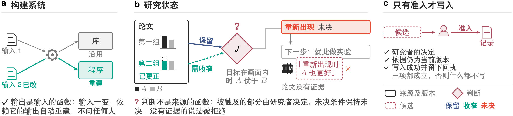
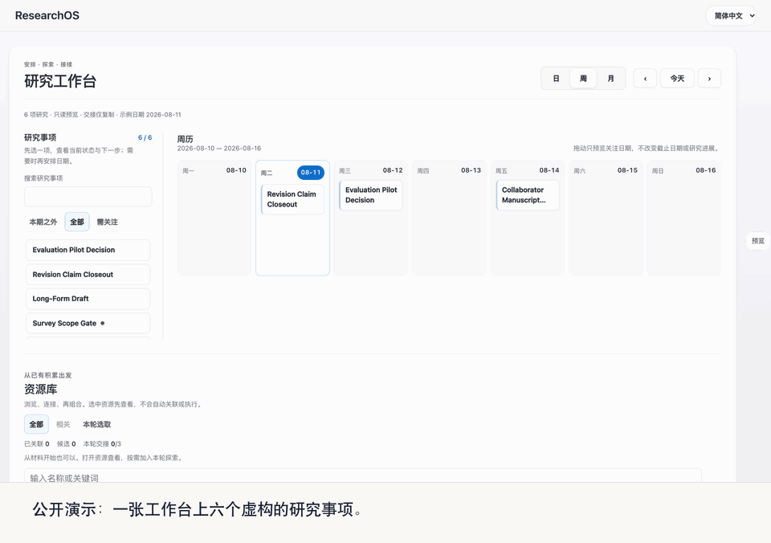

<p align="right">
  <a href="user-manual.en.md">English</a> | <strong>中文</strong>
</p>

# ResearchOS 用户手册

这份手册按读者的使用顺序展开：本仓库是什么、输出里的词是什么意思，怎样在 Agent 客户端里走一个研究闭环，怎样试用会话调度器，可选 Dashboard 显示什么，以及怎样用自己的材料替换虚构 demo。第一次上手请按[首次上手说明](../08_exports/public_starter/onboarding-step-by-step.zh.md)走，本手册是它背后的参考。状态、治理边界、架构、代码 owner 和目录的定义见[系统参考](system-reference.zh.md)；发布、自定义、插件、贡献与许可见[治理与扩展指南](governance-guide.zh.md)。

现在是 ResearchOS 的第一阶段：一个人用，材料是你电脑上的文件，拍板在你自己的终端里。第一阶段包含什么、不包含什么，集中写在 [README](../README.zh.md#第一阶段包含什么不包含什么)，完整的清单在技术报告的补充说明 6。

## 1. 本仓库是什么

ResearchOS Public Starter 是 ResearchOS 的公开入门版：一个给个人研究者用的小型文件化工具，卡片是你电脑上的普通文件，随附的例子都是虚构的。它让你的判断在不同工具、项目和时间之间接得上。Claude Code、Codex 等 Agent 客户端，或其他能读写本地文件的命令行工具，是主要执行路线，只用它就能完整地用起来：给出一个目标和最少的来源，得到回答或成果；要长期保存的改动，都等你批准、校验后才生效。第一次不需要 Dashboard、插件或模型设置，也不需要先弄懂整个仓库。可选 Dashboard 让注意力、关联资料和审阅边界可见，但不替研究者接受判断，也不扩大执行权限。

研究者选择问题，判断证据究竟支持什么；模型和工具完成有边界的局部工作；ResearchOS 把结果与来源、接受状态、未决依赖和下一动作连在一起，某份来源变化后，依赖它的判断会回来等待复核。它不是托管服务、自治科研系统、完整个人知识库、脱离证据的万能问答，也不是精致的 all-in-one 产品；库是空的，它不会替你读懂一个领域。文献检索、实验执行和通用 Agent runtime 交给专门工具；相邻工具以及 ResearchOS 为什么保持窄定位，见[相关科研工具](reference/RELATED_RESEARCH_TOOLS.zh.md)。

本仓库只打印改动、由你复制进去，自己不写入；文档里把这叫「复制回退」或「只复制」。它和技术报告里的原型用同一套核心代码，随附的数据都是虚构的。它可以读卡片、做检查、准备交给助手的任务包、显示计划中的改动，但不会说某件事已经替你做了，也不会说你的长期记录已经改了。排期、准入后的写入、维护写入和记下「这一步做完了」，都只在原型里有。[技术报告](technical-report.zh.md)描述的就是这个原型，它能做的比本仓库多，报告里的主张不是本仓库的能力清单。同一套代码有三种用法：

| | 本仓库（出厂） | 用你自己的材料（personal-vault 模式，第 5 节） | 技术报告里的原型 |
| --- | --- | --- | --- |
| 里面是什么 | 虚构的例子，可以公开 | 你自己的卡片，放在 Git 忽略的 `personal_vault/` 里 | 真实的本地研究材料 |
| `ros` 命令 | 只打印改动，由你复制进去 | 一样，`ros` 仍然只打印改动 | 你在终端确认之后，由系统写进卡片（包括 `ros admit`） |
| 可选的 Dashboard | 只能看：拖动日期只是预览，把事情交给助手时只生成可复制任务包，由你贴进自己的助手 | 经你确认后会写进 `personal_vault/`；本机装了 Codex 命令行的话，还能在页面里直接拿到回答或成果 | 页面里直接拿到回答或成果，也能写入 |
| 和别的私人系统相连 | 没有 | 没有 | 只在作者自己的部署里 |
| 公开出去 | 例子本身可以公开 | 任何内容都要先单独复查（见安全导出规则） | 同左 |

三种用法都可以配 Claude Code、Codex 或其他能读写本地文件的助手，没有哪一步要求你安装 Codex。只有在 personal-vault 模式下想让 Dashboard 页面直接给出回答时，才用到本机的 Codex 命令行（第 5 节「本地执行 provider」）。执行设置、写入范围这类工程细节，见系统参考的[三种运行方式](system-reference.zh.md#三种运行方式)。

除了 Python 3.10 或更新版本，不用再装别的：不需要 Python 包、API key、数据库、Node.js、服务器或云账号；用 Dashboard 时还要一个较新的浏览器。我们在 Python 3.10 和 3.13 上做自动测试（CI）。用 Git、GitHub Desktop 或 GitHub 的 **Download ZIP** 拿到仓库，在仓库文件夹里打开终端，用 `python3` 运行。支持 macOS 与 Linux；Windows 请在 WSL（Windows Subsystem for Linux）中运行，因为它依赖的文件锁在原生 Windows 的 Python 中不可用。真实、敏感或未公开的材料不要放进受跟踪的文件；它们该放在哪里见第 5 节。

### 你会遇到的词

演示输出和这几份指南里，有几个词用的是特定意思。第一次上手，看每个词旁边那一句就够了；表里列出的几句输出都是正常现象，不是报错。[技术报告](technical-report.zh.md)用的是同一套词，并给出精确定义。

| 词 | 在这里指什么 |
| --- | --- |
| 承诺（commitment） | 一个项目当前的那一个下一步或下一个判断。被排期的是它，而不是整个项目。 |
| 承诺清单 | `06_active_context/research-portfolio.md` 这个文件：每个项目一段，写着它眼下的那项承诺。 |
| 卡片（card） | 一份带 frontmatter 的 Markdown 文件，记一个项目、一篇论文、一个人或其他来源。承诺和判断都以卡片为依据。 |
| 研究状态 | 问题、证据、已接受的判断及其范围、仍未决的条件，以及下一步。`ros state` 把它们印成 Q、E、J、B、N。 |
| 候选（candidate） | 还没有被接受的模型产出或草稿。 |
| 准入（admission / admit） | 研究者把候选接受进研究状态。本仓库只显示计划中的改动，从不准入。 |
| 判断块 | 记录一条已接受判断及其依据的 `> [!judgment]` Markdown 块。 |
| 事项（item） | 一件登记在册的维护工作，例如来源变化后复核某条判断。技术文档里有时叫它「要求」。 |
| 待答与延期 | 待答的工作在等研究者回答一个问题；延期的工作在等一个触发条件，比如某个日期。 |
| 回执（receipt） | 做了什么、查了什么的记录。 |
| complete、complete_with_held、human_stopped、budget_stopped | `close` 报告的结果：没有未关闭的事；只剩待答或延期的工作；你在还有未关闭工作时结束了会话；会话的预算用完了。带着未关闭的工作收尾很正常，不是报错。 |
| 决策边界 | 系统查看已到达的内容、决定下一步的时刻。输出里叫「上一次 ros 命令」。 |
| 复制回退、只复制 | `ros` 只打印改动（例如 `admit` 会做的那处 diff），由你复制进去；它自己不运行、也不写入任何东西。 |
| 「还没有准入回执」 | 这条判断是直接写进文件的，没有人准入过它，所以 `today` 请你确认它。 |
| 「已事后确认」「不算准入」「未经准入」 | 你对一条已经写进文件的判断点了头：「请确认」这个请求关闭了，但没有准入任何东西。 |
| `personal_vault/` | 下载下来的仓库里一个 Git 会忽略的文件夹，放你自己的材料。 |
| 库（vault） | `--root` 指向的那个装着卡片和承诺清单的文件夹：`personal_vault/` 是你自己的库，`examples/scheduler-demo/` 是虚构的演示库。技术文档里库也叫研究图（research graph），演示库也叫夹具（fixture）。 |
| public、internal、sensitive、private | 卡片的 `sensitivity`（敏感性）标签，决定 `ros context` 会不会把这张卡打包交给助手：public 和 internal 打包，sensitive、private 和没写标签的不打包。 |

## 2. 在 Agent 客户端里走一个闭环

用 Claude Code、Codex、Gemini CLI 或其他能读写本地文件的 AI 助手打开本文件夹。第一次只需要四件事：目标，即现在要回答、整理或产出什么；来源，即一份你提供的材料或一个明确公开链接；结果，即回答、可打开的成果文件或可核对的 diff；边界与下一步，即哪些是来源事实、哪些仍是候选、接下来做什么。不确定从哪里开始，或者还不会用终端时，先让助手带你走，只复制它给出的命令：

```text
我还不知道怎么使用 ResearchOS Public Starter。请你作为我的向导，先只读 AGENTS.md；如果环境已经加载该文件，不要重读，也不要扫描仓库。然后用简单中文告诉我：1. 这个项目是做什么的；2. 我现在应该选哪条路线；3. 下一个文件或命令；4. 哪些内容不能放进公开仓库。暂时不要写文件；如果需要信息，最多先问我两个问题。
```

有具体任务时，直接交出来源：

```text
我这里有一份 PDF：[链接或本地路径]。它是：[公开 / 在投 / 内部 / 边界不清楚]。

请用 ResearchOS 帮我理解它，并把它和[我的任务]联系起来。先读 AGENTS.md，只补充读取当前任务需要的最小工作流或目标文件。请返回材料边界、短阅读笔记、候选判断、建议保存位置和需要我确认的内容。在我批准候选内容和证据边界之前，不要写入长期记忆。
```

助手应说明读了什么、有意没读什么，哪条路线合适，涉及什么隐私或导出边界，以及结果是普通回答、成果还是拟议的长期变化。好的阅读笔记写清：原文说了什么、你怎么理解、一个局限、还缺什么、下一步；并分清原文支持什么、什么还没验证过。

普通回答已经够用就停；无论如何，说得出依据什么、还有什么没定、下一步做什么，就可以停了。只有内容值得长期留下、而且说得出该存进哪张卡时，才把它留作候选；之后你批准它、再检查一遍，仍是分开的两步。想接着用自己的材料，按第 5 节操作，并告诉助手在你确认前不写文件。

第一次用不必碰下面这些，跑通第一圈之后它们都还在：插件和插件的安装、系统结构图和完整架构、维护命令和代码、把所有人物关系一次画全、事先选好模型或配置模型服务，以及一次导入全部论文、项目和人物。

不用 Dashboard 时，每一轮都是同样几步：

```text
一个目标 + 最少的来源
  -> 助手在说好的范围内工作，或运行一条命令
  -> 得到三种结果之一：回答、成果文件，或一处等你决定的候选改动
  -> 你核对来源、还不知道的地方、敏感性和实际效果
  -> 你批准之后才改长期内容，并留下检查结果、记录和改回去的办法
```

四条规则守住这一轮：助手的输出先是候选；任务做完不等于证据确认；Dashboard 和程序生成的数据文件只是展示，一切以 Markdown 卡片为准；私人材料要单独复查才能公开。这些规则背后的几种状态见系统参考的[状态与权威模型](system-reference.zh.md#状态与权威模型)；来源路径只说明证据从哪里来，从来不是保存的位置。

**助手说某张卡被排除时。** 助手用 `ros context` 取卡片，输出末尾有一行像 `[交付 1 项；排除 1 项]`，其中「排除」数的是没打包的卡，下面每张没打包的卡一行，说明原因。被排除的通常是 sensitive 的卡，比如人物卡或会议卡：它们记的是别人，所以不交给助手，助手也不该改为直接打开文件。任务确实需要这张卡时，你在自己的终端运行 `python3 scripts/ros.py --root personal_vault context <卡片>`，回答 `y`，再只把任务需要的部分复制给助手。随附的承诺清单标为 internal，所以项目的问题和判断会被打包；没写标签的卡片或承诺清单不打包。要记住，标签只管 `ros context` 打包什么，管不住助手自己直接打开文件。

### 保持读取范围小

读取档位同时限制首轮文件数和估算 token：

| 档位 | 首轮文件 | 估算总 token | 适用场景 |
| --- | ---: | ---: | --- |
| `Quick` | 1 | 约 10k | 已有精确来源或窄问题。 |
| `Standard` | 最多 5 | 约 35k | 需要一份工作流程和少量项目背景。 |
| `Evidence` | 最多 8 个指定文件 | 约 60k | 正式的说法或公开的输出需要核对。 |

默认从 `Quick` 开始；给出精确论文、草稿或目标路径时，Quick 直接从那里开始。Standard 可以再加一份工作流程、项目页和少量正式卡片；Evidence 只加入能回答当前核对问题的核对记录、阅读笔记或原始来源。只有能说清缺少哪个事实或判断时才升档；文件数或 token 将要超限时，缩小文件子集并分批处理。这样能减少 token 和无关信息，同时保留长期资料库的完整性。读取档和助手的「思考深度」是两回事：缺材料时提高读取档；推理步骤多、判断难时，在助手里把思考深度调高（有的客户端叫推理强度或 effort）。用哪个模型、思考多深，都在助手里设置。结果是普通回答、成果文件还是要写回卡片的候选，由任务本身决定，不用你事先分类。开放讨论、推理和起草直接在助手里按仓库说明进行，不需要交接。

在你自己的库里，给 `python3 scripts/plan_context.py <路线> --mode quick`（或 `standard`、`evidence`）加上 `--vault personal_vault`，它会按读取档列出助手要读你的哪些卡。它跟着库的语言走，不用加 `--lang`。quick 只读一张：对外的任务（例如回复外部请求、导出前检查）先读边界卡，其他任务读这类任务的风格卡，都没有时读研究身份摘要。standard 首轮最多 5 个文件：研究身份摘要、风格卡、方向摘要、这项任务的工作流程，以及这条路线另外点名的卡（例如写申请前的边界卡）。方向摘要里点名的卡单独列成一组，助手需要哪张，就用 `ros context` 一张张取，它们不算在首轮这 5 个文件里。evidence 首轮最多 8 个文件：在 standard 之外，写论文和写申请时再加两张索引卡，即成果与使用边界和论文作者角色（库里有这两张时才列）；原件只打开这些卡「证据边界」里写明的，而且要有一个说得出的核对问题。还没写的卡也会列出名字，并给出从哪份骨架开始；在它写好之前，助手先跳过。

### 没有终端：只在浏览器里聊天

如果你在浏览器里用 ChatGPT 或 Claude，没法运行命令，`ros` 就跑不起来，来源变了把判断交回来复核的这一圈也就用不上。这是第一阶段的限制。三层读法仍然有用。打开仓库的 GitHub 页面 <https://github.com/huuuuusy/researchos-public-starter>，点 **Code**，再点 **Download ZIP**，下载后解压。要用的骨架是 `09_templates/basic/research-identity.zh.md` 和 `09_templates/basic/capsule.zh.md`，填好的样子在 `examples/starter-cards/zh-CN/`。把骨架和你的发表清单一起贴进聊天，请 AI 帮你起草；方向摘要里「做什么任务读哪张卡」那张表，只列你会上传的卡。把这两页贴进聊天里项目的说明（project instructions），这是第一层；做某项任务时，只上传它需要的一两张卡，这是第二层；PDF、数据、原始笔记这类原件默认不放进聊天，这是第三层，只有要核对某个具体数字或引文时才上传一份。你贴进去和上传的内容都会发给服务商，所以 README 里「哪些不要交给助手」清单上的东西一律不要上传。

如果你自己或帮你的人偶尔能运行一条命令，`python3 scripts/plan_context.py <路线> --vault personal_vault --mode quick --pack <文件>` 会把这一档要读的卡拼成一份可以直接粘贴的文本，例如 `~/Desktop/chat-pack.md`；换成 `standard` 会再加上方向摘要点名的卡。卡片包开头有一段写给聊天里 AI 的话（这些卡是你写的，里面的路径在你电脑上，需要别的就问你），用 `standard` 时末尾还附上这类任务的做法说明。只有标为 public 或 internal 的卡会放进去；sensitive 和 private 的卡不放进来，命令会告诉你它们在哪里。它不会写进本仓库，除非写在 `personal_vault/` 下。

### 报告里的例子：来源被纠正后保住什么

下面的虚构比较沿用[报告第 4.1 节的贯穿会话](technical-report.zh.md)，展示来源更正前后的状态。哪部分受影响，由候选指出、由你来定；系统自己算不出来。

| 阶段 | 来源、判断与未决条件 | 核对什么 |
| --- | --- | --- |
| 变化前 | 两组基准支持目标在画面内时 A 优于 B；重新出现后的情况未测试，实验已计划 | 证据、范围、未知与下一动作一起保留 |
| 来源更正 | 第二组上 A 的优势消失，第一组不变 | 来源变化触发复核，不裁定科学判断 |
| 候选 | 连同证据保留第一组说法，撤回第二组说法，重新出现的实验保持未决 | 基于更正后的来源版本审阅候选 |
| 决定边界 | 报告中的原型只在研究者决定后准入；本仓库默认只准备候选或拟议差异，不实际准入 | 分清拟议变化与已接受的长期状态 |



*报告图 1。构建系统自己重建，研究状态等研究者决定。论文的第二组基准被更正后，判断 J 来自第一组的证据保留，来自第二组的证据要复核，重新出现条件保持未决，另一个会话提出、论文并不支持的说法被拒绝。只有研究者的准入才写入。*

第 3 节能实际运行的演示用的是另一份虚构的演示库，它不执行报告里的准入，也不把判断收窄到一部分。两个例子都不能说明它比「每次手写一页交接说明」更好。

### 中断了怎么接上

中断后，在 `personal_vault/` 里留一份简短交接：问题、来源及版本、最后确认的判断（没有就写「无」）、还没定的候选、下一步。交接只是备忘，不等于批准了里面的候选。回来后先看来源有没有变，再接着做；你之前已经批准的事，在原来的范围内继续有效，不用再问一遍。核对交接和来源是否还对得上的命令，见系统参考的[中断后接续与 ResearchOS 之外的修改](system-reference.zh.md#中断后接续与-researchos-之外的修改)。

### 在 ResearchOS 之外改过文件

如果你或助手不经 `ros` 直接改了卡片，`ros` 没有经手这次修改，它的记录里也就没有这次批准。想留下凭据，就保存改动的 diff、你同意的那句话、改了哪些文件和检查结果。细节见同一节系统参考。

### 判断它有没有帮上忙

拿一件真实的任务来用，隔 24 到 72 小时、按平常的节奏再回来接着做。拿来对照的做法是：同一个模型、同样的材料和时间，再加一页你自己写的交接说明（问题、来源及版本、已有判断、下一步）。记下漏看了哪些证据、接上和纠正花了多少工夫、有没有严重错误、哪些判断变了、维护它费多少事，没比出好处的对比也要留着。装好了、合成测试通过了、工程检查通过了，都不等于有真人接受了它，也不等于证明了它对研究有帮助。报告解释了这条证据边界；其中的合成案例只用来说明怎么比，不能证明已测得的效率提升或研究者成长。

## 3. 会话调度器与命令行检查

`python3 scripts/ros_demo.py --lang zh-CN`（不带 `--lang` 时为英文）在一个虚构演示库的临时副本上运行：来源卡片变化，依赖它的判断被标为待复核；研究者随后提出重新确认，本仓库只把它显示为拟议变化而不准入，收尾时复核仍列为待处理。能指出来源变化、候选或计划、仍开着的工作和下一动作即可停。输出里的词看不懂时，见第 1 节的[你会遇到的词](#你会遇到的词)。

调度器和 Dashboard 用的是两个互不相干的虚构世界。`examples/scheduler-demo/` 里的调度器演示库是一个关于遮挡论文的库：两项承诺、两张卡片和一条判断。第 4 节的 Dashboard 演示显示 `08_exports/public_starter/demo-research-agenda.zh.md` 里的六个虚构议程事项。两者互不引用。

### 自己走一遍会话：从 today 到 close

`ros` 是调度器的命令行客户端。命令行打印出的每个 `ros …`，都指 `python3 scripts/ros.py --root <文件夹> …`，而且 `--root` 要写在子命令之前。在仓库文件夹里运行：

```bash
python3 scripts/ros.py --root examples/scheduler-demo today
python3 scripts/ros.py --root examples/scheduler-demo context commitment:occlusion-paper
python3 scripts/ros.py --root examples/scheduler-demo run judgment --target commitment:occlusion-paper --executor copy_packet
```

`today` 开启会话，列出需要你决定的事；`context` 打印这项承诺及其依据的卡片；`run` 写出交给你自己助手的任务包。`run` 最后会打印形如 `ros-run-…` 的 run id 和对应的 `collect` 命令。平时你把任务包交给助手，把它的回答存成文件；没有助手也想试一下，就用演示库随附的示例回答。下面的 id 只是示例：`ros-run-aee8c1335137` 代表你的 `run` 打印出的 run id，输入时换成你自己的：

```bash
python3 scripts/ros.py --root examples/scheduler-demo collect ros-run-aee8c1335137 --file examples/scheduler-demo/sample-answer.md
```

`collect` 把回答回收为候选，并打印形如 `c-…` 的候选 id 和 `admit` 命令。同样，`c-3f9a1d20` 代表你的 `collect` 打印出的 id：

```bash
python3 scripts/ros.py --root examples/scheduler-demo admit c-3f9a1d20
python3 scripts/ros.py --root examples/scheduler-demo close
```

`admit` 打印它会对 `06_active_context/research-portfolio.md` 做的改动，但不写入；`close` 结束会话，并把这个候选列为尚未决定。

输出里有两处来自日期，而不是演示库本身。按当天日期运行时，演示库里的承诺会被标为久未核实；`ros_demo.py` 固定了日期。新 clone 上第一次运行 `today`，还可能看到某份来源「在核实后有更新」，因为判断依据是文件的修改时间，而 clone 刚把它设成了当天，晚于承诺的 `last_verified`。不带 `--root` 时，`ros` 把本仓库本身当作库来读，其中没有承诺。

### 来源变了怎么办

判断所依据的卡片你更新了，比如某项研究被撤稿、研究方案做了修订、档案馆发布了更正后的目录，下一次 `today` 会把这条判断列在「待判断」下，给出三个选项。它是否仍然成立由你决定，系统判断不了。输出里的 `ros …`，在终端里要输入 `python3 scripts/ros.py --root personal_vault …`。

- **A，仍然成立。** 运行它给出的 `ros admit --reconfirm <判断编号>`。本仓库会打印出改用新版本依据的改动；照原样应用（或请助手代为应用），再在你自己的终端运行 `ros admit --confirm <判断编号>`，回答 `y`。
- **B，需要修改。** 用新的 id 起草替代的判断，用 `ros propose judgment --file <草稿> --target commitment:<id>` 登记，再应用 `ros admit <候选编号>` 打印出的改动。然后删掉旧的判断块，以及承诺 `judgments` 一行里的旧 id。之后 `today` 会列出两项要你在终端确认的事：新判断（`ros admit --confirm <新编号>`）和旧判断的复核（`ros answer <编号> cancel --reason …`）。旧复核用 `cancel` 回答；它的 `narrow` 选项只是让这条事项保持未关闭、留到下一个版本。你改过的 `judgments` 一行是判断类字段，要单独确认，确认新判断块并不包括它：有会话开着时，`admit` 会打印带真实编号的 `ros decide <编号> confirm`，这次会话接下来的 `today` 和 `close` 也会列出它。你已应用并确认的那个候选，`close` 会单独列出，不用再处理。收过尾的会话不能再收一次：确认了 `close` 列出的事项之后，先运行 `today` 开一个新会话，再运行 `close`。
- **C，以后再定。** `ros decide <编号> defer --until <日期>` 让这项复核延期到那一天。

手工改承诺字段也是一样。`today` 读过这项承诺之后，你若改了 `state`、`priority`、`question`、`responsibility` 或 `judgments`，这次会话接下来的 `today` 和 `close` 都会把这次写入列为待确认的判断类字段，之后每次 `today` 也会列出；在你自己的终端运行 `ros decide <编号> confirm` 并回答 `y`。由助手转述的调用只记为代理转述。`last_verified`、`current_stage`、`next_step` 这类事实不用确认。

判断的依据写它所依赖的卡片，不要写它所在的承诺：承诺的版本包含它的日期和下一步，依据写了承诺，每次更新这些内容，判断都会回来等复核。

### 本仓库里 `ros` 写什么

在出厂的 `runtime_scope: public_starter` 下：

- 每条 `ros` 命令只在 `--root` 下 git 忽略的 `06_active_context/work_state/` 里写出任务包、候选与会话记录。没有命令写长期来源。
- `run` 只接受 `--executor copy_packet`，拒绝所有 provider。personal-vault 模式（第 5 节）不改变这一点。
- `admit <candidate>` 和 `admit --reconfirm` 不先询问，直接通过复制回退显示拟议差异，因此不向长期来源准入任何东西。
- `admit --confirm` 只有你在自己的终端回答时，才会在 git 忽略的本地账里记一笔事后确认；由 Agent 转述时只记为转述（asserted），确认请求仍未关闭。两种情况都不写来源，也不算准入。
- `close` 列出会话开始以来回收或登记、尚未决定的候选。这里它们始终尚未决定，因为 `admit` 既不准入，也不记录拒绝；你手工应用、又确认了其判断的候选单独列出，不用再处理。

准入与派发的代码随本仓提供，但默认关闭。只有 `config/ros.json` 显式写明 `runtime_scope: "private"` 才会开启；缺这个键、拼错或写成其他值，都按只复制模式运行。`runtime_scope: "private"` 是技术报告里原型的设置，原型开启准入与派发运行；本仓库不支持这个设置，例如 `ros attend` 此时会给出说明后停止，什么也不写。从演示库复制出来的库保留它的 `config/ros.json`，所以同样按只复制运行。

13 个子命令在本仓库里都有。多数命令先跑一次边界检查，记在同一份 git 忽略的账里；`receipt`、`propose rule`、`admit --rollback`、`collect --abandon` 与 `attend` 不跑。所有命令都不写长期来源：

| 命令 | 本仓库里的行为 |
| --- | --- |
| `today` | 只复制：列出变化与待处理事项并开启会话；库里有注意力安排（`06_active_context/work_state/attention-schedule.md`）时，「今日」列出排在今天的承诺，没有时所有承诺都读作未安排；排到以后或搁置的承诺列在「不在今日」一行 |
| `close` | 与报告中的原型同语义；列出的候选始终尚未决定，你手工应用并确认过的除外；范围一行在其中有非零项时显示，或加 `--all` 显示 |
| `propose judgment`、`episode-close`、`rule` | 同语义：登记候选 |
| `admit` | 只显示拟议改动：`<candidate>` 与 `--reconfirm` 显示拟议差异；`--confirm` 只记确认、不写入，且只有你在自己的终端回答时才生效；`--rollback` 被拒绝，因为这里不写来源，也就不回滚来源 |
| `decide` | 同语义：记下决定；`cancel` 与 `confirm` 只有你在自己的终端回答时才生效 |
| `answer` | 同语义：记下回答；`satisfied` 与 `cancel` 会关闭这条请求，因此只有你在自己的终端回答时才生效；只有检查依据是研究者判断时才提供 `satisfied`，出厂规则里没有这样的检查 |
| `state`、`context`、`rules`、`receipt` | 同语义，只读 |
| `run` | 只复制：只接受 `--executor copy_packet`，拒绝所有 provider |
| `collect` | 同语义，只是不记 run-state 账 |
| `attend` | 给出要写进注意力安排的条目（今天、明天、某天、搁置、这一步做完）和放在哪里，不写入；你自己贴，或你同意后让助手贴，`today` 就会列出；文件从它打印出完整路径的模板建立（本仓库里是 `09_templates/attention-schedule.zh.md`）。条目要替换原有的一段时，先打印被替换的那一段，留着它就能撤销；`undo` 说明怎样手工改回 |

工程检查运行 `python3 scripts/validate_headless.py`。它验证完整的无 Dashboard profile，这个 profile 必须在 `dashboard/` 目录不存在时通过：routing、receipts、runtime 与 provider 边界、task extensions、public safety、links 和 focused zero-dashboard 行为，且不为通过而放宽 authority 检查。它不是用 Agent 客户端读一份来源的前提。CLI 路线准备同一个“目标、来源、结果、边界”的闭环，不启动服务器或 Dashboard；第二条命令给出第一次上手要读的那一个文件，即[首次上手说明](../08_exports/public_starter/onboarding-step-by-step.zh.md)：

```bash
python3 scripts/start_researchos.py --mode cli
python3 scripts/plan_context.py first_run_onboarding --lang zh-CN
```

承诺清单（commitment list）是在声明范围内记录主责/协作、承诺状态、优先级、时效、负责人与角色、唯一下一步和权威来源的账本。承诺（commitment）是项目当前唯一的下一步或下一次判断；被排期的是它，而不是整个项目；无论用哪个客户端查看或继续，它都只保留一个有边界的状态和一个下一安全动作。问“我当前主责多少任务”时，运行 `python3 scripts/query_research_agenda.py --view lead-active`，或用 `lead-all`、`support-active`、`support-all`、`waiting`、`queued`、`conditional`、`paused`、`review`、`unclassified`、`all` 查看明确分层。责任缺失或非法时失败关闭到 `unclassified`。只有覆盖回执当前有效且没有未决候选，数量才可称为完整；否则只代表已登记事项。时间栏只用于排序，不决定清单里有什么。

## 4. 可选的 Dashboard

Dashboard 是可选的，处于冻结状态：可以按这里的说明使用，但不在开发之中。在仓库根目录启动 demo：

```bash
python3 scripts/start_researchos.py --mode dashboard --port 8880
```



然后打开 `http://127.0.0.1:8880/`。这里显示 `08_exports/public_starter/demo-research-agenda.zh.md` 里的六个虚构议程事项，与第 3 节调度器的演示库是两个不同的虚构世界，不需要真实 API key。在 personal-vault 模式下（第 5 节），它显示你的论文、人物、项目和报告；决策、启发式、风格卡、方向摘要和会议卡不在这里显示，要通过助手来读。演示设在一个固定的虚构日期 2026-08-11，页面状态栏会显示这个日期，所以无论哪天打开，它的日历和时效读起来都一样。普通启动直接读取随仓发布的公开安全投影，不重写受 Git 跟踪的文件；只有投影缺失时才自动恢复。维护者修改 demo 来源后，用 `python3 scripts/build_public_starter_data.py --write` 显式重建。启动器只在 `/session-config` 确认运行时身份匹配时复用已有服务，因此公开 demo 不会被误认为 personal-vault、报告中的原型或占用同一端口的其他程序；遇到这种情况会停止并建议另一个端口。`--mode public-starter` 只报告本仓库的运行状态，不启动服务器。其余模式：

```bash
python3 scripts/start_researchos.py --mode public-starter --check --provider codex
python3 scripts/start_researchos.py --mode cli
python3 scripts/start_researchos.py --mode gui --port 8880
python3 scripts/start_researchos.py --mode public-starter
```

Dashboard 是与 Agent 客户端互补的跨会话注意力与控制面，不是第二个聊天入口，也不是 Agent 路线的前置条件。它以统一工作台呈现现在与资料两个语义区域：`现在`在多项承诺之间分配注意力并承载日历，`资料`通过一项或少量承诺 lens 连接来源与关系。Work 与 Review 是精确事项的局部状态，只在该事项的抽屉中展开，不形成第三个顶层屏幕。各界面的定义和路由规则见[系统参考](system-reference.zh.md#主要路线与辅助界面)。第一次可以判断一个虚构承诺，也可以展开可选的直接 Agent 输入、只给一个目标；默认输入框只收集目标和可选来源，Dashboard 不提供模型、推理档位或输出类型控件。第一次打开时：

1. 在统一工作台选择事项卡，核对当前依据和下一步。
2. 拖到日历日期只预览关注安排；取消或重新载入即可丢弃预览。
3. 在右侧查看关联资料，再预览并复制 Agent 交接任务包。
4. 只在独立的私有助手任务中执行。
5. 审阅返回结果，再通过研究者确认流程提出长期更新。复制本身不代表已执行或已接受结果。

月历以日为最小单位，不提供小时网格。`+N` 展开当天；“安排”卡可拖拽或用 `Alt + 方向键` 移到另一日，作为内存中的预览，界面标明未保存，刷新即恢复。只有支持写入的私有运行时才会经可撤销的排期 owner 保存日期；复查、截止和生命周期标记始终不可拖动。“完成本步”“结束 Work Session”和“结束项目”关闭的东西不同：当前承诺、执行会话和长期项目生命周期。Work Session 是与 Agent 客户端处理一个意图的有界执行会话，结束会话不等于结束项目。另外三件事也要分开：生命周期说明项目处于投稿、审稿、rebuttal、修订还是完成；进行中 / 待推进 / 暂不推进 / 已结束说明如何管理整个项目；今日 / 明日 / 未来 / 搁置只说明下一步何时再次占用注意力。审稿中的项目仍可从关联资料中找到；真实事件或复核日期到达时，它的下一动作会回到工作台。

本仓库固定为 copy-only。它不启动本机 Codex 或 Claude Code CLI，不探测本机 provider，不调用远程 API，不写长期记忆（它可能写的两类文件列在本节末尾），不执行 Inbox 写回任务，也不接受任意 shell 命令。提交任务只生成交给独立私有助手的任务包；工作台总是只产出可复制的任务说明。受控执行路线是 personal-vault 模式和 private 运行态；private 是报告中原型的运行态，本仓库不支持。各部分的分工如下：

| 界面 | 负责 | 不负责 |
| --- | --- | --- |
| Agent 客户端 | 解释意图、深读材料、推理、修改文件、生成成果、与你反复协作、运行验证 | 代替研究者确认证据或修改长期记忆，维护 Today 投影 |
| CLI | 确定性 route、query、receipt、validation 与维护命令 | 开放研究判断或第二套 authority |
| canonical Markdown 与 Git | 长期事实、决定、provenance 与恢复坐标 | 生成或仅运行时状态 |
| Dashboard | 可重建的投影：分诊近期注意力、可视化资源与关系、按天排期、选择执行路线、显示状态与结果 | 产品事实、首次使用前置条件、开放讨论、模型选择、深度推理、跨文件编辑，或批准长期变化 |

后台准备只运行有边界、结果能原位返回的工作；开放讨论或复杂修改时，界面复制一个完整任务包，由你粘贴到 Agent 客户端的新任务中；只有确实存在可核验的绑定时，“继续已有任务”才可用。Dashboard 不复制你的聊天，只显示有界的会话状态。普通选卡保持原位，系统建议可以直接建立 Work Session。独立的私有 Codex runner 更适合深度读取、文件修改、成果生成、验证、后台队列、逐项执行或隔离写入。

```text
现在：恢复一份有边界的当前研究焦点
  -> 资料：按需补上下文
  -> 现在 / Agent：继续研究工作
  -> 需要时由 Agent 有界读取
  -> 可见回答、成果或 diff
  -> 待复核：核对结果、候选变化、回执和交接
  -> 研究者决定
  -> 在私人库中验证后写回
```

一轮工作会明确三件事。Work Session 包含当前目标、按需来源、当前结果、折叠的过程记录、工作牌组和被冻结的 prompt/模板语言；浏览器协调状态和最近任务摘要都不是长期记忆。候选交接是一个有边界的任务，带着来源卡片、证据状态、敏感性、拟议权威变化、影响范围和验证状态。待复核边界提醒你：任务完成不等于证据确认，来源路径也不是写回目标。在私人库中，后续步骤是执行、证据核对、你的决定、验证后写回和恢复包；它们保持受控，本仓库不会把它们伪装成自动完成。

待复核不只接收写回提案。它的[完整接收范围](system-reference.zh.md#共享治理边界)还包括有界未知、break-glass 确认、结果、验证失败、回滚与关闭前必须明确的交接；长期、敏感、公开或破坏性变化一律经过它。公开运行态从不执行持久写回。

页面语言选择只改变可见文案。新建 Work Session 会冻结当时的界面语言，作为该任务的回答和任务包语言；任务中途切换界面语言不会改写已有任务。内容语言在 `config/researchos.runtime.example.json` 中设置，决定生成记录和 prompt：

```json
"public_starter": {
  "content_language": "zh-CN",
  "available_content_languages": ["en", "zh-CN"],
  "alternate_language_files": "reference_only_do_not_read_by_agent"
}
```

用 `python3 scripts/build_public_starter_data.py --language en --write` 或 `--language zh-CN --write` 重建。被选中的语言进入 `08_exports/public_starter/generated-public-starter-data.json` 和 `dashboard/data/researchos-dashboard.json`。另一种语言的文件留在仓库中作为参照；除非你要求翻译、对照或双语维护，Agent 正常运行时不读取它们。

```text
浏览器 Dashboard
  -> 运行在 127.0.0.1 的本地 Python 服务器
  -> 当前选择的 demo 或 personal-vault 投影 / provider 状态
  -> 交给独立私有助手的可复制任务包
```

Agent 路线与 Dashboard 依赖同一套 Markdown 和确认规则，本仓库遵守上文说明的只复制边界，所有 `/codex-runner` 提交都被拒绝，不启动线程或命令。personal-vault 与私有运行态可以把本地回答或成果返回待复核；只有在你提交任务后才启动本地 Codex。公开 demo 中保存反馈、Inbox 条目或卡片分组、撤回确认、运行更新的本地端点都返回 403 `public_starter_writeback_blocked`，只在 personal-vault 模式下执行。公开 demo 只会写两类文件：上传到 Git 忽略的会话目录的来源，以及你运行已登记的 `build_public_starter_data` 动作时重建的示例投影（示例来源不变时字节不变）。这些本地 HTTP 端点服务 Dashboard，不是公网 API；完整列表见[系统参考](system-reference.zh.md#本地-http-端点)。

本地 **打开**/**定位** 在 macOS 使用 Finder，在 Windows 使用 Explorer，在 Linux 尝试 `xdg-open`；当前桌面环境没有可用 opener 时，服务器返回清楚的失败信息并保留路径，供手动打开。

## 5. 用自己的材料

你自己的材料放在 clone 里的 `personal_vault/` 文件夹。Git 忽略它，所以里面的东西不会被提交；`ros` 和 Dashboard 的 personal-vault 模式都读它。正因为 `personal_vault/` 不在 Git 里，你要自己备份它（复制整个文件夹，或放进你自己的私人备份）：删掉的判断块或卡片没法从本仓库恢复。即便如此，含有真实材料的 clone 也不要推送到公开远程仓库。想给库做版本管理，就另建一个没有公开远程的私人仓库副本，并在那个副本的 `.gitignore` 里删掉 `personal_vault/`。无论哪种做法，下面都用同样的 `personal_vault/` 布局。

### 开始自己的

1. 复制演示库：

   ```bash
   python3 scripts/ros_demo.py --init personal_vault --lang zh-CN
   ```

   它复制演示库的承诺、卡片和 `config/ros.json`，不带走按第 3 节走查时留在演示库里的记录、示例回答和虚构的判断，并打印接下来的步骤。`personal_vault/` 已经存在时（例如你先启动过 personal-vault Dashboard）也可以用，文件夹里已有的文件会保留；如果其中已经有 `06_active_context/research-portfolio.md`，它会拒绝执行。

2. 编辑承诺清单 `personal_vault/06_active_context/research-portfolio.md`。把两项虚构承诺换成你自己的一项；你自己的判断以后按第 3 节的方式作为候选进入。一项承诺需要标题、id、你的责任和状态、一个问题、一个下一步、你上次核对它的日期，以及它依据的卡片；Dashboard 还会读取最终负责人、你的角色和项目所处阶段：

   ```markdown
   ### 论文第二章

   - id: thesis-ch2
   - responsibility: lead
   - accountable_owner: 你
   - role_summary: 本章作者
   - lifecycle_phase: writing
   - state: mainline
   - priority: P0
   - question: 基线在新划分上还成立吗？
   - next_step: 在新划分上重跑基线
   - last_verified: 2026-10-29
   - stale_after_days: 14
   - source_path: 01_knowledge/projects/thesis-ch2.md
   ```

   `responsibility` 取 `lead` 或 `support`；`state` 取 `mainline`、`queued`、`conditional`、`waiting`、`paused` 或 `closed` 之一；`last_verified` 写成 `YYYY-MM-DD` 日期，`source_path` 相对于 `personal_vault/`。`lifecycle_phase` 取 `scoping`、`planned`、`experiment_preparation`、`production`、`gated_operation`、`writing`、`release_preparation`、`submitted`、`under_review`、`rebuttal`、`decision`、`revision`、`accepted`、`published`、`paused`、`completed` 之一；取 `submitted`、`under_review` 或 `decision` 时还要写 `activation_trigger`，即让这一项重新回到眼前的事件。id 和路径由你自己定。`ros` 用不了的值会列在 `today` 输出的「承诺清单问题」一栏和 `ros rules --check` 里，这项承诺不会悄悄从检查中消失。`ros` 不读 `lifecycle_phase` 和 `activation_trigger`，阶段写错或缺少触发条件，只会在 Dashboard 的 personal-vault 投影里标出。

3. 把 `personal_vault/01_knowledge/` 下的两张虚构卡片换成你自己的一张，放在 `source_path` 指向的路径。从 `09_templates/basic/` 里的骨架起步，例如 `project.zh.md` 或 `paper.zh.md`；每份骨架都有 frontmatter、Agent Summary、事实与看法各节和证据边界，并附一段简短说明，写明文件放在哪里、每个值是什么意思。[examples/starter-cards/zh-CN/](../examples/starter-cards/zh-CN/README.md) 里是每类卡填好的样子：同一个虚构故事串起研究身份摘要、方向摘要、项目卡、论文卡、决策卡、启发式卡、风格卡、人物卡和会议卡，并讲了三层读法、成熟度和敏感性。`ros` 用 frontmatter 的 `title` 作为卡片的显示名，没有时用第一个 `#` 标题。首次上手已经建好研究身份摘要（`00_identity/research-identity.md`）和 `01_knowledge/capsules/` 下的一份方向摘要；新的方向照同样方式再加一份。助手会先读它们（`python3 scripts/plan_context.py <任务> --vault personal_vault` 会把它们列在任务文件前面）。大多数卡写 `sensitivity: internal`，人物和记录别人说话的卡写 `sensitive`；`private` 的卡 `ros context` 从不打包。`09_templates/` 里的完整模板（`project-template.md` 等）多了后期用得上的治理小节。

4. 在你的库上运行调度器：

   ```bash
   python3 scripts/ros.py --root personal_vault today
   ```

   用 `--init personal_vault --lang zh-CN` 建的库，`config/ros.json` 已设为中文输出；要临时换语言，加 `--lang en` 或 `--lang zh-CN`。

   再给库做一次体检：

   ```bash
   python3 scripts/build_public_starter_data.py --personal-vault
   ```

   它只读不写，检查仓库里的 `personal_vault/`，在「库体检」下列出手写的库常见的问题：链接到不存在的文件、`sensitivity` 标签写错、Agent Summary 是空的、frontmatter 某行末尾带了 `#` 注释（会被当成值的一部分）、方向摘要比它列出的卡更旧、卡片 `source` 写的原件在本机找不到（只是提醒），以及注意力安排里同一项承诺有两段条目。没有问题时它说「没有发现问题」。承诺清单本身由 `ros today` 和 `ros rules --check` 检查。以后每次手工改过卡片，都可以再跑一遍。

5. 需要时，在同一个文件夹上打开 Dashboard：

   ```bash
   python3 scripts/start_researchos.py --mode personal-vault --port 8881
   ```

   然后打开 `http://127.0.0.1:8881/`。这个模式读取 `personal_vault/06_active_context/research-portfolio.md`，以及 `personal_vault/00_identity/` 到 `personal_vault/06_active_context/` 中带 frontmatter 的卡片，从不显示虚构的示例数据。服务器在启动时读取卡片，所以新建或修改的卡片要重启服务器后才出现。第一次启动只建出部分分层目录（`00_identity/`、`01_knowledge/papers/` 及其下的 `own_papers/reading_notes/` 与 `source_files/`、`01_knowledge/projects/`、`04_people/collaborators/` 和 `06_active_context/`）；`02_decisions/`、`05_workflows/` 等其他目录，需要时自己建。

使用个人库不需要关闭示例数据。[首次上手说明](../08_exports/public_starter/onboarding-step-by-step.zh.md)把这几步再走一遍，写明每一步应该看到的输出，以及看到的不一样时怎么办；字段仍以本节为准。

### 让库慢慢长大

候选卡片是解释，写下它并不使它成为长期记忆或公开事实。从一个来源和一张卡片开始，卡片写明来源边界、证据状态和一个缺失的事实；核对第一版结果之后，再按需要补项目历史、报告、决策理由和其他来源。需要理解 M/I/R/G 标签，或把卡片缺口变成有边界的 Work 任务时，再读[卡片成熟度与增强](reference/CARD_MATURITY_AND_ENHANCEMENT.zh.md)。

某类工作反复出现时，从 `09_templates/basic/` 加上对应的卡。风格卡用 `style.zh.md`，放在 `personal_vault/03_cognition/style/<任务>.md`，记的是你做某一类任务的习惯，`<任务>` 取 `writing`、`review`、`proposal`、`figures-talks` 或 `mentoring` 之一；助手在读取档 quick 先读对应的那一张。每一条写规则、为什么、怎么用和出处；你纠正助手时，它把这次纠正起草成一条，你同意后才加进去（[示例](../examples/starter-cards/zh-CN/03_cognition/style/writing.md)）。边界卡 `personal_vault/00_identity/boundaries.md`（`boundaries.zh.md`）用你自己的话写哪些材料从不交给助手、哪些事对外不说、机构或期刊对 AI 工具的规定、发出去前要谁点头；对外的任务先读它。写论文和申请到了 evidence 档，会再读两张索引：成果与使用边界（`outputs-index.zh.md`，放在 `01_knowledge/papers/`）和论文作者角色（`author-roles.zh.md`，也放在 `01_knowledge/papers/`），用来核对说法能不能对外讲、贡献有没有出处。同一文件夹里还有审稿意见、基金申请、学术邮件、给学生的反馈和心智模型的骨架（`review.zh.md`、`grant.zh.md`、`message.zh.md`、`feedback.zh.md`、`mental-model.zh.md`），每份的填写说明里写了放在哪里。

在 `personal_vault/` 里，简短当前状态放入 `06_active_context/`，有来源的摘要放入 `01_knowledge/`，决策与取舍放入 `02_decisions/`，人物上下文放入 `04_people/`，可复用方法放入 `05_workflows/`。完整的放置表见[新材料放置规则](reference/WHERE_TO_PUT_NEW_MATERIALS.zh.md)。原始材料留在原处、放在仓库之外：卡片记下路径，很多时候已经足够，不要为了让 Dashboard 看见而复制原始文件。库里的任何内容，不经[安全导出规则](reference/SAFE_EXPORT_POLICY.zh.md)下的单独复查，都不会公开。

卡片是上下文对象，不是前置条件。你提供的来源会成为第一张工作卡片；只有当前证据不足时才搜索`资料`。每张卡片带有 public、internal、sensitive 或 private 的敏感性标签。personal-vault 投影写入 Git 忽略的 `dashboard/data/researchos-local.json`，因为它可能含私人派生元数据；公开 demo 与 personal-vault 不共用生成数据文件。在这个模式下，Dashboard 和本机的 Codex 都只往 `personal_vault/` 里写；公开的模板只能读，不能借这个模式改动仓库里受跟踪的演示文件（写入范围的细节见系统参考的[三种运行方式](system-reference.zh.md#三种运行方式)）。personal-vault 也不会把任务完成变成证据确认：长期变化需要明确目标、证据检查、你的批准和写回后的验证。

完成一个闭环就停：只有每个新文件都说得清归哪一层管、证据边界在哪里，扩大库才有意义。真正有用的长期记忆仍需要你自己的论文、笔记、项目、报告、决策或关系上下文，并保留可追溯的边界，且只在当前判断需要时补充。

### 关闭示例案例（维护者）

这一步可选，只改变公开 demo 的投影。`python3 scripts/build_public_starter_data.py --disable-cases` 预览去掉虚构案例后的投影；加上 `--write` 会重写受跟踪的 `08_exports/public_starter/generated-public-starter-data.json` 和 `dashboard/data/researchos-dashboard.json`，所以除非你确实要发布不带案例的 demo，不要提交这个结果。`python3 scripts/build_public_starter_data.py --write` 会把它们恢复。关闭案例不删除任何文件；示例保留为字段和放置位置的对照。

### 本地执行 provider

除了 Agent 路线和 Dashboard，也可以在文本编辑器或 GitHub 上直接读 Markdown，了解目录、案例和手册。Codex 图形界面适合 AI 协助阅读和修改，Codex 命令行可执行小型交接并记录日志；ResearchOS 没有远程 API provider。ResearchOS 不附带 Codex，公开 Dashboard 也不会启动它。若要在独立私有 Agent 任务中执行复制出的任务包，按 OpenAI 当前官方说明安装 Codex 图形界面或命令行，并用 `command -v codex` 与 `codex --version` 检查。macOS 桌面应用可能把命令行程序放在 `/Applications/Codex.app/Contents/Resources/codex`；如果 `codex --version` 不可用而该文件存在，把它加入 `PATH`，或设置 `alias codex="/Applications/Codex.app/Contents/Resources/codex"`。不要把登录令牌、API 密钥或账号信息写入仓库。

本仓库登记了两个本地 provider：`codex` 与 `claude_code`，在这里两者都是 `copy_only`。`python3 scripts/runtime_profile_cli.py list --scope public_starter` 显示本仓库的只复制配置档，`show --profile codex --scope public_starter` 查看某个保留 provider 在本版中的投影；两者都不需要凭据或网络。公开 Dashboard 的默认配置是：

```json
{
  "provider_mode": "copy_only",
  "allow_local_codex": false,
  "execution_scope": "none",
  "maintenance_scope": "registered_actions",
  "allow_real_api": false
}
```

换成白话：本机 runner 关闭，只能运行登记过的维护动作（例如重建演示数据），也不调用真实 API。

不要把公开 Dashboard 改成执行主机。如需使用两个本地命令行 provider 之一，先切换到 personal-vault 模式（private 运行态属于报告中的原型，本仓库不支持），配置不纳入 Git，运行 provider 检查，再在那里启用它；命令行工具的登录信息留在仓库之外。检查命令是 `python3 scripts/validate_runtime_config.py` 和 `python3 scripts/start_researchos.py --mode personal-vault --check --provider codex`，后者会报告本机是否装了这个命令行工具。

## 6. 安全规则与常见错误

不要把 Dashboard 暴露到公网。不要提交 API 密钥、令牌、`.env` 或本地运行配置，也不要把真实敏感人物、未公开稿件、真实关系笔记、原始语料或私人运行日志放进本仓库。发布前，`python3 scripts/validate_public_safety.py` 会检查这些内容。

公开 demo 的跟踪文件约 19 MB，连同 Git 历史约 100 MB，不复制任何私人的库。ResearchOS 不治理你的磁盘空间：在 personal-vault 与私有运行态中，本地 Work Session 接收你选择的研究材料，不设产品级文件类型、大小、数量或保存期限配额，实际上限只是本机文件系统和运行环境；公开 demo 则接受单个文件最大 1 GiB 的上传。两者都不因空间阈值自动删除你的材料。系统只约束自己产生的冗余，具体见[低冗余运行契约](system-reference.zh.md#低冗余运行契约)；本机空间较低或会话副本较大时只给出非阻断提醒。

常见错误是：任务尚未明确就扫描整个仓库；把 Agent 回答当成已确认记忆；把 Dashboard 的 JSON 数据或浏览器里的状态当作权威来源；把真实材料放在 `personal_vault/` 之外，或把含有真实材料的 clone 推送到公开远程仓库；在 Markdown 或受跟踪配置中写入密钥；删除虚构示例；期待一个空库自己理解一个研究领域。正确使用时，助手会说明读了什么、刻意没读什么；每个来源都有边界；每个解释都先成为候选；每个长期变化最后都有验证结果，或一个明确的缺失证据。
